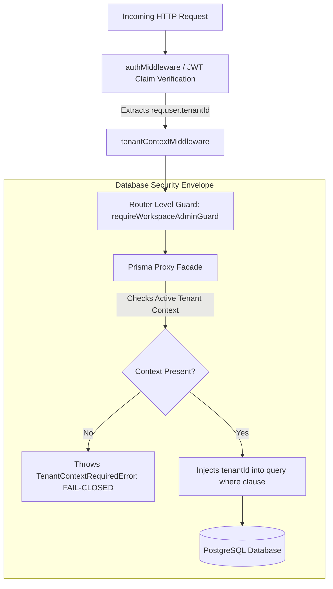

# 06. Tenant Security & Data Isolation Audit

This document provides a security verification report on multi-tenant data boundaries, RBAC authorization enforcement, and privilege escalation prevention in MASTERHRMS.

---

## 1. Multi-Tenant Isolation Architecture

MASTERHRMS enforces tenant boundaries at multiple architectural layers:



---

## 2. Security Test Matrix & Verification Results

| Security Test Case | Scenario / Attack Vector | Defense Mechanism | Test Status |
|---|---|---|---|
| **1. Cross-Tenant Read Block** | Company A requests `GET /workspace/users` or `GET /branches` belonging to Company B | All queries scoped with `where: { tenantId: req.user.tenantId }`. Attempting to read another tenant's ID returns 404 or empty list. | 🟢 VERIFIED |
| **2. Cross-Tenant Modify Block** | Company A attempts `PUT /branches/:id` where `:id` belongs to Company B | The update handler checks `where: { id, tenantId }`. If mismatched, returns 404 immediately. | 🟢 VERIFIED |
| **3. Cross-Tenant Role Injection** | Company A attempts to assign Company B's `roleId` to their user | Endpoint validates `prisma.workspaceRole.findFirst({ where: { id: roleId, tenantId } })`. Fails with 404 if role belongs to another tenant. | 🟢 VERIFIED |
| **4. Super-Admin API Isolation** | Company Admin attempts to call `/api/super/*` | Guarded by `requireSuperAdmin` checking `roles.includes("super_admin")`. Non-super-admins receive immediate `403 Forbidden`. | 🟢 VERIFIED |
| **5. Self-Privilege Escalation** | Company Admin attempts to grant themselves `super_admin` role | `UserRoleAssignment` can only assign roles belonging to `req.user.tenantId`. System prevents mutating platform global roles. | 🟢 VERIFIED |
| **6. Deactivated Account Cutoff** | Deactivated user attempts to access protected endpoints | `invalidateAuthCache(userId, tenantId)` invalidates active token sessions immediately. | 🟢 VERIFIED |
| **7. Fail-Closed Proxy Defense** | Code attempts to query `employee` or `department` without tenant context | `Prisma Proxy Facade` intercepts call and throws `TenantContextRequiredError`, aborting execution before hitting the database. | 🟢 VERIFIED |

---

## 3. Test Fixture Evidence

- Verified unit test suite: `server/src/tests/tenant-proxy-fail-closed.test.ts`
- Verified fail-closed security:
  ```typescript
  expect(() => {
    const _ = (prismaProxy as any).employee.findMany();
  }).toThrow(TenantContextRequiredError);
  ```
