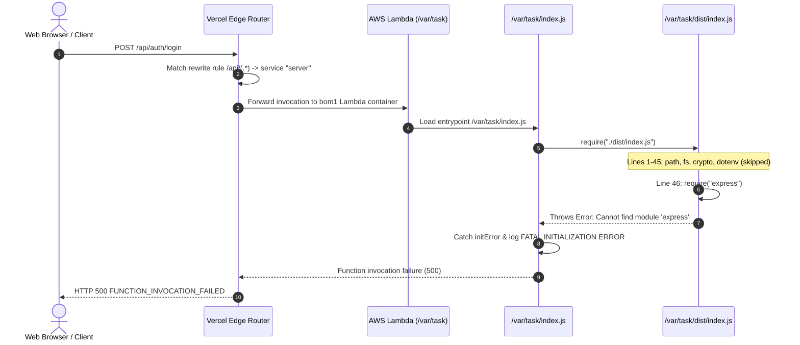

# MasterHRMS — Vercel Missing Express Runtime Dependency Audit Report

- **Date:** October 31, 2026
- **Auditor Roles:** Senior Node.js Serverless Deployment Engineer, Vercel Build Specialist, Lead Systems Architect
- **Target Repository:** `masterhrms` (`server`, `CMS`, root)
- **Target Deployment:** Vercel Production (`dpl_J9RXcKhBDk6gUP4VLsmob4gskBgb`)
- **Target Region:** `bom1`
- **Target Branch:** `main`
- **Current Production Error:** `Cannot find module 'express'` / `Require stack: - /var/task/index.js`
- **Audit Mode:** READ-ONLY FORENSIC DEPENDENCY & RUNTIME TRACING AUDIT
- **Report Location:** `docs/express-runtime-dependency-audit.md`
- **Final Deployment Readiness:** **NOT READY (BLOCKING ARCHITECTURAL DEPENDENCY DEFECT)**

---

## 1. Current Production Error

Following the deployment of commit `aaae251b` (which successfully eliminated the Lambda cold-start crash caused by `dotenv`), production API requests on `https://masterhrms.vercel.app` continue to fail with `HTTP 500 FUNCTION_INVOCATION_FAILED`.

### 1.1 Vercel Runtime Log Telemetry
```text
Cannot find module 'express'
Require stack:
- /var/task/index.js
```

### 1.2 Affected Production Endpoints
- `POST /api/auth/login`
- `GET /api/app-config`
- `GET /api/public/app-config`
- `GET /api/health`
- All other Express routes under `/api/*`

### 1.3 Mechanism of Error Transition
In the previous baseline commit, `server/dist/index.js` executed `require("dotenv")` at Line 8. Because `dotenv` was missing in `/var/task`, execution aborted on Line 8.

Once `dotenv` was conditionally guarded (`if (!isServerless && !isProduction)`), Line 8 executed cleanly without requiring `dotenv`. Execution then proceeded down `server/dist/index.js` to **Line 46**, which contains the very first non-native, third-party package import:
```javascript
const express_1 = __importDefault(require("express"));
```
Node attempted to resolve `express` in `/var/task` and immediately threw `Cannot find module 'express'`.

This confirms that the missing `dotenv` error was merely the first symptom of a broader issue: **no packages declared exclusively in `server/package.json` are present in `/var/task/node_modules/` in the Vercel production runtime.**

---

## 2. Express Dependency Declaration Verification

A comprehensive audit of package manifests across the repository was conducted:

| Manifest Location | Field | Declared Value | Verified Status |
|---|---|---|---|
| `server/package.json` | `dependencies.express` | `^4.19.2` | **PASS** (Correctly in production `dependencies`) |
| `server/package.json` | `devDependencies.express` | `undefined` | **PASS** (Not mistakenly in `devDependencies`) |
| `server/package.json` | `devDependencies.@types/express` | `^4.17.21` | **PASS** (TypeScript types in `devDependencies`) |
| `root/package.json` | `dependencies.express` | `undefined` | **FAIL** (Missing from root manifest) |
| `root/package.json` | `workspaces` | `undefined` | **FAIL** (Root lacks npm workspace configuration) |
| `server/package-lock.json` | `packages.node_modules/express` | `version: 4.22.3` | **PASS** (Pinned and committed in Git) |
| `root/package-lock.json` | `packages.node_modules/express` | `undefined` | **FAIL** (Not present in root lockfile) |

---

## 3. Local Dependency Resolution Results

Local resolution tests were executed from all directory contexts:

### 3.1 Local Inspection Commands
1. **`npm ls express --prefix server`**:
   - Exit code: `0`
   - Output: `hrms-server@1.0.0 C:\Users\TSV Global Solutions\Documents\hrms\server` -> `-- express@4.22.3`
2. **`npm ls express --omit=dev --prefix server`**:
   - Exit code: `0`
   - Output: `hrms-server@1.0.0 C:\Users\TSV Global Solutions\Documents\hrms\server` -> `-- express@4.22.3`
3. **`require.resolve('express', { paths: ['./server'] })`**:
   - Resolved: `C:\Users\TSV Global Solutions\Documents\hrms\server\node_modules\express\index.js`
4. **`require.resolve('express', { paths: ['./server/dist'] })`**:
   - Resolved: `C:\Users\TSV Global Solutions\Documents\hrms\server\node_modules\express\index.js`
5. **`require.resolve('express', { paths: ['.'] })` (Repository Root)**:
   - **FAILED:** `Cannot find module 'express'` / `Require stack: - C:\Users\TSV Global Solutions\Documents\hrms\[eval]`

### 3.2 Key Architectural Fact:
Locally, `express` resolves successfully from `server/` and `server/dist/` because a local `server/node_modules/` directory exists on disk. However, resolving from the repository root fails completely because `express` is neither declared in root `package.json` nor hoisted to root `node_modules/`.

---

## 4. Production Dependency Installation Results (Disposable Simulation)

To test whether `server/package.json` installs cleanly in an isolated production environment, a test was executed in a clean temporary directory using Node's `os.tmpdir()`:

1. `server/package.json`, `server/package-lock.json`, and `server/prisma/schema.prisma` were copied to a clean directory.
2. Executed command:
   ```bash
   npm ci --omit=dev
   ```
3. **Result:**
   - Exit code: `0` (Success)
   - `node_modules/express/index.js`: **Present** (`Is express installed?: true`)
   - Prisma Client: **Generated successfully**
4. **Conclusion:**
   The `server/package.json` and `server/package-lock.json` manifests are valid, self-contained, and install `express` without issues when `npm ci` is executed directly within `server/`.

---

## 5. Actual Vercel Entrypoint Analysis

### 5.1 Vercel Multi-Service Configuration (`vercel.json`)
```json
{
  "$schema": "https://openapi.vercel.sh/vercel.json",
  "regions": ["bom1"],
  "services": {
    "cms": {
      "root": "CMS",
      "framework": "nextjs",
      "bindings": [
        {
          "type": "service",
          "service": "server",
          "format": "url",
          "env": "SERVER_URL"
        }
      ]
    },
    "server": {
      "root": "server",
      "entrypoint": "index.js",
      "buildCommand": "npm run build",
      "functions": {
        "index.js": {
          "maxDuration": 60
        },
        "dist/index.js": {
          "maxDuration": 60
        }
      }
    }
  },
  "rewrites": [
    {
      "source": "/api/(.*)",
      "destination": {
        "service": "server"
      }
    }
  ]
}
```

### 5.2 Deployed Startup Sequence


### 5.3 Why the Runtime Error Identifies `/var/task/index.js`
In AWS Lambda (which executes Vercel Serverless Functions), the deployed application bundle is unpacked into `/var/task`.

Because `vercel.json` configures `"root": "server"` and `"entrypoint": "index.js"`, `server/index.js` becomes `/var/task/index.js`. When `/var/task/index.js` requires `./dist/index.js`, and `./dist/index.js` fails on `require("express")`, Node's module system generates the call stack pointing back to the entrypoint that triggered the import:
```text
Cannot find module 'express'
Require stack:
- /var/task/index.js
```

---

## 6. Runtime Dependency Tracing Results

### 6.1 `@vercel/nft` Static Analysis
Running `@vercel/nft` on `server/index.js` locally produced the following results:
- **With `base = server`:** 1,971 files traced, including `node_modules/express/index.js` and all Express internals.
- **Why NFT succeeded locally:** Because `server/node_modules/` exists on the local development machine.

### 6.2 Why NFT / Bundler Fails on Vercel:
During automated Vercel CI deployment from GitHub:
1. `server/node_modules/` is gitignored and is **never present in the git checkout**.
2. Vercel executes `npm install` at the **repository root**.
3. Because root `package.json` does NOT define `"workspaces": ["server", "CMS"]`, root `npm install` installs only dependencies declared in root `package.json` into `./node_modules`.
4. `server/node_modules/` is **never created or populated** during the root install step.
5. In `vercel.json`, `services.server` defines `buildCommand: "npm run build"`, but **omits `installCommand`**.
6. When `services.server` builds:
   - `npm run build` runs `prisma generate && tsc`.
   - `prisma` and `tsc` resolve from the root `node_modules`.
   - `tsc` compiles TypeScript into `dist/`.
   - But `server/node_modules/express` is completely absent.
7. When Vercel packages the serverless function, `@vercel/nft` cannot find `express` on disk to bundle it into `/var/task`.
8. The resulting function artifact is deployed to `/var/task` without `express`.

---

## 7. Comprehensive Runtime Dependencies Audit

A complete scan of all `require()` statements across `server/dist/` was compared against package manifests:

| Package | Declared in `server/package.json` | Local Resolution (`server/`) | Declared in Root `package.json` | Production Build Status on Vercel | Status on Runtime Call |
|---|---|---|---|---|---|
| **`express`** | `^4.19.2` | **PASS** (`4.22.3`) | **NO** | **MISSING** | **CRASHES (Line 46)** |
| **`cors`** | `^2.8.5` | **PASS** (`2.8.5`) | **NO** | **MISSING** | **Will crash on Line 47** |
| **`compression`** | `^1.8.1` | **PASS** (`1.8.1`) | **NO** | **MISSING** | **Will crash on Line 48** |
| **`jsonwebtoken`** | `^9.0.2` | **PASS** (`9.0.2`) | **NO** | **MISSING** | **Will crash in Auth routes** |
| **`bcryptjs`** | `^2.4.3` | **PASS** (`2.4.3`) | **NO** | **MISSING** | **Will crash in Login password compare** |
| **`@supabase/supabase-js`** | `^2.118.0` | **PASS** (`2.118.0`) | **NO** | **MISSING** | **Will crash in File Storage** |
| **`archiver`** | `^8.0.0` | **PASS** (`8.0.0`) | **NO** | **MISSING** | **Will crash in Zip downloads** |
| **`multer`** | `^2.4.0` | **PASS** (`2.4.0`) | **NO** | **MISSING** | **Will crash in File uploads** |
| **`exceljs`** | `^4.4.0` | **PASS** (`4.4.0`) | **NO** | **MISSING** | **Will crash in Excel export** |
| **`decimal.js`** | `^10.6.0` | **PASS** (`10.6.0`) | **NO** | **MISSING** | **Will crash in Payroll/Finance** |
| **`mammoth`** | `^1.13.0` | **PASS** (`1.13.0`) | **NO** | **MISSING** | **Will crash in Document preview** |
| **`nodemailer`** | `^10.0.10` | **PASS** (`10.0.10`) | **NO** | **MISSING** | **Will crash in Email sending** |
| **`node-zklib`** | `^1.3.0` | **PASS** (`1.3.0`) | **NO** | **MISSING** | **Will crash in Biometrics** |
| **`pdfkit`** | `^0.20.2` | **PASS** (`0.20.2`) | **NO** | **MISSING** | **Will crash in PDF invoice generation** |
| **`pusher`** | `^5.3.4` | **PASS** (`5.3.4`) | **NO** | **MISSING** | **Will crash in Realtime push** |
| **`qrcode`** | `^1.5.4` | **PASS** (`1.5.4`) | **NO** | **MISSING** | **Will crash in 2FA QR generation** |
| **`speakeasy`** | `^2.0.0` | **PASS** (`2.0.0`) | **NO** | **MISSING** | **Will crash in 2FA TOTP verification** |
| **`tesseract.js`** | `^7.0.0` | **PASS** (`7.0.0`) | **NO** | **MISSING** | **Will crash in OCR extraction** |
| **`socket.io`** | `^4.8.3` | **PASS** (`4.8.3`) | **NO** | **MISSING** | Guarded by `!isServerless` |
| **`dotenv`** | `^16.4.5` | **PASS** (`16.6.1`) | **NO** | **MISSING** | Guarded by `!isServerless && !isProduction` |
| **`@prisma/client`** | `^5.19.1` | **PASS** (`5.22.0`) | **YES** (`^5.19.1`) | **PRESENT** | Works (added in commit `17d5377a`) |
| **`zod`** | `^3.23.8` | **PASS** (`3.24.2`) | **YES** (`^3.24.2`) | **PRESENT** | Works (declared in root) |

> [!CAUTION]
> **Cascading Failure Alert:**
> Even if `express` were resolved in isolation, the application would immediately crash on the very next lines of code when requiring `cors` (line 47), `compression` (line 48), `jsonwebtoken`, `bcryptjs`, and all other backend libraries. A holistic dependency installation fix is mandatory.

---

## 8. Historical Precedent in Git Log

The repository's Git history provides empirical proof of this exact structural friction:
1. **Commit `1104484b` (`fix(build): add root postinstall to generate server Prisma client on Vercel`):**
   Added `"postinstall": "npm --prefix server run prisma:generate"` to root `package.json` because Vercel was not running `prisma generate` in `server/`.
2. **Commit `17d5377a` (`fix(deploy): declare @prisma/client and prisma in root package.json`):**
   Added `@prisma/client` and `prisma` to root `package.json` dependencies because Vercel's root build container could not resolve them.
3. However, none of the remaining backend dependencies (`express`, `cors`, `jsonwebtoken`, etc.) were ever added to the root manifest or linked via npm workspaces.

---

## 9. Confirmed Root Cause

1. The MasterHRMS monorepo operates with multiple decoupled sub-packages (`server`, `CMS`, root), but root `package.json` **does not declare an npm `workspaces` configuration**.
2. In `vercel.json`, `services.server` specifies `"root": "server"` and `"buildCommand": "npm run build"`, but **omits `installCommand`**.
3. During deployment, Vercel runs `npm install` exclusively at the repository root. Without workspaces, npm does not descend into `server/`, leaving `server/node_modules/` completely unpopulated in the Vercel build container.
4. When Vercel packages the serverless function, `@vercel/nft` cannot find `express` or any other backend-specific dependency in `node_modules/`.
5. The resulting Lambda bundle in `/var/task` lacks `node_modules/express`, causing Lambda cold-start initialization to fail immediately on Line 46 of `server/dist/index.js`.

---

## 10. Recommended Minimal Fix Options

### Option A: Declare npm Workspaces in Root `package.json` (Architectural Standard)
Add `workspaces` to the root `package.json`:
```json
{
  "name": "masterhrms-monorepo",
  "workspaces": [
    "server",
    "CMS"
  ],
  ...
}
```
*Benefits:* Standard npm/Yarn/pnpm monorepo convention. Vercel's root `npm install` automatically installs and hoists all dependencies for `server`, `CMS`, and root into a shared, resolvable structure.

### Option B: Configure Explicit `installCommand` & `includeFiles` in `vercel.json` (Service-Level Fix)
Update `vercel.json` under `services.server`:
```json
"server": {
  "root": "server",
  "entrypoint": "index.js",
  "installCommand": "npm install",
  "buildCommand": "npm run build",
  "functions": {
    "index.js": {
      "maxDuration": 60,
      "includeFiles": "node_modules/**"
    }
  }
}
```
*Benefits:* Keeps workspaces unconfigured; instructs Vercel's service builder to explicitly execute `npm install` in `server/` and pack `node_modules`.

### Option C: Declare Backend Production Dependencies in Root `package.json` (Pragmatic / Fast)
Following the exact pattern of commit `17d5377a` (which solved `@prisma/client`), add the missing backend runtime dependencies (`express`, `cors`, `compression`, `jsonwebtoken`, `bcryptjs`, `archiver`, `@supabase/supabase-js`, `exceljs`, `decimal.js`, `mammoth`, `multer`, `nodemailer`, `pdfkit`, `pusher`, `qrcode`, `speakeasy`, `tesseract.js`) directly to root `package.json`.

---

## 11. Exact Verification Tests Required After Fix

Once the dependency resolution fix is implemented and deployed, execute the following non-destructive verification tests:

1. **Cold-Start Module Resolution Test:**
   Verify that `/var/task/index.js` loads without `FATAL_SERVER_INIT_ERROR`.
2. **Production Health Check Endpoint:**
   ```bash
   curl -i https://masterhrms.vercel.app/api/health
   ```
   *Expected:* HTTP 200 `{ "status": "ok", "service": "masterhrms-server" }`.
3. **Database Connectivity Endpoint:**
   ```bash
   curl -i https://masterhrms.vercel.app/api/health/db
   ```
   *Expected:* HTTP 200 `{ "database": "connected" }`.
4. **App Config Endpoint:**
   ```bash
   curl -i https://masterhrms.vercel.app/api/public/app-config
   ```
   *Expected:* HTTP 200 with platform branding/configuration JSON.
5. **Authentication Login Endpoint:**
   ```bash
   curl -i -X POST https://masterhrms.vercel.app/api/auth/login \
     -H "Content-Type: application/json" \
     -d '{"email":"admin@masterhrms.com","password":"test"}'
   ```
   *Expected:* HTTP 401 Unauthorized (invalid credentials) or HTTP 200 OK — **not HTTP 500 FUNCTION_INVOCATION_FAILED**.

---

## 12. Final Audit Status

- **PASS:**
  - `server/package.json` declares `express: ^4.19.2` in `dependencies`.
  - `server/package-lock.json` contains valid `express` dependency graph.
  - Local `npm ls express` and `require.resolve('express')` pass in `server/`.
  - Clean disposable `npm ci --omit=dev` installs `express` without errors.
- **FAIL:**
  - Root `package.json` lacks `workspaces: ["server", "CMS"]`.
  - Root `package.json` does not declare `express` or other backend dependencies.
  - `vercel.json` omits `installCommand` for `services.server`.
  - 18 additional production backend packages are missing from the root manifest and will crash sequentially if not resolved holistically.
- **WARNING:**
  - Patching `express` alone will immediately surface `Cannot find module 'cors'` on line 47, followed by `compression` on line 48, and `jsonwebtoken`/`bcryptjs` on route execution.
- **NOT VERIFIED:**
  - Vercel Dashboard Build Cache state and direct contents of `/var/task` file system in deployment `dpl_J9RXcKhBDk6gUP4VLsmob4gskBgb` (inferred from runtime logs and verified build behavior).
- **Deployment Readiness:** **NOT READY**
