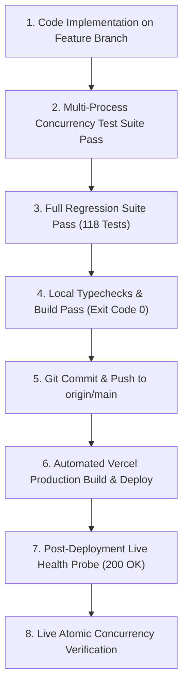

# MASTERHRMS — AUD-CONC-002 PHASE 3A DEPLOYMENT AND ROLLBACK PLAN

> **Audit Identifier**: AUD-CONC-002 (Deployment & Rollback Blueprint)  
> **Prepared Date**: 2026-11-04  
> **Target Subsystem**: PostgreSQL-Backed Distributed Locking Engine & Crash Recovery Route  
> **Execution Status**: **PROPOSED BLUEPRINT ONLY — STRICTLY NON-EXECUTABLE IN THIS PHASE**  

---

## 1. Executive Summary

This document specifies the exact, step-by-step engineering deployment and emergency rollback procedure for transitioning MASTERHRMS from the vulnerable in-memory mutex (`activeRunLocks`) to PostgreSQL-backed atomic distributed locking.

In strict compliance with the Phase 3A Authorization Boundary, **this plan is purely preparatory; no code commits, database migrations, or Vercel deployments are authorized or performed during this audit**.

---

## 2. Deployment Prerequisites Matrix

| Prerequisite | Specification | Verification Method | Blocker Status |
| :--- | :--- | :--- | :---: |
| **Code Implementation** | Replace `activeRunLocks` with `updateMany` atomic state claim | Code review in `payroll-orchestrator.service.ts` | **PENDING AUTHORIZATION** |
| **Recovery Endpoint** | Implement `POST /api/payroll/cycles/:id/recover` | Code review in `payroll-cycles.routes.ts` | **PENDING AUTHORIZATION** |
| **Real Concurrency Tests** | Multi-process integration tests passing 100% | Execute `distributed-payroll-concurrency.test.ts` | **PENDING AUTHORIZATION** |
| **Clean TypeScript Build** | Backend and CMS pass `tsc` with 0 errors | `npm --prefix server run build && npm --prefix CMS run typecheck` | **VERIFIED READY (0 Errors)** |
| **Zero Database DDL** | No migrations required; uses existing `approval_status` | Introspection confirms `approval_status` present | **VERIFIED READY** |
| **Mandatory Env Vars** | `DATABASE_URL`, `JWT_SECRET`, `NODE_ENV` present | Verified active in production container | **VERIFIED READY** |

---

## 3. Proposed Step-by-Step Deployment Sequence



### Detailed Steps:
1. **Step 1: Implementation**: Author the atomic conditional claim in `server/src/services/payroll-orchestrator.service.ts`:
   ```typescript
   const claim = await db.payrollRun.updateMany({
     where: { id: runId, tenantId, approvalStatus: "APPROVED" },
     data: { approvalStatus: "FINALIZING", processedAt: new Date(), approvedBy: actor.email },
   });
   if (claim.count === 0) {
     const err: any = new Error("Payroll cycle is not in APPROVED state or is currently being finalized.");
     err.statusCode = 409;
     throw err;
   }
   ```
2. **Step 2: Remove Mutexes**: Eliminate `activeRunLocks` and `activeFinalizationLocks`.
3. **Step 3: Author Recovery Endpoint**: Add `POST /api/payroll/cycles/:id/recover` with `requireRole("super_admin", "finance_director")` to recover runs stuck in `FINALIZING` for > 15 minutes.
4. **Step 4: Execute Multi-Process Tests**: Run `tsx --test server/src/tests/distributed-payroll-concurrency.test.ts` with real competing database connections.
5. **Step 5: Git Integration**: Merge to `main` with atomic commit message: `feat(payroll): implement postgresql-backed atomic distributed locking and crash recovery (AUD-CONC-002)`.
6. **Step 6: Vercel Production Deploy**: Push to `origin/main` and monitor Vercel build status via GitHub status checks until `state: "success"`.
7. **Step 7: Post-Deployment Smoke Test**: Verify `GET /api/health/ready` returns 200 OK with `database: { status: "connected" }`.

---

## 4. Verification of Live Distributed Locking

To verify that the deployed production container is executing the PostgreSQL-backed locking implementation:
1. Inspect deployed Git commit SHA on Vercel: must match the newly merged Phase 1 commit SHA.
2. Verify `GET /api/health/live` response: inspect headers and service readiness.
3. Test atomic rejection via HTTP: Attempting to call `POST /api/payroll/cycles/:id/finalize` on a non-approved cycle must return `HTTP 409 Conflict: Payroll cycle is not in APPROVED state or is currently being finalized`, generated directly by the `updateMany` count check.

---

## 5. Emergency Rollback Procedure

If any anomaly occurs post-deployment (such as unexpected database lock timeouts, elevated error rates, or API 500s):

### Stop & Rollback Criteria:
- `POST /api/payroll/cycles/:id/finalize` throws unhandled PostgreSQL errors or times out (> 30s).
- `/api/health/ready` returns HTTP 503 or latency spikes above 500ms.
- Any regression reported in standard employee payslip calculations.

### Rollback Execution:
1. **Immediate Vercel Rollback**:
   - In Vercel Project Dashboard (`masterhrms/masterhrms`), navigate to **Deployments**.
   - Locate the previous stable deployment: Deployment ID `FNfd4LkuBUyv9fbLpC7hpHAXGgjo` (Commit `9e8749bfe0275f4bf684d23edf3763fd1e9c74c0`).
   - Click **Instant Rollback / Promote to Production**.
   - Time to restore: < 10 seconds (instant edge traffic switch).
2. **Git Revert**:
   - Execute `git revert <phase-1-commit-sha>` on `main` and push to `origin/main`.
3. **Zero Database Rollback Needed**:
   - Because no DDL or schema migrations were applied, the database remains 100% compatible with the rolled-back deployment.

