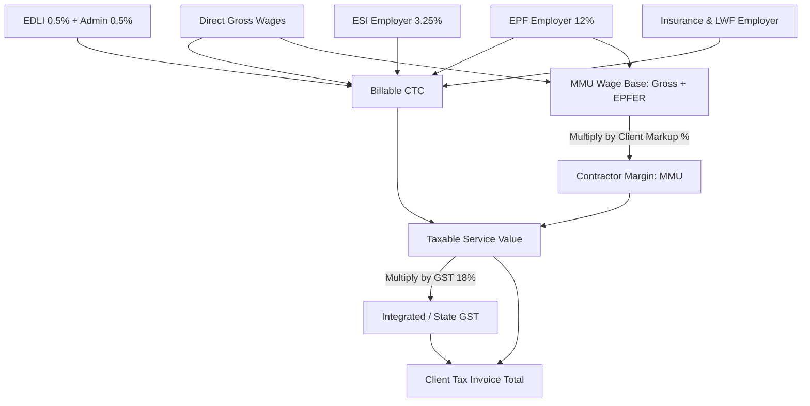

# MASTERHRMS — CONTRACT BILLING WORKSTREAM B IMPLEMENTATION PLAN
## Contract Staffing Commercial Billing, Margin (MMU), GST & Client Invoicing Integration

> **Workstream**: B — Contract Staffing Billing & Client Invoicing  
> **Status**: APPROVED FOR PLANNING ONLY (Strict Read-Only Mode — Zero Code/Schema Changes)  
> **Reference Workbook**: `Paysheet_ENABL_OCT_2026 -Final.xlsx` (Sheets: `OCT 2026 - Final`, `Summary`)  
> **Audit Gap IDs**: `GAP-OCT-014`, `GAP-OCT-015`, `GAP-OCT-016`, `GAP-SUM-001` through `GAP-SUM-008`, `HC-09`, `HC-11`, `HC-12`

---

## 1. Objectives & Business Context

In the reference staffing model (Client: *Enable Engineering Private Limited* / Contractor: *Precede Workforce Solutions India Pvt Ltd*), payroll processing is inextricably linked to **commercial agency billing**:
1. **Direct Employee Cost**: Net wages disbursed to employee bank accounts.
2. **Statutory Employer Liability**: EPF, EDLI, PF Admin, ESI, Insurance, LWF employer portions.
3. **Billable CTC**: $\text{Gross Wages} + \text{Total Employer Contributions}$.
4. **Contractor Margin (MMU)**: $10\%$ markup on agency labor costs: $(\text{Gross Wages} + \text{EPF Employer}) \times 10\%$.
5. **Taxable Supply Value**: $\text{Billable CTC} + \text{MMU} + \text{Admin Charges}$.
6. **GST (18%)**: Central GST ($9\%$) + State GST ($9\%$) or Integrated GST ($18\%$).
7. **Client Invoice Total**: $\text{Taxable Supply Value} + \text{GST}$.

Workstream B wires this commercial calculation directly into MASTERHRMS, creating an automated link between payroll completion and client invoicing.

---

## 2. Identified Audit Gaps & Target Remediation

| Gap ID | Description in Audit Reports | Location in Codebase | Target Dynamic Behavior |
| :---: | :--- | :--- | :--- |
| **GAP-OCT-014** | MMU (Contractor Margin 10%) missing in payroll run | `payroll.routes.ts` | Compute dynamic MMU per employee snapshot based on client contract rate. |
| **GAP-OCT-015** | GST (18%) per employee missing in snapshot | `payroll.routes.ts` | Compute and store prorated GST liability per employee. |
| **GAP-OCT-016** | Total Billing missing from `PayrollSnapshot` | `schema.prisma` | Store total client billable amount natively on each snapshot record. |
| **GAP-SUM-001** | `Summary` sheet client invoice reconciliation missing | `payroll-batch.service.ts` | Automatically aggregate client-level billing manifest upon cycle close. |
| **GAP-SUM-006** | Invoices decoupled from payroll execution | `invoices.routes.ts` | Introduce automated `generateInvoiceFromPayrollRun(cycleId, clientId)`. |
| **HC-09** | Hardcoded agency contact info on client invoices | `invoices.routes.ts:1696` | Pull establishment identity dynamically from `Tenant` legal entity profile. |
| **HC-11** | Static 10% MMU assumption | Engine | Read client-specific markup percentage from `StaffingClient.markupPercentage`. |
| **HC-12** | Hardcoded 18% GST assumption | Engine | Read tax rate from `TenantTaxConfig` or client GST profile. |

---

## 3. Database Models & Schema Extensions

### 3.1 Link Employee to StaffingClient
Extend `Employee` in `server/prisma/schema.prisma`:
```prisma
// In model Employee:
staffingClientId String?          @db.VarChar(36)
staffingClient   StaffingClient?  @relation(fields: [staffingClientId], references: [id], onDelete: SetNull)

@@index([staffingClientId])
```

### 3.2 Extend StaffingClient with Commercial Billing Terms
Update `StaffingClient` in `server/prisma/schema.prisma` (line 4539):
```prisma
model StaffingClient {
  id                String            @id @default(uuid())
  tenantId          String
  name              String            @db.VarChar(150)
  clientCode        String            @db.VarChar(50)
  gstin             String?           @db.VarChar(20)
  panNumber         String?           @db.VarChar(20)
  billingAddress    String?           @db.Text
  billingEmail      String?           @db.VarChar(100)
  billingPhone      String?           @db.VarChar(30)
  
  // Commercial Terms
  markupPercentage  Decimal           @default(10.00) @db.Decimal(5, 2) // e.g. 10.00%
  markupBasis       String            @default("GROSS_PLUS_PF") // GROSS_PLUS_PF or TOTAL_CTC or FIXED_PER_HEAD
  fixedMarkupPerHead Decimal?         @db.Decimal(10, 2)
  gstRate           Decimal           @default(18.00) @db.Decimal(5, 2) // e.g. 18.00%
  paymentTermsDays  Int               @default(30)
  
  // Effective Date Range
  contractStartDate DateTime
  contractEndDate   DateTime?
  isActive          Boolean           @default(true)
  
  employees         Employee[]
  invoices          Invoice[]
  tenant            Tenant            @relation(fields: [tenantId], references: [id], onDelete: Cascade)
  createdAt         DateTime          @default(now())
  updatedAt         DateTime          @updatedAt

  @@unique([tenantId, clientCode])
  @@index([tenantId])
}
```

### 3.3 Extend PayrollSnapshot with Client Billing Financials
Add commercial billing columns to `PayrollSnapshot`:
```prisma
// In model PayrollSnapshot:
staffingClientId   String?   @db.VarChar(36)
mmuAmount          Decimal   @default(0) @db.Decimal(12, 2)
billableCtc        Decimal   @default(0) @db.Decimal(12, 2)
gstAmount          Decimal   @default(0) @db.Decimal(12, 2)
totalBillingAmount Decimal   @default(0) @db.Decimal(12, 2)

staffingClient     StaffingClient? @relation(fields: [staffingClientId], references: [id], onDelete: SetNull)
@@index([staffingClientId])
```

---

## 4. Commercial Calculation Engine Specifications



### Mathematical Definitions
1. **Billable CTC**:
   $$\text{Billable CTC} = \text{Gross Wages} + \text{EPFER} + \text{EDLI} + \text{PF Admin} + \text{ESICER} + \text{Employer Insurance} + \text{LWFER}$$
2. **Contractor Margin (MMU)**:
   * Under standard contract formula (`GROSS_PLUS_PF`):
     $$\text{MMU} = (\text{Gross Wages} + \text{EPFER}) \times \frac{\text{client.markupPercentage}}{100}$$
   * Under `TOTAL_CTC` basis:
     $$\text{MMU} = \text{Billable CTC} \times \frac{\text{client.markupPercentage}}{100}$$
   * Under `FIXED_PER_HEAD` basis:
     $$\text{MMU} = \text{client.fixedMarkupPerHead}$$
3. **Goods and Services Tax (GST)**:
   $$\text{Taxable Supply} = \text{Billable CTC} + \text{MMU}$$
   $$\text{GST} = \text{ROUND}\left(\text{Taxable Supply} \times \frac{\text{client.gstRate}}{100}, 0\right)$$
4. **Total Client Bill**:
   $$\text{Total Invoice Line Item} = \text{Taxable Supply} + \text{GST}$$

---

## 5. Automated Payroll-to-Invoice Integration Service

When a payroll cycle containing staffing clients reaches `APPROVED` or `COMPLETED` status:

```typescript
// server/src/services/staffing-invoice.service.ts (Design Pattern)
export class StaffingInvoiceService {
  public static async generateInvoicesForPayrollCycle(
    payrollCycleId: string,
    actorId: string,
    tenantId: string
  ): Promise<InvoiceGenerationResult[]> {
    // 1. Group snapshots by staffingClientId
    // 2. For each client:
    //    a. Aggregate Billable CTC, Admin Charges, MMU, and GST
    //    b. Generate sequential invoice number (e.g. INV-2026-10-ENABL-001)
    //    c. Query establishment legal identity from Tenant
    //    d. Create Invoice record with status 'DRAFT' or 'ISSUED'
    //    e. Create line items:
    //       - Line 1: Billable Personnel CTC (Count of N employees)
    //       - Line 2: Statutory Administration Charges (EPF & EDLI Admin)
    //       - Line 3: Contractor Management Utility (MMU Markup)
    //       - Tax Line: CGST 9% + SGST 9% (or IGST 18%)
    //    f. Attach reference Excel manifest (multi-tab Paysheet + Summary)
    // 3. Return created invoice summaries
  }
}
```

---

## 6. API Endpoints

| HTTP Method | Route | Description | Permissions |
| :--- | :--- | :--- | :--- |
| `GET` | `/api/staffing/clients` | List all staffing clients and markup rates | `requireAuth`, `resolveTenantContext` |
| `POST` | `/api/staffing/clients` | Register new staffing client with commercial terms | `requireRole('admin', 'finance_manager')` |
| `PUT` | `/api/staffing/clients/:id` | Update client billing configuration | `requireRole('admin', 'finance_manager')` |
| `GET` | `/api/payroll/runs/:id/staffing-summary` | Preview commercial billing by client | `requireRole('admin', 'finance_manager', 'hr_manager')` |
| `POST` | `/api/payroll/runs/:id/generate-invoices` | Manually or automatically trigger client invoices | `requireRole('admin', 'finance_manager')` |

---

## 7. Security & Separation of Concerns

1. **Strict Financial Separation**:
   * Employee compensation data (Net Salary, employee bank accounts) must never be conflated with client invoice receivables.
   * Employees on Employee Self-Service (ESS) view **only** their personal payslip, never contractor markup (MMU) or client billing totals.
2. **Tenant Isolation**:
   * `StaffingClient` queries enforce `tenantId: req.tenantId`.
   * Cross-tenant access is blocked with fail-closed security.
3. **Complexity & Dependencies**:
   * Depends on: Workstream A (Prorated Gross & Employer Contributions).
   * Complexity: Medium. Estimated execution: 1.5 Days.

---

## 8. Acceptance Criteria & Rollback Plan

### Acceptance Criteria
- [ ] For the 11 reference employees under client `ENABLE ENGINEERING PRIVATE LIMITED`, aggregated MMU equals exactly `₹28,582.40` (10% of Gross + EPFER).
- [ ] Aggregated GST equals exactly `₹57,057.00` (18% of CTC + MMU).
- [ ] Total client billing matches the reference `Summary` sheet to 0.00% variance.
- [ ] Generated `Invoice` record links directly to the payroll cycle and contains clean, dynamic company establishment details.

### Rollback Strategy
- Commercial billing extensions to `PayrollSnapshot` are nullable with default values.
- If invoice generation fails, the core payroll payout and payslip delivery can proceed unimpeded.
- Feature flag `enableAutoStaffingInvoicing: boolean` allows toggling automated invoice creation off without affecting internal payroll.

