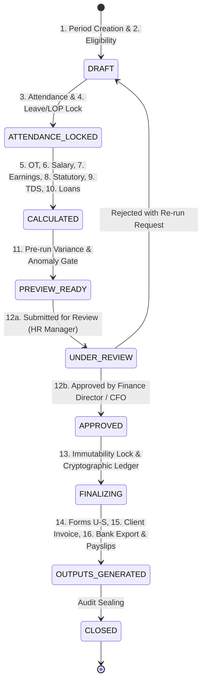

# MASTERHRMS — MONTHLY AUTOMATION WORKSTREAM D IMPLEMENTATION PLAN
## Full 16-Stage Monthly Payroll Automation Lifecycle, Approval Gates & Failure Recovery

> **Workstream**: D — End-to-End Monthly Automation Lifecycle  
> **Status**: APPROVED FOR PLANNING ONLY (Strict Read-Only Mode — Zero Code/Schema Changes)  
> **Target Source Code**: `server/src/routes/payroll.routes.ts`, `server/src/services/payroll-batch.service.ts`, `server/src/services/ledger-posting.service.ts`  
> **Audit Gap IDs**: `GAP-WF-001` through `GAP-WF-016`

---

## 1. Objectives & Architectural Blueprint

Workstream D orchestrates the entire monthly payroll lifecycle into an automated, idempotent state machine. It ties together:
* Dynamic compensation proration (Workstream A)
* Contract staffing client invoicing (Workstream B)
* Five dedicated statutory registers (Workstream C)
* Bank disbursement advice and Employee Self-Service (ESS) payslips

The state machine guarantees:
1. **Zero Duplicate Runs**: Idempotent period locks prevent re-calculation of closed cycles.
2. **Two-Tier Governance**: HR Manager review $\rightarrow$ Finance Director approval.
3. **Transaction Boundaries**: All database commits occur inside atomic Prisma `$transaction` blocks.
4. **Failure Recovery**: Safe rollbacks and resumable calculation checkpoints.

---

## 2. The 16-Stage Lifecycle State Machine



---

## 3. Detailed Stage-by-Stage Specifications

### Stage 1: Period Creation & Calendar Initialization
* **Trigger**: Automated cron job on 1st of every month or manual trigger via `/api/payroll/cycles`.
* **Action**: Derives days in month (28, 29, 30, 31), weekends, and gazetted establishment holidays. Creates `PayrollCycle` in `DRAFT` status.
* **Idempotency Rule**: Unique constraint on `[tenantId, periodMonth, periodYear]`. Re-trigger returns existing cycle.

### Stage 2: Employee Eligibility & Mid-Month Joiners/Exits
* **Action**: Queries `Employee` where `status = "ACTIVE" OR exitDate >= periodStartDate`.
* **Joiner Rule**: If `dateOfJoining > periodStartDate`, set `prorationFactor = (monthDays - joiningDay + 1) / monthDays`.
* **Exit Rule**: If `exitDate <= periodEndDate`, calculate prorated final salary and mark for Full & Final (FnF) workflow.

### Stage 3: Attendance & Biometric Data Lock
* **Action**: Normalizes raw biometric punch logs and mobile geofenced check-ins into daily statuses (`PRESENT`, `ABSENT`, `HALF_DAY`, `HOLIDAY`, `WEEK_OFF`).
* **Locking Protocol**: Freezes attendance records for the period (`isLocked = true`), preventing retroactive punch alterations.

### Stage 4: Leave & Loss of Pay (LOP) Reconciliation
* **Action**: Evaluates approved leave requests from `LeaveLedgerEntry`.
* **Proration Formula**:
  $$\text{Payable Days} = \text{Total Month Days} - \text{Unpaid LOP Days} - \text{Unauthorized Absences}$$
  Supports half-day leave increments ($0.5$).

### Stage 5: Overtime Hours Calculation & Authorization
* **Action**: Gathers approved overtime records beyond 9 hours/day or 48 hours/week.
* **Factories Act Rate**: Computes $\text{Hourly Rate} \times 2 \times \text{Approved OT Hours}$.

### Stage 6: Salary Structure Resolution & Revision Versioning
* **Action**: Evaluates temporal salary versioning using `effectiveFrom` and `effectiveTo` boundaries.
* **Mid-Month Revision**: Splits salary calculation into pre-revision and post-revision prorated segments if effective date is mid-month.

### Stage 7: Prorated Earnings Computation
* **Action**: Invokes Workstream A engine to calculate prorated Basic, HRA, Special Allowance, and Monthly Bonus.
* **Gross Formula**: $\text{Gross Wages} = \sum(\text{Earned Components}) + \text{OT} + \text{Arrears}$.

### Stage 8: Statutory Deductions Calculation
* **EPF**: Computes employee 12% and employer portions (EPS 8.33% capped at ₹1,250 + EPF 3.67% + EDLI 0.5% + Admin 0.5%).
* **ESI**: Checks ₹21,000 ceiling; applies 0.75% employee and 3.25% employer contributions with next-higher-rupee rounding.
* **Professional Tax**: Applies Tamil Nadu municipal half-yearly slabs.
* **LWF**: In December, applies ₹20 employee / ₹40 employer deductions.

### Stage 9: Projected Tax Withholding (TDS / IT Section 192)
* **Action**: Projects annual taxable earnings across New (Sec 115BAC) and Old regimes.
* **Withholding**: Subtracts verified Chapter VI-A investments, applies standard deduction (₹75k/₹50k), and spreads remaining annual tax evenly across remaining fiscal months.

### Stage 10: Loan Recovery & Voluntary Deductions
* **Action**: Automatically queries active `EmployeeLoan` records.
* **Deduction**: Decrements loan principal by monthly EMI and credits recovery ledger.

### Stage 11: Pre-Run Variance & Anomaly Validation Gate
* **Automated Audit Checks**:
  1. **Net Pay Variance**: Flag if any employee's net pay varies by $> \pm 20\%$ compared to the preceding cycle.
  2. **Negative Pay Prevention**: Assert $\text{Net Pay} \ge 0$. Flag if deductions exceed gross earnings.
  3. **Zero Payable Days**: Flag active employees with zero payable days for HR verification.
  4. **Missing Statutory IDs**: Assert presence of PAN, UAN, and Bank Account before payout approval.

### Stage 12: Two-Tier Governance & Dual Approval
* **Tier 1 (HR Manager)**: Reviews preview roster, variance flags, and submits for sign-off (`UNDER_REVIEW`).
* **Tier 2 (Finance Director / CFO)**: Reviews aggregate cash required, statutory challan totals, and grants final authorization (`APPROVED`).
* **Anti-Collusion Rule**: Strict RBAC prevents the same user from submitting and approving the same cycle.

### Stage 13: Finalization & Cryptographic Ledger Lock
* **Action**: Updates cycle status to `COMPLETED`.
* **Immutability Lock**: Sets `isLocked = true` on `PayrollCycle` and all `PayrollSnapshot` records.
* **Ledger Posting**: Auto-posts debit/credit journal entries to General Ledger (`autoPostPayrollToLedger`) with SHA-256 cryptographic proof.

### Stage 14: Statutory Compliance Form Auto-Generation
* **Action**: Triggers Workstream C builders to automatically compile:
  - Form U (Employee Register)
  - Form V (31-day Muster Roll)
  - FORM W (Register of Wages)
  - Form X (Leave & Social Security Register)
  - FORM S (Notice of Shifts)

### Stage 15: Contract Staffing Client Invoicing Auto-Generation
* **Action**: Triggers Workstream B service to create `Invoice` records:
  - Aggregates Billable CTC + MMU 10% + Admin Charges + GST 18%.
  - Dispatches draft invoices to client billing contacts with reference spreadsheet attachments.

### Stage 16: Bank Disbursement Export & Payslip Distribution
* **Bank Advice**: Generates standardized bank payment format (Account Number, IFSC, Employee Name, Net Pay amount).
* **ESS Distribution**: Publishes password-protected PDF payslips (`PAN + DOB`) to Employee Self-Service portal; dispatches notification emails.

---

## 4. Transaction Boundaries & Failure Recovery

```typescript
// server/src/services/payroll-finalization.service.ts (Design Pattern)
export async function finalizePayrollCycle(cycleId: string, actorId: string, tenantId: string) {
  return await prisma.$transaction(async (tx) => {
    // 1. Assert cycle status is APPROVED
    const cycle = await tx.payrollCycle.findFirstOrThrow({
      where: { id: cycleId, tenantId, status: "APPROVED" }
    });

    // 2. Lock all snapshot records
    await tx.payrollSnapshot.updateMany({
      where: { payrollCycleId: cycleId },
      data: { isLocked: true }
    });

    // 3. Mark cycle as COMPLETED
    const completedCycle = await tx.payrollCycle.update({
      where: { id: cycleId },
      data: { status: "COMPLETED", finalizedAt: new Date(), finalizedBy: actorId }
    });

    // 4. Post journal entries to General Ledger
    await postCycleToLedger(tx, completedCycle);

    // 5. Emit audit event
    await recordAuditEvent(tx, {
      tenantId,
      actorId,
      action: "PAYROLL_CYCLE_FINALIZED",
      entityId: cycleId
    });

    return completedCycle;
  }, {
    timeout: 30000, // 30 second timeout for large rosters
    isolationLevel: "Serializable"
  });
}
```

---

## 5. API Endpoints

| HTTP Method | Route | Description | Permissions |
| :--- | :--- | :--- | :--- |
| `POST` | `/api/payroll/cycles` | Initialize monthly payroll period | `requireRole('admin', 'hr_manager')` |
| `POST` | `/api/payroll/cycles/:id/lock-attendance` | Lock attendance and calculate LOP | `requireRole('admin', 'hr_manager')` |
| `POST` | `/api/payroll/cycles/:id/calculate` | Execute full batch calculation | `requireRole('admin', 'hr_manager')` |
| `GET` | `/api/payroll/cycles/:id/variance` | Retrieve pre-run variance audit report | `requireRole('admin', 'hr_manager', 'finance_director')` |
| `PATCH` | `/api/payroll/cycles/:id/submit-review` | Submit cycle for CFO approval | `requireRole('hr_manager')` |
| `PATCH` | `/api/payroll/cycles/:id/approve` | Grant final authorization | `requireRole('finance_director', 'super_admin')` |
| `POST` | `/api/payroll/cycles/:id/finalize` | Commit transaction, lock ledger, emit outputs | `requireRole('finance_director', 'super_admin')` |

---

## 6. Acceptance Test Criteria & Rollback Plan

### Acceptance Criteria
- [ ] End-to-end execution completes stages 1 through 16 within a single unified workflow.
- [ ] Pre-run variance checks detect injected artificial salary jumps (>20%) and halt progression.
- [ ] Attempting to re-calculate a `COMPLETED` cycle returns `409 Conflict: Cycle is immutable`.
- [ ] Transaction rollbacks revert 100% of mutations if ledger posting or invoice creation fails midway.
- [ ] Generated bank advice matches total net salary disbursement to the exact rupee.

### Rollback Strategy
- Non-destructive database migrations.
- If calculation fails midway, cycle resets to `DRAFT` status and clears partial snapshot records inside the transaction.
- Completed cycles cannot be unfinalized except via a supervised adjustment / supplementary payroll run.

