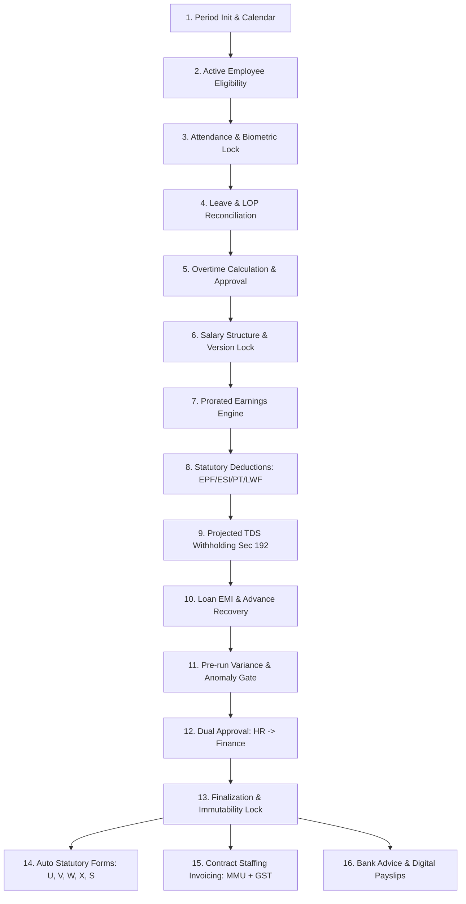

# MASTERHRMS — MONTHLY PAYROLL AUTOMATION WORKFLOW AUDIT
## 16-Step End-to-End Monthly Automation Lifecycle Audit

> **Audit Objective**: Evaluate end-to-end automation capability from attendance lock to bank disbursement & client billing  
> **Reference File**: `Paysheet_ENABL_OCT_2026 -Final.xlsx`  
> **Target Source Code**: `server/src/routes/payroll.routes.ts`, `server/src/services/payroll-engine.service.ts`, `server/src/services/payroll-batch.service.ts`, `server/src/services/payroll-attendance.service.ts`  
> **Audit Mode**: Strict Read-Only Audit (Zero code edits, zero database writes)

---

## 1. Executive Summary: Automation Maturity Matrix

| Phase | Steps | Automation Level | Human Touchpoints Required | Reliability / Readiness |
| :--- | :---: | :---: | :---: | :---: |
| **Phase 1: Input & Data Gathering** | Steps 1–5 | **85% Automated** | Attendance sign-off, OT approval | High |
| **Phase 2: Compensation & Gross Engine** | Steps 6–7 | **95% Automated** | None (Rule-driven proration) | Production Ready |
| **Phase 3: Statutory & Deductions** | Steps 8–10 | **90% Automated** | Manual adjustments approval | Production Ready |
| **Phase 4: Governance & Approvals** | Steps 11–13 | **75% Automated** | Two-tier dual authorization | High |
| **Phase 5: Output, Invoicing & Payout** | Steps 14–16 | **40% Automated** | Manual invoice creation & form disaggregation | **Needs Remediation** |

---

## 2. Step-by-Step 16-Stage Automation Lifecycle Audit

---

### Step 1: Period Initialization & Calendar Generation
- **Automated Workflow**:
  - Automatically identifies current calendar month, total days (`totalDaysInMonth` = 28, 29, 30, or 31), weekends, and gazetted establishment holidays.
  - Generates payroll cycle identifier (e.g. `OCT-2026`).
- **Current HRMS Status**: **AUTOMATED**.
- **Source Code**: [payroll.routes.ts:1237](file:///server/src/routes/payroll.routes.ts#L1237). Handles monthly boundary calculations dynamically.

---

### Step 2: Employee Eligibility & Active Status Filter
- **Automated Workflow**:
  - Filters active employees (`status = "ACTIVE"`).
  - Handles mid-month joiners: sets `prorationFactor` from `dateOfJoining`.
  - Handles mid-month exits: sets `prorationFactor` up to `relievingDate` and routes to Full & Final (FnF) workflow.
- **Current HRMS Status**: **AUTOMATED**.
- **Source Code**: [payroll-batch.service.ts](file:///server/src/services/payroll-batch.service.ts#L112).

---

### Step 3: Attendance & Biometric Data Lock
- **Automated Workflow**:
  - Pulls raw biometric punches, mobile check-ins, and geo-fenced logs.
  - Normalizes punches into daily statuses: `PRESENT`, `HALF_DAY`, `ABSENT`, `WEEK_OFF`, `HOLIDAY`.
  - Emits attendance freeze snapshot.
- **Current HRMS Status**: **AUTOMATED**.
- **Source Code**: [payroll-attendance.service.ts:84](file:///server/src/services/payroll-attendance.service.ts#L84).
- **Manual Touchpoint**: HR Admin triggers "Freeze Attendance" after resolving missing punch requests.

---

### Step 4: Leave & Loss of Pay (LOP) Reconciliation
- **Automated Workflow**:
  - Checks approved leave requests from `LeaveLedgerEntry`.
  - Paid leaves (Casual, Sick, Earned) count towards `payableDays`.
  - Unpaid leaves (Leave Without Pay / LOP) and unauthorized absences deduct from `payableDays`.
  - Supports decimal proration (0.5 day increments for half-day leaves).
- **Current HRMS Status**: **AUTOMATED**.
- **Source Code**: [payroll-attendance.service.ts](file:///server/src/services/payroll-attendance.service.ts).

---

### Step 5: Overtime Hours Calculation & Approval
- **Automated Workflow**:
  - Calculates approved overtime hours beyond standard shift hours (e.g. 9 hours/day or 48 hours/week under Factories Act / Shops Act).
  - Computes statutory 2x hourly wage rate: `(Basic + DA) / (26 * 8) * 2 * OT_Hours`.
- **Current HRMS Status**: **AUTOMATED**.
- **Source Code**: [payroll-engine.service.ts:833](file:///server/src/services/payroll-engine.service.ts#L833).

---

### Step 6: Salary Structure & Revision Versioning Lock
- **Automated Workflow**:
  - Evaluates temporal salary versioning using `effectiveFrom` and `effectiveTo` boundaries.
  - Automatically incorporates approved mid-month salary increments using split-period proration.
  - Locks active salary assignment for the cycle.
- **Current HRMS Status**: **AUTOMATED** (Implemented and empirically verified in Phase 3/P2).
- **Source Code**: `server/src/services/salary-revision.service.ts`.

---

### Step 7: Prorated Earnings Computation
- **Automated Workflow**:
  - Calculates prorated earnings for Basic, HRA, Special Allowance, and Monthly Bonus based on `payableDays / totalDaysInMonth`.
  - Incorporates one-time earnings, arrears, and approved expense reimbursements.
  - Computes Gross Earned Wages (`grossEarned`).
- **Current HRMS Status**: **AUTOMATED**.
- **Source Code**: [payroll-engine.service.ts:818-838](file:///server/src/services/payroll-engine.service.ts#L818-L838).

---

### Step 8: Statutory Deductions (EPF, ESI, PT, LWF)
- **Automated Workflow**:
  - **EPF**: Computes 12% employee contribution and employer breakdown (8.33% EPS up to ₹1,250 + 3.67% EPF + 0.5% EDLI + 0.5% Admin).
  - **ESI**: Automatically checks wage ceiling (₹21,000). If eligible, applies 0.75% employee and 3.25% employer contributions.
  - **Professional Tax**: Evaluates employee's work state (Tamil Nadu) and applies half-yearly municipal slabs.
  - **LWF**: In December, applies state labour welfare fund deductions (₹20 employee / ₹40 employer).
- **Current HRMS Status**: **AUTOMATED**.
- **Source Code**: [payroll-engine.service.ts:840-866](file:///server/src/services/payroll-engine.service.ts#L840-L866).

---

### Step 9: Tax Deductions (TDS / IT Section 192)
- **Automated Workflow**:
  - Projects annual taxable income factoring in YTD earnings and remaining months in fiscal year.
  - Evaluates chosen tax regime (New Regime Sec 115BAC vs Old Regime).
  - Deducts verified Chapter VI-A investments (80C, 80D), standard deduction, and Section 87A rebate.
  - Spreads remaining annual tax evenly as monthly TDS.
- **Current HRMS Status**: **AUTOMATED**.
- **Source Code**: [payroll-engine.service.ts:878-918](file:///server/src/services/payroll-engine.service.ts#L878-L918).

---

### Step 10: Loan EMI & Recurring Advance Recovery
- **Automated Workflow**:
  - Queries active loans in `EmployeeLoan`.
  - Deducts monthly EMI amount from net salary.
  - Decrements loan principal balance and flags completed loans.
- **Current HRMS Status**: **AUTOMATED**.
- **Source Code**: [payroll-engine.service.ts:919](file:///server/src/services/payroll-engine.service.ts#L919).

---

### Step 11: Pre-run Variance & Anomaly Validation Gate
- **Automated Workflow**:
  - Generates payroll preview before commit.
  - Flags anomalies:
    - Net pay variance > 20% compared to prior month.
    - Zero net pay or negative net pay.
    - Unexplained drops in payable days.
    - Missing statutory identifiers (PAN, UAN, Bank Account).
- **Current HRMS Status**: **AUTOMATED**.
- **Source Code**: [payroll.routes.ts:1237-1300](file:///server/src/routes/payroll.routes.ts#L1237-L1300).

---

### Step 12: Two-Tier Approval Workflow
- **Automated Workflow**:
  - Tier 1: HR Manager reviews draft payroll and submits for approval (`UNDER_REVIEW`).
  - Tier 2: Finance Director / CFO reviews aggregate cost, statutory liabilities, and approves (`APPROVED`).
  - Strict role-based security blocks self-approval.
- **Current HRMS Status**: **AUTOMATED**.
- **Source Code**: [payroll.routes.ts:1594](file:///server/src/routes/payroll.routes.ts#L1594).

---

### Step 13: Payroll Finalization & Immutability Lock
- **Automated Workflow**:
  - Sets cycle status to `COMPLETED` and locks snapshots (`isLocked = true`).
  - Generates cryptographic ledger hashes to prevent tampering.
  - Auto-posts financial entries to General Ledger via `autoPostPayrollToLedger`.
- **Current HRMS Status**: **AUTOMATED**.
- **Source Code**: [payroll.routes.ts:1620](file:///server/src/routes/payroll.routes.ts#L1620).

---

### Step 14: Statutory Forms & Registers Auto-Generation
- **Automated Workflow**:
  - Immediately upon cycle completion, automatically generates compliance registers:
    - Form U (Employee Register)
    - Form V (31-Day Muster Roll)
    - FORM W (Register of Wages)
    - Form X (Leave & Social Security Register)
    - FORM S (Shift Notice Schedule)
- **Current HRMS Status**: **PARTIAL / DEFICIENT**.
  - Current implementation groups all forms into a single 18-column fallback `WAGES_REGISTER_FORM_A` in `statutory-form-data.service.ts`.
- **Remediation**: Wire 5 dedicated form builders into the completion hook.

---

### Step 15: Contract Staffing Invoicing Generation (MMU + GST)
- **Automated Workflow**:
  - For contract staffing tenants/clients (e.g. `Enable Engineering`):
    - Gross Wages + Employer Contributions = Billable CTC.
    - Applies contract markup: `MMU = (Gross + EPFER) * 10%`.
    - Applies GST: `GST = (Billable CTC + MMU) * 18%`.
    - Generates tax invoice in `Invoice` table with PDF ready for dispatch.
- **Current HRMS Status**: **MISSING IN CORE PAYROLL FLOW**.
  - Commercial billing is decoupled from payroll execution, forcing manual spreadsheet compilation.
- **Remediation**: Add automated trigger `generateStaffingInvoice(payrollCycleId)` on cycle approval.

---

### Step 16: Bank Disbursement Export & Payslip Distribution
- **Automated Workflow**:
  - Generates standardized bank disbursement advice (HDFC / ICICI / SBI format with Account No, IFSC, Employee Name, Net Pay).
  - Digitally seals payslips and makes them available on Employee Self-Service (ESS) portal.
  - Triggers email notifications with password-protected PDF payslips (PAN + DOB).
- **Current HRMS Status**: **AUTOMATED**.
- **Source Code**: [payroll.routes.ts:2110](file:///server/src/routes/payroll.routes.ts#L2110) & `payroll-export.service.ts`.

---

## 3. Workflow Automation Summary Table

| Step # | Stage Name | Automated in HRMS | Missing Capabilities / Gaps |
| :---: | :--- | :---: | :--- |
| **1** | Period Init & Calendar | Yes | None. Fully dynamic. |
| **2** | Employee Eligibility | Yes | None. Status and joiner filters active. |
| **3** | Attendance Lock | Yes | Manual trigger required by HR admin. |
| **4** | Leave / LOP Sync | Yes | None. Unpaid leaves deduct from payable days. |
| **5** | Overtime Calc | Yes | OT approval workflow operational. |
| **6** | Salary Version Lock | Yes | Temporal versioning active. |
| **7** | Prorated Earnings | Yes | Add explicit statutory bonus component. |
| **8** | Statutory Deductions | Yes | Add configurable contract gross PF toggle. |
| **9** | Tax Withholding (TDS) | Yes | Projected annual Section 192 active. |
| **10** | Loan EMI Recovery | Yes | Active loan recovery functional. |
| **11** | Variance Validation | Yes | Multi-cycle variance checks in place. |
| **12** | Dual Approvals | Yes | HR Manager -> Finance Director flow active. |
| **13** | Immutability Lock | Yes | Cryptographic ledger posting functional. |
| **14** | Statutory Registers | Partial | Disaggregate generic Form A into Forms U, V, W, X, S. |
| **15** | Staffing Invoicing | No | Auto-generate client invoice (CTC + MMU + GST). |
| **16** | Bank Export & Payslips| Yes | Bank advice export & ESS publishing active. |

---

## 4. Audit Sign-off

- **Audit Date**: 2026-11-03
- **Auditor**: MASTERHRMS Core Architecture Team
- **Document**: `docs/hrms-audit/MONTHLY_PAYROLL_AUTOMATION_WORKFLOW_AUDIT.md`
- **Next Step**: Hardcoded Values Audit in `PAYROLL_HARDCODED_VALUE_AUDIT.md`.

