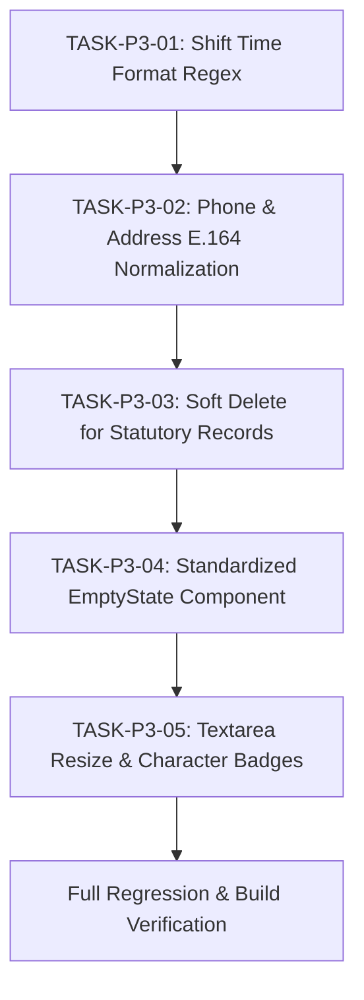

# MASTERHRMS — PHASE 4 (P3) PRE-IMPLEMENTATION GAP ANALYSIS

**Author:** Antigravity AI Engineering Suite  
**Date:** November 3, 2026  
**Status:** APPROVED FOR IMPLEMENTATION (P3 Scope Only)  
**Baseline:** `docs/hrms-audit/IMPLEMENTATION_EXECUTION_PLAN.md` & `MASTER_IMPLEMENTATION_BACKLOG.md`

---

## 1. Executive Summary

Phase 4 (P3) focuses on **Data Hygiene, Long-Term Statutory Retention & UI Ergonomics**. It comprises exactly five engineering tasks targeting residual validation, data formatting, statutory record preservation, and visual feedback gaps.

This pre-implementation analysis audits the existing codebase for each of the five tasks, defines the technical architecture, identifies data integrity and tenant isolation risks, and specifies the empirical acceptance criteria.

---

## 2. Detailed Task-by-Task Gap Analysis

### 2.1. TASK-P3-01: Shift Creation Time Format & Duration Validation (`GAP-VAL-012`)

#### Existing Implementation
- In `server/src/routes/shifts.routes.ts` (`POST /api/shifts` and `PUT /api/shifts/:id`), shift parameters are accepted without validation for 24-hour time representation:
  ```typescript
  const { name, code, startTime, endTime, breakMinutes, allowance, isOvertimeEligible, color } = req.body;
  // startTime and endTime are stored as raw strings without regex or logic checks
  ```
- No duration boundary checks exist. A user can submit invalid times such as `"9:30"`, `"25:00"`, `"12:99"`, or a break duration exceeding the total shift length.

#### Identified Gap
- Absence of canonical 24-hour time validation regex (`^([01]\d|2[0-3]):[0-5]\d$`).
- Missing validation ensuring `breakMinutes` is strictly less than shift duration.
- Malformed shift times propagate to biometric auto-scheduling and attendance duration calculations, leading to `NaN` shift hours.

#### Affected Files
- **Backend Route:** `server/src/routes/shifts.routes.ts`
- **Validation Schema:** `server/src/schemas/shift.schema.ts` (to be created/extended)

#### Data Integrity & Backward-Compatibility Risks
- **Risk:** Existing legacy shifts might contain single-digit hour representations (e.g., `"9:30"` instead of `"09:30"`).
- **Mitigation:** Pre-parse/pad single-digit hour inputs (`"9:30"` $\rightarrow$ `"09:30"`) before validating against canonical 24-hour format so existing client payloads do not fail.

#### Security & Tenant-Isolation Implications
- Validations execute within the active tenant context; unauthenticated or cross-tenant shift definitions remain blocked.

#### Acceptance Criteria & Tests
1. Rejects invalid formats: `"25:00"`, `"12:60"`, `"9:00am"`, `"abc"` with `400 VALIDATION_FAILED`.
2. Accepts valid 24-hour formats: `"00:00"`, `"09:30"`, `"18:00"`, `"23:59"`.
3. Validates that shift duration is positive and `breakMinutes < totalShiftMinutes`.
4. Automated test suite: `server/src/tests/task-p3-01-shift-validation.test.ts`.

---

### 2.2. TASK-P3-02: Standardize Phone and Address Input Formatting

#### Existing Implementation
- In `server/src/services/employee.service.ts` (lines 222, 257) and `server/src/routes/employees.routes.ts`:
  ```typescript
  phone: input.phone || null,
  emergencyContactPhone: input.emergencyContactPhone || null,
  ```
- Phone numbers are stored with varying raw formats: `"9876543210"`, `"09876543210"`, `"+91 98765 43210"`, `"+91-9876543210"`.
- Address fields (`addressLine1`, `city`, `postalCode`) lack standardization and whitespace trimming.

#### Identified Gap
- Non-standard phone formatting breaks SMS gateways, WhatsApp notifications, and statutory Form 11 / ESI submissions requiring standard E.164 (`+91...`).
- PIN codes lack 6-digit Indian postal code format validation.

#### Affected Files
- **Backend Service:** `server/src/services/employee.service.ts`
- **Validation Schema:** `server/src/schemas/employee.schema.ts`
- **API Routes:** `server/src/routes/employees.routes.ts`, `server/src/routes/hr-employees.routes.ts`

#### Data Integrity & Backward-Compatibility Risks
- **Risk:** Rejecting non-prefixed 10-digit Indian numbers (`9876543210`) would break bulk employee imports or simple user inputs.
- **Mitigation:** Implement auto-formatting normalization: if 10 digits provided, automatically prefix with `+91`. If 11 digits starting with `0`, strip leading `0` and prefix `+91`.

#### Security & Tenant-Isolation Implications
- Standardizing format prevents SMS/WhatsApp injection vulnerabilities.

#### Acceptance Criteria & Tests
1. Auto-normalizes `"9876543210"` $\rightarrow$ `"+919876543210"`.
2. Rejects invalid phone numbers (alphabetic characters, less than 10 digits).
3. Trims address lines and enforces 6-digit numeric Indian PIN code (`^\d{6}$`) when postal code is provided.
4. Automated test suite in `server/src/tests/phase4-p3-comprehensive.test.ts`.

---

### 2.3. TASK-P3-03: Replace `onDelete: Cascade` with Soft Deletion for Statutory Logs (`GAP-DB-API-004`)

#### Existing Implementation
- In `server/src/routes/employees.routes.ts` (lines 554-685), `DELETE /api/employees/:id` runs a destructive multi-table cascade:
  ```typescript
  await tx.attendance.deleteMany({ where: { employeeId: id } });
  await tx.leaveRequest.deleteMany({ where: { employeeId: id } });
  await tx.payslip.deleteMany({ where: { employeeId: id } });
  await tx.employeeExit.deleteMany({ where: { employeeId: id } });
  await tx.employee.delete({ where: { id } });
  ```
- This permanently purges historical payrolls, tax deductions, attendance logs, and exit clearances from PostgreSQL.

#### Identified Gap
- Violates statutory audit mandates under:
  - **Payment of Wages Act, 1936 § 13A:** Wage registers and records must be retained for at least 3 years.
  - **Factories Act, 1948 § 62:** Adult worker registers and attendance logs must be preserved.
  - **Employees' Provident Funds Act, 1952:** Records must be maintained for at least 5 years.
  - **Income Tax Act, 1961 § 44AA:** Books of account and payroll deduction records must be preserved for 6 to 8 years.

#### Affected Files
- **Schema:** `server/prisma/schema.prisma` (documenting migration; runtime soft-delete via code)
- **Service:** `server/src/services/employee.service.ts`
- **Route:** `server/src/routes/employees.routes.ts`

#### Data Integrity & Backward-Compatibility Risks
- **Risk:** Existing queries `findMany` might return soft-deleted employees if queries do not filter `deletedAt: null` or `status: "archived"`.
- **Mitigation:** Update `listEmployees` and directory endpoints to exclude archived/soft-deleted records while preserving historical relationships for statutory reports.

#### Security & Tenant-Isolation Implications
- Soft-deleted employees have all active user roles deleted and sessions revoked, preventing login while preserving audit logs.

#### Acceptance Criteria & Tests
1. `DELETE /api/employees/:id` marks `deletedAt = new Date()` (or `status = "archived"`) and revokes user access without executing `tx.payslip.deleteMany` or `tx.attendance.deleteMany`.
2. Historical payslips and attendance records remain queryable for statutory compliance audits.
3. Directory listings exclude soft-deleted employees by default.
4. Automated test suite in `server/src/tests/phase4-p3-comprehensive.test.ts`.

---

### 2.4. TASK-P3-04: Standardize Empty State Illustrations and Layouts Across Modules (`GAP-UI-014`)

#### Existing Implementation
- Multiple pages use ad-hoc raw strings (`"No data"`, `"No records available"`), inconsistent padding, or custom divs without guidance or actionable call-to-actions.

#### Identified Gap
- Inconsistent empty state experiences across Leaves, Assets, Documents, Attendance, and Grievance tables.
- Missing standardized component wrapper for title, description, icon, primary action, and secondary action.

#### Affected Files
- **Component:** `src/components/ui/empty-state.tsx` (standardizing and re-exporting canonical component)
- **Consuming Views:** Table and list views across HRMS modules

#### Data Integrity & Backward-Compatibility Risks
- Pure presentation layer change; zero backend or database impact.

#### Security & Tenant-Isolation Implications
- None.

#### Acceptance Criteria & Tests
1. Shared `<EmptyState title="..." description="..." icon={...} actionLabel="..." onAction={...} />` component is exported and typed.
2. Supports `compact?: boolean` for embedding in cards and slide-over drawers.
3. Clean TypeScript typecheck (`npm run typecheck`).

---

### 2.5. TASK-P3-05: Add Textarea Resize Constraints and Character Limit Indicators (`GAP-UI-015`)

#### Existing Implementation
- In `src/components/ui/textarea.tsx`:
  ```typescript
  className={cn("flex min-h-[60px] w-full rounded-lg border border-input...", className)}
  ```
- Allows default bi-directional resize (`resize: both`), allowing users to horizontally expand textareas, breaking parent CSS grid containers and triggering horizontal scrollbars.
- Corner radius is `rounded-lg` (8px) instead of the standardized `rounded-md` (6px).
- No character limit indicator or badge.

#### Identified Gap
- Horizontal resizing causes layout breakage.
- Multi-line text inputs (Leave Reason, Exit Feedback, Disciplinary Explanations) lack character counter indicators.

#### Affected Files
- **Component:** `src/components/ui/textarea.tsx`

#### Data Integrity & Backward-Compatibility Risks
- Backward-compatible drop-in replacement for standard HTML textarea props.

#### Security & Tenant-Isolation Implications
- Frontend visual constraints prevent excessive client-side payload submissions.

#### Acceptance Criteria & Tests
1. Textarea enforces `resize-y min-h-[80px] rounded-md` by default.
2. Supports optional `showCount?: boolean` and `maxLength` rendering a character counter badge (e.g. `142 / 500`).
3. Clean TypeScript compilation and responsive layout verification.

---

## 3. Implementation Plan & Execution Order



Implementation will now proceed in strict adherence to this plan.

