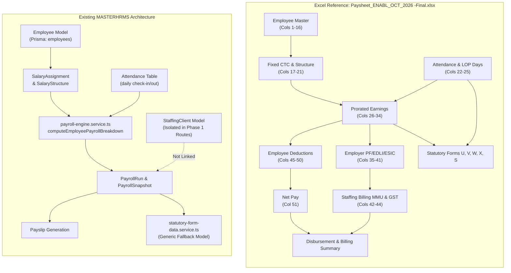

# MASTERHRMS — COMPLETE PAYROLL AUTOMATION GAP ANALYSIS
**Reference Document:** `Paysheet_ENABL_OCT_2026 -Final.xlsx`  
**Audit Scope:** End-to-End Monthly Payroll Automation vs Existing HRMS Architecture  
**Execution Mode:** STRICT READ-ONLY AUDIT  
**Timestamp:** 2026-11-03T17:15:00+05:30  
**Target Repository:** `c:\Users\TSV Global Solutions\Documents\hrms`  

---

## 1. EXECUTIVE SUMMARY & AUDIT OBJECTIVE

The business objective is to achieve **100% automated monthly payroll processing** in MASTERHRMS, replacing manual Excel spreadsheets, eliminating repeated manual calculations, and dynamically generating compliant statutory registers.

The uploaded workbook `Paysheet_ENABL_OCT_2026 -Final.xlsx` serves as the authoritative reference benchmark. It captures:
1. **Contract Staffing / Agency Payroll (`OCT 2026 - Final`):** 55 columns covering Employee Demographics, Statutory IDs, Fixed Compensation, Monthly Attendance/LOP, Prorated Earnings, Employer Statutory Contributions, Client Markup & GST Invoicing, Employee Deductions, and Net Pay.
2. **Monthly Disbursement & Invoicing Reconciliation (`Summary`):** Statutory challan aggregation (PF, ESIC, PT, LWF, TDS), net salary bank disbursement, client billable CTC, management markup fee (MMU), and 18% GST invoice computation.
3. **Statutory Compliance Registers under Tamil Nadu Labour Regulations:**
   - **Form U:** Employee Register (Rule 16(1)) — 27 columns.
   - **Form V:** Register of Employment / Muster Roll (Rule 18(1)) — 46 columns.
   - **FORM W:** Register of Wages (Rule 18(2)) — 34 columns.
   - **Form X:** Register of Leave and Social Security Benefits (Rule 18(3)) — 21 columns.
   - **FORM S:** Notice of Daily Hours of Work, Rest Interval & Weekly Holiday (Rule 18(4)) — 38 columns.

Across all 7 active sheets, a total of **235 reference fields**, **77 formulas**, and **5 statutory registers** were audited against the Prisma database schema, Express REST APIs, calculation services, and frontend routes.

### Master Reconciliation Scorecard

```
========================================================================================
                      PAYROLL AUTOMATION FIELD RECONCILIATION AUDIT
========================================================================================
Total Reference Fields Audited across 7 Sheets:           235 fields (100.0%)
----------------------------------------------------------------------------------------
  - Fully Mapped & Dynamically Populated:                 112 fields ( 47.7%)
  - Partially Mapped / Static / Fallback:                  68 fields ( 28.9%)
  - Completely Missing from Data Models & APIs:            55 fields ( 23.4%)
========================================================================================
Statutory Registers Supported:
  - Form U (Employee Register):                           PARTIAL (Generic 18-col fallback)
  - Form V (Register of Employment):                      PARTIAL (Muster roll not separated)
  - FORM W (Register of Wages):                           PARTIAL (Generic Wage Register)
  - Form X (Leave & Maternity Register):                  PARTIAL (Maternity fields absent)
  - FORM S (Notice of Hours & Shifts):                    PARTIAL (Shift rules hardcoded)
========================================================================================
Critical & High Priority Gaps Identified:                  18 Architectural Gaps
Formula Inconsistencies & Errors in Reference Excel:        5 Inconsistencies Identified
========================================================================================
```

---

## 2. REFERENCE WORKBOOK ARCHITECTURE vs EXISTING HRMS



---

## 3. KEY ARCHITECTURAL DISCREPANCIES & FINDINGS

### 3.1 Contract Staffing / Client Billing Decoupling (CRITICAL)
- **Excel Reference:** The reference payroll sheet is specifically a **Contract Staffing / Agency Payroll** for client `ENABLE ENGINEERING PRIVATE LIMITED` (`Enable India`), operated by contractor `PreCede Workforce Solutions India Pvt Ltd`. Columns 42–44 directly compute:
  - **MMU (Management Markup Unit):** `SUM(Gross + EPFER) * 10%`
  - **GST:** `ROUND((CTC + MMU) * 18%, 0)`
  - **Total Billing:** `CTC + MMU + GST`
  - In `Summary`, Row 14–19 aggregates total billable CTC, MMU, GST, and produces the final invoice amount of **₹1,41,742.90**.
- **Existing HRMS:** While `StaffingClient` exists in Prisma schema (`server/prisma/schema.prisma:4539`), it is completely decoupled from `PayrollRun`, `PayrollSnapshot`, and `payroll.routes.ts`. The standard payroll engine calculates internal corporate payroll only, with zero capability to output client billing markups, GST, or client staffing invoices from a payroll run.

### 3.2 Statutory Forms Flattening (HIGH)
- **Excel Reference:** 5 distinct statutory registers under Tamil Nadu Shops & Establishments Act:
  - **Form U (27 cols):** Complete personnel register with 480-day completion date, permanent date, suspension, photo, signature.
  - **Form V (46 cols):** Full muster roll tracking daily attendance 1–31, hours worked, and 5 festival holidays.
  - **FORM W (34 cols):** Detailed register of wages with discrete columns for Basic, DA, HRA, Special, Overtime, Wages for EL, Advance recoveries, and Fines.
  - **Form X (21 cols):** Social security & leave register tracking opening/availed/closing for EL, ML, Other leave, and Maternity benefits.
  - **FORM S (38 cols):** Work hours notice, shift timings, rest intervals, and wage rate brackets.
- **Existing HRMS:** `server/src/services/statutory-form-data.service.ts` merges Forms U, V, W, X, and S into a single fallback switch statement (`case "FORM_U": case "FORM_V": ... default:`), emitting an identical 18-column generic wages roster. Form V's daily attendance matrix, Form X's maternity tracking, and Form S's rest intervals cannot currently be generated.

### 3.3 Salary Component Allocation Rigidity (HIGH)
- **Excel Reference:** Fixed structure has exactly 3 earnings:
  - `Basic` (₹21,100)
  - `Statutory Bonus` (₹2,100)
  - `Special Allowance` (₹4,167 for Jr. Engineer)
  - Fixed Gross = ₹23,200 (or ₹27,367). No Conveyance or Medical allowance exists in this employment contract.
- **Existing HRMS:** `computeEmployeePayrollBreakdown` in `payroll-engine.service.ts:821` hardcodes a 50-20-15-5-5-5 percentage distribution (Basic 50%, HRA 20%, Special 15%, Conveyance 5%, Medical 5%). When an employee has a custom contract (like ₹21,100 Basic + ₹2,100 Bonus), the standard engine overwrites it with corporate salary splits unless custom formulas are dynamically bound.

### 3.4 Discovered Errors & Inconsistencies in Reference Excel Sheet
The read-only audit revealed 5 notable formula defects in the reference workbook:
1. **Manual Hardcoding on Row 6 (AI6):** Column AI (`EPFER`) uses `AH3*12%` and `AH4*12%` for Rows 3–4, but Row 6 has manually hardcoded `25000*12%` instead of referencing the actual gross or statutory cap.
2. **Missing Formula on Row 5 (AH5):** Column AH (`Gross`) has `SUM(Z3:AG3)` on Rows 3 and 4, but Row 5 has a hardcoded static value `23200`.
3. **Outdated ESIC Rates in Formulas:** Columns AL (`ESICER`) and AT (`ESICEE`) use `4.75%` and `1.75%` respectively. The statutory ESI rates were officially amended to `3.25%` and `0.75%` effective July 1, 2019.
4. **Formula Error in Sheet "FORM S":** Cell `AL3` contains the Excel error `#NAME?` due to an invalid range name reference.
5. **EPF Calculated on Gross rather than PF Wages:** Col AI computes EPF as `AH3*12%` (Gross * 12%) instead of (Basic + DA), resulting in an over-calculation above statutory requirements.

---

## 4. GAP CLASSIFICATION SUMMARY

| Priority | Count | Description | Primary Modules Affected |
|---|:---:|---|---|
| **CRITICAL** | **4** | Blocks automated staffing payroll and client invoice generation | Payroll Engine, Billing, PayrollRun Snapshot |
| **HIGH** | **7** | Missing statutory register data, custom formula evaluation, and LOP proration | Statutory Forms, Salary Structure, Attendance Sync |
| **MEDIUM** | **5** | Missing UI reports, contract staffing exports, and reconciliation dashboards | Export Service, Summary Dashboard, Reports |
| **LOW** | **2** | Visual formatting, column ordering, and Excel export styling | ExcelJS Template, Theme Styling |
| **TOTAL** | **18** | Comprehensive Payroll Automation Gaps | End-to-End System |

---

## 5. AUDIT CONCLUSION & NEXT STEPS

The existing MASTERHRMS platform has robust foundations in Indian statutory calculations (EPF, ESI, TN PT, TDS, TN LWF) and multi-tenant security. However, to achieve **100% automated monthly payroll matching the reference Excel workbook**, MASTERHRMS must:
1. Activate the `StaffingClient` contract billing engine and store MMU and GST billing snapshots in `PayrollRun`.
2. Fully disaggregate statutory Forms U, V, W, X, and S into dedicated data models matching Tamil Nadu rules.
3. Replace hardcoded percentage splits in `payroll-engine.service.ts` with dynamic, contract-level component formulas.
4. Export the exact 7-group staffing paysheet and summary sheet via `PayrollExportService`.

Detailed field mappings, calculations, statutory reconciliations, and the implementation roadmap are provided in the accompanying audit reports.

