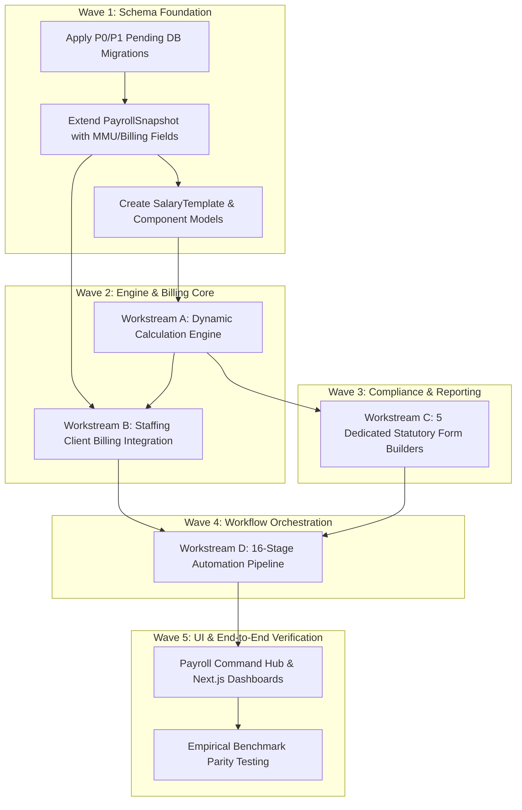

# MASTERHRMS — PAYROLL AUTOMATION MASTER IMPLEMENTATION PLAN
## Unified Implementation Strategy for Automated Monthly Payroll & Contract Staffing Billing (Workstreams A–D)

> **Document Type**: Master Implementation Roadmap & Orchestration Strategy  
> **Status**: APPROVED FOR PLANNING ONLY (Strict Read-Only Mode — Zero Code/Schema Changes)  
> **Reference Baseline**: `Paysheet_ENABL_OCT_2026 -Final.xlsx` & Audit Reports 1–7  
> **Audited Baseline Metric**: 235 Total Workbook Fields (112 Populated, 68 Partially Mapped, 55 Missing)

---

## 1. Executive Summary & Strategic Vision

The business objective of MASTERHRMS is to achieve **100% automated monthly payroll and contract staffing billing**, transitioning away from disparate spreadsheets, manual calculations, and disconnected invoicing.

This Master Implementation Plan synthesizes the findings of the 7-part comprehensive audit into four synchronized, interdependent workstreams:
* **Workstream A**: Dynamic Payroll Engine (Compensation, Proration, Deductions, and Fallback Removal)
* **Workstream B**: Contract Staffing Commercial Billing (MMU Margin, Invoicing, and GST Synchronization)
* **Workstream C**: Statutory Registers Disaggregation (Dedicated Form U, V, W, X, and S Builders)
* **Workstream D**: Full Monthly Payroll Automation Lifecycle (16-Stage Orchestrated Pipeline)

```
┌─────────────────────────────────────────────────────────────────────────────────┐
│                      MASTER AUTOMATION LIFECYCLE (WORKSTREAM D)                 │
│                                                                                 │
│   ┌───────────────────────────┐                ┌────────────────────────────┐   │
│   │   WORKSTREAM A: ENGINE    │                │   WORKSTREAM B: BILLING    │   │
│   │  • Attendance Proration   │                │  • Contract Margin (MMU)   │   │
│   │  • Salary Resolution      │───────────────>│  • Billable CTC            │   │
│   │  • Statutory EPF/ESI/PT   │                │  • Client GST (18%)        │   │
│   │  • Net Salary Finalization│                │  • Automated Invoice Gen   │   │
│   └─────────────┬─────────────┘                └─────────────┬──────────────┘   │
│                 │                                            │                  │
│                 ▼                                            ▼                  │
│   ┌───────────────────────────┐                ┌────────────────────────────┐   │
│   │   WORKSTREAM C: FORMS     │                │     DISBURSEMENT & ESS     │   │
│   │  • Form U: Employee Reg   │                │  • Bank NEFT/RTGS Advice   │   │
│   │  • Form V: Muster Roll    │                │  • Password-Protected PDF  │   │
│   │  • Form W: Wage Register  │                │  • General Ledger Hash     │   │
│   │  • Form X: Leave & Benefits│               │  • Cycle Immutability Lock │   │
│   │  • Form S: Shift Notice   │                │                            │   │
│   └───────────────────────────┘                └────────────────────────────┘   │
└─────────────────────────────────────────────────────────────────────────────────┘
```

---

## 2. Baseline Reconciliation: 235 Workbook Fields

The authoritative field inventory established in `docs/hrms-audit/EXCEL_TO_HRMS_FIELD_MAPPING_MATRIX.md` confirms the exact baseline:

| Section / Functional Domain | Total Evaluated | Fully Populated in HRMS | Partially Mapped / Derivable | Missing in HRMS | Target Workstream |
| :--- | :---: | :---: | :---: | :---: | :---: |
| **Personal Info (OCT Cols 1–10)** | 10 | 10 | 0 | 0 | Workstream A |
| **Statutory Identifiers (OCT Cols 11–16)** | 6 | 6 | 0 | 0 | Workstream A |
| **Fixed Compensation (OCT Cols 17–21)** | 5 | 4 | 1 | 0 | Workstream A |
| **Attendance & Working Days (OCT Cols 22–25)**| 4 | 3 | 1 | 0 | Workstream A |
| **Earned Salary (OCT Cols 26–34)** | 9 | 5 | 3 | 1 | Workstream A |
| **Employer Contributions (OCT Cols 35–41)**| 7 | 4 | 2 | 1 | Workstream A |
| **Contract Staffing Billing (OCT Cols 42–44)**| 3 | 0 | 1 | 2 | Workstream B |
| **Deductions (OCT Cols 45–50)** | 6 | 4 | 2 | 0 | Workstream A |
| **Payables (OCT Col 51)** | 1 | 1 | 0 | 0 | Workstream A |
| **Summary: Statutory Outlay (Rows 1–10)** | 6 | 4 | 2 | 0 | Workstream A / D |
| **Summary: Client Invoicing (Rows 13–19)** | 8 | 1 | 2 | 5 | Workstream B |
| **Statutory Form U (Employee Register)** | 27 | 19 | 5 | 3 | Workstream C |
| **Statutory Form V (Muster Roll)** | 46 | 39 | 4 | 3 | Workstream C |
| **Statutory FORM W (Wage Register)** | 34 | 26 | 3 | 5 | Workstream C |
| **Statutory Form X (Leave & Benefits)** | 21 | 14 | 3 | 4 | Workstream C |
| **Statutory FORM S (Notice of Shifts)** | 38 | 16 | 13 | 9 | Workstream C |
| **TOTAL COMBINED AUDITED FIELDS** | **235** | **112** | **68** | **55** | **All Streams** |

---

## 3. Workstream Dependency Graph & Wave Sequence

To ensure database consistency, prevent broken foreign keys, and avoid circular dependencies, the execution must proceed in five strictly sequenced waves:



---

## 4. Workstream Scope Summary

### 4.1 Workstream A: Dynamic Payroll Engine
* **Core Tasks**:
  - Implement dynamic salary resolution supporting effective-dated salary assignments.
  - Implement decimal proration (`payableDays / totalDaysInMonth`) and LOP deduction.
  - Add explicit native support for statutory monthly bonus (`ROUND(T3/V3*W3,0)`).
  - Implement dual-mode EPF: Statutory standard (Basic+DA up to ₹15,000 cap) vs Contract Gross (12% of Gross).
  - Enforce amended 2019 ESI rates (3.25% / 0.75%) with next-higher-rupee rounding.
  - Remove all hardcoded fallbacks (₹1600 conveyance, ₹1250 medical, static 50-20-15-5-5-5 splits).

### 4.2 Workstream B: Contract Staffing Commercial Billing
* **Core Tasks**:
  - Connect `StaffingClient` configuration to payroll cycles.
  - Compute Billable CTC, Contractor Management Margin (`MMU 10%`), and GST (`18%`).
  - Wire payroll finalization directly into the `Invoice` generation service.
  - Generate automated multi-tab Excel billing manifests matching the reference `Summary` sheet.

### 4.3 Workstream C: Statutory Form Generation
* **Core Tasks**:
  - Eliminate the generic 18-column `WAGES_REGISTER_FORM_A` fallback.
  - Create five dedicated builders:
    - **Form U**: Employee Register (27 cols)
    - **Form V**: Muster Roll with 31-day daily status matrix (46 cols)
    - **FORM W**: Register of Wages (34 cols)
    - **Form X**: Leave & Social Security Register (21 cols)
    - **FORM S**: Notice of Shifts & Working Hours (38 cols, repairing Excel `#NAME?` error)
  - Implement both Excel (multi-tab formatted XLSX) and PDF export with digital signature placeholders.

### 4.4 Workstream D: Full Monthly Payroll Automation
* **Core Tasks**:
  - Orchestrate the complete 16-step payroll execution state machine:
    `DRAFT -> ATTENDANCE_LOCKED -> CALCULATED -> PREVIEW_GENERATED -> UNDER_REVIEW -> APPROVED -> COMPLETED`.
  - Implement pre-run variance and anomaly detection gates (>20% net pay swing, negative pay, missing tax IDs).
  - Implement two-tier authorization (HR Manager review -> Finance Director approval).
  - Enforce payroll immutability and post cryptographic ledger hashes.
  - Auto-generate bank disbursement export files and deliver password-protected ESS payslips.

---

## 5. Risk Assessment & Governance Controls

| Risk | Impact | Likelihood | Mitigation Strategy |
| :--- | :---: | :---: | :--- |
| **Production Database Lock** | High | Low | Deploy schema updates during maintenance windows using non-blocking DDL statements. |
| **EPFO Audit Inconsistencies** | High | Medium | Keep Statutory Standard (Basic+DA capped at ₹15,000) as default; contract gross PF requires joint declaration flag. |
| **Rounding Tolerances (±₹1)** | Low | High | Standardize `Decimal.js` across backend calculations; round ESI employee share up to next whole rupee. |
| **Cross-Tenant Data Leakage** | Critical | Very Low | Enforce strict `resolveTenantContext` middleware on all new payroll and billing endpoints. |

---

## 6. Document Roadmap Sign-off & Stop Condition

This Master Implementation Plan coordinates the six accompanying architectural plans:
1. `PAYROLL_WORKSTREAM_A_IMPLEMENTATION_PLAN.md`
2. `CONTRACT_BILLING_WORKSTREAM_B_IMPLEMENTATION_PLAN.md`
3. `STATUTORY_FORMS_WORKSTREAM_C_IMPLEMENTATION_PLAN.md`
4. `MONTHLY_AUTOMATION_WORKSTREAM_D_IMPLEMENTATION_PLAN.md`
5. `PAYROLL_DATABASE_API_DEPENDENCY_MATRIX.md`
6. `PAYROLL_IMPLEMENTATION_ACCEPTANCE_TEST_PLAN.md`

> [!IMPORTANT]
> **Planning Authorization Boundary**:  
> This master document serves as the architectural blueprint only. Execution of code changes, migrations, or tests requires explicit, phased authorization.

