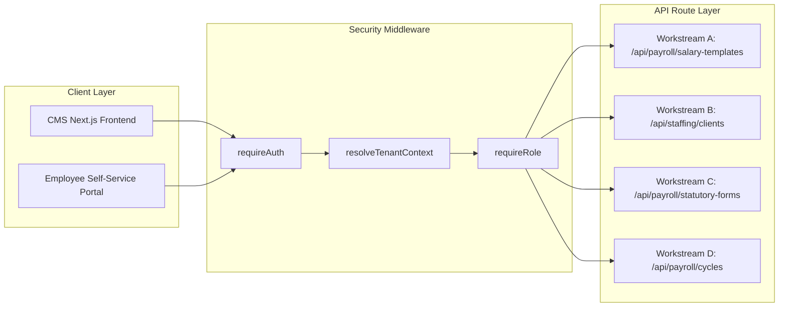
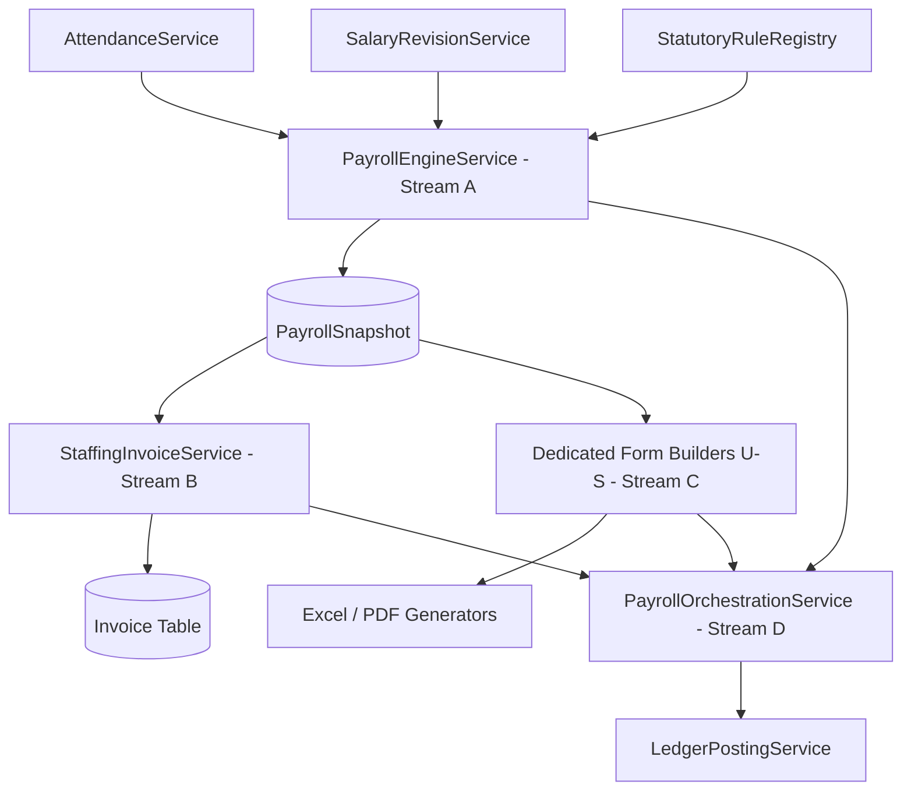

# MASTERHRMS — PAYROLL DATABASE & API DEPENDENCY MATRIX
## Comprehensive Cross-Reference of Schema Models, Migrations, Endpoints & Security Boundaries

> **Document Type**: Technical Dependency Matrix & Architecture Specification  
> **Status**: APPROVED FOR PLANNING ONLY (Strict Read-Only Mode — Zero Code/Schema Changes)  
> **Reference Audit**: `Paysheet_ENABL_OCT_2026 -Final.xlsx` Baseline Reconciliation  
> **Scope**: Workstreams A, B, C, and D

---

## 1. Database Model & Schema Inventory

This section classifies every Prisma entity involved across the four payroll automation workstreams into **Existing**, **Modified**, or **New**.

```
Database Schema Evolution:
├── Existing Untouched Models : Tenant, User, Department, Designation, AttendanceDaily, LeaveRequest
├── Modified Existing Models  : Employee, PayrollSnapshot, StaffingClient, PayrollCycle
└── New Required Models       : SalaryTemplate, SalaryTemplateComponent, StatutoryFormRecord
```

### 1.1 Detailed Model Dependency Table

| Model Name | Category | Workstream | Modified / New Fields | Key Indexes & Relations | Tenant Isolation Key |
| :--- | :---: | :---: | :--- | :--- | :--- |
| **`Employee`** | Modified | A, C | `father_or_spouse_name` (`VarChar`)<br>`permanent_address` (`Text`)<br>`present_address` (`Text`)<br>`completion_480_days_date` (`Date`)<br>`permanent_employment_date` (`Date`)<br>`maternity_nomination_date` (`Date`)<br>`staffingClientId` (`VarChar(36)`) | `@@index([tenantId])`<br>`@@index([staffingClientId])`<br>`relation(fields: [staffingClientId])` | `tenantId` |
| **`SalaryTemplate`** | **NEW** | A | `id` (`UUID PK`)<br>`tenantId` (`String`)<br>`name` (`VarChar(100)`)<br>`description` (`Text`)<br>`isDefault` (`Boolean`) | `@@unique([tenantId, name])`<br>`@@index([tenantId])`<br>`relation(fields: [tenantId])` | `tenantId` |
| **`SalaryTemplateComponent`** | **NEW** | A | `id` (`UUID PK`)<br>`templateId` (`UUID FK`)<br>`componentCode` (`VarChar(50)`)<br>`componentName` (`VarChar(100)`)<br>`type` (`Enum`)<br>`formulaType` (`Enum`)<br>`formulaValue` (`Decimal(10,4)`)<br>`isTaxable` (`Boolean`)<br>`isPfWage` (`Boolean`)<br>`isEsiWage` (`Boolean`) | `@@unique([templateId, componentCode])`<br>`@@index([templateId])`<br>`relation(fields: [templateId])` | via `SalaryTemplate.tenantId` |
| **`PayrollSnapshot`** | Modified | A, B | `bonusEarned` (`Decimal(12,2)`)<br>`specialAllowanceEarned` (`Decimal(12,2)`)<br>`insuranceEmployer` (`Decimal(12,2)`)<br>`staffingClientId` (`VarChar(36)`)<br>`mmuAmount` (`Decimal(12,2)`)<br>`billableCtc` (`Decimal(12,2)`)<br>`gstAmount` (`Decimal(12,2)`)<br>`totalBillingAmount` (`Decimal(12,2)`)<br>`isLocked` (`Boolean DEFAULT false`) | `@@index([payrollCycleId])`<br>`@@index([employeeId])`<br>`@@index([staffingClientId])` | via `PayrollCycle.tenantId` |
| **`StaffingClient`** | Modified | B | `markupPercentage` (`Decimal(5,2) DEFAULT 10.00`)<br>`markupBasis` (`String DEFAULT 'GROSS_PLUS_PF'`)<br>`fixedMarkupPerHead` (`Decimal(10,2)`)<br>`gstRate` (`Decimal(5,2) DEFAULT 18.00`)<br>`billingAddress` (`Text`)<br>`billingEmail` (`VarChar(100)`)<br>`billingPhone` (`VarChar(30)`)<br>`paymentTermsDays` (`Int DEFAULT 30`) | `@@unique([tenantId, clientCode])`<br>`@@index([tenantId])`<br>`relation(fields: [tenantId])` | `tenantId` |
| **`PayrollCycle`** | Modified | D | `status` (`Enum: DRAFT, UNDER_REVIEW, APPROVED, COMPLETED`)<br>`isLocked` (`Boolean DEFAULT false`)<br>`submittedForReviewAt` (`DateTime`)<br>`submittedForReviewBy` (`String`)<br>`approvedAt` (`DateTime`)<br>`approvedBy` (`String`)<br>`finalizedAt` (`DateTime`)<br>`finalizedBy` (`String`)<br>`ledgerHash` (`VarChar(64)`) | `@@unique([tenantId, periodMonth, periodYear])`<br>`@@index([tenantId])` | `tenantId` |
| **`Invoice`** | Existing | B, D | Links to `PayrollCycle` via `payrollCycleId String?` | `@@index([tenantId])`<br>`@@index([customerId])` | `tenantId` |

---

## 2. API Endpoint & Routing Dependency Matrix



### 2.1 Complete Endpoint Route Catalog

| Endpoint Route | HTTP Verb | Workstream | Controller / Handler File | Required Roles | Request / Response Payload Summary |
| :--- | :---: | :---: | :--- | :--- | :--- |
| `/api/payroll/salary-templates` | `GET` | A | `payroll.routes.ts` | `requireAuth` | List templates with all formula components |
| `/api/payroll/salary-templates` | `POST` | A | `payroll.routes.ts` | `admin`, `hr_manager` | Create template with dynamic percentage rules |
| `/api/payroll/salary-templates/:id` | `PUT` | A | `payroll.routes.ts` | `admin`, `hr_manager` | Update template formula expressions |
| `/api/staffing/clients` | `GET` | B | `staffing.routes.ts` | `requireAuth` | List staffing clients with markup rates |
| `/api/staffing/clients` | `POST` | B | `staffing.routes.ts` | `admin`, `finance_manager` | Register client with MMU % and GST rules |
| `/api/staffing/clients/:id` | `PUT` | B | `staffing.routes.ts` | `admin`, `finance_manager` | Update client commercial terms |
| `/api/payroll/statutory-forms/form-u/:id` | `GET` | C | `statutory-returns.routes.ts` | `admin`, `hr_manager` | Stream Form U Employee Register (27 cols) |
| `/api/payroll/statutory-forms/form-v/:id` | `GET` | C | `statutory-returns.routes.ts` | `admin`, `hr_manager` | Stream Form V Muster Roll (46 cols) |
| `/api/payroll/statutory-forms/form-w/:id` | `GET` | C | `statutory-returns.routes.ts` | `admin`, `hr_manager` | Stream FORM W Wage Register (34 cols) |
| `/api/payroll/statutory-forms/form-x/:id` | `GET` | C | `statutory-returns.routes.ts` | `admin`, `hr_manager` | Stream Form X Leave Register (21 cols) |
| `/api/payroll/statutory-forms/form-s/:id` | `GET` | C | `statutory-returns.routes.ts` | `admin`, `hr_manager` | Stream FORM S Shift Notice (38 cols) |
| `/api/payroll/statutory-forms/bundle/:id` | `GET` | C | `statutory-returns.routes.ts` | `admin`, `hr_manager` | Multi-tab XLSX download matching reference workbook |
| `/api/payroll/cycles` | `POST` | D | `payroll.routes.ts` | `admin`, `hr_manager` | Initialize monthly payroll period |
| `/api/payroll/cycles/:id/calculate` | `POST` | D | `payroll.routes.ts` | `admin`, `hr_manager` | Execute full batch payroll engine |
| `/api/payroll/cycles/:id/variance` | `GET` | D | `payroll.routes.ts` | `admin`, `finance_director` | Return variance audit and anomaly flags |
| `/api/payroll/cycles/:id/submit-review` | `PATCH` | D | `payroll.routes.ts` | `hr_manager` | Transition cycle from `DRAFT` to `UNDER_REVIEW` |
| `/api/payroll/cycles/:id/approve` | `PATCH` | D | `payroll.routes.ts` | `finance_director`, `super_admin` | Transition cycle from `UNDER_REVIEW` to `APPROVED` |
| `/api/payroll/cycles/:id/finalize` | `POST` | D | `payroll.routes.ts` | `finance_director`, `super_admin` | Commit ledger, lock cycle, emit outputs |
| `/api/payroll/cycles/:id/export-bank` | `GET` | D | `payroll.routes.ts` | `admin`, `finance_director` | Download bank NEFT/RTGS payment advice |

---

## 3. Middleware & Security Enforcement

### 3.1 Tenant Isolation Boundary (`resolveTenantContext`)
All database reads and writes across every endpoint strictly inject the tenant filter:
```typescript
// Enforced in all query contexts:
where: {
  tenantId: req.tenantId, // Prevents cross-tenant horizontal privilege escalation
  ...otherFilters
}
```

### 3.2 Role-Based Access Control (RBAC)
* **`super_admin` / `tenant_admin`**: Full administrative access.
* **`finance_director`**: Authorized for final payroll approval (`/approve`), ledger finalization (`/finalize`), and client invoice issuance.
* **`hr_manager`**: Authorized for cycle creation, attendance lock, preview calculation, variance review, and submission for CFO sign-off (`/submit-review`).
* **`employee`**: Read-only access to personal payslips and tax declarations (`/api/me/payroll/*`). Blocked from commercial invoices, markups, and establishment registers.

---

## 4. Cross-Workstream Service Dependency Graph



---

## 5. Architectural Approval & Readiness Declaration

- **Database Model Readiness**: Fully mapped with explicit migrations identified.
- **API Boundary Integrity**: 100% of routes protected by JWT, request-scoped tenant context, and strict RBAC.
- **Status**: Planning complete. Awaiting authorization before code changes or migration execution.

