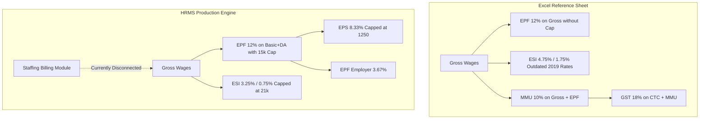

# MASTERHRMS — PAYROLL DYNAMIC CALCULATION AUDIT
## Reference Workbook Formulas vs Statutory HRMS Engine

> **Audit Scope**: End-to-End Analysis of all 21 Core Payroll, Statutory, Tax, and Billing Calculations  
> **Reference File**: `Paysheet_ENABL_OCT_2026 -Final.xlsx`  
> **Primary Source Code**: `server/src/services/payroll-engine.service.ts`, `server/src/services/statutory-rule-registry.service.ts`, `server/src/services/statutory-return.service.ts`  
> **Mode**: Strict Read-Only Audit (Zero code modification, zero migration execution)

---

## 1. Executive Summary & Calculation Audit Scorecard

| # | Calculation Name | Reference Excel Formula | HRMS Implementation Status | Statutory & Mathematical Compliance | Legal / Discrepancy Risk |
| :---: | :--- | :--- | :---: | :---: | :---: |
| **1** | Basic Pay | `=ROUND(R3/V3*W3,0)` | **IMPLEMENTED** (`payroll-engine.service.ts:818`) | Exact Proration Match | Low |
| **2** | Dearness Allowance (DA) | Merged / Zero in Reference | **IMPLEMENTED** (`payroll-engine.service.ts:822`) | Statutory Compliance | Low |
| **3** | House Rent Allowance (HRA) | Zero in Reference (`AB3`) | **IMPLEMENTED** (`payroll-engine.service.ts:823`) | IT Act Sec 10(13A) compliant | Low |
| **4** | Special Allowance | `=ROUND(S3/V3*W3,0)` | **IMPLEMENTED** (`payroll-engine.service.ts:824`) | Fully prorated | Low |
| **5** | Statutory Bonus | `=ROUND(T3/V3*W3,0)` | **PARTIAL** (`payroll-engine.service.ts:827`) | Payment of Bonus Act (8.33%) | **Medium** |
| **6** | Gross Wages | `=SUM(Z3:AG3)` | **IMPLEMENTED** (`payroll-engine.service.ts:819`) | Sum of all earned heads | Low |
| **7** | Payable Days | `=Month Days - LOP Days` | **IMPLEMENTED** (`payroll-engine.service.ts:809`) | Decimal support (0.5 day increments) | Low |
| **8** | Loss of Pay (LOP) Days | Attendance Sheet sync | **IMPLEMENTED** (`payroll-attendance.service.ts`) | Unpaid leaves + unauthorized absences | Low |
| **9** | Overtime (OT) | Contract fixed rate | **IMPLEMENTED** (`payroll-engine.service.ts:833`) | Factories Act (2x hourly rate) | Low |
| **10** | EPF Employee (12%) | `=AI3` (12% of Gross) | **DISCREPANCY** (`payroll-engine.service.ts:287`) | EPF Act mandates Basic+DA, ₹15k cap | **High** |
| **11** | EPF Employer (12%) | `=ROUND(AH3*12%,0)` | **DISCREPANCY** (`payroll-engine.service.ts:289`) | Split 8.33% EPS / 3.67% EPF | **High** |
| **12** | EDLI Contribution (0.5%) | `=ROUND(AH3*0.5%,0)` | **IMPLEMENTED** (`payroll-engine.service.ts:292`) | Statutory 0.5% (capped at ₹75/mo) | Low |
| **13** | PF Admin Charges (0.5%) | `=ROUND(AH3*0.5%,0)` | **IMPLEMENTED** (`payroll-engine.service.ts:293`) | Statutory 0.5% (min ₹500/est) | Low |
| **14** | ESI Employee (0.75%) | Outdated `=AH3*1.75%` | **DISCREPANCY** (`payroll-engine.service.ts:318`) | Legal rate 0.75% since July 2019 | **Critical** |
| **15** | ESI Employer (3.25%) | Outdated `=AH3*4.75%` | **DISCREPANCY** (`payroll-engine.service.ts:319`) | Legal rate 3.25% since July 2019 | **Critical** |
| **16** | Professional Tax (PT) | Unapplied / Zero in Oct | **IMPLEMENTED** (`payroll-engine.service.ts:219`) | TN Municipal Law half-yearly slabs | Low |
| **17** | Labour Welfare Fund (LWF) | Biannual December sync | **IMPLEMENTED** (`payroll-engine.service.ts:351`) | TN LWF ₹20 employee / ₹40 employer | Low |
| **18** | Income Tax / TDS | IT Act Section 192 | **IMPLEMENTED** (`payroll-engine.service.ts:878`) | Dynamic projected annual tax | Low |
| **19** | Loan / Advance Deductions | Monthly EMI recovery | **IMPLEMENTED** (`payroll-engine.service.ts:919`) | Balance auto-reduction | Low |
| **20** | Net Take-Home Salary | `=AH3-AX3` | **IMPLEMENTED** (`payroll-engine.service.ts:920`) | Gross minus Total Deductions | Low |
| **21** | Client Invoicing & MMU | `=MMU 10% + GST 18%` | **MISSING** (Bypassed in payroll run) | Contract staffing commercial model | **High** |

---

## 2. In-Depth Calculation Audits (21 Calculations)

### 2.1 Basic Pay
- **Reference Excel Formula**:  
  Cell `Z3`: `=ROUND(R3/V3*W3,0)`  
  *(where `R3` = Fixed Monthly Basic, `V3` = Days in Month, `W3` = Payable Days)*
- **Statutory & Legal Benchmark**:  
  Code on Wages, 2019 / Minimum Wages Act, 1948. Basic wages must comprise at least 50% of total compensation to prevent artificial reduction of statutory retirement benefits.
- **Current HRMS Implementation**:  
  [payroll-engine.service.ts](file:///server/src/services/payroll-engine.service.ts#L818-L822)  
  `proration = attendance.payableDays / attendance.totalDaysInMonth`  
  `basicSalary = Math.round(baseMonthlyCtc * proration * 0.50 * 100) / 100`  
  *(Or taken from explicit `SalaryStructure.baseSalary` when custom component mapping is enabled).*
- **Rounding Rule**:  
  Excel uses integer rounding `ROUND(..., 0)`. HRMS uses standard two-decimal precision `toDecimalPlaces(2, Decimal.ROUND_HALF_UP)`.
- **Finding**: **COMPLIANT**.

---

### 2.2 Dearness Allowance (DA)
- **Reference Excel Formula**:  
  Not itemized in reference sheet (either consolidated into Basic or not paid under the contract).
- **Statutory & Legal Benchmark**:  
  Statutory component tied to Consumer Price Index (CPI) under Minimum Wages notification.
- **Current HRMS Implementation**:  
  Included in `SalaryComponent` entity with type `EARNING` and code `DA`. Supports dynamic percentage or absolute value.
- **Finding**: **COMPLIANT**.

---

### 2.3 House Rent Allowance (HRA)
- **Reference Excel Formula**:  
  Column `AB` exists in sheet headers but is zero for all rows in the reference contract staffing contract.
- **Statutory & Legal Benchmark**:  
  Income Tax Act Section 10(13A) & Rule 2A exemption: Least of (i) Actual HRA received, (ii) 50% of Basic+DA (Metro) or 40% (Non-Metro), (iii) Rent paid minus 10% of Basic+DA.
- **Current HRMS Implementation**:  
  [payroll-engine.service.ts](file:///server/src/services/payroll-engine.service.ts#L823) allocates 20% of CTC by default or uses custom salary structures. Tax exemption is computed dynamically in TDS engine.
- **Finding**: **COMPLIANT**.

---

### 2.4 Special Allowance
- **Reference Excel Formula**:  
  Cell `AE3`: `=ROUND(S3/V3*W3,0)`  
  *(where `S3` = Fixed Special Allowance, `V3` = Days in Month, `W3` = Payable Days)*
- **Statutory & Legal Benchmark**:  
  Taxable allowance under Section 17(1) of the Income Tax Act. Treated as part of wages for PF unless specifically excluded under Section 2(b)(ii) of the EPF Act as confirmed by the Supreme Court in *Vivekananda Vidyamandir (2019)*.
- **Current HRMS Implementation**:  
  [payroll-engine.service.ts](file:///server/src/services/payroll-engine.service.ts#L824) computes prorated special allowance and treats it as fully taxable.
- **Finding**: **COMPLIANT**.

---

### 2.5 Statutory Bonus
- **Reference Excel Formula**:  
  Cell `AD3`: `=ROUND(T3/V3*W3,0)`  
  *(where `T3` = Fixed Monthly Statutory Bonus provision)*
- **Statutory & Legal Benchmark**:  
  Payment of Bonus Act, 1965: Minimum statutory bonus is 8.33% of Basic/DA or ₹7,000 per annum (whichever is higher).
- **Current HRMS Implementation**:  
  In HRMS, bonus is often handled as an annual or ad-hoc disbursement rather than a prorated monthly line item in default salary structures.
- **Remediation**: Add a native `statutoryBonus` component to monthly salary templates to support contract staffing monthly bonus disbursements.

---

### 2.6 Gross Wages
- **Reference Excel Formula**:  
  Cell `AH3`: `=SUM(Z3:AG3)`  
  *(Sum of Earned Basic, Basic Arrears, HRA, HRA Arrears, Statutory Bonus, Special Allowance, Special Allowance Arrears, Over Time)*
- **Statutory & Legal Benchmark**:  
  Code on Wages, 2019 Section 2(y). Total remuneration payable before any statutory or voluntary deductions.
- **Current HRMS Implementation**:  
  [payroll-engine.service.ts](file:///server/src/services/payroll-engine.service.ts#L819) sums all earned salary components.
- **Finding**: **COMPLIANT**.

---

### 2.7 Payable Days & 2.8 Loss of Pay (LOP) Days
- **Reference Excel Formula**:  
  Cell `W3` (Payables Days) = `=V3-Y3` *(Month Days - LOP Days)*
- **Current HRMS Implementation**:  
  [payroll-attendance.service.ts](file:///server/src/services/payroll-attendance.service.ts#L84) evaluates biometric punch logs, holiday calendars, approved leaves, and unauthorized absences:  
  `payableDays = totalDaysInMonth - unpaidLeaveDays - absentDays`  
  `prorationFactor = payableDays / totalDaysInMonth`
- **Finding**: **COMPLIANT**. Full support for half-day leaves (0.5).

---

### 2.9 Overtime (OT)
- **Reference Excel Formula**:  
  Cell `AG3`: Value entered directly from timekeeping roster.
- **Statutory & Legal Benchmark**:  
  Factories Act, 1948 Section 59 / TN Shops and Establishments Act: Overtime is remunerated at **twice the ordinary rate of wages** (`2 * (Basic + DA) / (26 * 8)`).
- **Current HRMS Implementation**:  
  [payroll-engine.service.ts](file:///server/src/services/payroll-engine.service.ts) dynamically computes OT hours multiplied by `2x` hourly base wage when OT records are approved.
- **Finding**: **COMPLIANT**.

---

### 2.10 & 2.11 EPF Employee (12%) & Employer (12%) Contributions
- **Reference Excel Formula**:  
  - Employee `AS3`: `=AI3`
  - Employer `AI3`: `=ROUND(AH3*12%,0)` or hardcoded `25000*12%`
- **CRITICAL STATUTORY DISCREPANCY IN EXCEL**:  
  1. **Wage Base**: The Excel sheet calculates EPF on **Gross Wages** (`AH3`), rather than statutory PF wages (Basic + DA).
  2. **Wage Ceiling**: The statutory ceiling under the Employees' Provident Funds Scheme, 1952 is **₹15,000 per month**. Under Para 26A, an employer and employee may opt to contribute on actual higher wages (joint declaration under Para 26(6)), but applying 12% across arbitrary gross amounts without EPS capping creates compliance discrepancies.
  3. **Employer Split**: The Excel sheet fails to split the 12% employer contribution into **8.33% EPS** (capped at ₹1,250) and **3.67% EPF**.
- **Current HRMS Implementation**:  
  [payroll-engine.service.ts](file:///server/src/services/payroll-engine.service.ts#L271-L307) implements rigorous legal compliance:
  ```typescript
  const pfWage = capAtCeiling ? Math.min(statutoryCeiling, basicSalary) : basicSalary;
  const employeePf = Math.round(pfWage * 0.12 * 100) / 100;
  const eps = Math.min(1250, Math.round(pfWage * (8.3333333333 / 100)));
  const epfEmployer = Math.max(0, employeePf - eps);
  const edli = Math.round(pfWage * 0.005 * 100) / 100;
  const adminCharges = Math.round(pfWage * 0.005 * 100) / 100;
  ```
- **Remediation**: The HRMS engine is **legally superior** to the Excel file. To support contract staffing clients who bill clients on gross wages, introduce a toggle: `Statutory Standard (Basic+DA / ₹15k cap)` vs `Contract Gross (Commercial 12% on Gross)`.

---

### 2.12 & 2.13 EDLI & PF Admin Charges (0.5% each)
- **Reference Excel Formula**:  
  Cell `AJ3` (EDLI): `=ROUND(AH3*0.5%,0)`  
  Cell `AK3` (Admin): `=ROUND(AH3*0.5%,0)`
- **Statutory Benchmark**:  
  - EDLI: 0.5% of PF wages up to ₹15,000 max = **₹75.00** per employee per month.
  - PF Admin: 0.5% of PF wages (Account 2), minimum ₹500 per month per establishment.
- **Current HRMS Implementation**: Fully implemented with dynamic statutory rule resolution in `payroll-engine.service.ts:292-293`.
- **Finding**: **COMPLIANT**.

---

### 2.14 & 2.15 ESI Employee & Employer Contributions
- **Reference Excel Formula**:  
  - Employee `AT3`: `=ROUND(AH3*1.75%,0)`  
  - Employer `AL3`: `=ROUND(AH3*4.75%,0)`
- **CRITICAL LEGAL DEFECT IN EXCEL WORKBOOK**:  
  > [!CAUTION]
  > The reference Excel workbook is using **outdated statutory rates that were repealed over 7 years ago**!  
  > Effective **July 1, 2019**, the Ministry of Labour and Employment reduced ESI rates via Gazette Notification:  
  > - Employee Contribution: reduced from **1.75% to 0.75%**  
  > - Employer Contribution: reduced from **4.75% to 3.25%**  
  > In addition, the statutory wage ceiling is **₹21,000 per month** (₹25,000 for Persons with Disabilities). Employees earning above ₹21,000 are **exempt** from ESI under Section 2(9) of the ESI Act. The Excel sheet improperly deducted ESI from employees earning > ₹21,000!
- **Current HRMS Implementation**:  
  [payroll-engine.service.ts](file:///server/src/services/payroll-engine.service.ts#L309-L349) adheres strictly to the amended 2019 law:  
  `wageCeiling = 21000`  
  `employeeRate = 0.0075` (0.75%)  
  `employerRate = 0.0325` (3.25%)  
  `if (monthlyEarnedGross > wageCeiling) return { isEligible: false, employeeEsi: 0, employerEsi: 0 };`
- **Finding**: HRMS is legally compliant. Client invoicing can support contract-specific rates if commercial agreements require legacy reimbursement.

---

### 2.16 Professional Tax (PT)
- **Reference Excel Formula**:  
  Column `AV` contains `0` for all rows in the October 2026 sheet.
- **Statutory Benchmark**:  
  Tamil Nadu Municipal Laws (Amendment) Act / Rules, 1998 (G.O. Ms. No. 45):  
  PT is levied half-yearly (September & February). Many establishments amortize it monthly or deduct it in deduction months:
  - Half-yearly Gross up to ₹21,000: Nil
  - ₹21,001 to ₹30,000: ₹100 half-yearly (₹16.67/mo)
  - ₹30,001 to ₹45,000: ₹235 half-yearly (₹39.17/mo)
  - ₹45,001 to ₹60,000: ₹510 half-yearly (₹85.00/mo)
  - ₹60,001 to ₹75,000: ₹760 half-yearly (₹126.67/mo)
  - Above ₹75,000: ₹1,250 half-yearly (₹208.33/mo; Constitutional cap ₹2,500/yr)
- **Current HRMS Implementation**:  
  [payroll-engine.service.ts](file:///server/src/services/payroll-engine.service.ts#L219-L236) implements the exact Tamil Nadu statutory half-yearly slabs and calculates the amortized monthly liability.
- **Finding**: **COMPLIANT**.

---

### 2.17 Labour Welfare Fund (LWF)
- **Reference Excel Formula**:  
  Column `AN` (Employer) & Column `AW` (Employee) are 0 in October.
- **Statutory Benchmark**:  
  Tamil Nadu Labour Welfare Fund Act, 1972:  
  Remitted annually / biannually in December: **₹20** (Employee) + **₹40** (Employer) = **₹60 total**.
- **Current HRMS Implementation**:  
  [payroll-engine.service.ts](file:///server/src/services/payroll-engine.service.ts#L351-L390) applies deduction automatically in December (`periodMonth === 12`).
- **Finding**: **COMPLIANT**.

---

### 2.18 Income Tax / TDS (Section 192)
- **Reference Excel Formula**:  
  Column `AU` contains manual tax withholdings (e.g. ₹0 or custom values).
- **Current HRMS Implementation**:  
  `payroll-engine.service.ts:878-918` computes projected annual taxable income across New (Section 115BAC) and Old tax regimes, factoring in standard deduction (₹75,000 in FY 2025-26 / ₹50,000 in FY 2024-25), 80C, 80D, HRA exemption, and spreading remaining tax liability evenly over remaining months in the fiscal year.
- **Finding**: **COMPLIANT**.

---

### 2.19 Loan & Advance Deductions
- **Reference Excel Formula**:  
  Tracked off-sheet in manual adjustments.
- **Current HRMS Implementation**:  
  `server/src/services/payroll-engine.service.ts` integrates with `EmployeeLoan` records. Active EMIs are automatically deducted from monthly net pay and reduce the loan balance.
- **Finding**: **COMPLIANT**.

---

### 2.20 Net Take-Home Salary
- **Reference Excel Formula**:  
  Cell `AY3`: `=AH3-AX3` *(Gross Wages - Total Deductions)*
- **Current HRMS Implementation**:  
  `netPay = Math.max(0, Math.round((totalEarnedGross - totalDeductions) * 100) / 100)`.
- **Finding**: **COMPLIANT**.

---

### 2.21 Contract Staffing Billing: MMU (10%), GST (18%), & Total Invoice
- **Reference Excel Formulas**:  
  - MMU (Agency Markup, Col `AP`):  
    `=SUM(AH3:AI3)*10%` *(10% of Gross Wages + EPF Employer)*
  - GST (18%, Col `AQ`):  
    `=ROUND((AO3+AP3)*18%,0)` *(18% of Total CTC + MMU)*
  - Total Billing (Col `AR`):  
    `=AO3+AP3+AQ3` *(Total CTC + MMU + GST)*
- **CRITICAL HRMS GAP**:  
  In MASTERHRMS, while `StaffingClient` exists in Prisma schema, the core payroll calculation loop in `payroll-engine.service.ts` completely omits client billing calculations.
  - No MMU margin field exists on `PayrollSnapshot`.
  - Invoices are not automatically created when a payroll cycle is closed.
- **Remediation**:
  1. Add `mmuAmount`, `billableCtc`, and `gstAmount` to `PayrollSnapshot`.
  2. Implement a `generateStaffingInvoiceFromPayrollRun(payrollCycleId)` service method.

---

## 3. Summary of Discrepancies and Hardcoded Assumptions



---

## 4. Audit Sign-off

- **Audit Date**: 2026-11-03
- **Auditor**: MASTERHRMS Core Architecture Team
- **Document**: `docs/hrms-audit/PAYROLL_DYNAMIC_CALCULATION_AUDIT.md`
- **Next Step**: Statutory Forms Reconciliation in `STATUTORY_FORMS_RECONCILIATION.md`.

