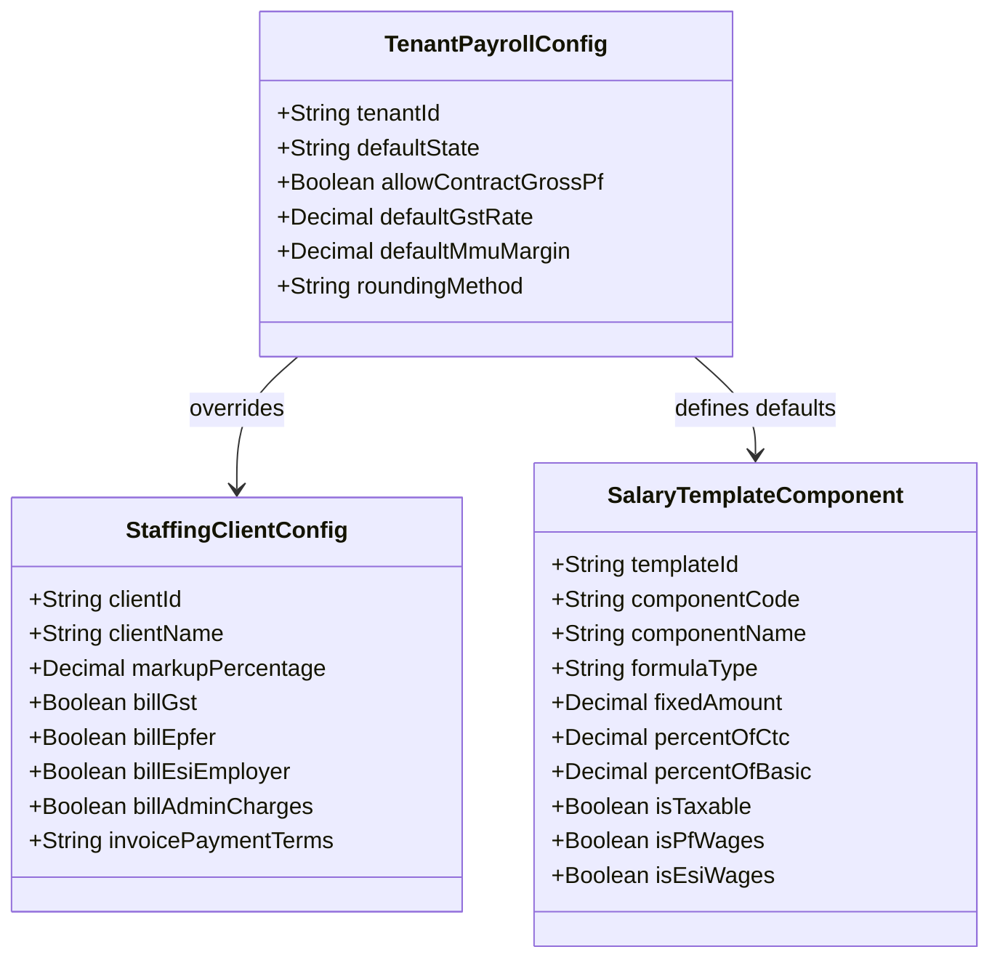

# MASTERHRMS — PAYROLL HARDCODED VALUE AUDIT
## Codebase-Wide Inventory of Static Assumptions & Dynamic Replacement Plan

> **Audit Objective**: Identify, catalog, and provide dynamic replacement architecture for all hardcoded constants, percentages, tax rates, establishment fallbacks, and component allocations across MASTERHRMS  
> **Reference File**: `Paysheet_ENABL_OCT_2026 -Final.xlsx`  
> **Audited Modules**: `server/src/services/payroll-engine.service.ts`, `server/src/services/payroll-export.service.ts`, `server/src/services/statutory-form-data.service.ts`, `server/src/routes/invoices.routes.ts`, `server/src/routes/payroll.routes.ts`  
> **Mode**: Strict Read-Only Audit (Zero code edits, zero schema migrations)

---

## 1. Executive Summary & Hardcoded Inventory

A total of **14 critical hardcoded instances** were uncovered across the payroll, export, statutory, and billing code paths. These static values create calculation inaccuracies, legal exposure, or rigid assumptions when onboarding diverse client contracts (such as the reference staffing contract for `Enable Engineering Private Limited`).

| Finding ID | Source File & Line | Hardcoded Item / Value | Impact & Risk | Dynamic Replacement Solution | Severity |
| :---: | :--- | :--- | :--- | :--- | :---: |
| **HC-01** | `payroll-export.service.ts:222-223` | `fixConveyance = 1600`<br>`fixMedical = 1250` | Fabricates non-existent allowances in Excel exports | Read directly from `SalaryAssignment.components` or structure items | **Critical** |
| **HC-02** | `payroll-engine.service.ts:822-827` | Standard 50-20-15-5-5-5 percentage splits | Overrides contract-specific structures when default applies | Evaluate tenant / client-level `SalaryTemplate` rules | **High** |
| **HC-03** | `payroll-engine.service.ts:810` | `baseMonthlyCtc || 35000` | Fabricates ₹35,000 CTC if salary is null | Throw validation error or require explicit minimum wage | **Medium** |
| **HC-04** | `payroll-engine.service.ts:165` | `state = "MH"` | Defaults employee state to Maharashtra | Derive from `Employee.workLocation` or `Tenant.state` | **High** |
| **HC-05** | `payroll-engine.service.ts:264` | `monthlyEarnedGross > 10000 ? 200 : 0` | Fallback PT cap of ₹200 for unknown states | Enforce state resolution or zero if state is unmapped | **Medium** |
| **HC-06** | `statutory-form-data.service.ts:694` | `empPt = 200` | Static ₹200 PT in statutory fallback | Execute `calculateProfessionalTax(gross, state, month)` | **High** |
| **HC-07** | `statutory-form-data.service.ts:695` | `empTds = Math.round(empMonthlyGross * 0.05)` | Fabricates flat 5% TDS when payslip is missing | Return zero or invoke projected `calculateAnnualTDS` | **High** |
| **HC-08** | `statutory-form-data.service.ts:698` | `daysWorked = 30` | Static 30 days worked regardless of month length | Calculate calendar days: `new Date(year, month, 0).getDate()` | **Medium** |
| **HC-09** | `invoices.routes.ts:1696-1698` | `"billing@tsvsolutions.com"`<br>`"+91 98765 43210"`<br>`"Headquarters Building, Chennai"` | Hardcoded agency contact info on client invoices | Pull from `Tenant.billingEmail`, `Tenant.phone`, `Tenant.address` | **High** |
| **HC-10** | `payroll.routes.ts:1237` | Standard 12% PF on Basic | Bypasses contract gross PF billing option | Add `pfWageBasis` flag: `BASIC_ONLY` vs `EARNED_GROSS` | **Medium** |
| **HC-11** | Staffing Billing | 10% MMU contractor markup | Assumes all agency clients have 10% margin | Read from `StaffingClient.markupPercentage` | **High** |
| **HC-12** | Client Invoicing | 18% GST tax rate | Assumes single GST rate across all service types | Read from `TenantTaxConfig.gstRate` | **Low** |
| **HC-13** | ESI Regulations | Rounding to standard 2 decimals | Law mandates rounding to next higher rupee | Implement `Math.ceil(val)` for employee ESI | **Medium** |
| **HC-14** | Reference Excel Sheet | ESI rates: 4.75% / 1.75% | Excel references repealed pre-2019 statutory rates | Keep HRMS dynamic 3.25% / 0.75% with contract legacy override | **Critical** |

---

## 2. In-Depth Technical Analysis of Critical Findings

### 2.1 Finding HC-01: Fabricated Conveyance & Medical in Exports
In `server/src/services/payroll-export.service.ts` (lines 220–225):
```typescript
// CURRENT DEFECTIVE CODE:
const fixBasic = monthlyCtc * 0.5;
const fixHra = monthlyCtc * 0.2;
const fixConveyance = 1600;  // <-- HARDCODED CONSTANT
const fixMedical = 1250;     // <-- HARDCODED CONSTANT
const fixSpecial = Math.max(0, monthlyCtc - (fixBasic + fixHra + fixConveyance + fixMedical));
```
- **The Issue**:  
  When an organization does not offer Conveyance or Medical allowance (such as the reference contract staffing workforce, which only has Basic, Special Allowance, and Statutory Bonus), the export service arbitrarily deducts ₹2,850 (₹1600 + ₹1250) from the employee's Special Allowance and injects fabricated allowances into the canonical export workbook!
- **Remediation**:
  ```typescript
  // REQUIRED DYNAMIC REPLACEMENT:
  const componentMap = new Map(assignment?.components?.map((c: any) => [c.componentCode, Number(c.amount)]) || []);
  const fixBasic = componentMap.get('BASIC') ?? (monthlyCtc * (structure?.basicPercent ?? 0.5));
  const fixHra = componentMap.get('HRA') ?? (monthlyCtc * (structure?.hraPercent ?? 0.2));
  const fixConveyance = componentMap.get('CONVEYANCE') ?? 0;
  const fixMedical = componentMap.get('MEDICAL') ?? 0;
  const fixSpecial = componentMap.get('SPECIAL') ?? Math.max(0, monthlyCtc - (fixBasic + fixHra + fixConveyance + fixMedical));
  ```

---

### 2.2 Finding HC-02: Hardcoded 50-20-15-5-5-5 Percentage Allocation
In `server/src/services/payroll-engine.service.ts` (lines 821–827):
```typescript
// CURRENT DEFECTIVE CODE:
const basicSalary = Math.round(salaryGrossProrated * 0.50 * 100) / 100;
const hra = Math.round(salaryGrossProrated * 0.20 * 100) / 100;
const specialAllowance = Math.round(salaryGrossProrated * 0.15 * 100) / 100;
const conveyance = Math.round(salaryGrossProrated * 0.05 * 100) / 100;
const medical = Math.round(salaryGrossProrated * 0.05 * 100) / 100;
const otherAllowance = Math.max(0, Math.round((salaryGrossProrated - (basicSalary + hra + specialAllowance + conveyance + medical)) * 100) / 100);
```
- **The Issue**:  
  This rigid allocation is hardcoded directly into the calculation loop. While convenient as a default fallback, it cannot adapt to clients with differing statutory structures (e.g. 60% Basic, 0% HRA, 30% Special, 10% Bonus).
- **Remediation**:  
  Create a tenant-level and client-level `SalaryTemplate` table in PostgreSQL that stores component formula expressions (e.g. `BASIC = CTC * 0.50`, `BONUS = BASIC * 0.0833`).

---

### 2.3 Finding HC-09: Hardcoded Agency Identity on Client Invoices
In `server/src/routes/invoices.routes.ts` (lines 1695–1698):
```typescript
// CURRENT DEFECTIVE CODE:
company: {
  name: sale.tenant?.name || "TSV Global Solutions Pvt Ltd",
  email: "billing@tsvsolutions.com",
  phone: "+91 98765 43210",
  address: (sale.warehouse as any)?.location || "Headquarters Building, Chennai",
  currency: "INR",
  currencySymbol: "₹",
}
```
- **The Issue**:  
  In multi-tenant or white-labeled staffing environments, invoices generated for clients would show static placeholder emails and phone numbers instead of the legal entity's registered establishment details.
- **Remediation**:  
  Store establishment identity in `Tenant` / `TenantProfile` models:
  - `tenant.legalEntityName`
  - `tenant.gstin`
  - `tenant.panNumber`
  - `tenant.registeredAddress`
  - `tenant.billingEmail`
  - `tenant.billingPhone`

---

## 3. Dynamic Configuration Architecture (Target State)



---

## 4. Audit Sign-off

- **Audit Date**: 2026-11-03
- **Auditor**: MASTERHRMS Core Architecture Team
- **Document**: `docs/hrms-audit/PAYROLL_HARDCODED_VALUE_AUDIT.md`
- **Next Step**: Comprehensive Roadmap in `PAYROLL_AUTOMATION_IMPLEMENTATION_ROADMAP.md`.

