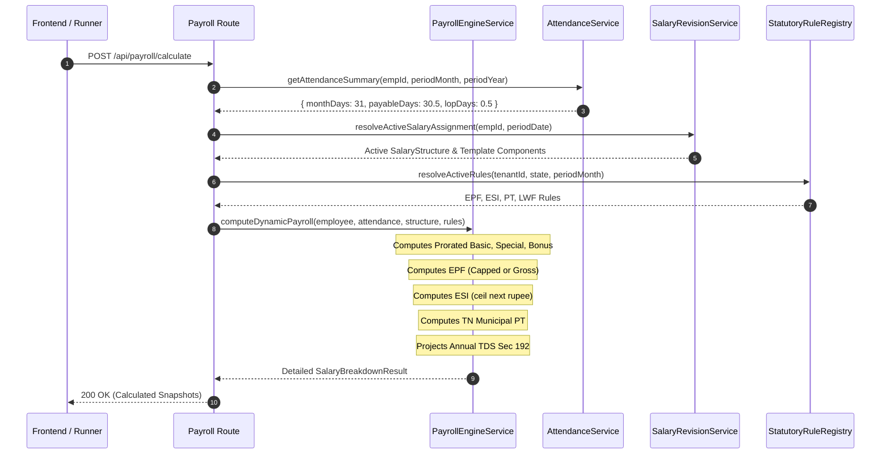

# MASTERHRMS — PAYROLL WORKSTREAM A IMPLEMENTATION PLAN
## Dynamic Payroll Engine, Proration, Statutory Rules & Fallback Removal

> **Workstream**: A — Core Dynamic Payroll Engine  
> **Status**: APPROVED FOR PLANNING ONLY (Strict Read-Only Mode — Zero Code/Schema Changes)  
> **Reference Workbook**: `Paysheet_ENABL_OCT_2026 -Final.xlsx`  
> **Audit Gap IDs**: `GAP-OCT-001` through `GAP-OCT-018`, `HC-01`, `HC-02`, `HC-03`, `HC-04`, `HC-05`, `HC-10`, `HC-13`, `HC-14`

---

## 1. Objectives & Scope

Workstream A transforms the core compensation and deduction engine into a 100% dynamic, legally verified calculation pipeline. It resolves:
1. Proration based on exact calendar days and payable attendance.
2. Effective-dated salary structures without static split fallbacks.
3. Explicit monthly statutory bonus calculation.
4. Dual-mode statutory contributions (Statutory Capped vs Contract Gross PF).
5. Amended ESI (3.25% / 0.75%) with next-higher-rupee rounding.
6. Removal of all hardcoded allowance fallbacks in export services.

---

## 2. Identified Audit Gaps & Target Remediation

| Gap ID | Description in Audit Reports | Location in Codebase | Target Dynamic Behavior |
| :---: | :--- | :--- | :--- |
| **HC-01** | Fabricated ₹1600 conveyance & ₹1250 medical in export | `payroll-export.service.ts:222` | Read components directly from `SalaryAssignment` or template. Zero if absent. |
| **HC-02** | Hardcoded 50-20-15-5-5-5 salary allocation | `payroll-engine.service.ts:821` | Introduce `SalaryTemplate` with dynamic mathematical formula evaluation. |
| **HC-03** | Fallback ₹35,000 monthly CTC when base is null | `payroll-engine.service.ts:810` | Require explicit salary assignment or throw `UNCONFIGURED_SALARY` error. |
| **HC-04** | Hardcoded state fallback `"MH"` (Maharashtra) | `payroll-engine.service.ts:165` | Derive state from `Employee.workLocation` or `Tenant.registeredState`. |
| **HC-05** | Fallback PT cap of ₹200 for unmapped states | `payroll-engine.service.ts:264` | Explicit state tax lookup; evaluate to ₹0 if state does not levy professional tax. |
| **HC-10** | Uncapped Gross PF in Contract Sheet vs Statutory Cap | `payroll-engine.service.ts:286` | Provide configurable flag: `STATUTORY_CAPPED` (Basic+DA up to ₹15k) vs `CONTRACT_GROSS`. |
| **HC-13** | ESI rounding to two decimal places | `payroll-engine.service.ts:318` | Implement statutory rule: employee share rounded to **next higher whole rupee** (ESI Reg 52). |
| **HC-14** | Outdated 4.75% / 1.75% ESI rates in Excel | Reference Sheet | HRMS keeps legally valid 3.25% / 0.75% as default; contract legacy override optional. |

---

## 3. Database Models & Migration Requirements

### 3.1 Migration 1: Apply Pending P0/P1 Native Columns
The accepted P0/P1 migration adds critical statutory columns to the `Employee` table in PostgreSQL:
* `father_or_spouse_name` (`VarChar(255)`)
* `permanent_address` (`Text`)
* `present_address` (`Text`)
* `completion_480_days_date` (`Date`)
* `permanent_employment_date` (`Date`)
* `maternity_nomination_date` (`Date`)

### 3.2 Migration 2: SalaryTemplate & Dynamic Components
Introduce a multi-tenant dynamic template model in `server/prisma/schema.prisma`:
```prisma
model SalaryTemplate {
  id             String                    @id @default(uuid())
  tenantId       String
  name           String                    @db.VarChar(100)
  description    String?                   @db.Text
  isDefault      Boolean                   @default(false)
  components     SalaryTemplateComponent[]
  tenant         Tenant                    @relation(fields: [tenantId], references: [id], onDelete: Cascade)
  createdAt      DateTime                  @default(now())
  updatedAt      DateTime                  @updatedAt

  @@unique([tenantId, name])
  @@index([tenantId])
}

model SalaryTemplateComponent {
  id             String         @id @default(uuid())
  templateId     String
  componentCode  String         @db.VarChar(50) // BASIC, HRA, SPECIAL, BONUS
  componentName  String         @db.VarChar(100)
  type           ComponentType  // EARNING, DEDUCTION, STATUTORY
  formulaType    FormulaType    // PERCENTAGE_OF_CTC, PERCENTAGE_OF_BASIC, FIXED_AMOUNT
  formulaValue   Decimal        @db.Decimal(10, 4) // e.g. 0.5000 for 50%
  isTaxable      Boolean        @default(true)
  isPfWage       Boolean        @default(false)
  isEsiWage      Boolean        @default(false)
  template       SalaryTemplate @relation(fields: [templateId], references: [id], onDelete: Cascade)

  @@unique([templateId, componentCode])
  @@index([templateId])
}
```

### 3.3 Migration 3: PayrollSnapshot Native Statutory Columns
Extend `PayrollSnapshot` in `schema.prisma` with discrete earning/deduction fields:
* `bonusEarned` (`Decimal(12,2) DEFAULT 0`)
* `specialAllowanceEarned` (`Decimal(12,2) DEFAULT 0`)
* `insuranceEmployer` (`Decimal(12,2) DEFAULT 0`)
* `pfWageBasis` (`String DEFAULT 'STATUTORY_CAPPED'`)

---

## 4. Backend Service Architecture & Logic Flow



### 4.1 Detailed Calculation Specifications

#### 1. Prorated Earnings
$$\text{Proration Factor} = \frac{\text{Payable Days}}{\text{Days in Month}}$$
$$\text{Basic Earned} = \text{ROUND}\left(\text{Fixed Basic} \times \text{Proration Factor}, 0\right)$$
$$\text{Special Allowance Earned} = \text{ROUND}\left(\text{Fixed Special Allowance} \times \text{Proration Factor}, 0\right)$$
$$\text{Statutory Bonus Earned} = \text{ROUND}\left(\text{Fixed Bonus} \times \text{Proration Factor}, 0\right)$$
$$\text{Gross Wages} = \sum(\text{All Earned Components}) + \text{Overtime Amount} + \text{Arrears}$$

#### 2. EPF Statutory vs Contract Gross
* **Statutory Standard Mode** (Default):
  $$\text{PF Wages} = \min\left(15000, \text{Basic Earned} + \text{DA Earned}\right)$$
  $$\text{Employee PF} = \text{ROUND}\left(\text{PF Wages} \times 12\%, 0\right)$$
  $$\text{EPS (Pension)} = \min\left(1250, \text{ROUND}(\text{PF Wages} \times 8.33\%, 0)\right)$$
  $$\text{Employer EPF} = \text{Employee PF} - \text{EPS}$$
  $$\text{EDLI} = \text{ROUND}(\text{PF Wages} \times 0.5\%, 0) \quad [\text{Max ₹75}]$$
  $$\text{PF Admin} = \text{ROUND}(\text{PF Wages} \times 0.5\%, 0) \quad [\text{Min ₹500/est}]$$
* **Contract Gross Mode** (Reference Excel Compatibility):
  $$\text{PF Wages} = \text{Gross Wages}$$
  $$\text{Employee PF} = \text{Employer PF} = \text{ROUND}\left(\text{Gross Wages} \times 12\%, 0\right)$$

#### 3. ESI Amended 2019 Legal Rules
$$\text{If Gross Wages} > 21000 \implies \text{ESI} = 0$$
$$\text{Employee ESI} = \lceil \text{Gross Wages} \times 0.0075 \rceil \quad (\text{Next Higher Whole Rupee})$$
$$\text{Employer ESI} = \text{ROUND}\left(\text{Gross Wages} \times 0.0325, 0\right)$$

#### 4. Professional Tax (Tamil Nadu Slabs)
$$\text{Half-Yearly Gross} = \text{Monthly Earned Gross} \times 6$$
* Up to ₹21,000: Nil
* ₹21,001 to ₹30,000: ₹16.67/month (₹100 half-yearly)
* ₹30,001 to ₹45,000: ₹39.17/month (₹235 half-yearly)
* ₹45,001 to ₹60,000: ₹85.00/month (₹510 half-yearly)
* ₹60,001 to ₹75,000: ₹126.67/month (₹760 half-yearly)
* Above ₹75,000: ₹208.33/month (₹1,250 half-yearly; Constitutional Cap ₹2,500/yr)

---

## 5. API Endpoints

| HTTP Method | Route | Description | Auth / Security |
| :--- | :--- | :--- | :--- |
| `GET` | `/api/payroll/salary-templates` | List tenant salary structure templates | `requireAuth`, `resolveTenantContext` |
| `POST` | `/api/payroll/salary-templates` | Create custom template with component formulas | `requireRole('admin', 'hr_manager')` |
| `PUT` | `/api/payroll/salary-templates/:id` | Update template formula rules | `requireRole('admin', 'hr_manager')` |
| `POST` | `/api/payroll/calculate` | Execute dynamic dry-run payroll preview | `requireRole('admin', 'hr_manager')` |
| `GET` | `/api/payroll/export-canonical/:id` | Export XLSX matching reference format | `requireRole('admin', 'hr_manager')` |

---

## 6. Security, Tenant Isolation & Implementation Order

1. **Tenant Isolation**: Every SQL query and Prisma operation strictly includes `tenantId: req.tenantId`.
2. **Implementation Sequence**:
   - Step A.1: Database migrations (apply pending P0 native columns, create `SalaryTemplate`).
   - Step A.2: Refactor `payroll-engine.service.ts` to consume dynamic templates and eliminate 50-20-15-5-5-5 splits.
   - Step A.3: Refactor `calculateStatutoryESI` to enforce next-higher-rupee rounding (`Math.ceil`).
   - Step A.4: Refactor `calculateStatutoryEPF` to support `STATUTORY_CAPPED` vs `CONTRACT_GROSS`.
   - Step A.5: Refactor `payroll-export.service.ts` to remove hardcoded ₹1600 conveyance and ₹1250 medical constants.
3. **Complexity**: High (Core mathematical engine). Estimated execution: 2 Days.

---

## 7. Acceptance Test Criteria & Rollback Plan

### Acceptance Criteria
- [ ] 11 reference employees from `OCT 2026 - Final` run through dynamic engine without hardcoded fallbacks.
- [ ] Proration matches reference sheet to 0.00% variance for all payable day counts.
- [ ] ESI employee share rounds up to the next integer rupee for all eligible employees.
- [ ] Export service outputs exact values without injecting fictitious conveyance or medical allowances.
- [ ] Zero hardcoded constants detected by static lint checks.

### Rollback Strategy
If mathematical divergence is detected during test runs:
1. Engine retains a feature flag: `useDynamicSalaryTemplates: boolean`.
2. Revert flag to `false` to immediately restore previous calculation paths while preserving data integrity.
3. Database migrations use non-destructive column additions; rollback requires zero schema drops.

