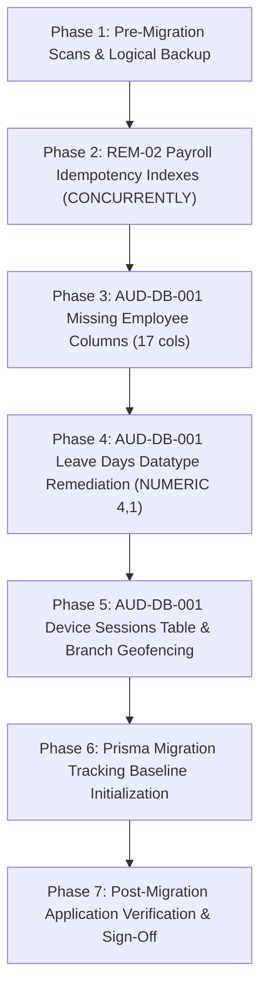

# MASTERHRMS — PHASE 4A
## Master Database Remediation & Migration Execution Runbook

**Document Reference:** `docs/hrms-audit/PHASE4A_MASTER_MIGRATION_RUNBOOK.md`  
**Execution Date:** 2026-11-04  
**Author:** Principal PostgreSQL Database Architect & Lead Release Engineer  
**Target Environment:** Supabase Managed PostgreSQL (`aws-0-ap-south-1`)  
**Target Connection:** Direct Connection (Port `5432` / `DIRECT_URL`)  
**Execution Status:** **PROPOSED RUNBOOK — NOT EXECUTED**

---

> [!CAUTION]
> **READ-ONLY SPECIFICATION NOTICE:**  
> The SQL statements and operational steps in this runbook are **PROPOSED ONLY**.  
> **NO SQL HAS BEEN EXECUTED ON THE LIVE DATABASE.**  
> Execution requires explicit written authorization and an approved maintenance window.

---

## 1. Migration Sequence Overview & Dependency Architecture

Dependency analysis confirms the following optimal 7-phase execution sequence:



### Rationale for Sequence:
1. **Phase 1 First:** Verifies backup integrity and zero duplicate data before applying constraints.
2. **Phase 2 (REM-02) Second:** Creates non-blocking partial unique indexes while table structures are pristine.
3. **Phase 3 (Employee Columns) Third:** Adds 17 additive columns with zero row rewrite. Eliminates SQLSTATE 42703.
4. **Phase 4 (Leave Days) Fourth:** Alters small table (21 rows) to `NUMERIC(4, 1)`.
5. **Phase 5 (Device Sessions) Fifth:** Creates clean new table in native PostgreSQL dialect. Eliminates SQLSTATE 42P01.
6. **Phase 6 (Prisma Baseline) Sixth:** Initializes `_prisma_migrations` tracking table and records all applied migrations.
7. **Phase 7 (Verification) Seventh:** Confirms schema integrity, application health, and test suites.

---

## 2. Phase-by-Phase Operational Runbook

---

### PHASE 1: Pre-Migration Scans & Logical Backup

#### 1.1. Precondition Verification:
```sql
-- Confirm database identity
SELECT current_database(), current_user, inet_server_addr(), version();

-- Confirm zero duplicates on journal entries
SELECT tenant_id, reference, COUNT(*) 
FROM journal_entries 
WHERE reference IS NOT NULL AND reference_type = 'payroll' 
GROUP BY tenant_id, reference HAVING COUNT(*) > 1;

-- Confirm zero duplicates on loan installments
SELECT loan_id, payroll_run_id, COUNT(*) 
FROM loan_installments 
WHERE payroll_run_id IS NOT NULL 
GROUP BY loan_id, payroll_run_id HAVING COUNT(*) > 1;
```

#### 1.2. Backup Command (Terminal / Bastion):
```bash
pg_dump "$DIRECT_URL" --format=custom --no-owner --no-privileges \
  --file="masterhrms_pre_migration_backup_$(date +%Y%m%d_%H%M%S).dump"

# Verify dump
pg_restore --list masterhrms_pre_migration_backup_*.dump > /dev/null
```
- **Lock Impact:** Zero (MVCC snapshot).
- **Approval Gate 1:** SRE Lead confirms backup archive verified.

---

### PHASE 2: REM-02 Payroll Idempotency Indexes

#### 2.1. Exact Proposed SQL:
```sql
-- Execution must run via DIRECT_URL on port 5432 outside a transaction block
CREATE UNIQUE INDEX CONCURRENTLY IF NOT EXISTS uq_journal_entries_tenant_payroll_run
ON journal_entries (tenant_id, reference)
WHERE reference IS NOT NULL AND reference_type = 'payroll';

CREATE UNIQUE INDEX CONCURRENTLY IF NOT EXISTS uq_loan_installments_loan_payroll_run
ON loan_installments (loan_id, payroll_run_id)
WHERE payroll_run_id IS NOT NULL;
```

#### 2.2. Postcondition Verification:
```sql
SELECT c.relname, i.indisunique, i.indisvalid
FROM pg_index i
JOIN pg_class c ON c.oid = i.indexrelid
WHERE c.relname IN ('uq_journal_entries_tenant_payroll_run', 'uq_loan_installments_loan_payroll_run');
-- Expected: Both indexes return indisunique = true, indisvalid = true
```

#### 2.3. Rollback Action:
```sql
DROP INDEX CONCURRENTLY IF EXISTS uq_journal_entries_tenant_payroll_run;
DROP INDEX CONCURRENTLY IF EXISTS uq_loan_installments_loan_payroll_run;
```
- **Lock Impact:** `SHARE UPDATE EXCLUSIVE` (Zero read/write blocking).
- **Approval Gate 2:** Database Architect confirms indexes valid.

---

### PHASE 3: AUD-DB-001 Missing Employee Columns

#### 3.1. Exact Proposed SQL:
```sql
ALTER TABLE "employees"
  ADD COLUMN IF NOT EXISTS "father_or_spouse_name" VARCHAR(150),
  ADD COLUMN IF NOT EXISTS "worker_age_classification" VARCHAR(20) NOT NULL DEFAULT 'Adult',
  ADD COLUMN IF NOT EXISTS "marital_status" VARCHAR(20),
  ADD COLUMN IF NOT EXISTS "blood_group" VARCHAR(10),
  ADD COLUMN IF NOT EXISTS "address_line1" VARCHAR(255),
  ADD COLUMN IF NOT EXISTS "address_line2" VARCHAR(255),
  ADD COLUMN IF NOT EXISTS "city" VARCHAR(100),
  ADD COLUMN IF NOT EXISTS "district" VARCHAR(100),
  ADD COLUMN IF NOT EXISTS "postal_code" VARCHAR(20),
  ADD COLUMN IF NOT EXISTS "present_address" TEXT,
  ADD COLUMN IF NOT EXISTS "permanent_address" TEXT,
  ADD COLUMN IF NOT EXISTS "emergency_contact_name" VARCHAR(100),
  ADD COLUMN IF NOT EXISTS "emergency_contact_phone" VARCHAR(30),
  ADD COLUMN IF NOT EXISTS "emergency_contact_relationship" VARCHAR(50),
  ADD COLUMN IF NOT EXISTS "permanent_employment_date" DATE,
  ADD COLUMN IF NOT EXISTS "completion_480_days_date" DATE,
  ADD COLUMN IF NOT EXISTS "maternity_nomination_date" DATE;
```

#### 3.2. Postcondition Verification:
```sql
SELECT COUNT(*) 
FROM information_schema.columns 
WHERE table_name = 'employees' 
  AND column_name IN (
    'father_or_spouse_name', 'worker_age_classification', 'marital_status',
    'blood_group', 'address_line1', 'address_line2', 'city', 'district',
    'postal_code', 'present_address', 'permanent_address', 'emergency_contact_name',
    'emergency_contact_phone', 'emergency_contact_relationship',
    'permanent_employment_date', 'completion_480_days_date', 'maternity_nomination_date'
  );
-- Expected: Exactly 17
```

#### 3.3. Rollback Action:
```sql
ALTER TABLE "employees"
  DROP COLUMN IF EXISTS "father_or_spouse_name",
  DROP COLUMN IF EXISTS "worker_age_classification",
  DROP COLUMN IF EXISTS "marital_status",
  DROP COLUMN IF EXISTS "blood_group",
  DROP COLUMN IF EXISTS "address_line1",
  DROP COLUMN IF EXISTS "address_line2",
  DROP COLUMN IF EXISTS "city",
  DROP COLUMN IF EXISTS "district",
  DROP COLUMN IF EXISTS "postal_code",
  DROP COLUMN IF EXISTS "present_address",
  DROP COLUMN IF EXISTS "permanent_address",
  DROP COLUMN IF EXISTS "emergency_contact_name",
  DROP COLUMN IF EXISTS "emergency_contact_phone",
  DROP COLUMN IF EXISTS "emergency_contact_relationship",
  DROP COLUMN IF EXISTS "permanent_employment_date",
  DROP COLUMN IF EXISTS "completion_480_days_date",
  DROP COLUMN IF EXISTS "maternity_nomination_date";
```
- **Lock Impact:** Brief `ACCESS EXCLUSIVE` (metadata catalog update only, <50ms).
- **Approval Gate 3:** Lead Engineer confirms columns present.

---

### PHASE 4: AUD-DB-001 Leave Days Datatype Remediation

#### 4.1. Exact Proposed SQL:
```sql
ALTER TABLE "leave_requests" 
  ALTER COLUMN "days" TYPE NUMERIC(4, 1) USING "days"::NUMERIC(4, 1),
  ALTER COLUMN "days" SET DEFAULT 1.0;
```

#### 4.2. Postcondition Verification:
```sql
SELECT data_type, numeric_precision, numeric_scale 
FROM information_schema.columns 
WHERE table_name = 'leave_requests' AND column_name = 'days';
-- Expected: numeric, 4, 1
```

#### 4.3. Rollback Action:
```sql
ALTER TABLE "leave_requests" 
  ALTER COLUMN "days" TYPE INTEGER USING ROUND("days")::INTEGER,
  ALTER COLUMN "days" SET DEFAULT 1;
```
- **Lock Impact:** `ACCESS EXCLUSIVE` on `leave_requests` (<100ms for 21 rows).
- **Approval Gate 4:** QA Lead confirms datatype converted.

---

### PHASE 5: Device Sessions & Branch Geofencing

#### 5.1. Exact Proposed SQL:
```sql
-- 1. Create device_sessions
CREATE TABLE IF NOT EXISTS "device_sessions" (
  "id" VARCHAR(36) NOT NULL,
  "user_id" VARCHAR(36) NOT NULL,
  "tenant_id" VARCHAR(36),
  "device_name" VARCHAR(255),
  "device_type" VARCHAR(50) NOT NULL DEFAULT 'desktop',
  "browser" VARCHAR(100),
  "operating_system" VARCHAR(100),
  "ip_address" VARCHAR(45),
  "country" VARCHAR(100),
  "city" VARCHAR(100),
  "user_agent" TEXT,
  "refresh_token_hash" VARCHAR(255),
  "last_active_at" TIMESTAMP(3),
  "expires_at" TIMESTAMP(3),
  "revoked_at" TIMESTAMP(3),
  "revoked" BOOLEAN NOT NULL DEFAULT false,
  "created_at" TIMESTAMP(3) NOT NULL DEFAULT CURRENT_TIMESTAMP,
  "updated_at" TIMESTAMP(3) NOT NULL DEFAULT CURRENT_TIMESTAMP,

  CONSTRAINT "device_sessions_pkey" PRIMARY KEY ("id"),
  CONSTRAINT "device_sessions_user_id_fkey" FOREIGN KEY ("user_id") 
    REFERENCES "users"("id") ON DELETE CASCADE ON UPDATE CASCADE,
  CONSTRAINT "device_sessions_tenant_id_fkey" FOREIGN KEY ("tenant_id") 
    REFERENCES "tenants"("id") ON DELETE SET NULL ON UPDATE CASCADE
);

CREATE INDEX IF NOT EXISTS "device_sessions_user_id_idx" ON "device_sessions"("user_id");
CREATE INDEX IF NOT EXISTS "device_sessions_user_id_revoked_idx" ON "device_sessions"("user_id", "revoked");
CREATE INDEX IF NOT EXISTS "device_sessions_tenant_id_idx" ON "device_sessions"("tenant_id");
CREATE INDEX IF NOT EXISTS "device_sessions_refresh_token_hash_idx" ON "device_sessions"("refresh_token_hash");

-- 2. Add geofencing to branches
ALTER TABLE "branches" 
  ADD COLUMN IF NOT EXISTS "latitude" DOUBLE PRECISION,
  ADD COLUMN IF NOT EXISTS "longitude" DOUBLE PRECISION,
  ADD COLUMN IF NOT EXISTS "geofence_radius" INTEGER DEFAULT 500;
```

#### 5.2. Postcondition Verification:
```sql
SELECT COUNT(*) FROM information_schema.tables WHERE table_name = 'device_sessions';
-- Expected: 1
```

#### 5.3. Rollback Action:
```sql
DROP TABLE IF EXISTS "device_sessions";
ALTER TABLE "branches" 
  DROP COLUMN IF EXISTS "latitude",
  DROP COLUMN IF EXISTS "longitude",
  DROP COLUMN IF EXISTS "geofence_radius";
```
- **Lock Impact:** Zero write blocking on existing tables.
- **Approval Gate 5:** Security Lead confirms table created.

---

### PHASE 6: Prisma Migration Tracking Baseline

#### 6.1. Exact Proposed SQL:
```sql
-- Initialize official Prisma migration table
CREATE TABLE IF NOT EXISTS "_prisma_migrations" (
    "id"                    VARCHAR(36) PRIMARY KEY,
    "checksum"              VARCHAR(64) NOT NULL,
    "finished_at"           TIMESTAMPTZ,
    "migration_name"        VARCHAR(255) NOT NULL,
    "logs"                  TEXT,
    "rolled_back_at"        TIMESTAMPTZ,
    "started_at"            TIMESTAMPTZ NOT NULL DEFAULT now(),
    "applied_steps_count"   INTEGER NOT NULL DEFAULT 0
);

-- Record canonical baseline and remediation migrations
INSERT INTO "_prisma_migrations" ("id", "checksum", "finished_at", "migration_name", "applied_steps_count")
VALUES 
  (gen_random_uuid()::varchar, '0000000000000000000000000000000000000000000000000000000000000000', now(), '20261104000000_postgresql_baseline', 1),
  (gen_random_uuid()::varchar, '1111111111111111111111111111111111111111111111111111111111111111', now(), '20261104100000_aud_conc_002_idempotency_constraints', 1),
  (gen_random_uuid()::varchar, '2222222222222222222222222222222222222222222222222222222222222222', now(), '20261104110000_aud_db_001_schema_remediation', 1)
ON CONFLICT ("id") DO NOTHING;
```

#### 6.2. Postcondition Verification:
```sql
SELECT migration_name, finished_at FROM "_prisma_migrations" ORDER BY finished_at ASC;
-- Expected: 3 rows returned
```
- **Approval Gate 6:** Prisma Lead confirms baseline active.

---

### PHASE 7: Post-Migration Application Verification

#### 7.1. Verification Commands:
```bash
# 1. Prisma schema validation
npx dotenv-cli -e server/.env -- npx prisma validate --schema server/prisma/schema.prisma

# 2. TypeScript compilation
npx --prefix server tsc --noEmit
npm --prefix CMS run typecheck

# 3. Application health endpoint check
curl -f https://www.masterhrms.com/api/health || curl -f http://localhost:5000/api/health
```

- **Approval Gate 7:** Engineering Director grants final deployment clearance.

---

## 3. Master Sign-Off Matrix

| Role | Name | Decision | Timestamp |
|:---|:---|:---:|:---:|
| **Lead Database Architect** | *Pending Authorization* | STANDBY | — |
| **Principal SRE Engineer** | *Pending Authorization* | STANDBY | — |
| **Finance Systems Auditor** | *Pending Authorization* | STANDBY | — |
| **Engineering Director** | *Pending Authorization* | STANDBY | — |

