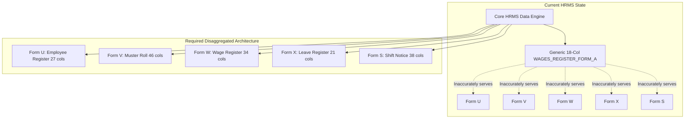

# MASTERHRMS — STATUTORY FORMS RECONCILIATION
## Tamil Nadu Statutory Registers vs HRMS Implementation Reality

> **Audit Scope**: Form U, Form V, FORM W, Form X, and FORM S Compliance under the Tamil Nadu Shops and Establishments Act, 1947 & Rules, 1948  
> **Reference File**: `Paysheet_ENABL_OCT_2026 -Final.xlsx`  
> **Target Source Code**: `server/src/services/statutory-form-data.service.ts`, `server/src/services/statutory-return.service.ts`, `server/prisma/schema.prisma`  
> **Mode**: Strict Read-Only Audit (Zero code edits, zero schema migrations)

---

## 1. Executive Summary & The "Single Generic Fallback" Defect

In the reference Excel workbook, the contractor maintains five distinct statutory registers corresponding to statutory requirements under Tamil Nadu Labor Rules:
1. **Form U**: Employee Register [Rule 16(1)] (27 columns)
2. **Form V**: Register of Employment / Muster Roll [Rule 16(1)] (46 columns)
3. **FORM W**: Register of Wages [Rule 16(1)] (34 columns)
4. **Form X**: Register of Leave and Social Security Benefits [Rule 16(1)] (21 columns)
5. **FORM S**: Notice of Daily Hours of Work & Shifts [Rule 18(4)] (38 columns)

### Architectural Defect in Existing HRMS
In `server/src/services/statutory-form-data.service.ts` (lines 644–651):
```typescript
case "FORM_U":
case "FORM_V":
case "FORM_W":
case "FORM_X":
case "FORM_S":
case "WAGES_REGISTER_FORM_A":
default: {
  // Collapses all five distinct statutory forms into an identical 18-column array!
  const rosterRows = allTenantEmployees.map((emp, idx) => ({
    slNo: idx + 1,
    employeeCode: emp.employeeCode,
    employeeName: `${emp.firstName} ${emp.lastName}`.trim(),
    designation: emp.position || "Staff",
    department: emp.department?.name || "General",
    daysWorked,
    lopDays,
    basicSalary: empBasic,
    hra: empHra,
    otherAllowances: empOther,
    overtime: 0,
    grossWages: empGross,
    epfDeduction: empEpf,
    esiDeduction: empEsi,
    ptDeduction: empPt,
    tdsDeduction: empTds,
    otherDeductions: 0,
    totalDeductions: empTotalDed,
    netWages: empNet,
  }));
}
```

> [!CAUTION]
> **Statutory Inspection Risk**: Generating an identical 18-column wages layout when an enforcement officer or labor auditor requests an **Employee Register (Form U)**, a **31-Day Muster Roll (Form V)**, a **Leave Register (Form X)**, or a **Shift Schedule (Form S)** constitutes non-compliance under Rule 16 & Rule 18 of the Tamil Nadu Shops and Establishments Rules.

---

## 2. Disaggregated Statutory Analysis



---

## 3. Form-by-Form Column Reconciliation

### 3.1 Form U — Employee Register [Rule 16(1)] (27 Columns)
**Statutory Objective**: Complete statutory master of all personnel admitted into service.

| Col # | Excel Header Name | HRMS Database Field | Status | Missing / Remediation Required |
| :---: | :--- | :--- | :---: | :--- |
| **1** | Serial Number | Auto-increment index | **POPULATED** | None. |
| **2** | Name of the employee | `firstName + ' ' + lastName` | **POPULATED** | None. |
| **3** | Employee Identification No. | `Employee.employeeCode` | **POPULATED** | None. |
| **4** | Gender | `Employee.gender` | **POPULATED** | Stored as Enum (`MALE`, `FEMALE`, `OTHER`). |
| **5** | Father / Spouse Name | `Employee.fatherOrSpouseName` | **PARTIAL** | Column in Prisma schema (P0), requires production migration. |
| **6** | Date of Birth | `Employee.dateOfBirth` | **POPULATED** | Stored as `DateTime`. Formats to DD-MM-YYYY. |
| **7** | Date of entry into service | `Employee.dateOfJoining` | **POPULATED** | Stored as `DateTime`. |
| **8** | Designation | `Designation.name` | **POPULATED** | Relation lookup. |
| **9** | Department | `Department.name` | **POPULATED** | Relation lookup. |
| **10** | Educational Qualification | `Employee.education` | **POPULATED** | Stored in employee profile. |
| **11** | Permanent Address | `Employee.permanentAddress` | **PARTIAL** | Column in Prisma schema (P0), requires production migration. |
| **12** | Present Address | `Employee.presentAddress` | **PARTIAL** | Column in Prisma schema (P0), requires production migration. |
| **13** | Mobile Number | `Employee.phone` | **POPULATED** | Direct phone string. |
| **14** | Email ID | `Employee.email` | **POPULATED** | Direct email string. |
| **15** | Aadhaar Number | `Employee.aadhaarNumber` | **POPULATED** | Masked / unmasked based on role. |
| **16** | PAN Number | `Employee.panNumber` | **POPULATED** | Validated regex string. |
| **17** | UAN | `Employee.uanNumber` | **POPULATED** | 12-digit EPF UAN. |
| **18** | EPF Member ID | `Employee.pfNumber` | **POPULATED** | Regional PF account ID. |
| **19** | ESIC Insurance No | `Employee.esiNumber` | **POPULATED** | 17-digit ESI number. |
| **20** | Bank Account No | `Employee.bankAccountNo` | **POPULATED** | Bank account string. |
| **21** | Bank Name & Branch | `Employee.bankName` | **POPULATED** | Bank name string. |
| **22** | Bank IFSC Code | `Employee.ifscCode` | **POPULATED** | 11-char IFSC string. |
| **23** | Date of Completion of 480 Days | `Employee.completion480DaysDate` | **PARTIAL** | TN Industrial Establishments Act requirement. In schema, unmigrated. |
| **24** | Date of Confirmation | `Employee.permanentEmploymentDate` | **PARTIAL** | In schema, unmigrated. |
| **25** | Date of Cessation of Service | `Employee.resignationDate` / `exitDate` | **POPULATED** | Stored in exit records. |
| **26** | Reason for Cessation | `ExitInterview.reason` | **POPULATED** | Resignation, termination, superannuation. |
| **27** | Employee Signature / Thumb Impression | Digital Sign / Biometric Ack | **MISSING** | Digital receipt placeholder required. |

---

### 3.2 Form V — Register of Employment / Muster Roll [Rule 16(1)] (46 Columns)
**Statutory Objective**: Exact daily record of work commencement, rest intervals, and shift attendance.

| Col # | Excel Header Name | HRMS Database Field | Status | Missing / Remediation Required |
| :---: | :--- | :--- | :---: | :--- |
| **1** | Serial Number | Auto-increment index | **POPULATED** | None. |
| **2** | Name of the Employee | `Employee.firstName + lastName` | **POPULATED** | None. |
| **3** | Employee Identification No. | `Employee.employeeCode` | **POPULATED** | None. |
| **4** | Time at which work commences | `Shift.startTime` | **PARTIAL** | Stored on shift model, not pulled into current statutory register. |
| **5** | Rest Interval | `Shift.breakDurationMinutes` | **PARTIAL** | e.g. `15 mnt and 45 mnts` (tea + lunch break). |
| **6** | Time at which work ends | `Shift.endTime` | **PARTIAL** | Stored on shift model. |
| **7–37** | **Daily Attendance (Days 1 to 31)** | `AttendanceDaily.status` | **POPULATED** | Evaluated daily: `P` (Present), `A` (Absent), `WO` (Week Off), `HL` (Holiday), `OD` (On Duty), `HD` (Half Day). |
| **38** | Total Number of Days Worked | `PayrollSnapshot.payableDays` | **POPULATED** | Sum of present days + paid holidays. |
| **39** | Number of Overtime Hours Worked | `PayrollSnapshot.overtimeHours` | **POPULATED** | Sum of approved OT hours in month. |
| **40** | Total Rest Intervals Availed | `Shift.breakDurationMinutes * Days` | **PARTIAL** | Derivable from shift and attendance. |
| **41** | Adult / Young Person / Adolescent | `Employee.workerCategory` | **MISSING** | Factories Act / Shops Act age classification. Default `Adult`. |
| **42** | Weekly Holiday Granted | `Shift.weeklyOffDays` | **POPULATED** | Typically Sunday or rostered off. |
| **43** | Compensatory Holidays Due | `LeaveBalance.compensatoryOff` | **POPULATED** | Tracked in comp-off balance. |
| **44** | Compensatory Holidays Availed | `LeaveRequest` (Type: `COMP_OFF`) | **POPULATED** | Tracked in leave ledger. |
| **45** | Date of Notice of Shift Change | `RosterShiftChange.noticeDate` | **MISSING** | Requirement under Section 18. |
| **46** | Employer Signature / Seal | Establishment Authority | **MISSING** | Digital seal/signature placeholder. |

---

### 3.3 FORM W — Register of Wages [Rule 16(1)] (34 Columns)
**Statutory Objective**: Definitive record of wage rates, earned amounts, legal deductions, and net wage receipts.

| Col # | Excel Header Name | HRMS Database Field | Status | Missing / Remediation Required |
| :---: | :--- | :--- | :---: | :--- |
| **1** | Serial Number | Auto-increment index | **POPULATED** | None. |
| **2** | Name of the Employee | `Employee.firstName + lastName` | **POPULATED** | None. |
| **3** | Employee Identification No. | `Employee.employeeCode` | **POPULATED** | None. |
| **4** | Number of days worked | `PayrollSnapshot.payableDays` | **POPULATED** | None. |
| **5** | Basic Wage Rate / Earned | `PayrollSnapshot.basicEarned` | **POPULATED** | None. |
| **6** | Dearness Allowance | `PayrollSnapshot.daEarned` | **POPULATED** | Zero in reference; supported in HRMS. |
| **7** | House Rent Allowance | `PayrollSnapshot.hraEarned` | **POPULATED** | Zero in reference; supported in HRMS. |
| **8** | Special Allowances | `PayrollSnapshot.specialAllowanceEarned` | **POPULATED** | None. |
| **9** | Statutory Bonus (Monthly Provision) | `PayrollSnapshot.bonusEarned` | **PARTIAL** | Lumped in allowances; needs native column. |
| **10** | Overtime Wages | `PayrollSnapshot.overtimeAmount` | **POPULATED** | 2x hourly wage rate. |
| **11** | Arrears (Basic / Special) | `PayrollSnapshot.arrears` | **PARTIAL** | Tracked in adjustments. |
| **12** | Gross Wages Earned | `PayrollSnapshot.grossEarned` | **POPULATED** | Sum of Cols 5–11. |
| **13** | Minimum Wages Payable by Law | `StatutoryRule.minWage` | **MISSING** | State notified minimum wage benchmark. |
| **14** | EPF Employee Deduction | `PayrollSnapshot.pfEmployee` | **POPULATED** | 12% deduction. |
| **15** | ESIC Employee Deduction | `PayrollSnapshot.esiEmployee` | **POPULATED** | 0.75% deduction. |
| **16** | Professional Tax Deduction | `PayrollSnapshot.professionalTax` | **POPULATED** | Municipal tax deduction. |
| **17** | LWF Employee Deduction | `PayrollSnapshot.lwfEmployee` | **POPULATED** | Labour welfare deduction. |
| **18** | Income Tax / TDS | `PayrollSnapshot.tds` | **POPULATED** | Tax withholding. |
| **19** | Recovery of Advances / Loans | `PayrollSnapshot.loanDeductions` | **POPULATED** | Monthly EMI recovery. |
| **20** | Deductions for Damage or Loss | `PayrollDeduction.damageLoss` | **MISSING** | Penal deduction authorized by employer. |
| **21** | Total Deductions | `PayrollSnapshot.totalDeductions` | **POPULATED** | Sum of Cols 14–20. |
| **22** | Net Wages Paid | `PayrollSnapshot.netSalary` | **POPULATED** | Gross minus Total Deductions. |
| **23** | Date of Payment | `PayrollCycle.payoutDate` | **POPULATED** | Typically 7th or 10th of following month. |
| **24** | Payment Mode (Bank / Cash / Cheque) | `Employee.paymentMethod` | **POPULATED** | Usually `BANK_TRANSFER`. |
| **25** | Bank UTR / Transaction Reference | `PayrollPayment.transactionRef` | **POPULATED** | Bank disbursement reference. |
| **26–34** | Worker Signature / Thumb Impression / Ack | Digital Acknowledgment | **MISSING** | Employee digital payslip receipt confirmation. |

---

### 3.4 Form X — Register of Leave & Social Security Benefits [Rule 16(1)] (21 Columns)
**Statutory Objective**: Individual worker leave balances, accruals, and statutory social security benefits.

| Col # | Excel Header Name | HRMS Database Field | Status | Missing / Remediation Required |
| :---: | :--- | :--- | :---: | :--- |
| **1** | Serial Number | Auto-increment index | **POPULATED** | None. |
| **2** | Name of the employee | `Employee.firstName + lastName` | **POPULATED** | None. |
| **3** | Employee Identification No. | `Employee.employeeCode` | **POPULATED** | None. |
| **4** | Earned Leave: Opening Balance | `LeaveBalance.openingEarnedLeave` | **POPULATED** | Opening balance at month start. |
| **5** | Earned Leave: Accrued in Month | `LeaveBalance.monthlyAccrual` | **POPULATED** | e.g. 0.5 or 1.25 days per month. |
| **6** | Earned Leave: Availed in Month | `LeaveRequest.availedDays` | **POPULATED** | Days approved and taken. |
| **7** | Earned Leave: Closing Balance | `LeaveBalance.closingEarnedLeave` | **POPULATED** | Opening + Accrued - Availed. |
| **8** | Sick / Medical Leave: Opening | `LeaveBalance.openingSickLeave` | **POPULATED** | Opening balance. |
| **9** | Sick / Medical Leave: Availed | `LeaveRequest.availedSickLeave` | **POPULATED** | Availed in month. |
| **10** | Sick / Medical Leave: Closing | `LeaveBalance.closingSickLeave` | **POPULATED** | Closing balance. |
| **11** | Casual Leave: Opening Balance | `LeaveBalance.openingCasualLeave` | **PARTIAL** | Currently grouped with General Leave. |
| **12** | Casual Leave: Availed | `LeaveRequest.availedCasualLeave` | **PARTIAL** | Grouped in general leave requests. |
| **13** | Casual Leave: Closing Balance | `LeaveBalance.closingCasualLeave` | **PARTIAL** | Grouped in general leave ledger. |
| **14** | Maternity Benefit: Nomination Date | `Employee.maternityNominationDate` | **PARTIAL** | Column in schema (P0), unmigrated. |
| **15** | Maternity Benefit: Days Availed | `LeaveRequest` (Type: `MATERNITY`) | **POPULATED** | 26 weeks entitlement under 2017 Act. |
| **16** | Maternity Benefit: Amount Paid | `PayrollSnapshot.maternityBenefitPaid` | **MISSING** | Dedicated line item absent from snapshot. |
| **17** | Accident Compensation Claims | `WorkmenCompClaim.amount` | **MISSING** | Module not present in HRMS. |
| **18–21** | Inspector Remarks / Signatures | Inspection log | **MISSING** | Statutory audit remark fields. |

---

### 3.5 FORM S — Notice of Daily Hours of Work & Shifts [Rule 18(4)] (38 Columns)
**Statutory Objective**: Prominently displayed notice of shift schedules, rest breaks, and weekly off days.

| Col # | Excel Header Name | HRMS Database Field | Status | Missing / Remediation Required |
| :---: | :--- | :--- | :---: | :--- |
| **1** | Serial No. | Auto-increment index | **POPULATED** | None. |
| **2** | Name of the person employed | `Employee.firstName + lastName` | **POPULATED** | None. |
| **3** | Sex | `Employee.gender` | **POPULATED** | Male, Female, Other. |
| **4** | Father / Husband's Name | `Employee.fatherOrSpouseName` | **PARTIAL** | In schema (P0), unmigrated. |
| **5** | Designation | `Designation.name` | **POPULATED** | Relation lookup. |
| **6** | Employee number | `Employee.employeeCode` | **POPULATED** | None. |
| **7** | Date of entry into service | `Employee.dateOfJoining` | **POPULATED** | None. |
| **8** | Adult / Adolescent / Child | `Employee.workerCategory` | **MISSING** | Under TN law, employment of children is prohibited; adolescents require fitness certificates. |
| **9** | Shift Number / Name | `Shift.shiftName` | **POPULATED** | e.g. `General Shift`, `Shift 1`. |
| **10** | Time of commencement of work | `Shift.startTime` | **POPULATED** | e.g. `09:30 AM`. |
| **11–12** | Rest Interval (Start / Duration) | `Shift.breakDurationMinutes` | **POPULATED** | e.g. `60 mins` (1:00 PM to 2:00 PM). |
| **13** | Time which work ends | `Shift.endTime` | **POPULATED** | e.g. `06:30 PM`. |
| **14** | Weekly Holiday | `Shift.weeklyOffDays` | **POPULATED** | Typically `Sunday`. |
| **15** | Class of work | `Employee.jobCategory` | **MISSING** | Technical, Supervisory, Clerical, Trainee. |
| **16** | Rate of Wages: Max / Standard | `SalaryStructure.baseSalary` | **POPULATED** | Basic salary grade. |
| **17** | Rate of Wages: Min | `StatutoryRule.minWage` | **MISSING** | Minimum wage floor. |
| **18–37** | Shift Timings per Roster Day | Daily Shift Roster | **PARTIAL** | Shift assignments per employee. |
| **38** | Signature of Employer / Manager | Authorized Signatory | **MISSING** | Cell `AL3` had formula error `#NAME?`. Digital authorization needed. |

---

## 4. Technical Architecture for Statutory Disaggregation

To replace the monolithic generic fallback with full compliance, the service architecture must be refactored into modular statutory exporters:

```
server/src/services/statutory/
├── statutory-form-registry.service.ts    # Central dispatcher routing to individual builders
├── builders/
│   ├── form-u-builder.service.ts        # Employee Register builder (27 cols)
│   ├── form-v-builder.service.ts        # Muster Roll builder (46 cols, 31-day matrix)
│   ├── form-w-builder.service.ts        # Wage Register builder (34 cols)
│   ├── form-x-builder.service.ts        # Leave & Social Security builder (21 cols)
│   └── form-s-builder.service.ts        # Shift Notice builder (38 cols)
└── exporters/
    ├── statutory-excel-exporter.service.ts  # Multi-tab XLSX generator matching TN templates
    └── statutory-pdf-exporter.service.ts    # Official PDF printer with signature boxes
```

---

## 5. Audit Sign-off

- **Audit Date**: 2026-11-03
- **Auditor**: MASTERHRMS Core Architecture Team
- **Document**: `docs/hrms-audit/STATUTORY_FORMS_RECONCILIATION.md`
- **Next Step**: Monthly Payroll Automation Workflow Audit in `MONTHLY_PAYROLL_AUTOMATION_WORKFLOW_AUDIT.md`.

