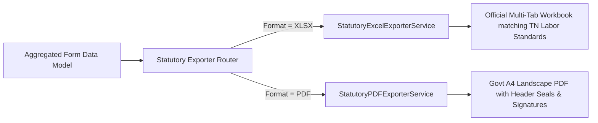

# MASTERHRMS — STATUTORY FORMS WORKSTREAM C IMPLEMENTATION PLAN
## Dedicated Statutory Register Builders (Forms U, V, W, X, and S)

> **Workstream**: C — Statutory Form Generation & Compliance Reporting  
> **Status**: APPROVED FOR PLANNING ONLY (Strict Read-Only Mode — Zero Code/Schema Changes)  
> **Governing Statutes**: Tamil Nadu Shops and Establishments Act, 1947 & Rules, 1948 (Rules 16 & 18)  
> **Audit Gap IDs**: `GAP-STA-001` through `GAP-STA-005`, `GAP-DB-API-006`

---

## 1. Objectives & Compliance Rationale

Under Rules 16(1) and 18(4) of the Tamil Nadu Shops and Establishments Rules, 1948, employers and staffing contractors must maintain five separate, legally defined statutory registers.

The existing HRMS defect in `statutory-form-data.service.ts`—which routes all form requests to an 18-column generic fallback (`WAGES_REGISTER_FORM_A`)—creates immediate statutory compliance vulnerability during Labor Department audits and inspections.

Workstream C replaces this fallback with **five dedicated builders** that construct legally authentic, multi-tab Excel and printable PDF schedules.

```
server/src/services/statutory/
├── statutory-form-registry.service.ts     # Central Form Dispatcher
├── builders/
│   ├── form-u-builder.service.ts         # Employee Register (27 columns)
│   ├── form-v-builder.service.ts         # Muster Roll / 31-day Matrix (46 columns)
│   ├── form-w-builder.service.ts         # Register of Wages (34 columns)
│   ├── form-x-builder.service.ts         # Leave & Social Security (21 columns)
│   └── form-s-builder.service.ts         # Shift Notice & Rest Breaks (38 columns)
└── exporters/
    ├── statutory-excel-exporter.service.ts   # Formatted XLSX Exporter
    └── statutory-pdf-exporter.service.ts     # Official PDF with Signatures
```

---

## 2. Dedicated Form Specifications

### 2.1 Form U — Employee Register [Rule 16(1)] (27 Columns)
* **Statutory Role**: Comprehensive register of all persons employed in the establishment.
* **Header Block**: Establishment Name, Employer Name, Full Address, Registration Certificate No.
* **Column Catalog & Sources**:
  1. `Sl. No`: 1-based sequential index. [Mandatory]
  2. `Employee Name`: `Employee.firstName + ' ' + Employee.lastName`. [Mandatory]
  3. `Employee ID`: `Employee.employeeCode`. [Mandatory]
  4. `Gender`: `Employee.gender`. [Mandatory]
  5. `Father / Spouse Name`: `Employee.fatherOrSpouseName`. [Mandatory]
  6. `Date of Birth`: `Employee.dateOfBirth` (Formatted: `DD-MM-YYYY`). [Mandatory]
  7. `Date of Entry into Service`: `Employee.dateOfJoining` (`DD-MM-YYYY`). [Mandatory]
  8. `Designation`: `Designation.name`. [Mandatory]
  9. `Department`: `Department.name`. [Optional]
  10. `Educational Qualification`: `Employee.education`. [Optional]
  11. `Permanent Address`: `Employee.permanentAddress`. [Mandatory]
  12. `Present Address`: `Employee.presentAddress`. [Mandatory]
  13. `Mobile Number`: `Employee.phone`. [Mandatory]
  14. `Email ID`: `Employee.email` or `User.email`. [Optional]
  15. `Aadhaar Number`: `Employee.aadhaarNumber` (Masked for standard roles: `XXXXXXXX1234`). [Mandatory]
  16. `PAN Number`: `Employee.panNumber`. [Mandatory]
  17. `UAN`: `Employee.uanNumber`. [Mandatory]
  18. `EPF Member ID`: `Employee.pfNumber`. [Mandatory]
  19. `ESIC Insurance No`: `Employee.esiNumber`. [Mandatory]
  20. `Bank Account No`: `Employee.bankAccountNo`. [Mandatory]
  21. `Bank Name & Branch`: `Employee.bankName`. [Mandatory]
  22. `Bank IFSC Code`: `Employee.ifscCode`. [Mandatory]
  23. `Date of Completion of 480 Days`: `Employee.completion480DaysDate` (Tamil Nadu Industrial Establishments Act requirement). [Mandatory for permanent eligibility]
  24. `Date of Confirmation`: `Employee.permanentEmploymentDate`. [Optional]
  25. `Date of Cessation`: `Employee.resignationDate` / `exitDate`. [Optional]
  26. `Reason for Cessation`: `ExitInterview.reason`. [Optional]
  27. `Employee Signature`: Digital receipt timestamp / acknowledgment token. [Mandatory]

* **Validation Rules**:
  - Fail closed if PAN, Aadhaar, DOB, or DOJ are missing.
  - Assert 12-digit format for UAN and 17-digit format for ESIC.

---

### 2.2 Form V — Register of Employment / Muster Roll [Rule 16(1)] (46 Columns)
* **Statutory Role**: Daily record of employment, shift times, rest intervals, and overtime.
* **Header Block**: Wage Period (e.g. `1st October - 31st October 2026`), Establishment Details, Manager Name.
* **Column Catalog & Sources**:
  1. `Sl. No`: Sequential index.
  2. `Employee Name`: Full name.
  3. `Employee ID`: Code.
  4. `Time at which work commences`: `Shift.startTime` (e.g. `09:30 AM`). [Mandatory]
  5. `Rest Interval`: `Shift.breakDurationMinutes` (e.g. `60 mins` or `1:00 PM - 2:00 PM`). [Mandatory]
  6. `Time at which work ends`: `Shift.endTime` (e.g. `06:30 PM`). [Mandatory]
  7–37. `Daily Attendance (Days 1 to 31)`: Array of daily status codes from `AttendanceDaily.status`:
    - `P`: Present
    - `A`: Absent
    - `WO`: Weekly Off (e.g. Sunday)
    - `HL`: Paid Statutory Holiday
    - `OD`: On Duty
    - `HD`: Half Day
    - `LOP`: Loss of Pay
  38. `Total Days Worked`: Sum of `P` + `HL` + `WO` (or payable days). [Mandatory]
  39. `Overtime Hours Worked`: `PayrollSnapshot.overtimeHours`. [Mandatory]
  40. `Total Rest Intervals Availed`: Daily break duration $\times$ days worked. [Optional]
  41. `Adult / Adolescent / Child`: Default `Adult`. [Mandatory]
  42. `Weekly Holiday Granted`: `Shift.weeklyOffDays` (e.g. `Sunday`). [Mandatory]
  43. `Compensatory Holidays Due`: Tracked in `LeaveBalance`. [Optional]
  44. `Compensatory Holidays Availed`: Tracked in `LeaveRequest`. [Optional]
  45. `Notice of Shift Change Date`: Tracked in roster change events. [Optional]
  46. `Employer Signature`: Authorized signatory digital signature block. [Mandatory]

---

### 2.3 FORM W — Register of Wages [Rule 16(1)] (34 Columns)
* **Statutory Role**: Detailed legal register of wages earned, deductions made, and net disbursement.
* **Header Block**: Wage Period, Establishment Name, Manager Name, Registration No.
* **Column Catalog & Sources**:
  1. `Sl. No`: Sequential index.
  2. `Employee Name`: Full name.
  3. `Employee ID`: Code.
  4. `Number of Days Worked`: `PayrollSnapshot.payableDays`.
  5. `Basic Wage Rate / Earned`: `PayrollSnapshot.basicEarned`.
  6. `Dearness Allowance`: `PayrollSnapshot.daEarned`.
  7. `House Rent Allowance`: `PayrollSnapshot.hraEarned`.
  8. `Special Allowances`: `PayrollSnapshot.specialAllowanceEarned`.
  9. `Statutory Bonus (Monthly)`: `PayrollSnapshot.bonusEarned`.
  10. `Overtime Wages`: `PayrollSnapshot.overtimeAmount`.
  11. `Arrears Amount`: `PayrollSnapshot.arrears`.
  12. `Gross Wages Earned`: `PayrollSnapshot.grossEarned`.
  13. `Minimum Wage Benchmark`: Notified state minimum wage.
  14. `EPF Employee (12%)`: `PayrollSnapshot.pfEmployee`.
  15. `ESIC Employee (0.75%)`: `PayrollSnapshot.esiEmployee`.
  16. `Professional Tax`: `PayrollSnapshot.professionalTax`.
  17. `Labour Welfare Fund (LWF)`: `PayrollSnapshot.lwfEmployee`.
  18. `Income Tax / TDS`: `PayrollSnapshot.tds`.
  19. `Advance / Loan Recovery`: `PayrollSnapshot.loanDeductions`.
  20. `Fines / Damage Deductions`: `PayrollDeduction.fines`.
  21. `Total Deductions`: `PayrollSnapshot.totalDeductions`.
  22. `Net Wages Paid`: `PayrollSnapshot.netSalary`.
  23. `Date of Payment`: `PayrollCycle.payoutDate`.
  24. `Payment Method`: `Employee.paymentMethod` (`BANK_TRANSFER`).
  25. `Bank UTR / Ref No`: `PayrollPayment.transactionRef`.
  26–34. `Worker Signature / Receipt Acknowledgment`: Digital receipt token or digital voucher ID.

---

### 2.4 Form X — Register of Leave & Social Security Benefits [Rule 16(1)] (21 Columns)
* **Statutory Role**: Tracks individual leave ledgers and statutory social security benefits.
* **Column Catalog & Sources**:
  1. `Sl. No`: Sequential index.
  2. `Employee Name`: Full name.
  3. `Employee ID`: Code.
  4. `Earned Leave: Opening Balance`: `LeaveBalance.openingEarnedLeave`.
  5. `Earned Leave: Accrued in Period`: `LeaveBalance.monthlyAccrual`.
  6. `Earned Leave: Availed in Period`: `LeaveRequest.availedDays`.
  7. `Earned Leave: Closing Balance`: `LeaveBalance.closingEarnedLeave`.
  8. `Sick / Medical Leave: Opening`: `LeaveBalance.openingSickLeave`.
  9. `Sick / Medical Leave: Availed`: `LeaveRequest.availedSickLeave`.
  10. `Sick / Medical Leave: Closing`: `LeaveBalance.closingSickLeave`.
  11. `Casual Leave: Opening Balance`: `LeaveBalance.openingCasualLeave`.
  12. `Casual Leave: Availed`: `LeaveRequest.availedCasualLeave`.
  13. `Casual Leave: Closing Balance`: `LeaveBalance.closingCasualLeave`.
  14. `Maternity Benefit: Nomination Date`: `Employee.maternityNominationDate`.
  15. `Maternity Benefit: Days Availed`: Days approved under Maternity Act (26 weeks).
  16. `Maternity Benefit: Amount Paid`: Paid maternity benefit.
  17. `Accident / Compensation Claims`: Workmens compensation records.
  18–21. `Inspector Remarks / Employer Endorsements`.

---

### 2.5 FORM S — Notice of Daily Hours of Work & Shifts [Rule 18(4)] (38 Columns)
* **Statutory Role**: Notice displayed prominently specifying hours of work, rest intervals, and shift rotas.
* **Correction of Excel Reference Error**:
  > [!NOTE]
  > In the reference Excel sheet, cell `AL3` threw formula error `#NAME?` due to an invalid relative reference. The Form S builder replaces this with deterministic metadata.
* **Column Catalog & Sources**:
  1. `Serial No`: Sequential index.
  2. `Name of Person Employed`: Full name.
  3. `Sex`: Male / Female / Other.
  4. `Father / Husband's Name`: `Employee.fatherOrSpouseName`.
  5. `Designation`: `Designation.name`.
  6. `Employee Number`: `Employee.employeeCode`.
  7. `Date of Entry into Service`: `Employee.dateOfJoining`.
  8. `Adult / Adolescent / Child`: Adult.
  9. `Shift Number`: Shift name / ID.
  10. `Time of Commencement`: `Shift.startTime` (e.g. `09:30 AM`).
  11–12. `Rest Interval (Start & Duration)`: e.g. `60 mins` (`01:00 PM - 02:00 PM`).
  13. `Time which Work Ends`: `Shift.endTime` (e.g. `06:30 PM`).
  14. `Weekly Holiday`: e.g. `Sunday`.
  15. `Class of Work`: Technical / Clerical / Trainee.
  16. `Rate of Wages (Max)`: Basic pay ceiling / grade.
  17. `Rate of Wages (Min)`: Minimum statutory rate.
  18–37. `Daily Shift Timings Matrix`: Roster schedule for days 1 to 31.
  38. `Signature of Employer / Manager`: Authorized digital signatory token.

---

## 3. Exporter Architecture: Excel & PDF



### 3.1 Excel Formatting Standards
* Uses `ExcelJS` to build authentic worksheets matching the reference workbook layouts.
* Freeze header panes (rows 1–12 frozen on Form V and Form W).
* Auto-fit column widths with minimum 12-character width.
* Proper cell number formatting (Currency `₹#,##0.00`, Dates `DD-MM-YYYY`).

### 3.2 PDF Generation Standards
* Uses `PDFKit` or headless Chromium rendering.
* A4 Landscape format for wide registers (Form V and Form W).
* Page numbering: `Page X of Y`.
* Official header stamp block with establishment registration number.

---

## 4. API Endpoints

| HTTP Method | Route | Description | Auth / Security |
| :--- | :--- | :--- | :--- |
| `GET` | `/api/payroll/statutory-forms/form-u/:cycleId` | Generate Form U JSON / Export | `requireRole('admin', 'hr_manager')` |
| `GET` | `/api/payroll/statutory-forms/form-v/:cycleId` | Generate Form V Muster Roll | `requireRole('admin', 'hr_manager')` |
| `GET` | `/api/payroll/statutory-forms/form-w/:cycleId` | Generate FORM W Register of Wages | `requireRole('admin', 'hr_manager')` |
| `GET` | `/api/payroll/statutory-forms/form-x/:cycleId` | Generate Form X Leave Register | `requireRole('admin', 'hr_manager')` |
| `GET` | `/api/payroll/statutory-forms/form-s/:cycleId` | Generate FORM S Shift Notice | `requireRole('admin', 'hr_manager')` |
| `GET` | `/api/payroll/statutory-forms/bundle/:cycleId` | Download all 5 forms as `.zip` or multi-tab XLSX | `requireRole('admin', 'hr_manager')` |

---

## 5. Acceptance Test Criteria & Rollback Plan

### Acceptance Criteria
- [ ] Each of the 5 form endpoints generates a distinct, non-generic schedule matching its exact column count.
- [ ] Form V displays 31 distinct daily attendance columns matching actual daily punch records.
- [ ] FORM S renders without Excel formula errors (cell `AL3` `#NAME?` resolved).
- [ ] Multi-tab XLSX download produces a workbook identical in structure to sheets 3–7 of `Paysheet_ENABL_OCT_2026 -Final.xlsx`.
- [ ] Missing mandatory fields trigger clear diagnostic warning payloads before export generation.

### Rollback Strategy
- The existing generic `WAGES_REGISTER_FORM_A` fallback remains untouched during development under a deprecated flag.
- If a dedicated form builder fails during runtime, the endpoint gracefully falls back to the legacy generator with an alert logged to Sentry.
- Zero database schema modifications required for form generation logic.

