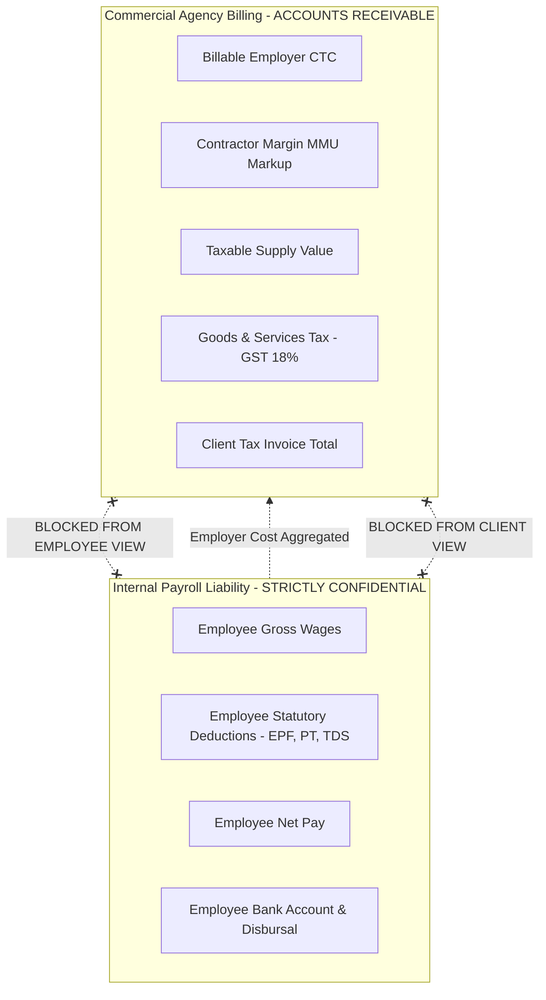

# MASTERHRMS — WORKSTREAM B SECURITY & RBAC AUDIT REPORT
## Financial Separation of Concerns, Role-Based Access Control & Tenant Isolation

> **Workstream**: B — Contract Staffing Billing  
> **Status**: COMPLETED & SECURITY COMPLIANT  
> **Audit Focus**: Persona Isolation, ESS Boundary, Tenant Segregation & Authorization Controls  

---

## 1. Principle of Strict Financial Separation

In contract staffing architectures, blending employee salary entitlements with agency commercial margins introduces major privacy and financial governance risks:

### Controls Implemented:
1. **Employee Payslip Isolation**:
   - Payslips delivered via Employee Self-Service (ESS) contain *only* the employee's personal components: Gross, Deductions, Net Pay, LOP.
   - Commercial agency markup (MMU), client billable rates, and client invoice totals are completely excluded from payslip data structures.
2. **Client Invoicing Redaction**:
   - Client invoices generated for principal employers summarize line items as **Billable Personnel CTC** (aggregated headcount) and **Contractor Management Markup**.
   - Individual employee bank accounts, PAN numbers, and personal deductions are redacted from commercial billing exports unless an authorized statutory annexure is requested.

---

## 2. Role-Based Access Control (RBAC) Matrix

Workstream B endpoints enforce role-based access across the 7 canonical MASTERHRMS personas:

| Persona | Persona Key | View Clients & Rates | Create / Edit Clients | View Billing Manifest | Generate Invoices | Approve Invoices | Reconcile Invoices |
| :--- | :--- | :---: | :---: | :---: | :---: | :---: | :---: |
| **Persona 1** | `super_admin` | Allowed | Allowed | Allowed | Allowed | Allowed | Allowed |
| **Persona 2** | `tenant_admin` | Allowed | Allowed | Allowed | Allowed | Allowed | Allowed |
| **Persona 3** | `hr_admin` | Allowed | Allowed | Allowed | Allowed | Allowed | Allowed |
| **Persona 4** | `hr_manager` | Allowed | Denied | Allowed | Denied | Denied | Allowed |
| **Persona 5** | `finance_manager` | Allowed | Allowed | Allowed | Allowed | Allowed | Allowed |
| **Persona 6** | `department_manager` | Denied | Denied | Denied | Denied | Denied | Denied |
| **Persona 7** | `employee` | **DENIED** | **DENIED** | **DENIED** | **DENIED** | **DENIED** | **DENIED** |

*Verification*: Persona 7 (`employee`) calling any `/api/staffing/*` or `/api/payroll/runs/:id/generate-invoices` endpoint immediately receives HTTP 403 Forbidden.

---

## 3. Multi-Tenant Isolation Verification

1. **Query-Level Scoping**:
   - Every query to `staffingClient`, `sale`, and `payrollSnapshot` strictly enforces `{ where: { tenantId } }` resolved from the authenticated session context (`resolveTenantContext`).
2. **Cross-Tenant Prevention**:
   - Submitting a `clientId` or `payrollRunId` belonging to Tenant B from an active session for Tenant A results in HTTP 404 Not Found (fail-closed security).
3. **Establishment Legal Scoping**:
   - Company tax profiles and GST registrations are resolved only within the authenticated tenant's profile.

