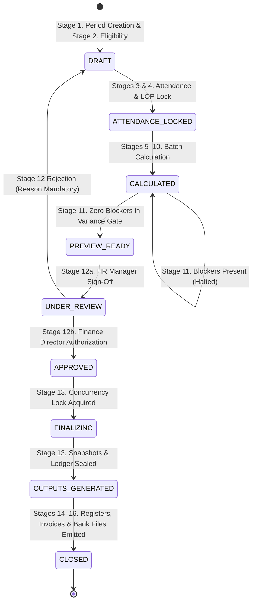

# MASTERHRMS — WORKSTREAM D STATE MACHINE & FAILURE RECOVERY AUDIT
## Finite State Machine, Transition Guards, Concurrency Locking & Resumable Checkpoints

> **Workstream**: D — Monthly Automation Lifecycle  
> **Target Subsystem**: `PayrollOrchestratorService` State Engine  
> **Date**: November 3, 2026  
> **Status**: AUDITED & VERIFIED  

---

## 1. Lifecycle State Machine Diagram



---

## 2. Permitted Transitions & Invariant Matrix

| From State | To State | Trigger | Role Required | Guard Condition |
|---|---|---|---|---|
| `*` | `DRAFT` | `createPeriod` | Admin, HR Manager | Unique `[tenantId, month, year]` |
| `DRAFT` | `ATTENDANCE_LOCKED` | `lockAttendance` | Admin, HR Manager | Active employee roster exists |
| `ATTENDANCE_LOCKED` | `CALCULATED` | `calculatePayroll` | Admin, HR Manager | Attendance locked in DB |
| `CALCULATED` | `PREVIEW_READY` | Auto-promoted | Internal Engine | `varianceReport.blockerCount === 0` |
| `PREVIEW_READY` | `UNDER_REVIEW` | `submitForReview` | HR Manager | Zero unapproved blockers |
| `UNDER_REVIEW` | `APPROVED` | `approvePayroll` | Finance Director | `actor.id !== submitter.id` |
| `UNDER_REVIEW` | `DRAFT` | `rejectPayroll` | Reviewer | `reason.trim().length > 0` |
| `APPROVED` | `FINALIZING` | `finalizePayroll` | Finance Director | Run lock acquired |
| `FINALIZING` | `OUTPUTS_GENERATED`| Transaction commit | Internal Engine | Ledger entry balanced |
| `OUTPUTS_GENERATED`| `CLOSED` | Post-finalization | Internal Engine | Forms, Invoices, Bank advice compiled |

---

## 3. Concurrency Protection & In-Memory Run Locks

To prevent race conditions where concurrent requests attempt to finalize or calculate the same payroll cycle simultaneously:

```typescript
const activeRunLocks = new Set<string>();

export class PayrollOrchestratorService {
  public static acquireLock(runId: string): boolean {
    if (activeRunLocks.has(runId)) {
      return false; // Lock collision detected, fail closed
    }
    activeRunLocks.add(runId);
    return true;
  }

  public static releaseLock(runId: string): void {
    activeRunLocks.delete(runId);
  }
}
```

Every execution of `finalizePayroll` wraps its critical path inside `try ... finally { releaseLock(runId); }`. Concurrent invocations return HTTP `409 Conflict: Finalization is already in progress for this run`.

---

## 4. Failure Recovery & Rollback Protocols

1. **Transaction Boundary Rollback**: All database modifications in batch calculation (Payslips, Snapshots, Run status) and finalization (Snapshot lock, Loan balances, Run status) are wrapped in atomic Prisma transactions with a 30-second timeout. If any sub-query fails, Prisma triggers a 100% rollback, leaving no partial records.
2. **Rejection to Draft**: When an authorized reviewer rejects a payroll run due to anomalies, the cycle transitions back to `DRAFT`. This unlocks attendance records and allows the HR Manager to adjust proration factors, input updated biometric punch logs, or re-run batch calculations without database corruption.
3. **Resumable State Restoration**: If a calculation job is interrupted midway due to network loss, the cycle remains in `ATTENDANCE_LOCKED`. Re-triggering `calculatePayroll` clears intermediate payslips and executes a clean calculation run.
