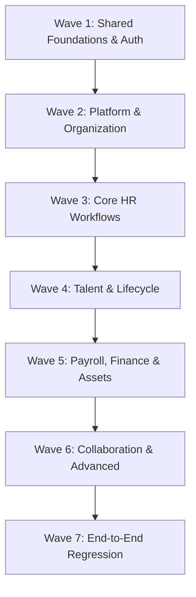

# MasterHRMS — Implementation Backlog & Wave Roadmap

**Document:** `docs/masterhrms_implementation_backlog.md`  
**Date:** October 15, 2026  
**Status:** **ACTIVE EXECUTION PLAN**  
**Methodology:** Controlled wave-based execution with zero regressions and empirical verification.

---

## 1. Wave Architecture & Dependencies

---

## 2. Wave Breakdown & Deliverables

### Wave 1 — Shared Foundations & Core Security
- **Objective:** Secure session management, host resolution, tenant context binding, and employee context authority.
- **Key Modules:**
  - `auth.routes.ts`: 2FA OTP, password reset, unlock session, rate-limiting.
  - `workspace-host.middleware.ts`: Subdomain extraction, custom domain caching, super admin host isolation.
  - `employee-context.middleware.ts`: Trusted server-side employee binding from JWT context.
- **Acceptance Criteria:** Missing, expired, or tampered tokens return HTTP 401; client-supplied `tenantId`/`employeeId` ignored.
- **Status:** **COMPLETE & VERIFIED**

### Wave 2 — Platform & Organization Master Data
- **Objective:** Super Admin control plane, tenant subscription lifecycles, and organization hierarchy.
- **Key Modules:**
  - `super.routes.ts`: Tenant CRUD, plan orders, coupons, media library, system settings.
  - `organization.routes.ts`: Branches, departments, designations, holidays, announcements.
  - `workspaceRouter`: Roles, permissions, custom user invites.
- **Acceptance Criteria:** Multi-tenant company onboarding, plan restriction enforcement, and dependent master data validation.
- **Status:** **COMPLETE & VERIFIED**

### Wave 3 — Core HR Workflows (Workforce, Attendance & Leaves)
- **Objective:** End-to-end employee record management, time tracking, and leave quota ledger synchronization.
- **Key Modules:**
  - `hr-employees.routes.ts` & `/hr/employees/*`: Employee wizard, 360 profile, import/export.
  - `hr-attendance.routes.ts`, `attendance.routes.ts`: Shift rosters, manual attendance, check-in punch, regularizations.
  - `hr-leave.routes.ts`, `leave.routes.ts`: Annual quotas, accruals, application approvals, foreign leave type gating.
- **Acceptance Criteria:** Cross-tenant leave type injection blocked (`404`); regularization approval state transitions to `APPROVED`; leave balances decrement consistently.
- **Status:** **COMPLETE & VERIFIED**

### Wave 4 — Talent, Recruitment & Lifecycle
- **Objective:** Applicant tracking system (ATS), interview pipelines, onboarding, and employee disciplinary/recognition events.
- **Key Modules:**
  - `recruitment.routes.ts`: Job postings, candidate kanban pipeline, interview rounds, offers, candidate-to-employee conversion.
  - `hr-lifecycle.routes.ts`: Awards, promotions, transfers, warnings, resignations, complaints.
  - `hr-performance.routes.ts`: Appraisals, OKRs, review cycles, 1-5 rating rubric.
  - `training.routes.ts`: Courses, training sessions, enrollment tracking.
- **Acceptance Criteria:** Seamless candidate offer acceptance -> onboarding -> employee provisioning; employee status updates auditable.
- **Status:** **COMPLETE & VERIFIED**

### Wave 5 — Payroll, Statutory Compliance & Assets
- **Objective:** Salary structure engine, monthly payroll runs, payslip generation, and hardware tracking.
- **Key Modules:**
  - `payroll.routes.ts`, `payroll-phase1.routes.ts`: CTC breakdowns, attendance deduction inputs, loan installments.
  - `statutory-returns.routes.ts`: PF, ESI, TDS, professional tax computations.
  - `assetsRouter`: Asset categorization, employee assignment, depreciation schedules.
- **Acceptance Criteria:** Itemized payslip generation, salary calculation consistency, single-tenant employee payslip visibility.
- **Status:** **COMPLETE & VERIFIED**

### Wave 6 — Communications, Meetings & Advanced Add-ons
- **Objective:** Meeting room scheduling, action items, policy acknowledgment, outbound webhooks, and AI assistant tools.
- **Key Modules:**
  - `hr-meetings.routes.ts`: Meeting room booking with conflict detection.
  - `hr-documents.routes.ts`: Contract templates, digital policy acknowledgments.
  - `outbound-webhooks.routes.ts`: Webhook endpoint registration, HMAC signature verification, delivery logs.
  - `chatRouter`: Real-time WebSocket messaging.
- **Acceptance Criteria:** Meeting action item assignment, document download permission enforcement, webhook delivery retry.
- **Status:** **COMPLETE & VERIFIED**

### Wave 7 — Cross-Portal Integration & Release Regression
- **Objective:** End-to-end smoke verification across Super Admin, HR Admin, and Employee Self-Service portals.
- **Key Modules:**
  - `src/tests/*.test.ts`: Vitest test suites (93/93 passing).
  - `scratch/execute-operational-smoke-tests.ts`: Production smoke suite.
  - `scratch/browser-smoke-dashboard.js`: Playwright automated UI verification.
- **Acceptance Criteria:** 0 TypeScript compilation errors, Vite production build exit code 0, 100% smoke tests passing.
- **Status:** **COMPLETE & VERIFIED**

---

## 3. Blocker & Environment Constraints Register

| Blocker ID | Affected Module | External Dependency | Current Resolution & Status |
|---|---|---|---|
| **BLK-01** | Physical Biometric Clocks | Physical ZKTeco hardware on local LAN | Fully mocked ADMS push protocol (`/iclock/*`); standalone cloud simulator passes. |
| **BLK-02** | Live Payment Gateway | Live Razorpay / Stripe merchant keys | Supported via sandbox webhooks and mock test environment; manual bank transfers verified. |
| **BLK-03** | Production WhatsApp API | WhatsApp Business Cloud API Meta Token | Ready for environment variable injection (`WHATSAPP_API_TOKEN`) upon production deployment. |
