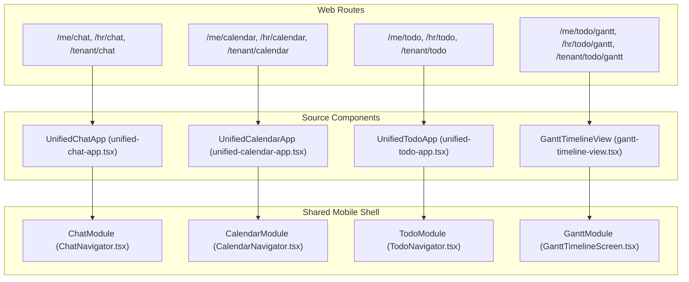

# MASTERHRMS MOBILE — CHAT, CALENDAR, TODO & GANTT MODULE DISCOVERY AUDIT

**Project:** MasterHRMS Unified Enterprise Mobile Application  
**Repository:** `Webfamily-06/masterhrms`  
**Application Directory:** `mobile-app/`  
**Discovery Date:** November 16, 2026  
**Phase:** Phase 0 — Read-Only Forensic Discovery  
**Status:** COMPLETED & VERIFIED AGAINST CODEBASE SOURCE  

---

## 1. Executive Summary

This forensic audit investigates the four core productivity and collaboration web applications within MasterHRMS:
1. **Chat** (`UnifiedChatApp` in `src/components/chat/unified-chat-app.tsx` and `CMS/src/components/chat/unified-chat-app.tsx`)
2. **Calendar** (`UnifiedCalendarApp` in `src/components/calendar/unified-calendar-app.tsx` and `CMS/src/components/calendar/unified-calendar-app.tsx`)
3. **Todo** (`UnifiedTodoApp` in `src/components/todo/unified-todo-app.tsx` and `CMS/src/components/todo/unified-todo-app.tsx`)
4. **Gantt Timeline** (`GanttTimelineView` in `src/components/todo/gantt-timeline-view.tsx` and `CMS/src/components/todo/gantt-timeline-view.tsx`)

These four modules share a unified architecture: the exact same frontend components and business workflows are mounted across Employee (`/me`), HR Operations (`/hr`), and Tenant Admin (`/tenant`) routes, differentiated purely by backend-authoritative permissions and tenant boundary parameters.

---

## 2. Complete Screen Inventory

| Module | Screen Key | Primary Purpose | Web Route Equivalents | Mobile Screen Target |
| :--- | :--- | :--- | :--- | :--- |
| **Chat** | `ChatConversations` | Conversations list (Direct, Groups, Announcements), unread badges, presence | `/hr/chat`, `/me/chat`, `/tenant/chat` | `ChatConversationsScreen` |
| **Chat** | `ChatConversationDetail` | Message stream, reply, reactions, pins, polls, attachments, typing indicators | `/hr/chat?conversationId=...` | `ChatConversationDetailScreen` |
| **Chat** | `ChatNewConversation` | Start direct message or create group with member selector | `/hr/chat/groups`, `/me/chat/groups` | `ChatNewConversationModal` |
| **Chat** | `ChatCallModal` | 1-on-1 audio/video call and meeting room interface | `/hr/chat/calls`, `/me/chat/calls` | `ChatCallScreen` |
| **Calendar** | `CalendarMain` | Month, Week, Day, and Agenda views with today indicator and search filters | `/hr/calendar`, `/me/calendar`, `/tenant/calendar` | `CalendarMainScreen` |
| **Calendar** | `CalendarEventDetail` | View event details, location, room, reminders, RSVP actions, cancellation | Inline Sheet / Modal | `CalendarEventDetailModal` |
| **Calendar** | `CalendarEventEditor` | Create/edit event (all-day, recurrence, categories, room, multi-share) | Inline Sheet / Modal | `CalendarEventEditorModal` |
| **Todo** | `TodoList` | Filterable task list (All, Pending, Completed), priority badges, due dates, stars | `/hr/todo`, `/me/todo`, `/tenant/todo` | `TodoListScreen` |
| **Todo** | `TodoTaskDetail` | Task drawer: checklist subtasks, assignee chips, comments stream, progress | Inline Sheet / Drawer | `TodoTaskDetailModal` |
| **Todo** | `TodoTaskEditor` | Create/edit task, multi-assignee selector, start/due dates, priority, categories | Inline Sheet / Modal | `TodoTaskEditorModal` |
| **Gantt** | `GanttTimeline` | Horizontal timeline grid, 14-day / 28-day scale, weekend shading, task bars | `/hr/todo/gantt`, `/me/todo/gantt` | `GanttTimelineScreen` |

---

## 3. Web Route and Component Mapping

Both HR, Employee, and Tenant Admin mount the **exact same codebases** with identical state machines:
- `/hr/chat` -> `<UnifiedChatApp workspacePrefix="/hr" />`
- `/me/chat` -> `<UnifiedChatApp workspacePrefix="/me" />`
- `/hr/calendar` -> `<UnifiedCalendarApp mode="hr" />`
- `/me/calendar` -> `<UnifiedCalendarApp mode="me" />`
- `/hr/todo` -> `<UnifiedTodoApp mode="hr" initialView="list" />`
- `/hr/todo/gantt` -> `<UnifiedTodoApp mode="hr" initialView="gantt" />`

---

## 4. Distinct Backend Endpoints & HTTP Method Inventory

### 4.1 Chat Endpoints (`server/src/routes/chat.routes.ts`)
| Method | Endpoint Path | Payload / Query Parameters | Response Type | Shared / Aliases |
| :--- | :--- | :--- | :--- | :--- |
| `GET` | `/api/chat/conversations` | `?type=direct,group,announcement&limit=50` | `ConversationSummary[]` | Core |
| `POST` | `/api/chat/conversations/direct` | `{ targetUserId: string }` | `Conversation` | Core |
| `GET` | `/api/chat/conversations/pinned` | None | `string[]` (thread IDs) | Core |
| `POST` | `/api/chat/conversations/:threadId/pin` | `{ isPinned: boolean }` | `{ success: boolean }` | Core |
| `PATCH` | `/api/chat/conversations/:threadId/preferences` | `{ isMuted?: boolean, sound?: string }` | `{ success: boolean }` | Alias with `POST` |
| `GET` | `/api/chat/messages/:threadId` | `?limit=50&before=msg_id` | `ChatMessage[]` | Alias: `/conversations/:threadId/messages` |
| `POST` | `/api/chat/messages` | `{ threadId, content, replyToId?, attachments?, poll? }` | `ChatMessage` | Core |
| `PATCH` | `/api/chat/messages/:id` | `{ content: string }` | `ChatMessage` | Core |
| `DELETE` | `/api/chat/messages/:id` | None | `{ success: boolean }` | Core |
| `POST` | `/api/chat/messages/:id/pin` | `{ isPinned: boolean }` | `{ success: boolean }` | Core |
| `POST` | `/api/chat/messages/:id/react` | `{ emoji: string }` | `MessageReaction[]` | Core |
| `POST` | `/api/chat/messages/:id/poll/vote` | `{ optionId: string }` | `PollResult` | Core |
| `POST` | `/api/chat/messages/:id/poll/close` | None | `PollResult` | Core |
| `POST` | `/api/chat/messages/:threadId/read` | None | `{ success: boolean }` | Aliases: `/conversations/...`, `/threads/...` |
| `POST` | `/api/chat/messages/delivered` | `{ messageIds: string[] }` | `{ success: boolean }` | Core |
| `GET` | `/api/chat/groups` | None | `ChatGroup[]` | Core |
| `POST` | `/api/chat/groups` | `{ name, description?, memberIds: string[] }` | `ChatGroup` | Core |
| `GET` | `/api/chat/groups/:id/members` | None | `GroupMember[]` | Core |
| `POST` | `/api/chat/groups/:id/members` | `{ memberIds: string[] }` | `GroupMember[]` | Core |
| `DELETE` | `/api/chat/groups/:id/members/:userId`| None | `{ success: boolean }` | Core |
| `POST` | `/api/chat/groups/:id/leave` | None | `{ success: boolean }` | Core |
| `GET` | `/api/chat/contacts` | `?search=...` | `ChatContact[]` | Core |
| `GET` | `/api/chat/presence` | None | `Record<string, { status: string, lastSeen: string }>` | Core |
| `POST` | `/api/chat/presence` | `{ status: "ONLINE" \| "AWAY" \| "OFFLINE" }` | `{ success: boolean }` | Core |
| `GET` | `/api/chat/calls` | `?limit=30` | `CallLogItem[]` | Core |
| `POST` | `/api/chat/calls` | `{ receiverId, callType: "audio" \| "video" }` | `CallSession` | Core |
| `DELETE` | `/api/chat/calls/:id` | None | `{ success: boolean }` | Core |

### 4.2 Calendar Endpoints (`server/src/routes/calendar.routes.ts`)
| Method | Endpoint Path | Payload / Query Parameters | Response Type | Shared / Aliases |
| :--- | :--- | :--- | :--- | :--- |
| `GET` | `/api/calendar/categories` | None | `CalendarCategory[]` | Core |
| `POST` | `/api/calendar/categories` | `{ name, color, isDefault?: boolean }` | `CalendarCategory` | Core |
| `PUT` | `/api/calendar/categories/:id` | `{ name, color }` | `CalendarCategory` | Core |
| `DELETE` | `/api/calendar/categories/:id` | None | `{ success: boolean }` | Core |
| `GET` | `/api/calendar/events` | `?start=...&end=...&categoryId=...&search=...` | `CalendarEvent[]` | Core |
| `POST` | `/api/calendar/events` | `{ title, description, startDate, endDate, allDay, category, location, room, recurrence, reminders, shares }` | `CalendarEvent` | Core |
| `PUT` | `/api/calendar/events/:id` | Partial event payload | `CalendarEvent` | Core |
| `DELETE` | `/api/calendar/events/:id` | None | `{ success: boolean }` | Core |
| `POST` | `/api/calendar/events/:id/cancel` | `{ reason?: string }` | `CalendarEvent` | Core |
| `POST` | `/api/calendar/events/:id/rsvp` | `{ status: "accepted" \| "declined" \| "tentative" }` | `{ success: boolean }` | Core |
| `POST` | `/api/calendar/events/:id/share` | `{ recipientId, permission: "view" \| "edit" }` | `CalendarShare` | Core |
| `GET` | `/api/calendar/rooms` | None | `MeetingRoom[]` | Core |
| `POST` | `/api/calendar/check-conflicts`| `{ roomId, start, end, excludeEventId? }` | `{ hasConflict: boolean, conflictingEvent? }` | Core |
| `GET` | `/api/calendar/eligible-recipients` | `?search=...` | `CalendarRecipient[]` | Core |
| `GET` | `/api/calendar/export/ics` | `?start=...&end=...` | `text/calendar` ICS stream | Core |

### 4.3 Todo & Gantt Endpoints (`server/src/routes/todos.routes.ts`)
| Method | Endpoint Path | Payload / Query Parameters | Response Type | Shared / Aliases |
| :--- | :--- | :--- | :--- | :--- |
| `GET` | `/api/todos` | `?status=...&priority=...&tag=...&search=...&sortBy=...` | `TodoItem[]` | Shared with Gantt |
| `POST` | `/api/todos` | `{ title, description, priority, startDate, dueDate, assigneeIds, categoryId, checklist }` | `TodoItem` | Core |
| `PUT` | `/api/todos/:id` | Partial task update (`status`, `progress`, `dueDate`, `priority`, etc.) | `TodoItem` | Shared with Gantt drag/edit |
| `DELETE` | `/api/todos/:id` | None | `{ success: boolean }` | Core |
| `GET` | `/api/todos/categories` | None | `TodoCategory[]` | Core |
| `POST` | `/api/todos/categories` | `{ name, color }` | `TodoCategory` | Core |
| `GET` | `/api/todos/assignees` | None | `TodoAssignee[]` | Core |
| `POST` | `/api/todos/:id/checklist` | `{ text: string }` | `ChecklistItem` | Core |
| `PATCH` | `/api/todos/:id/checklist/:itemId` | `{ completed: boolean }` | `ChecklistItem` | Core |
| `DELETE` | `/api/todos/:id/checklist/:itemId` | None | `{ success: boolean }` | Core |
| `POST` | `/api/todos/:id/comments` | `{ text: string }` | `TodoComment` | Core |

---

## 5. Realtime Socket.IO & Pusher Event Contracts

The server broadcasts realtime updates through `PusherService` and Socket.IO rooms partitioned by `tenantId`:

| Event Name | Channel / Room Pattern | Trigger Condition | Payload Data |
| :--- | :--- | :--- | :--- |
| `chat:message` | `presence-tenant-{tenantId}-thread-{threadId}` | New message created in thread | `{ message: ChatMessage }` |
| `chat:typing` | `presence-tenant-{tenantId}-thread-{threadId}` | User typing indicator | `{ userId, threadId, isTyping }` |
| `chat:read` | `presence-tenant-{tenantId}-thread-{threadId}` | Thread messages marked read | `{ threadId, userId, readAt }` |
| `chat:reaction` | `presence-tenant-{tenantId}-thread-{threadId}` | Message reaction toggled | `{ messageId, reaction }` |
| `call:incoming` | `private-user-{tenantId}-{userId}` | Outgoing call initiated | `{ callId, callerName, callerAvatar, callType }` |
| `call:ended` | `private-call-{callId}` | Call hung up or timed out | `{ callId, duration, reason }` |
| `calendar:event-shared` | `private-user-{tenantId}-{userId}` | Event shared with user | `{ eventId, title, start, end }` |
| `calendar:event-updated`| `private-user-{tenantId}-{userId}` | Shared event updated | `{ eventId, changes }` |
| `calendar:event-cancelled`| `private-user-{tenantId}-{userId}` | Event cancelled | `{ eventId, title, reason }` |
| `todo:assigned` | `private-user-{tenantId}-{userId}` | User assigned to new task | `{ todoId, title, priority, dueDate }` |
| `todo:updated` | `private-tenant-{tenantId}` | Task updated or status shifted | `{ todoId, status, progress }` |

---

## 6. Permissions, Data Scope & Ownership Rules

1. **Strict Multi-Tenant Boundary:**
   - Every request passes `x-tenant-id: <tenant_id>`.
   - The database Prisma queries strictly scope to `where: { tenantId }`.
2. **Chat Ownership:**
   - Any tenant user can send direct messages to colleague contacts within the same tenant.
   - Group creation is permitted for all tenant users; group admin permissions are required to add/remove members or archive the group.
   - Message edits/deletions are permitted only by the original author or Tenant Admin.
3. **Calendar Visibility:**
   - Personal events are visible only to the creator and shared recipients.
   - Company-wide events (`isCompanyEvent: true`) can be created by HR Admin and Tenant Admin, visible to all tenant employees.
   - Meeting room conflict detection prevents overlapping bookings.
4. **Todo & Gantt Scope:**
   - Employees see tasks where they are the creator or an assigned member (`assigneeIds.includes(user.id)`).
   - HR Admin and Tenant Admin can view all organizational tasks and assign tasks across departments.
   - Task completion/progress edits can be updated by assigned members or creators.

---

## 7. Mobile Adaptation Architecture & Known Gaps

1. **Native Touch Targets & UI Form Factors:**
   - Web Gantt uses CSS flex table with drag-and-drop. For mobile, a horizontally scrollable date grid with fixed task labels column and bottom sheet task editors is required.
   - Web Calendar month grid adapts to an interactive Date Header + Scrollable Day/Agenda list for small screens.
   - Web Chat attachment uploads use native file/image pickers.
2. **Audio/Video Calls:**
   - WebRTC in browser requires native WebRTC modules or audio call fallbacks for React Native CLI.
3. **Pusher / WebSocket Subscriptions:**
   - Subscriptions must be cleaned up on screen blur or tenant change to avoid memory leaks.

---

## 8. Forensic Conclusion

The backend REST contracts, web components, and data structures for Chat, Calendar, Todo, and Gantt are fully documented and ready for sequential migration into `mobile-app/` under one unified shared component hierarchy.
