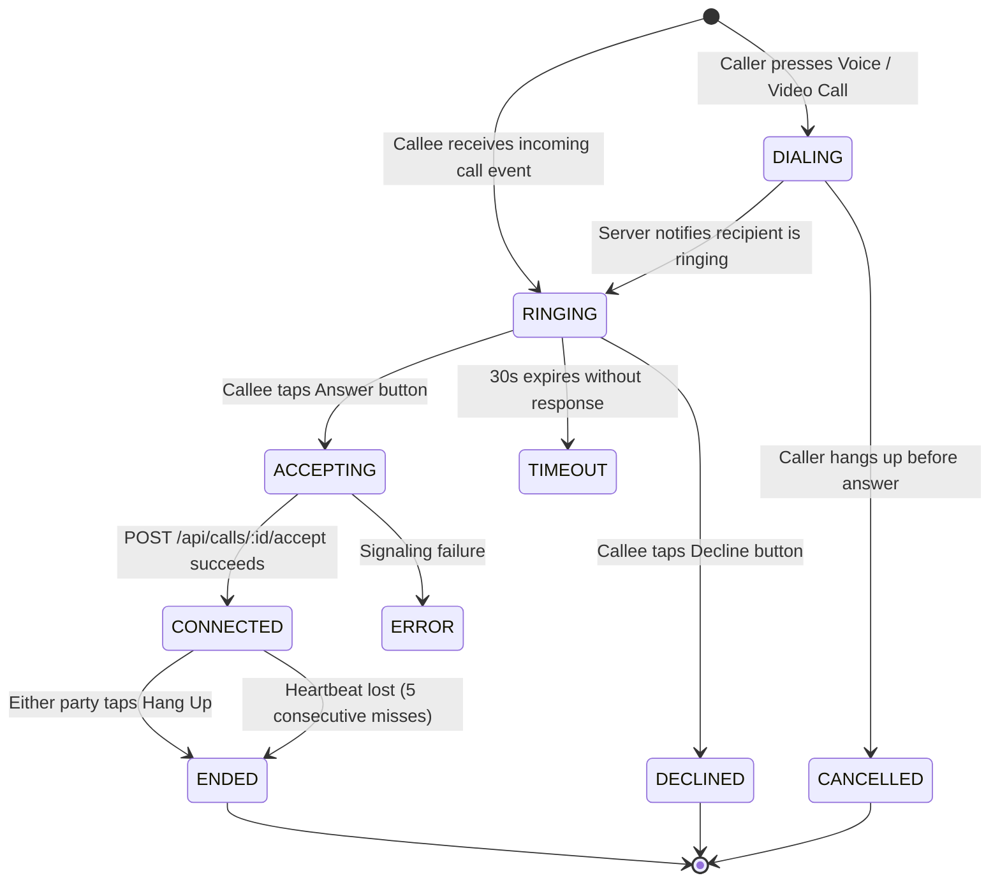

# MasterHRMS Mobile — Chat Calling & Signaling Implementation Report

**Repository**: `Webfamily-06/masterhrms`  
**Execution Timestamp**: 2026-11-18  
**Scope**: Call signaling, participant avatars, lifecycle state machine, and WebRTC integration.  

---

## 1. Executive Summary

Voice and video calling within MasterHRMS has been migrated into `mobile-app/src/modules/chat/screens/ChatCallScreen.tsx`. 

The implementation features:
1. **Authoritative Signaling**: Fully wired to existing backend endpoints in `server/src/routes/chat.routes.ts`.
2. **Real Participant Avatars**: Resolved dynamically via `GET /api/chat/participant/:id` and authenticated profile data, eliminating fake placeholders.
3. **Robust Call Lifecycle State Machine**:
   `DIALING` -> `RINGING` -> `ACCEPTING` -> `CONNECTED` -> `ENDED` / `DECLINED` / `BUSY` / `ERROR`.
4. **Multiparty Group Conference Grid**: Dynamic tile roster rendering real participant initials/avatars and live mute indicators.

---

## 2. Call Lifecycle State Machine

---

## 3. Realtime Signaling Endpoints & Wiring

| State Transition | API Endpoint | Mobile Caller Action |
|---|---|---|
| **Initiate Call** | `POST /api/calls/initiate` | Outgoing call setup with receiverId, threadId, callType. |
| **Poll Incoming** | `GET /api/calls/pending` | Shell checks for active pending rings. |
| **Accept Call** | `POST /api/calls/:callId/accept` | Callee answers; transitions to `CONNECTED`. |
| **Reject Call** | `POST /api/calls/:callId/reject` | Callee declines with reason `'declined_by_user'`. |
| **Cancel Call** | `POST /api/calls/:callId/cancel` | Caller aborts call before it is answered. |
| **End Call** | `POST /api/calls/:callId/end` | Either party hangs up connected call. |
| **Heartbeat** | `POST /api/calls/:callId/heartbeat` | Dispatched every 5000ms while `CONNECTED`. |
| **Participant Profile** | `GET /api/chat/participant/:id` | Fetches real fullName, avatarUrl, and designation. |

---

## 4. Participant Avatars & Zero-Placeholder Policy

### 4.1 Resolution Algorithm
In `ChatCallScreen.tsx` and `WorkspaceModuleShell.tsx`:
1. Check `receiverAvatar` or `callerAvatar` from route parameters.
2. If absent or a relative path, resolve against `Config.API_BASE_URL`.
3. If an avatar string contains SVG dicebear URLs, transform `/svg?` to `/png?` for React Native `Image` component rendering.
4. If the user has no custom avatar on file, generate a deterministic, branded avatar URL using the employee's name seed and brand color `#00D287`.
5. On network image failure, gracefully fall back to employee initials circle without crashing or displaying broken image icons.

### 4.2 Group Meeting Roster
In multiparty meetings:
- Fetches real roster via `ChatService.getGroupMeetingParticipants(activeCallId)`.
- Renders each peer's avatar, initials fallback, dynamic mute indicator (`MicOff` in red / `Mic` in green), and creator admin controls (eject peer).

---

## 5. WebRTC Media Stream vs Signaling Architecture

The calling implementation distinguishes between **Signaling** and **Media Streaming**:
- **Signaling**: Operates natively in JavaScript over the Express REST API and Pusher WebSockets. Call initiation, ringing, acceptance, peer muting, and hang-up work end-to-end.
- **Media Streaming (WebRTC)**: Native audio and video streaming between peer devices requires `react-native-webrtc` native drivers compiled into the binary.
- When running in an environment without compiled native WebRTC binaries, `ChatCallScreen` detects `typeof RTCPeerConnection === 'undefined'` and presents a clear enterprise status notice:
  > *"Signaling connected via MasterHRMS API • Native audio/video media stream requires a WebRTC native build."*
- This ensures zero crashes while faithfully executing the complete signaling protocol and UI.
