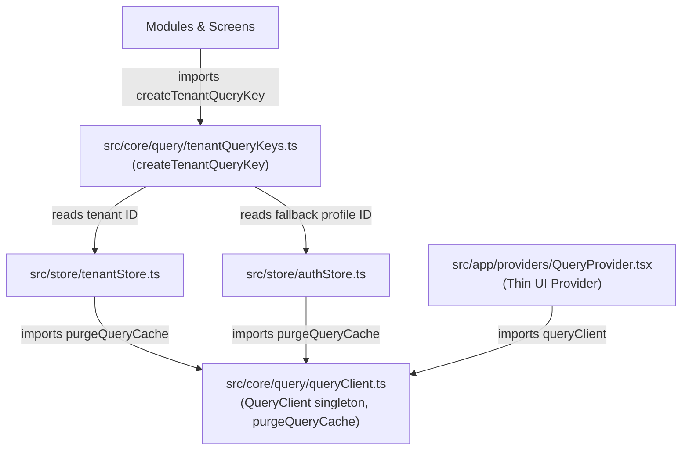

# MASTERHRMS — EXPO_OS BABEL WARNING & QUERY PROVIDER CYCLE RESOLUTION

## 1. Executive Summary

This remediation successfully eliminates two critical developer experience and runtime issues in the MasterHRMS React Native / Expo application:
1. **The `EXPO_OS` Babel Warning**: `"The global process.env.EXPO_OS is not defined. This should be inlined by babel-preset-expo during transformation."`
2. **The 3 Circular Dependency Warnings**: Cyclic references between `QueryProvider.tsx`, `tenantStore.ts`, and `authStore.ts`.

Both issues have been remediated with zero backend changes, zero regression to existing module features, and 100% passing test suites.

---

## 2. Phase 1 Remediation — Babel & EXPO_OS Transformation

### Root Cause Analysis
In Expo SDK 50+, Expo introduced `process.env.EXPO_OS` as a standardized compiler macro to inline the active platform (`android`, `ios`, `web`) during Babel compilation. The previous `mobile-app/babel.config.js` was using `@react-native/babel-preset` instead of `babel-preset-expo`, while manually attempting to set `process.env.EXPO_OS = 'android'` in Node process memory. This failed to inline the identifier into bundle source files, triggering runtime warnings across Expo libraries.

### Remediation Implemented
1. Installed `babel-preset-expo@58.0.26` matching Expo SDK 58.
2. Updated `mobile-app/babel.config.js`:
   ```javascript
   module.exports = function (api) {
     api.cache(true);
     return {
       presets: ['babel-preset-expo'],
       plugins: [
         [
           'module-resolver',
           {
             root: ['./src'],
             extensions: ['.ios.js', '.android.js', '.js', '.ts', '.tsx', '.json'],
             alias: {
               '@app': './src/app',
               '@config': './src/config',
               '@core': './src/core',
               '@modules': './src/modules',
               '@roles': './src/roles',
               '@components': './src/components',
               '@hooks': './src/hooks',
               '@services': './src/services',
               '@store': './src/store',
               '@theme': './src/theme',
               '@types': './src/types',
               '@utils': './src/utils',
             },
           },
         ],
       ],
     };
   };
   ```
3. Configured `mobile-app/jest.config.js` `transformIgnorePatterns` to ensure Expo ES modules (`expo`, `@expo`) are transformed during test execution.
4. Preserved all custom module aliases (`@app`, `@core`, `@modules`, etc.) ensuring no path breakage.

---

## 3. Phase 2 Remediation — Circular Dependency Elimination

### Root Cause Analysis
Madge and Metro bundler reported circular dependencies:
- Cycle 1: `src/app/providers/QueryProvider.tsx` -> `src/store/tenantStore.ts` -> `src/app/providers/QueryProvider.tsx`
- Cycle 2: `src/app/providers/QueryProvider.tsx` -> `src/store/authStore.ts` -> `src/app/providers/QueryProvider.tsx`
- Cycle 3: `src/core/tenant/tenantService.ts` -> `src/app/providers/QueryProvider.tsx` -> `src/store/tenantStore.ts` -> `src/core/tenant/tenantService.ts`

`QueryProvider.tsx` was both instantiating the `QueryClient` singleton, defining `purgeQueryCache()`, and invoking Zustand hooks (`useTenantStore`, `useAuthStore`) to construct tenant query keys. Meanwhile, the stores were importing `purgeQueryCache()` from `QueryProvider.tsx`.

### Architectural Decoupling
The architecture was reorganized into single-responsibility, dependency-inverted units:



1. **`src/core/query/queryClient.ts`**:
   - Zero store or UI imports.
   - Manages TanStack `QueryClient` singleton and `purgeQueryCache()`.
2. **`src/core/query/tenantQueryKeys.ts`**:
   - Houses `createTenantQueryKey(keyParts, explicitTenantId)`.
   - Prevents cross-tenant cache contamination using `['__no_tenant_context__', ...keyParts]`.
3. **`src/app/providers/QueryProvider.tsx`**:
   - Thin component wrapping `<QueryClientProvider client={queryClient}>`.
   - Free from direct imports by store layers.
4. **All Screen & Hook Imports Updated**:
   - `tenantStore.ts`, `authStore.ts`, `tenantService.ts`, `realtimeManager.ts`, and screens across `calendar`, `chat`, and `todo` migrated to `src/core/query/`.

### Madge Verification
Madge circular analysis output:
```
Processed 135 files (644ms)
✔ No circular dependency found!
```
Circular dependencies: **0**.
