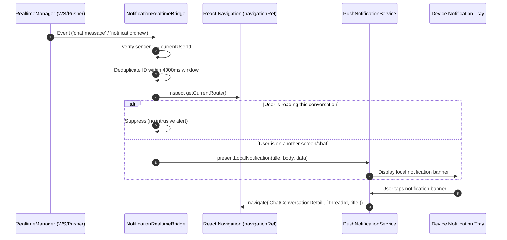

# MASTERHRMS — MOBILE FOREGROUND NOTIFICATION IMPLEMENTATION

## 1. Architectural Design

In mobile operating systems (iOS and Android), native remote push notifications are normally suppressed or routed differently when an application is in the foreground. To deliver an immediate, responsive user experience for incoming messages and alerts while an employee is actively inside the app, MasterHRMS implements `NotificationRealtimeBridge.tsx`.

---

## 2. Component Pipeline (`NotificationRealtimeBridge.tsx`)

Mounted within `RootNavigator.tsx` inside the authenticated navigation tree:



---

## 3. Implementation Highlights

### 1. Dual-Transport Deduplication
Because the MasterHRMS backend operates both WebSocket (Socket.io) and Pusher event broadcasting, identical messages can arrive via parallel channels. A sliding fingerprint cache prevents dual notifications:
```typescript
const fingerprint = `${eventName}:${rawId}`;
const now = Date.now();
const lastSeen = recentFingerprintsRef.current.get(fingerprint);
if (lastSeen && now - lastSeen < 4000) {
  return;
}
recentFingerprintsRef.current.set(fingerprint, now);
```

### 2. Self-Message Filtering
Messages authored by the active employee are ignored:
```typescript
if (senderId && currentUserId && String(senderId) === String(currentUserId)) {
  return;
}
```

### 3. Context Inspection
Using `navigationRef.getCurrentRoute()`, the bridge detects if the user is currently viewing the active conversation:
```typescript
const currentRoute = navigationRef.getCurrentRoute();
if (
  currentRoute &&
  currentRoute.name === 'ChatConversationDetail' &&
  (currentRoute.params as any)?.threadId === threadId
) {
  return; // Suppress notification while actively reading this chat
}
```

### 4. Tap Route Navigation
When the user taps the foreground local notification banner:
- Chat messages route immediately to `ChatConversationDetail` with `threadId` and `title`.
- Call invitations route to `ChatCall` with `callId` and caller metadata.

---

## 4. Verification Evidence

Validated via `mobile-app/__tests__/notifications_and_query_isolation.test.tsx`:
- Subscribes and unregisters listeners cleanly.
- Filters out self-authored messages.
- Suppresses local notification when viewing target chat.
- Dispatches `PushNotificationService.presentLocalNotification` when viewing a different screen or conversation.
- Deduplicates parallel WebSocket/Pusher events arriving within 4000ms.
