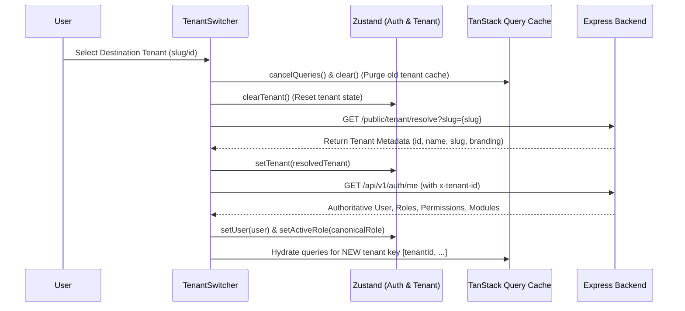

# MASTERHRMS MOBILE — PHASE 3 ARCHITECTURE CORRECTIONS
**Authoritative Architectural Specification & Gate 1 Compliance**
**Version:** 3.0.0  
**Status:** APPROVED & LOCKED FOR IMPLEMENTATION  

---

## 1. Executive Summary

This document establishes the mandatory architectural corrections required for **Phase 3: Role & Permission Navigation Engine & Role-Specific Dashboards** in the MasterHRMS mobile application. These corrections resolve potential security vulnerabilities identified during the architecture review:
1. Premature local permission synthesis based on role names.
2. Unsafe role fallback defaulting unknown users to `employee`.
3. Conflation of Super Admin global platform controls with Tenant Admin workspace controls.
4. Phantom or unverified ERP module key definitions.
5. Insecure tenant-switching states with unpurged caches and fallback query keys.

All implementation code in Phase 3 strictly adheres to this specification.

---

## 2. Mandatory Correction 1 — Permission Resolver Security

### 2.1 Backend Contract Authority
The mobile application is a pure client and **must never synthesize or invent permissions** based on role names (e.g., granting all permissions simply because a user is labeled "Admin" or "HR").
- The authoritative source for all user permissions is the authenticated `/api/v1/auth/me` (or `/api/auth/me`) payload returned by the Express backend.
- Permissions reside in `user.permissions: string[]` populated from the database via `userRoleAssignment -> workspaceRole -> permissions`.
- The mobile UI uses permissions solely to show or hide interface elements (`ScreenGuard`, `PermissionGate`).
- **Critical Security Boundary**: Mobile permission checks are for user experience and visual gating only; the Express backend independently enforces RBAC and tenant boundaries on every single API request.

### 2.2 Wildcard Permission Specification
The backend employs two permission formats:
1. **Hierarchical Dot Notation** (`module.resource.action`): e.g., `hrm.dashboard.view`, `hrm.employees.create`, `hrm.payroll.approve`.
2. **Colon Legacy Notation** (`module:resource:action`): e.g., `hr:employees:read`, `hr:employee:sensitive:read`.

Mobile wildcard expansion supports:
- `*` (Full access): matches any permission string.
- `module.*` or `module:*`: matches any resource/action within that module (e.g., `hrm.*` satisfies `hrm.dashboard.view` and `hrm.employees.create`).
- `module.resource.*`: matches all actions on that resource (e.g., `hrm.employees.*` satisfies `hrm.employees.view` and `hrm.employees.delete`).
- Explicit match: `p === requiredPermission`.

---

## 3. Mandatory Correction 2 — Unknown Role Handling & Canonical Role Mapping

### 3.1 Strict Canonical Whitelist
Only five canonical roles exist within the mobile application:
```typescript
export type CanonicalRole =
  | 'employee'
  | 'manager'
  | 'hr_admin'
  | 'tenant_admin'
  | 'super_admin';
```
Role aliases returned by backend queries are normalized strictly as:
- `admin` -> `tenant_admin`
- `workspace_admin` -> `tenant_admin`
- `Workspace Admin` -> `tenant_admin`
- `super_admin` -> `super_admin`
- `hr_admin` -> `hr_admin`
- `manager` -> `manager`
- `employee` -> `employee`

### 3.2 NO_VALID_ROLE / ACCESS_DENIED State
- **Zero Fallback Rule**: If `user.roles` is empty, missing, or contains only unrecognized strings, the system **never** defaults to `employee`.
- The application enters a strict `NO_VALID_ROLE` state and presents `AccessDeniedView`.
- The user is shown clear messaging indicating that their account has not been assigned an active role in the current tenant workspace, with options to retry, switch workspace, or log out.

### 3.3 Multiple Role & Persona Switching
When an authenticated user possesses multiple canonical roles (e.g., `['employee', 'manager']` or `['hr_admin', 'employee']`):
- `authStore` tracks both `roles: CanonicalRole[]` and `activeRole: CanonicalRole`.
- An active role is selected based on the highest privilege precedence (`super_admin` > `tenant_admin` > `hr_admin` > `manager` > `employee`) on initial boot.
- The user can toggle their active persona in runtime via the **Persona Switcher** without re-logging in.
- The UI navigation adapts to the selected persona, but permission checks continuously validate against the actual authoritative `permissions` array.

---

## 4. Mandatory Correction 3 — Super Admin Navigation Separation

### 4.1 Strict Platform Boundary
- `super_admin` is a global platform role (`tenantId: null` or platform-level account).
- A Super Admin is **never** routed to a `Tenant Admin` workspace dashboard.
- If a Super Admin logs into the mobile app, they are routed to a dedicated **Global Platform Overview** screen (`SuperAdminNavigator`).
- The screen clearly displays:
  - Global Platform Status (Backend API version, Database connection state, Active tenant count).
  - Platform System Metrics & Tenant List summary.
  - Informative banner indicating that full tenant configuration and server management are accessible via the MasterHRMS Web Management Console.
- Strict tenant data isolation is preserved: the app never executes tenant-scoped employee or payroll queries under a Super Admin context without a valid tenant workspace context.

---

## 5. Mandatory Correction 4 — Authoritative Module Registry

Inspected from `server/src/lib/erp-modules.ts` and `/api/v1/auth/me`:
```typescript
export type ErpModuleKey =
  | 'hrm'
  | 'pos'
  | 'inventory'
  | 'crm'
  | 'finance'
  | 'project'
  | 'support'
  | 'procurement'
  | 'analytics';
```

### Module Metadata:
| Key | Name | Core Platform | Default Mobile Scope |
| :--- | :--- | :---: | :--- |
| `hrm` | Human Resource Management | Yes | Core attendance, leaves, payroll, employees |
| `project` | Projects & Tasks | Yes | Kanban, sprints, milestones |
| `support` | Support Desk | Yes | Tickets, SLA resolution |
| `analytics`| Business Analytics | Yes | Reports & KPIs |
| `crm` | Sales CRM | No | Optional addon |
| `pos` | Point of Sale | No | Optional addon |
| `inventory`| Inventory & Stock | No | Optional addon |
| `finance` | Financials & Accounting | No | Optional addon |
| `procurement`| Procurement | No | Optional addon |

`ModuleGate` verifies that `enabledModules.includes(requiredModule)` and `allowedDashboards.includes(requiredModule)` before exposing module-specific navigation or UI sections.

---

## 6. Mandatory Correction 5 — Secure Tenant Switching Lifecycle

### 6.1 Vulnerability Elimination
- Unsafe `'default'` or `'default_tenant'` query-key fallbacks are completely removed.
- If `tenantId` is absent or unverified, tenant-specific queries are strictly disabled (`enabled: Boolean(tenantId)`).

### 6.2 Complete Tenant Switching Lifecycle:

Every step is atomic and prevents any cross-tenant data leakage.
