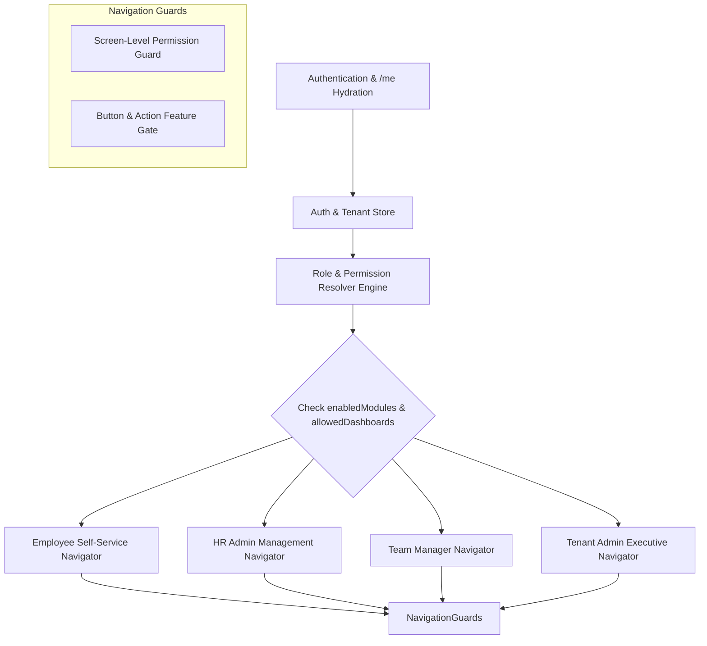

# MASTERHRMS MOBILE — PHASE 3 ARCHITECTURE PLAN
**Role & Permission Navigation Engine & Role-Specific Dashboards**

- **Date:** 2026-11-16
- **Status:** Architectural Specification (Ready for Phase 3 Execution)
- **Target Platform:** Android & iOS (React Native CLI + TypeScript)
- **Document Path:** `docs/mobile/PHASE_3_ARCHITECTURE_PLAN.md`

---

## 1. Executive Overview

Phase 3 establishes the **Role & Permission Navigation Engine** and **Role-Specific Dashboards** for the unified MasterHRMS mobile application. Rather than building separate apps for Employees, HR Managers, and Administrators, MasterHRMS uses a **single adaptive binary** that dynamically constructs its navigation tree, bottom tabs, dashboard widgets, and action capabilities based on:
1. **Canonical User Roles** (e.g., `employee`, `hr_admin`, `manager`, `admin`, `super_admin`).
2. **Granular Permissions** (e.g., `attendance.punch`, `leave.approve`, `payroll.view_own`).
3. **Tenant SaaS Subscriptions** (`enabledModules`: `hrm`, `crm`, `project`, `inventory`, `pos`, `finance`).
4. **Allowed Dashboards** (`allowedDashboards`).

This document details the complete design, data flow, component architecture, and security boundaries required to implement Phase 3 without altering backend business logic or database schemas.



---

## 2. Canonical Role Resolution & Precedence

### 2.1 Backend Canonical Role Definitions
Inspected from `server/src/routes/auth.routes.ts` (`resolveEffectiveUserRoles`) and `server/src/lib/erp-modules.ts`:

| Canonical Role | System Scope | Default Landing Persona | Privileges & Domain |
| :--- | :--- | :--- | :--- |
| `super_admin` | Global Platform | Global Admin Dashboard | Unrestricted platform control, all ERP modules, cross-tenant auditing. |
| `admin` / `workspace_admin` / `tenant_admin` | Single Tenant | Tenant Executive Dashboard | Full control over tenant organization, user management, billing, all enabled modules. |
| `hr_admin` | Single Tenant | HR Management Dashboard | Full HR operations: employee records, attendance adjustments, leave approvals, payroll runs. |
| `manager` | Single Tenant | Team Manager Dashboard | Departmental staff oversight: team attendance, regularization & leave approvals, project milestones. |
| `employee` | Single Tenant | Employee Self-Service (ESS) | Personal self-service: mobile GPS punch, regularization requests, leave applications, payslip downloads. |

### 2.2 Resolution & Precedence Logic
When `/api/v1/auth/me` returns `roles: string[]`:
1. If `roles.includes('super_admin')` → Precedence: **Super Admin**
2. Else if `roles.includes('admin') || roles.includes('workspace_admin') || roles.includes('tenant_admin')` → Precedence: **Tenant Admin**
3. Else if `roles.includes('hr_admin')` → Precedence: **HR Admin**
4. Else if `roles.includes('manager')` → Precedence: **Manager**
5. Else → Precedence: **Employee**

The user's default active view on launch will correspond to their highest-precedence role, while multi-role users can toggle their active view at runtime.

---

## 3. Multiple-Role Support & Role Switching

### 3.1 Overlapping Roles Scenario
In enterprise HR environments, a single user frequently possesses multiple responsibilities:
- An **HR Admin** is also an **Employee** who needs to log personal attendance and view their own payslips.
- A **Manager** oversees direct reports but also reports to upper management and applies for leave.
- A **Tenant Admin** may temporarily need to view the system from an Employee perspective to verify policies.

### 3.2 Mobile Architecture for Multi-Role Users
1. **Active Role State (`useAuthStore`):**
   ```typescript
   interface AuthState {
     roles: UserRole[];          // All assigned roles (e.g. ['employee', 'hr_admin'])
     activeRole: UserRole;       // Currently selected persona view (e.g. 'hr_admin')
     setActiveRole: (role: UserRole) => void;
   }
   ```
2. **Runtime Persona Switcher:**
   - A persistent Role Switcher pill in the top header or user profile drawer.
   - Switching `activeRole` switches the active bottom-tab navigator (e.g., from HR Admin view to Employee Self-Service view) with zero network reload.
3. **Composite Action Permissions:**
   - Regardless of which active persona view is selected, action-level checks always evaluate the **union of all granted permissions**.
   - An HR Admin in Employee Self-Service view can still approve an urgent leave request from a push notification without manually switching back to the HR view.

---

## 4. Granular Permission Resolver

### 4.1 Permission Schema
Permissions in MasterHRMS follow the dot-notation convention: `<module>.<resource>.<action>`
- Examples:
  - `attendance.punch` — Permission to perform GPS clock-in / clock-out.
  - `attendance.view` — View personal attendance history.
  - `attendance.approve` — Approve attendance regularizations.
  - `leave.apply` — Submit leave requests.
  - `leave.approve` — Approve team/company leave requests.
  - `payroll.view_own` — View personal payslips.
  - `payroll.manage` — Initiate and finalize payroll runs.
  - `employees.view` — View company employee directory.
  - `employees.create` — Onboard new staff members.

### 4.2 Permission Resolver Utilities (`mobile-app/src/core/auth/permissionService.ts`)
```typescript
export class PermissionService {
  /**
   * Evaluates if user possesses a single permission, supporting wildcards (e.g. 'attendance.*')
   */
  public static hasPermission(userPermissions: string[], required: string): boolean {
    if (userPermissions.includes('*') || userPermissions.includes(required)) {
      return true;
    }
    const [mod, action] = required.split('.');
    if (userPermissions.includes(`${mod}.*`)) {
      return true;
    }
    return false;
  }

  /**
   * Evaluates multiple permissions with 'AND' or 'OR' logic
   */
  public static hasAnyPermission(userPermissions: string[], required: string[]): boolean {
    return required.some((perm) => this.hasPermission(userPermissions, perm));
  }

  public static hasAllPermissions(userPermissions: string[], required: string[]): boolean {
    return required.every((perm) => this.hasPermission(userPermissions, perm));
  }
}
```

### 4.3 React Hook: `usePermission`
```typescript
export function usePermission(required: string | string[], mode: 'ALL' | 'ANY' = 'ANY'): boolean {
  const permissions = useAuthStore((s) => s.permissions);
  const roles = useAuthStore((s) => s.roles);

  // Super Admin and Tenant Admin automatically satisfy all permissions
  if (roles.includes('super_admin') || roles.includes('admin') || roles.includes('workspace_admin')) {
    return true;
  }

  if (Array.isArray(required)) {
    return mode === 'ALL'
      ? PermissionService.hasAllPermissions(permissions, required)
      : PermissionService.hasAnyPermission(permissions, required);
  }
  return PermissionService.hasPermission(permissions, required);
}
```

---

## 5. Dynamic Module Visibility (`enabledModules`) & `allowedDashboards`

### 5.1 Tenant Subscription Gating
The server evaluates the tenant's plan in MariaDB and returns:
- `enabledModules: string[]` — Active modules for this tenant (e.g. `['hrm', 'project']`).
- `allowedDashboards: string[]` — Filtered dashboards for the user's role (e.g. `['hrm']`).

### 5.2 Module Gating Rule
Even if a user's role has permission code `crm.dashboard.view`, if the tenant subscription does not include `'crm'` in `enabledModules`:
1. The CRM tab / module is **completely hidden** from the UI.
2. Direct navigation to CRM screens is blocked by the route guard.
3. API requests to `/crm/*` are blocked with HTTP 403 by server-side middleware.

### 5.3 Supported ERP Modules Registry

| Module Key | Display Name | Required Module Permission | Key Mobile Features |
| :--- | :--- | :--- | :--- |
| `hrm` | HRM | `hrm.dashboard.view` | Quick Punch, Attendance History, Leaves, Payroll, Directory |
| `project` | Projects | `project.dashboard.view` | My Tasks, Milestone Tracking, Task Status Updates |
| `support` | Support | `support.dashboard.view` | Ticket List, Create Ticket, Customer Issue Tracking |
| `crm` | Sales CRM | `crm.dashboard.view` | Lead Pipeline, Customer Contacts, Quotation Approvals |
| `finance` | Finance | `finance.dashboard.view` | Expense Claims, Invoices, Payment Approvals |
| `inventory`| Inventory | `inventory.dashboard.view` | Product Lookup, Stock Verification, Warehouse Locations |

---

## 6. Role-Specific Navigation Structures

The mobile application utilizes a **Nested Navigation Hierarchy**:
`RootNavigator` → `AppNavigator` → **Dynamic Role Navigator** (determined by `activeRole`).

### 6.1 Employee Self-Service (ESS) Navigator
Designed for staff daily self-service actions:
```
EmployeeTabNavigator
├── Tab 1: Home (Quick Punch, Today's Shift, Attendance Summary, Notices)
├── Tab 2: Attendance (Punch History, Calendar View, Regularization Request Modal)
├── Tab 3: Leaves (Leave Balance Cards, Apply Leave, Past Applications & Status)
├── Tab 4: Payslips (Monthly Payslips List, Year-to-Date Breakdown, PDF Preview/Download)
└── Tab 5: Profile (Personal Details, Emergency Contacts, Biometric Toggle, Logout)
```

### 6.2 HR Admin Management Navigator
Designed for human resource operational management:
```
HRAdminTabNavigator
├── Tab 1: HR Overview (Present Today, Late Arrivals, On Leave, Pending Action Badges)
├── Tab 2: Staff Directory (Searchable Employee Roster, Department Filter, Profile View)
├── Tab 3: Approvals Center (Attendance Adjustments, Leave Applications, Expense Approvals)
├── Tab 4: Payroll Batches (Active Payroll Runs, Salary Slips Generation, Audit Status)
└── Tab 5: Settings & Switcher (Company Policies, Role Persona Switcher, Workspace Info)
```

### 6.3 Team Manager Navigator
Designed for departmental leads:
```
ManagerTabNavigator
├── Tab 1: Team Dashboard (Team Attendance Today, Who's Out, Team Milestone Progress)
├── Tab 2: Team Approvals (Direct Report Leaves & Attendance Regularizations)
├── Tab 3: Team Projects (Active Tasks, Assignee Progress, Deadline Alerts)
├── Tab 4: My ESS (Personal Punch, My Leaves, My Payslips)
└── Tab 5: Profile & Settings
```

### 6.4 Tenant Admin Navigator
Designed for tenant owners and executive administrators:
```
TenantAdminTabNavigator
├── Tab 1: Organization KPIs (Headcount Growth, Module Usage, Subscription Status)
├── Tab 2: User Access Management (Staff Accounts, Role Assignment, Status Activation)
├── Tab 3: Workspace Branding & Config (Tenant Info, Custom Branding, Work Locations)
├── Tab 4: Security & Audit Logs (Session Management, Device Logins, Sensitive Exports)
└── Tab 5: Profile & Account Settings
```

---

## 7. Permission-Based Navigation Guards & UI Gates

### 7.1 Declarative UI Component Gate: `<PermissionGate>`
Used to conditionally render action buttons, tabs, or fields:
```tsx
<PermissionGate
  required="attendance.approve"
  fallback={<Text variant="caption" color="textMuted">Approval requires manager privileges</Text>}
>
  <Button title="Approve Request" variant="success" onPress={handleApprove} />
</PermissionGate>
```

### 7.2 Route Navigation Guard: `<ScreenGuard>`
Wraps sensitive screen components to enforce role and permission validation before rendering:
```tsx
export const ScreenGuard: React.FC<{
  requiredPermissions?: string[];
  requiredModule?: string;
  children: React.ReactNode;
}> = ({ requiredPermissions, requiredModule, children }) => {
  const { permissions, enabledModules } = useAuthStore();
  const navigation = useNavigation();

  if (requiredModule && !enabledModules.includes(requiredModule)) {
    return <AccessDeniedView reason="This module is not active for your organization." />;
  }

  if (requiredPermissions && !PermissionService.hasAnyPermission(permissions, requiredPermissions)) {
    return <AccessDeniedView reason="You do not have permission to view this section." />;
  }

  return <>{children}</>;
};
```

---

## 8. Backend Authorization Boundaries

The mobile application never assumes trust on the client. UI guards are convenience features to prevent user frustration; security is enforced at the server:

1. **Authentication Token Integrity (`requireAuth`):**
   Every API request includes `Authorization: Bearer <token>`. The server verifies signature, expiration, and session status in the `sessions` table.
2. **Tenant Boundary Enforcement (`requireTenantContext`):**
   The server extracts `tenantId` from JWT claims and rejects requests where `x-tenant-id` conflicts with the authenticated user's organization (`HOST_TENANT_MISMATCH`).
3. **Server-Side Permission Enforcement (`requirePermission`):**
   Protected API endpoints inspect effective permissions loaded from the database:
   ```typescript
   router.post("/attendance/approve", requirePermission("attendance.approve"), handleApproval);
   ```
4. **Client 403 Error Handling:**
   When the server returns `403 Forbidden`, the mobile Axios interceptor maps it to an `ApiError` with `isForbidden: true`. The UI surfaces a non-disruptive alert rather than invalidating the entire user session.

---

## 9. Tenant Switching & Cache Isolation

### 9.1 Cache Leakage Prevention
Multi-tenant mobile applications risk data leakage if cached queries from Organization A persist in memory when a user logs into Organization B.

### 9.2 Cache Isolation Protocol
1. **Query Key Prefixing:**
   Every query key is prefixed with the tenant ID:
   ```typescript
   export function createTenantQueryKey(keys: readonly unknown[]): readonly unknown[] {
     const tenantId = useTenantStore.getState().currentTenant?.id || 'default';
     return [tenantId, ...keys];
   }
   ```
2. **Tenant Transition Lifecycle:**
   When switching organizations or logging out:
   - `queryClient.clear()` immediately evacuates all in-memory query cache entries.
   - `secureStorage.removeItem(STORAGE_KEYS.AUTH_TOKEN)` & session tokens are cleared.
   - `useAuthStore.getState().logout()` resets role, permission, and user states.
   - New tenant slug is resolved and fresh `/me` hydration re-establishes isolated state.
3. **Dynamic Theming Synchronizer:**
   `useThemeStore.setTenantColor(tenant.primaryColor)` instantaneously repaints the app UI with the target tenant's brand identity.

---

## 10. Phase 3 Implementation Deliverables & Milestones

| Milestone | Target Deliverable | Description |
| :--- | :--- | :--- |
| **3.1** | `PermissionService` & `usePermission` Hook | Granular permission resolver supporting wildcards and multi-permission evaluation. |
| **3.2** | Navigation Engine & Role Switcher | Dynamic role-based navigator loading ESS, HR Admin, Manager, and Tenant Admin tab structures. |
| **3.3** | Permission & Module Guards | `<PermissionGate>` and `<ScreenGuard>` components with `<AccessDeniedView>`. |
| **3.4** | Employee Self-Service Dashboard (ESS) | Complete ESS Home screen with quick punch widget, shift status, and recent activity. |
| **3.5** | HR Admin Management Dashboard | Complete HR Overview screen with live attendance summary, pending approvals badge, and headcount KPIs. |
| **3.6** | Manager & Tenant Admin Dashboards | Team management dashboard and executive tenant overview dashboard. |
| **3.7** | Phase 3 Verification & Test Suite | Unit tests for permission resolver, role switching, module gating, and navigation guards. |

---

*This architecture plan is complete and ready to guide Phase 3 execution upon review and authorization.*
