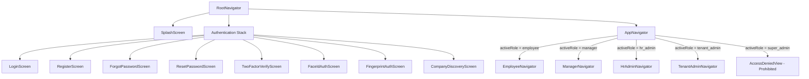

# MasterHRMS Mobile — Complete Screen & Component Inventory

## 1. Inventory Overview

This document provides an exhaustive, forensic inventory of every screen, navigation flow, reusable component, and interactive UI element discovered across the MasterHRMS React Native / Expo mobile application codebase (`mobile-app/src/`).

### Global Inventory Statistics
- **Total Screens Discovered**: 53 Screens
- **Shared Interactive Containers & Shells**: 2 (`WorkspaceModuleShell.tsx`, `TodoSharedModals.tsx`)
- **Total Screen / Container Files**: 55 Files
- **Total Lines of TypeScript / TSX in Modules**: 38,981 LOC
- **Total Touchable Elements (`TouchableOpacity`, `Pressable`, `Button`)**: 531
- **Total Form Inputs (`TextInput`)**: 82
- **Total In-App Dialogs & Sheets (`Modal`)**: 45
- **Total Toggle Switches (`Switch`)**: 11
- **Total Interactive Action Points**: 669 Elements

---

## 2. Navigators & Role Navigation Architecture

The MasterHRMS mobile application implements strict role-based access control (RBAC). Upon login, [AppNavigator.tsx](file:///c:/Users/TSV%20Global%20Solutions/Documents/hrms/mobile-app/src/modules/navigation/AppNavigator.tsx) inspects the active canonical role in `useAuthStore` and conditionally routes to exactly one role-specific navigation stack.

### Navigation Hierarchy

### Navigators Specification Table

| Navigator Name | File Location | Canonical Role | Screen Count | Enforced Access Policy |
|---|---|---|---|---|
| **RootNavigator** | `mobile-app/src/app/navigation/RootNavigator.tsx` | Global | 2 stacks | Orchestrates AuthStack vs AppNavigator based on `isAuthenticated`. |
| **AppNavigator** | `mobile-app/src/modules/navigation/AppNavigator.tsx` | Multi-role | 4 branches | Switchboard routing strictly to role stack. Fails closed (`AccessDeniedView`). |
| **EmployeeNavigator** | `mobile-app/src/modules/navigation/EmployeeNavigator.tsx` | `employee` | 23 screens | Full ESS suite, Attendance, Leave, Payslips, Chat, Calendar, Todos, Profile. |
| **ManagerNavigator** | `mobile-app/src/modules/navigation/ManagerNavigator.tsx` | `manager` | 26 screens | Inherits ESS suite + Team Attendance, Team Approvals, Team Projects. |
| **HrAdminNavigator** | `mobile-app/src/modules/navigation/HrAdminNavigator.tsx` | `hr_admin` | 27 screens | Inherits ESS + Employee Directory, Org Attendance, Payroll Overview, Pending Approvals. |
| **TenantAdminNavigator** | `mobile-app/src/modules/navigation/TenantAdminNavigator.tsx` | `tenant_admin` | 27 screens | Inherits ESS + Workspace Settings, Security Overview, Modules Overview, User Access. |
| **SuperAdminNavigator** | `mobile-app/src/modules/navigation/SuperAdminNavigator.tsx` | `super_admin` | 4 screens | **BLOCKED / PROHIBITED**: Unmounted in AppNavigator; Super Admin login rejected at API level. |

---

## 3. Module-by-Module Screen Master Inventory

### A. Authentication & Security (9 Screens)

| Screen Name | File Path | Stack | Touchables | Inputs | Modals | Switches | UI Actions Inventory |
|---|---|---|---|---|---|---|---|
| **SplashScreen** | `modules/authentication/screens/SplashScreen.tsx` | Root | 0 | 0 | 0 | 0 | Auto-checks stored credentials in Keychain and restores session or routes to Login. |
| **CompanyDiscoveryScreen** | `modules/authentication/screens/CompanyDiscoveryScreen.tsx` | Auth | 1 | 1 | 0 | 0 | Workspace slug input, "Continue to Workspace" button. Calls `TenantService.resolveTenant`. |
| **LoginScreen** | `modules/authentication/screens/LoginScreen.tsx` | Auth | 12 | 2 | 0 | 0 | Email/password inputs, Show/Hide password toggle, "Sign In" button, Social login pills, "Forgot Password?" link, "Create Account" link, Biometric shortcut pill. |
| **RegisterScreen** | `modules/authentication/screens/RegisterScreen.tsx` | Auth | 8 | 4 | 0 | 0 | Full Name, Company Name, Work Email, Password inputs; Terms checkbox; "Create Workspace Account" submit button; "Already have account? Sign In" link. |
| **ForgotPasswordScreen** | `modules/authentication/screens/ForgotPasswordScreen.tsx` | Auth | 3 | 1 | 0 | 0 | Work Email input, "Send Reset Instructions" submit button, "Back to Sign In" icon & link. Calls `AuthService.forgotPassword`. |
| **ResetPasswordScreen** | `modules/authentication/screens/ResetPasswordScreen.tsx` | Auth | 8 | 3 | 0 | 0 | 6-digit OTP code input, New Password, Confirm Password, Show/Hide password toggles, "Reset Password" submit, "Resend OTP" countdown button. |
| **TwoFactorVerifyScreen** | `modules/authentication/screens/TwoFactorVerifyScreen.tsx` | Auth | 5 | 1 | 0 | 0 | 6-digit MFA OTP input, "Verify & Proceed" button, "Resend Code" timer link, "Use Recovery Code" toggle, Back to Login button. |
| **FaceIdAuthScreen** | `modules/authentication/screens/FaceIdAuthScreen.tsx` | Auth | 4 | 0 | 0 | 0 | "Scan Face ID" prompt button, "Use Password Instead" link, Cancel button, Help link. |
| **FingerprintAuthScreen** | `modules/authentication/screens/FingerprintAuthScreen.tsx` | Auth | 4 | 0 | 0 | 0 | "Touch Fingerprint Sensor" trigger, "Use Password" link, Cancel button, Help link. |

---

### B. Dashboard Screens (6 Screens)

| Screen Name | File Path | Roles | Touchables | Inputs | Modals | Switches | UI Actions Inventory |
|---|---|---|---|---|---|---|---|
| **HomeScreen** | `modules/dashboard/screens/HomeScreen.tsx` | Fallback | 2 | 0 | 0 | 0 | Role selector pill, Sign Out button. Used as development switcher. |
| **EmployeeDashboardScreen** | `modules/dashboard/screens/EmployeeDashboardScreen.tsx` | `employee` | 26 | 0 | 1 | 0 | Punch In/Out button with GPS badge; Quick Action pills (Apply Leave, View Payslip, Shift Schedule, Timesheet); Leave balance cards; Announcements carousel; Recent activity list; View all links. |
| **ManagerDashboardScreen** | `modules/dashboard/screens/ManagerDashboardScreen.tsx` | `manager` | 18 | 0 | 0 | 0 | Team attendance KPI tiles (Present, Absent, On Leave); Pending approvals counter; Team projects shortcut; Quick approve/reject actions; View team roster link. |
| **HrAdminDashboardScreen** | `modules/dashboard/screens/HrAdminDashboardScreen.tsx` | `hr_admin` | 20 | 0 | 0 | 0 | Org Headcount card; Daily attendance breakdown; Payroll cycle progress bar; Leave approval queue shortcuts; Department distribution pie; Refresh button. |
| **TenantAdminDashboardScreen** | `modules/dashboard/screens/TenantAdminDashboardScreen.tsx` | `tenant_admin` | 16 | 0 | 0 | 0 | Subscription tier badge; Seat utilization gauge; Active modules grid; Security status card; Workspace configuration shortcut; Audit log shortcut. |
| **SuperAdminDashboardScreen** | `modules/dashboard/screens/SuperAdminDashboardScreen.tsx` | `super_admin` | 14 | 0 | 0 | 0 | *(Prohibited)* Global tenant count, system telemetry metrics, active database connections, server health status. |

---

### C. Employee Self Service (ESS) (19 Screens)

| Screen Name | File Path | Touchables | Inputs | Modals | Switches | UI Actions Inventory |
|---|---|---|---|---|---|---|
| **EmployeeServicesHubScreen** | `modules/ess/screens/EmployeeServicesHubScreen.tsx` | 15 | 0 | 0 | 0 | Grid navigation to: Attendance, Leaves, Payslips, Documents, Timesheets, Shifts, Advances, Expenses, Performance, Settings. |
| **AttendanceDetailScreen** | `modules/ess/screens/AttendanceDetailScreen.tsx` | 24 | 0 | 2 | 0 | Monthly / Daily view toggle; Month offset `<` `>` pagination; Day selection cards; Regularization request flow (3 steps modal); Download monthly report icon; Apply Leave shortcut. |
| **GeofenceMapPunchScreen** | `modules/ess/screens/GeofenceMapPunchScreen.tsx` | 5 | 1 | 0 | 0 | GPS coordinates refresh button; Geofence perimeter status indicator; Work location picker; Notes input; Slide or tap to Punch In/Out. |
| **ApplyLeaveScreen** | `modules/ess/screens/ApplyLeaveScreen.tsx` | 8 | 2 | 0 | 1 | Leave type dropdown picker; Start date picker; End date picker; Half-day toggle switch; Reason text area; "Submit Leave Application" button. |
| **LeaveDetailScreen** | `modules/ess/screens/LeaveDetailScreen.tsx` | 9 | 0 | 0 | 0 | Leave balance cards (Casual, Sick, Earned); Leave vs Permission tabs; Historical request status pills; Cancel pending request button; "Request Permission" action. |
| **CalendarLeavePlannerScreen** | `modules/ess/screens/CalendarLeavePlannerScreen.tsx` | 35 | 0 | 1 | 0 | Interactive monthly calendar matrix; Day tap to inspect leaves/holidays; Holiday badge indicators; Quick apply modal; Month pagination. |
| **PayslipsScreen** | `modules/ess/screens/PayslipsScreen.tsx` | 8 | 0 | 0 | 0 | Annual summary card (Gross, Net, Deductions); Year filter dropdown; Monthly payslip item cards; Download PDF action icon; Navigate to breakdown. |
| **SalarySlipDetailScreen** | `modules/ess/screens/SalarySlipDetailScreen.tsx` | 9 | 0 | 1 | 0 | Month navigation (`<` `>`); Net Pay card; Breakdown trigger buttons (Basic, Allowances, Tax & Insurance, Other); Detailed deduction modal sheet; Download Payslip button. |
| **SalaryAdvanceLoanScreen** | `modules/ess/screens/SalaryAdvanceLoanScreen.tsx` | 5 | 3 | 1 | 0 | Requested amount input; Loan type dropdown selector; Repayment tenure dropdown (3, 6, 12 months); Reason text input; "Submit Request" button. |
| **PaymentCardsScreen** | `modules/ess/screens/PaymentCardsScreen.tsx` | 5 | 4 | 1 | 0 | Virtual salary debit card display; Bank account number; IFSC code; Add/Edit card modal; "View Salary Slips" navigation button. |
| **TimesheetScreen** | `modules/ess/screens/TimesheetScreen.tsx` | 9 | 3 | 1 | 0 | Weekly date range filter; Add Timesheet modal (Project, Date, Hours, Description); Delete pending entry icon; Weekly aggregated hours counter. |
| **ShiftScheduleScreen** | `modules/ess/screens/ShiftScheduleScreen.tsx` | 6 | 3 | 1 | 0 | Weekly roster cards; Current shift timings; "Request Shift Swap" button; Swap modal (Peer employee picker, Date, Swap reason); Status filter pills. |
| **ProfileScreen** | `modules/ess/screens/ProfileScreen.tsx` | 8 | 0 | 0 | 0 | Profile avatar image; Personal info cards; Contact details; Statutory info (PAN, Aadhaar); Emergency contact; "Edit Profile" navigation button. |
| **EditProfileScreen** | `modules/ess/screens/EditProfileScreen.tsx` | 6 | 6 | 0 | 0 | Phone, Emergency Contact Name, Emergency Phone, Address, Blood Group inputs; Change photo button; "Save Changes" submit button. |
| **DocumentsVaultScreen** | `modules/ess/screens/DocumentsVaultScreen.tsx` | 7 | 1 | 1 | 0 | Category tabs (All, Contracts, Policies, Letters); Document item cards; "Request Document" button & modal; Download document icon. |
| **ExpenseClaimsScreen** | `modules/ess/screens/ExpenseClaimsScreen.tsx` | 9 | 5 | 1 | 0 | Category filters (All, Travel, Meals, Office, Telecom); Expense claim item list; "+ Add Claim" modal (Title, Amount, Category, Receipt); Submit button. |
| **PerformanceScreen** | `modules/ess/screens/PerformanceScreen.tsx` | 14 | 0 | 2 | 0 | Tabs (Overview, KPIs, Feedback); Goal progress bars; KPI detail modal; Feedback review modal; Check-in progress trigger. |
| **NotificationsScreen** | `modules/ess/screens/NotificationsScreen.tsx` | 6 | 0 | 0 | 0 | Filter tabs (All, Approvals, Payroll, General); Notification item cards; Mark as read action; Tap to navigate deep link; Clear all icon. |
| **SettingsScreen** | `modules/ess/screens/SettingsScreen.tsx` | 6 | 0 | 0 | 3 | Push notifications toggle; Biometric login toggle; Dark mode toggle; Language picker; "Change Password" link; "Sign Out" button. |

---

### D. HR Admin Module (4 Screens)

| Screen Name | File Path | Touchables | Inputs | Modals | Switches | UI Actions Inventory |
|---|---|---|---|---|---|---|
| **EmployeeDirectoryScreen** | `modules/hr/screens/EmployeeDirectoryScreen.tsx` | 3 | 1 | 0 | 0 | Search bar (by name/ID); Department filter chips; Employee card taps; Status indicator pills (Active, On Leave, Inactive). |
| **OrgAttendanceScreen** | `modules/hr/screens/OrgAttendanceScreen.tsx` | 1 | 0 | 0 | 0 | Date selector; Summary metrics (Total, Present, Absent, Half Day); Realtime attendance log list; Pull to refresh. |
| **PayrollOverviewScreen** | `modules/hr/screens/PayrollOverviewScreen.tsx` | 1 | 0 | 0 | 0 | Monthly payroll run cards; Total disbursement amount; Employee count; Status pills (Draft, Calculated, Paid); Pull to refresh. |
| **PendingApprovalsScreen** | `modules/hr/screens/PendingApprovalsScreen.tsx` | 3 | 0 | 0 | 0 | Leave approval cards; Quick "Approve" button; Quick "Reject" button with remarks modal; Filter by approval status. |

---

### E. Manager Module (3 Screens)

| Screen Name | File Path | Touchables | Inputs | Modals | Switches | UI Actions Inventory |
|---|---|---|---|---|---|---|
| **TeamAttendanceScreen** | `modules/manager/screens/TeamAttendanceScreen.tsx` | 1 | 0 | 0 | 0 | Date selector; Direct report status cards (Clock-in time, Work duration, Location); Pull to refresh. |
| **TeamApprovalsScreen** | `modules/manager/screens/TeamApprovalsScreen.tsx` | 9 | 1 | 1 | 0 | Approval queue tabs (Leaves, Regularizations, Profile Changes); Request detail modal; "Approve" button; "Reject" button; Manager comments input. |
| **TeamProjectsScreen** | `modules/manager/screens/TeamProjectsScreen.tsx` | 1 | 0 | 0 | 0 | Active team projects list; Progress percentage bars; Member avatar stack; Pull to refresh. |

---

### F. Tenant Admin Module (4 Screens)

| Screen Name | File Path | Touchables | Inputs | Modals | Switches | UI Actions Inventory |
|---|---|---|---|---|---|---|
| **WorkspaceSettingsScreen** | `modules/tenant-admin/screens/WorkspaceSettingsScreen.tsx` | 2 | 5 | 0 | 0 | Company Name, Support Email, Phone, Timezone, Currency form inputs; "Save Settings" button. |
| **SecurityOverviewScreen** | `modules/tenant-admin/screens/SecurityOverviewScreen.tsx` | 1 | 0 | 0 | 0 | MFA enforcement badge; Session timeout display; Password policy summary; IP whitelisting status. |
| **ModulesOverviewScreen** | `modules/tenant-admin/screens/ModulesOverviewScreen.tsx` | 1 | 0 | 0 | 0 | Enterprise modules list (Core HR, Attendance, Payroll, Leave, Chat, etc.); Enabled/Disabled indicators. |
| **UserAccessScreen** | `modules/tenant-admin/screens/UserAccessScreen.tsx` | 1 | 0 | 0 | 0 | Seat utilization progress bar; Active employees count; Plan limit; "Manage Subscription" link. |

---

### G. Super Admin Module (2 Screens — Prohibited on Mobile)

| Screen Name | File Path | Touchables | Inputs | Modals | Switches | UI Actions Inventory |
|---|---|---|---|---|---|---|
| **PlatformTenantsScreen** | `modules/super-admin/screens/PlatformTenantsScreen.tsx` | 1 | 0 | 0 | 0 | *(Prohibited)* SaaS tenant listing, plan badges, user counts, tenant status. |
| **SystemDiagnosticsScreen** | `modules/super-admin/screens/SystemDiagnosticsScreen.tsx` | 1 | 0 | 0 | 0 | *(Prohibited)* Server uptime, memory utilization, active database connections, node environment. |

---

### H. Chat & Realtime Calling (3 Screens)

| Screen Name | File Path | Touchables | Inputs | Modals | Switches | UI Actions Inventory |
|---|---|---|---|---|---|---|
| **ChatConversationsScreen** | `modules/chat/screens/ChatConversationsScreen.tsx` | 34 | 6 | 3 | 0 | Conversation list; Direct vs Groups vs Calls tabs; Global search modal; "+ New Chat / Group" modal; Pin/Mute conversation actions; Delete call log action. |
| **ChatConversationDetailScreen** | `modules/chat/screens/ChatConversationDetailScreen.tsx` | 98 | 8 | 15 | 1 | Message thread list; Text composer; Pre-send WhatsApp media preview (Camera, Gallery, Docs with caption & send); Voice note record & upload; Voice note audio playback; Swipe right to reply; Emoji reactions sheet; Poll creation modal; Group member management modal; Audio/Video call dials. |
| **ChatCallScreen** | `modules/chat/screens/ChatCallScreen.tsx` | 14 | 0 | 1 | 0 | Immersive full-screen active call stage; Mic mute/unmute; Camera flip; Video enable/disable; Audio routing (speaker/earpiece); "Add to Call" contact invitation modal; End Call button; 30-sec timeout "Didn't Respond" screen with Call Again. |

---

### I. Calendar Module (1 Screen)

| Screen Name | File Path | Touchables | Inputs | Modals | Switches | UI Actions Inventory |
|---|---|---|---|---|---|---|
| **CalendarMainScreen** | `modules/calendar/screens/CalendarMainScreen.tsx` | 57 | 14 | 7 | 2 | Day/Week/Month view toggles; Event cards; "+ Create Meeting" modal (Title, Category, Room, Recurrence, Invitees); RSVP actions (Accept, Tentative, Decline); Event editing & deletion; Share event modal; Export ICS action. |

---

### J. Tasks, Todos & Gantt (2 Screens + 1 Shared Container)

| Screen Name | File Path | Touchables | Inputs | Modals | Switches | UI Actions Inventory |
|---|---|---|---|---|---|---|
| **TodoListScreen** | `modules/todo/screens/TodoListScreen.tsx` | 12 | 1 | 0 | 0 | Task list; Status filter chips (All, To Do, In Progress, Completed); Category selector; "+ New Task" button; Checkbox completion toggle; Tap to open task detail modal. |
| **GanttTimelineScreen** | `modules/todo/screens/GanttTimelineScreen.tsx` | 9 | 1 | 0 | 0 | Timeline zoom controls (Day, Week, Month); Horizontal Gantt chart bars; Task progress drag/tap; Milestone indicators; Legend view. |
| **TodoSharedModals** | `modules/todo/components/TodoSharedModals.tsx` | 24 | 8 | 3 | 0 | Task Create/Edit Modal; Checklist item adder & toggle checkboxes; Comments thread with new comment input; Task priority & category dropdowns; Delete task confirmation. |

---

### K. Shared Navigation & Shell Components (4 Items)

| Component Name | File Path | Purpose | UI Actions |
|---|---|---|---|
| **WorkspaceModuleShell** | `components/workspace/WorkspaceModuleShell.tsx` | Global app container & incoming call listener | Top bar integration; Full-screen Incoming Call ringing UI modal; Accept (routes to ChatCall) & Decline buttons; Background polling guard. |
| **PersonaSwitcher** | `modules/navigation/PersonaSwitcher.tsx` | Multi-role switching sheet | Displays user's assigned roles (Employee, Manager, HR Admin, Tenant Admin); Tapping a role switches active navigation stack. |
| **AppTopBar** | `components/common/AppTopBar.tsx` | Standard module header | Left navigation/back arrow; Title; Notifications bell icon with unread badge; Chat bubble icon with badge; User avatar menu. |
| **AppBottomNav** | `components/common/AppBottomNav.tsx` | Standard bottom tab bar | 4 or 5 primary tabs based on active role (Home, Services, Calendar, Chat, Profile). |

---

## 4. Shared Reusable Component Library

The application defines a consistent set of shared design system components under `mobile-app/src/components/common/` and security guards under `mobile-app/src/components/guards/`:

1. **`Button.tsx`**: Standard enterprise button supporting variants (`primary`, `secondary`, `outline`, `ghost`, `danger`), loading spinner, icon slots, and disabled states.
2. **`Card.tsx`**: Elevated and outlined container with theme-aware background, rounded corners, and padding.
3. **`Text.tsx`**: Typography wrapper enforcing design system fonts (`Inter`), weights, sizes, and contrast colors.
4. **`LoadingView.tsx`**: Centered activity spinner with optional progress message.
5. **`EmptyStateView.tsx`**: Zero-data illustration container with action button.
6. **`OfflineBanner.tsx`**: Top alert bar displayed when NetInfo reports no network connectivity.
7. **`PermissionGate.tsx`**: Conditionally renders children if user holds the specified granular permission string.
8. **`ModuleGate.tsx`**: Conditionally renders UI based on tenant module entitlement flags.
9. **`ScreenGuard.tsx`**: Full-screen gate displaying access denied when the user lacks required credentials.
10. **`AccessDeniedView.tsx`**: Standard error view rendered when an unauthorized role attempts route access.
