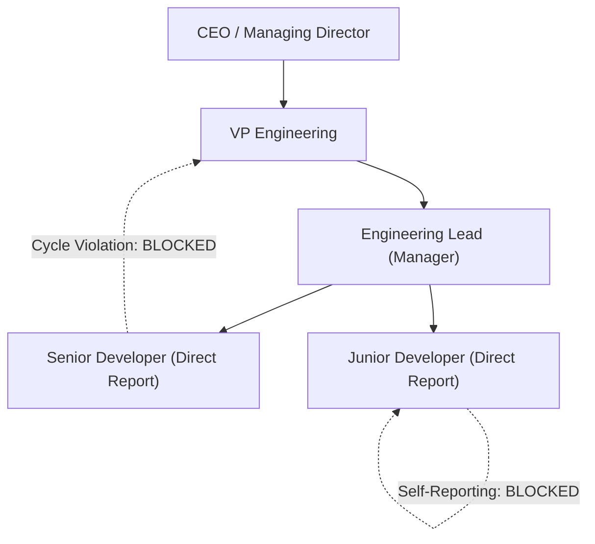

# MASTERHRMS — Phase 3: Lifecycle Discovery
## Document 05: Manager Self-Service (MSS) Discovery

**Document Version:** 1.0.0  
**Phase:** Phase 3 – Lifecycle Discovery  
**Domain:** Manager Self-Service (MSS), Team Management & Approval Workflows  
**Date:** November 19, 2026  
**Reference Target:** WorkDo HRMS Manager Capabilities  
**Source of Truth:** MASTERHRMS Local Source Code  

---

### 1. Module Overview & Functional Scope

Manager Self-Service (MSS) equips team leads and department managers with operational authority over their direct reports without granting them broad tenant administrative rights.

Key capabilities include:
1. Viewing direct report employee profiles, contact cards, and employment status.
2. Unified pending approvals queue across Leave, Attendance Regularizations, and Profile Changes.
3. Reviewing subordinate attendance, shifts, and team calendar availability.
4. Reviewing reporting manager change requests with cycle detection.
5. Conducting probation reviews and performance evaluations.

In MASTERHRMS:
- Frontend Routes:
  - Team Directory: `/me/team.tsx` ([team.tsx](file:///c:/Users/TSV%20Global%20Solutions/Documents/hrms/src/routes/_authenticated/me/team.tsx))
  - Approvals Hub: `/me/approvals.tsx` ([approvals.tsx](file:///c:/Users/TSV%20Global%20Solutions/Documents/hrms/src/routes/_authenticated/me/approvals.tsx))
  - Team Leave Calendar: `/me/leave/team-calendar.tsx`
- Backend API Endpoints:
  - `server/src/routes/employee-self-service.routes.ts` (`/api/me/team/*`)
  - `server/src/services/reporting-manager.service.ts`

---

### 2. Reporting Hierarchy & Graph Integrity Engine

The reporting structure in MASTERHRMS is managed with strict graph integrity checks in `server/src/services/reporting-manager.service.ts`:

**Enforced Constraints (Empirically Verified in Test Suite):**
1. **Self-Reporting Rejected**: An employee cannot be their own manager (`managerId === id`).
2. **Direct Subordinate Cycle Blocked**: A manager cannot report to an immediate subordinate.
3. **Deep Circular Traversal Blocked**: A multi-level circular loop (A → B → C → A) is detected and rejected during graph ancestor traversal.
4. **Cross-Tenant Boundary**: A manager must belong strictly to the same `tenantId`.
5. **Active Status Requirement**: Only active employees can be designated as reporting managers.

---

### 3. Manager Approval Queue Architecture (`GET /api/me/team/approvals`)

The approvals hub synthesizes all pending subordinate items into a unified operational queue:

| Category | Database Query Boundary | Actions Available | Post-Action Effect |
| :--- | :--- | :--- | :--- |
| **Leave Applications** | `LeaveRequest.findMany({ tenantId, employeeId: { in: reportIds }, status: "pending" })` | Approve, Reject with Reason | Deducts balance or restores ledger; notifies employee |
| **Attendance Regularizations** | `AttendanceRegularization.findMany({ tenantId, employeeId: { in: reportIds }, status: "PENDING" })` | Approve, Reject with Reason | Updates daily check-in/out record; recomputes work hours |
| **Profile Change Requests** | `ProfileChangeRequest.findMany({ tenantId, employeeId: { in: reportIds }, status: "PENDING" })` | Approve, Reject, Request Correction | Atomic update to employee master record; audit entry |
| **Manager Change Requests** | `ManagerChangeRequest.findMany({ tenantId, employeeId: { in: reportIds }, status: "PENDING" })` | Approve, Reject | Transits subordinate `managerId` to new supervisor |

---

### 4. Parity Comparison vs WorkDo HRMS

| Feature | WorkDo HRMS | MASTERHRMS | Parity Status |
| :--- | :--- | :--- | :--- |
| **Direct Reports View** | Team list page | Present with position, department & contact card | **VERIFIED** |
| **Consolidated Approvals Queue** | Separate pages per module | Unified `/me/approvals` hub + individual modules | **SUPERIOR TO WORKDO** |
| **Team Leave Calendar** | Month calendar showing team off-days | Present in `/me/leave/team-calendar` | **VERIFIED** |
| **Hierarchy Cycle Detection** | Basic dropdown filter | Graph-traversal cycle detection engine | **SUPERIOR TO WORKDO** |
| **Probation Review by Manager** | Static form | Multi-criteria probation rating & recommendation | **VERIFIED** |

---

### 5. Identified Gaps & Phase 3 Recommendations

1. **Manager Multi-Select Bulk Approval (P1)**: Allow a manager to check 5 leave requests and click "Approve Selected" in one action.
2. **Temporary Delegation (P2)**: If a manager goes on leave for 2 weeks, allow assigning an interim acting manager for approvals.
