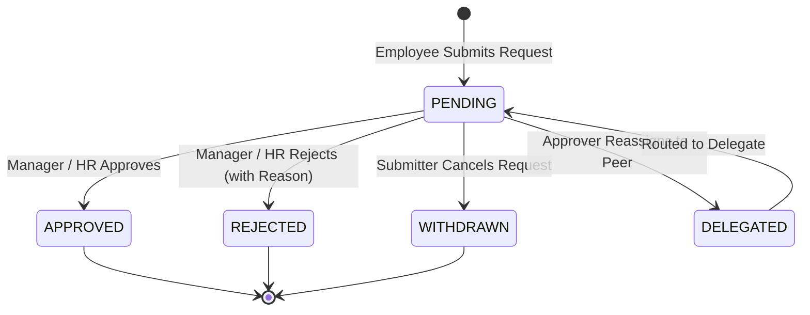

# MASTERHRMS — Phase 3: Lifecycle Discovery
## Document 07: Approvals & Realtime Notifications Discovery

**Document Version:** 1.0.0  
**Phase:** Phase 3 – Lifecycle Discovery  
**Domain:** Multi-Tier Approvals, Delegation & Realtime Notification Hub  
**Date:** November 19, 2026  
**Reference Target:** WorkDo HRMS Notifications & Approvals  
**Source of Truth:** MASTERHRMS Local Source Code  

---

### 1. Module Overview & Functional Scope

The Approvals and Notifications subsystem is the connective tissue of MASTERHRMS. It coordinates:
1. Multi-tier approval routing (Employee → Manager → HR Admin → Finance).
2. Approval lifecycle actions: Approve, Reject with Reason, Withdraw, Delegate.
3. Omnichannel notifications: In-App bell counter, Realtime WebSockets / Pusher events, Browser Web Push (VAPID), and transactional SMTP emails.

In MASTERHRMS:
- Frontend Routes:
  - Admin Approvals: `/hr/approvals.tsx` ([approvals.tsx](file:///c:/Users/TSV%20Global%20Solutions/Documents/hrms/src/routes/_authenticated/hr/approvals.tsx))
  - Self-Service / Manager Approvals: `/me/approvals.tsx` ([approvals.tsx](file:///c:/Users/TSV%20Global%20Solutions/Documents/hrms/src/routes/_authenticated/me/approvals.tsx))
  - Notification Centers: `/hr/notifications.tsx` & `/me/notifications.tsx`
- Backend API Endpoints:
  - `server/src/routes/platform-foundation.routes.ts` (`/api/v1/hr/approvals`, `/api/v1/me/approvals`, `/api/v1/shared/approvals/*`)
  - `server/src/services/notification.service.ts`

---

### 2. Approval Engine Architecture

The approval engine in `platform-foundation.routes.ts` provides a unified state machine:

**Key Approval API Endpoints**:
- `GET /api/v1/hr/approvals`: Retrieves all pending items across the tenant with entity filter (`LeaveRequest`, `AttendanceRegularization`, `ProfileChangeRequest`, `ManagerChangeRequest`, `ResignationRequest`).
- `GET /api/v1/me/approvals`: Filtered strictly to direct reports where `managerId === employeeId`.
- `POST /api/v1/shared/approvals/:id/approve`: Executes business logic approval, updates balance/records, triggers outbox event.
- `POST /api/v1/shared/approvals/:id/reject`: Records rejection remarks, restores reserved balance, alerts employee.
- `POST /api/v1/shared/approvals/:id/withdraw`: Allows submitter to cancel request prior to final action.
- `POST /api/v1/shared/approvals/:id/delegate`: Assigns temporary approval responsibility to another manager.

---

### 3. Realtime Multi-Channel Notification Hub

`NotificationService` in `server/src/services/notification.service.ts` orchestrates 4 simultaneous delivery channels:

1. **In-App Notification Ledger**:
   - Persisted in Prisma model `Notification` with columns `tenantId`, `userId`, `title`, `body`, `type`, `read`, `actionUrl`, `metadata`.
   - Polled/synced via `GET /api/v1/shared/notifications`.
2. **Realtime WebSockets (Socket.io & Pusher)**:
   - Emits instant event to tenant-specific and user-specific room (`tenant:${tenantId}:user:${userId}`).
   - Bell icon updates badge count instantly with zero page reload.
3. **Web Push Notifications (VAPID)**:
   - Dispatches standard W3C Web Push packets via `VapidService` to subscribed browser Service Workers.
4. **Transactional Email Alerts (SMTP)**:
   - Dispatches branded email templates via `server/src/lib/email.ts` for leave status, salary credit, password resets, and policy alerts.

---

### 4. Parity Comparison vs WorkDo HRMS

| Feature | WorkDo HRMS | MASTERHRMS | Parity Status |
| :--- | :--- | :--- | :--- |
| **In-App Bell Indicator** | Realtime dropdown | Dropdown drawer + full notification page | **VERIFIED** |
| **Mark as Read / Read All** | Single / All button | Both supported via `/shared/notifications/read-all` | **VERIFIED** |
| **Unified Approvals Console** | Fragmented across pages | Single consolidated `/me/approvals` dashboard | **SUPERIOR TO WORKDO** |
| **Approval Delegation** | Not supported | Present in backend API (`/shared/approvals/:id/delegate`) | **SUPERIOR TO WORKDO** |
| **Web Push (VAPID)** | Limited | Full VAPID push subscriber store | **VERIFIED** |

---

### 5. Identified Gaps & Phase 3 Recommendations

1. **Email Digest Frequency Preferences (P2)**: Allow employees to select between instant email alerts, daily digest, or in-app only in `/me/settings.tsx`.
2. **In-App Toast Push Integration (P1)**: When a Pusher event arrives while user has the browser tab focused, display an interactive sonner toast with 1-click view button.
