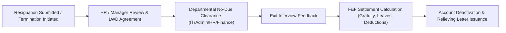

# MASTERHRMS — Phase 3: Lifecycle Discovery
## Document 08: Employee Separation, Resignation & Exit Discovery

**Document Version:** 1.0.0  
**Phase:** Phase 3 – Lifecycle Discovery  
**Domain:** Voluntary Resignation, Involuntary Termination, Clearances & F&F Settlement  
**Date:** November 19, 2026  
**Reference Target:** WorkDo HRMS Resignation & Termination  
**Source of Truth:** MASTERHRMS Local Source Code  

---

### 1. Module Overview & Functional Scope

The Separation and Offboarding subsystem governs the end-of-lifecycle transition for departing personnel. It covers:
1. Resignation submission by employee (`/me/lifecycle/resignation`).
2. Notice period calculation, management review, and acceptance (`/hr/lifecycle/resignations`).
3. Involuntary termination with documented grounds and evidence attachments (`/hr/lifecycle/terminations`).
4. Departmental No-Due Clearances (IT hardware return, Finance advance reconciliation, Admin identity badge surrender).
5. Exit interview feedback collection.
6. Full & Final (F&F) settlement statement generation and account deactivation.

In MASTERHRMS:
- Frontend Routes:
  - Resignations: `/hr/lifecycle/resignations.tsx` & `/me/lifecycle/resignation.tsx`
  - Terminations: `/hr/lifecycle/terminations.tsx`
  - Offboarding & Exits: `/hr/employees/exits.tsx` & `/hr/lifecycle/exits.tsx`
- Backend API Routers:
  - `server/src/routes/offboarding.routes.ts` (`/api/offboarding/*`)
  - `server/src/routes/hr-lifecycle.routes.ts` (`/api/hr/lifecycle/*`)
  - `server/src/routes/me-lifecycle.routes.ts` (`/api/me/lifecycle/*`)

---

### 2. Separation Lifecycle Architecture

---

### 3. Departmental No-Due Clearance Matrix

The clearance engine (`PUT /api/offboarding/exits/:id/clearance`) tracks 4 distinct departmental checkpoints:

| Department | Checkpoint Scope | Clearance Criteria | Model Record |
| :--- | :--- | :--- | :--- |
| **IT & Infrastructure** | Hardware assets, company email, VPN | Laptops, monitors returned in good condition; SSO credentials locked | `AssetAllocation`, `ExitClearance` |
| **Administration** | Physical access, ID badge, locker | Access card surrendered, company keys returned | `ExitClearance` |
| **Finance & Accounts** | Advances, credit cards, expense claims | Unsettled travel advances recovered, final expense claims audited | `ExpenseClaim`, `ExitClearance` |
| **Human Resources** | NDA sign-off, knowledge transfer sign-off | Handover document received from replacement/manager | `ExitClearance` |

---

### 4. Full & Final (F&F) Settlement Engine (`POST /api/offboarding/exits/:id/settle-fnf`)

The automated F&F calculator aggregates final payables and deductions:
1. **Payables**:
   - Pro-rated salary for active days worked in final month.
   - Earned leave encashment payable (accumulated balance × daily basic pay).
   - Statutory gratuity (if tenure exceeds 5 years per Indian Payment of Gratuity Act: $\frac{15 \times \text{Last Drawn Basic} \times \text{Tenure}}{26}$).
   - Any approved pending reimbursement expense claims.
2. **Deductions**:
   - Short notice period recovery (unserved notice days × per-day salary).
   - Unreturned asset replacement cost.
   - Unsettled travel advances or salary loans outstanding.
   - Applicable TDS (Tax Deducted at Source).
3. **Net Payable**:
   - Outputs authoritative final settlement voucher.
   - Transitions employee status to `resigned` or `terminated`.
   - Triggers automated issuance of Digital Relieving & Experience Letter.

---

### 5. Parity Comparison vs WorkDo HRMS

| Feature | WorkDo HRMS | MASTERHRMS | Parity Status |
| :--- | :--- | :--- | :--- |
| **Resignation Submission** | Form in employee portal | Supported in `/me/lifecycle/resignation` | **VERIFIED** |
| **Notice Period Computation** | Manual date input | Auto-computes Last Working Day from policy | **VERIFIED** |
| **Departmental Clearance Hub** | Not present (basic status) | 4-department clearance checklist with asset link | **SUPERIOR TO WORKDO** |
| **Exit Interview Survey** | Basic notes | Structured survey with rating categories | **VERIFIED** |
| **Automated F&F Settlement** | Manual payroll adjustment | Formula-driven settlement voucher with gratuity/TDS | **SUPERIOR TO WORKDO** |

---

### 6. Identified Gaps & Phase 3 Recommendations

1. **Relieving Letter PDF Automation (P1)**: When F&F settlement is marked `PAID`, automatically generate the Relieving Letter using the Certificate/Document template service and attach to the exit record.
2. **Alumni Portal Access (P2)**: Allow ex-employees read-only access to download past Form 16s and payslips for 12 months after separation.
