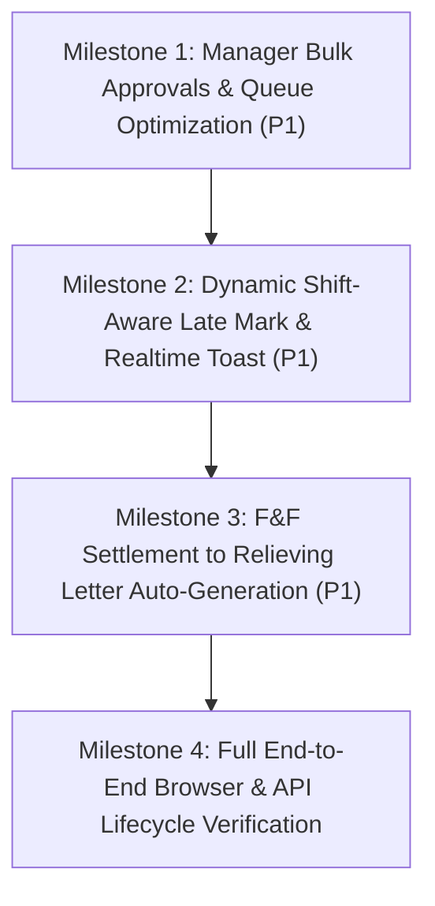

# MASTERHRMS — Phase 3: Lifecycle Discovery
## Document 12: Phase 3 Implementation Roadmap & Acceptance Criteria

**Document Version:** 1.0.0  
**Phase:** Phase 3 – Lifecycle Implementation Blueprint  
**Status:** READ-ONLY DISCOVERY COMPLETE — AWAITING EXPLICIT USER AUTHORIZATION  
**Date:** November 19, 2026  
**Reference Target:** WorkDo HRMS SaaS  

---

### 1. Execution Principles & Constraints

When authorized to commence Phase 3 implementation, the following strict engineering guardrails must be preserved:
1. **Zero Database Migrations**: All required models (`Employee`, `Attendance`, `LeaveRequest`, `ProfileChangeRequest`, `OnboardingTask`, `ExitProcess`, `Notification`, `AuditLog`) are already fully present and indexed in PostgreSQL.
2. **Preserve Baseline State**: Never discard or overwrite existing changes.
3. **Fail-Closed Tenancy**: All queries must remain scoped to `tenantId`.
4. **Automated Verification Gate**: Every milestone requires passing TypeScript compilation (`npx tsc --noEmit`) and relevant backend tests before sign-off.

---

### 2. Staged Implementation Milestones

---

### 3. Detailed Milestone Breakdown

#### Milestone 1: Manager Bulk Approvals & Queue Polish
- **Objective**: Accelerate supervisory workflows by enabling multi-selection actions on `/me/approvals`.
- **Target Files**:
  - `src/routes/_authenticated/me/approvals.tsx`
  - `server/src/routes/employee-self-service.routes.ts`
- **Deliverables**:
  - Checkbox selection column in leave and regularization tables.
  - "Approve Selected" and "Reject Selected" batch action buttons.
  - Batch endpoint `POST /api/me/team/approvals/bulk-action`.
- **Acceptance Criteria**:
  - Approving 3 requests updates all 3 records in a single batch.
  - Emits separate audit records for each approved entity.
  - Deducts corresponding leave balances without race conditions.

#### Milestone 2: Dynamic Shift Grace Period & Realtime Toast Alerts
- **Objective**: Ensure late marks reflect actual shift rosters, and notify managers instantly.
- **Target Files**:
  - `server/src/routes/dashboard.routes.ts`
  - `src/components/notification-toast-listener.tsx`
- **Deliverables**:
  - Late check-in aggregator joins `ShiftRoster` and `AttendancePolicy.graceMinutes`.
  - Frontend listens to Pusher `notification:created` channel and triggers interactive toast.
- **Acceptance Criteria**:
  - Employee checking in within shift grace window is not marked late.
  - Submitting a leave request instantly displays a toast notification on the manager's screen.

#### Milestone 3: Automated Relieving Letter on F&F Settlement
- **Objective**: Close the loop between exit clearance, final payout, and statutory relieving documents.
- **Target Files**:
  - `server/src/routes/offboarding.routes.ts`
  - `server/src/services/contract-lifecycle.service.ts`
- **Deliverables**:
  - When `POST /api/offboarding/exits/:id/settle-fnf` succeeds, automatically invoke letter generation for template type `RELIEVING_LETTER`.
  - Store generated document in `EmployeeDocument` and update exit process document link.
- **Acceptance Criteria**:
  - Settling an employee's exit produces a verifiable PDF relieving letter accessible in employee's profile and exit record.

#### Milestone 4: Comprehensive Regression & Verification Suite
- **Objective**: Full end-to-end verification across all 11 lifecycle modules.
- **Deliverables**:
  - Run `npx tsc --noEmit` across client and server.
  - Run `vitest` tests for tenant proxy, ESS request center, and hierarchy integrity.
  - Capture final git status and author Phase 3 completion report.

---

### 4. Risk Assessment & Mitigation

| Risk Scenario | Probability | Impact | Mitigation Strategy |
| :--- | :--- | :--- | :--- |
| **Race conditions in bulk approvals** | Low | High | Wrap batch updates in Prisma `$transaction` with optimistic locking. |
| **Pusher connection drop** | Medium | Low | Fallback to periodic 30-second polling for unread notifications count. |
| **F&F calculation discrepancy** | Low | High | Support manual override fields for bonus/deduction line items before finalizing voucher. |

---

### 5. Final Hold & Checkpoint

Per user instructions:
> **Stop after producing the discovery reports. Wait for explicit authorization before implementing Phase 3.**

This discovery phase is concluded with zero code modifications made during discovery. All findings, models, endpoints, and UI paths are documented and ready for immediate execution upon your approval.
