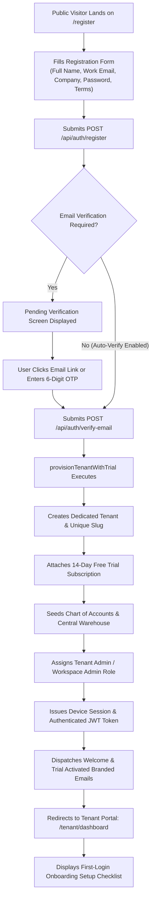

# MASTERHRMS — NEW USER ONBOARDING & TENANT WORKSPACE JOURNEY

## 1. Overview & Customer Journey

The **MASTERHRMS** onboarding lifecycle is designed to guide new enterprise evaluators and company administrators seamlessly from public registration to a fully provisioned, trial-active workspace in under 60 seconds.

---

## 2. Step-by-Step Stage Breakdown

### Stage 1: Public Registration (`/register`)
- **Route**: `src/routes/register.tsx`
- **User Actions**:
  - Enters Full Name, Business Email Address, Company Name, and Country.
  - Chooses a strong password (minimum 8 characters) and confirms password.
  - Accepts MasterHRMS Terms of Service and Privacy Policy.
  - Completes Cloudflare Turnstile bot verification (in production environments).
- **Client Validation**: Real-time password matching, email syntax checking, and strength indicators.
- **Server Response**: HTTP 201 Created with `{ requiresVerification: true, maskedEmail, workspaceSlug }`.

### Stage 2: Email Verification (`/auth?mode=verify`)
- **Email Dispatch**: User receives an official MasterHRMS branded verification email containing:
  - High-resolution `/logo.webp` header.
  - Direct 1-click activation button: `Verify Email & Activate Workspace →`.
  - Fallback 6-digit verification code.
- **Verification Handling**:
  - **1-Click Link**: Directly passes the 32-byte cryptographic token to `POST /api/auth/verify-email`.
  - **Manual OTP Code**: User can type the 6-digit code on the interactive verification screen.
  - **Single-Use Enforcement**: Token is consumed and cannot be reused.

### Stage 3: Automated Canonical Tenant Provisioning
Executed synchronously upon verified registration:
1. **Organization Creation**: Creates `Tenant` with unique UUID, company name, and collision-resistant slug.
2. **Trial Subscription**: Provisions `TenantSubscription` with `status: "trialing"`, 14-day duration, 25 employees, 5 users, and 10 GB storage.
3. **Core ERP Seeding**:
   - 17 Standard Accounts in Chart of Accounts (Cash, Accounts Receivable, Inventory, Equipment, Accounts Payable, Retained Earnings, Sales Revenue, Payroll Expense, etc.).
   - Default Warehouse ("Central Warehouse").
4. **Role Assignment**: User is granted `hr_admin` AppRole and assigned the `Workspace Admin` role.

### Stage 4: Authentication & Redirection
- **Session Creation**: Active `DeviceSession` is registered in the database.
- **Token Generation**: Secure JWT generated containing `userId`, `email`, `tenantId`, `roles: ["tenant_admin", "admin", "workspace_admin"]`, and `sessionId`.
- **Portal Landing**: Tenant Admin is redirected strictly to `/tenant/dashboard`.

### Stage 5: First-Login Onboarding Setup Checklist
Located at the top of `/tenant/dashboard`:
1. **Workspace Provisioned** (Completed automatically).
2. **Set Company Details**: Legal business entity name, registration numbers, tax identifiers.
3. **Configure Company Branding**: Custom logo upload (`/logo.webp`), dark mode variant, brand theme color.
4. **Review Organization Roles & Permissions**: Access control boundaries and team assignments.
5. **Enable Add-on Modules**: Activate Chat, Calendar, Todo, Payroll, or Attendance modules.
6. **Review 14-Day Trial Plan**: Quota overview, employee counts, and upgrade paths.

---

## 3. Strict Portal Boundary Separation

In accordance with MasterHRMS architectural rules:
- **Tenant Portal (`/tenant/*`)**: Strictly reserved for Company / Workspace Administrators.
- **No HR Management Links**: Links to `/hr/*` (HR Management Portal) have been completely removed from the Tenant Portal.
- **No Employee Portal Links**: Links to `/me/*` (Employee Self-Service) have been completely removed from the Tenant Portal.
- **No Super Admin Bleed**: Platform administration routes (`/super/*`) remain isolated under platform domain routing.
