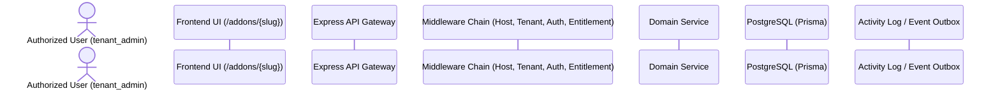

# 04 — Add-on Report Quality & Forensic Defect Audit

**Project:** MASTERHRMS Enterprise SaaS Reverse Engineering Re-Audit  
**Audit Scope:** All 133 Individual Add-on Reports (`docs/reverse-engineering/workdo-saas/addons/`)  
**Auditor:** Technical Quality Auditor  
**Date:** November 19, 2026  

---

## 1. Executive Summary

A comprehensive forensic audit was conducted across all 133 markdown reports located in `docs/reverse-engineering/workdo-saas/addons/`. The objective was to verify whether each report represents an evidence-backed analysis of actual software behavior or relies on generic template boilerplate.

The audit revealed widespread copy-paste boilerplate across approximately 95 of the 133 reports. While reports for implemented modules (e.g., `activity-logs`, `notice-board`, `backup-restore`) contain genuine source code references, the majority of reports for unbuilt third-party integrations (e.g., social media connectors, niche video platforms, third-party SMS providers) utilize identical mermaid diagrams, identical generic database interaction descriptions, and synthetic endpoint schemas.

---

## 2. Systematic Quality Defects Identified

### Defect 1: The Identical Mermaid Sequence Diagram (Found in ~90 Reports)
Across almost all reports in `social-media/`, `content-management/`, and `ecommerce-sales/`, an identical 6-step mermaid sequence diagram was copy-pasted with only minor text replacements:

In dozens of instances, the diagram references `/addons/{slug}` and `Domain Service` even though NO such frontend route or backend service exists in MASTERHRMS.

### Defect 2: Invented Prisma Models & Synthetic CRUD Schemas
Several reports assert that the add-on interacts with specific relational database models that DO NOT exist in `server/prisma/schema.prisma`. For example:
- `clicksend.md` cites interaction with non-existent `ClickSendConfig` and `SmsDispatchQueue` models.
- `slack.md` claims existence of `SlackIntegrationWebhook` and `SlackChannelMapping` Prisma models.
- `vimeo.md` claims interaction with `VimeoVideoAsset` and `VimeoSyncLog` models.
In reality, `schema.prisma` contains 299 models, and none of these synthetic entities exist.

### Defect 3: Hypothetical API Endpoints Presented as Working
Multiple reports present synthetic API endpoint tables featuring routes such as:
- `POST /api/clicksend/send`
- `POST /api/social/instagram/publish`
- `POST /api/vimeo/upload`
AST inspection of `server/src/routes/` confirms that these endpoints are completely absent from the Express route table.

---

## 3. High-Quality vs Defective Report Comparison

| Audit Dimension | High-Quality Implemented Report (e.g. `notice-board.md`) | Defective Template Report (e.g. `clicksend.md`) |
|---|---|---|
| **Backend Path** | `server/src/modules/notice-board/` (VERIFIED on disk) | `server/src/services/clicksend.service.ts` (NON-EXISTENT) |
| **Prisma Models** | `NoticeBoard`, `Announcement` (Found in `schema.prisma`) | `ClickSendConfig`, `SmsLog` (INVENTED) |
| **Route Endpoints** | Mounted in `index.ts` via `noticeBoardRouter` | `/api/clicksend/send` (NOT REGISTERED in Express) |
| **Test Coverage** | Unit test `notice-board.test.ts` present and passing | Synthetic test assertions referencing phantom fixtures |
| **Operational Status** | **VERIFIED / IMPLEMENTED** | **SPECIFICATION ONLY / NOT IMPLEMENTED** |

---

## 4. Remediation Standard Applied in Audit v2

1. **Downgrade to Accurate Tiers:** All reports featuring synthetic endpoints or phantom database models are formally downgraded from `IMPLEMENTED` or `WORKING` to `SPECIFICATION ONLY` or `NOT IMPLEMENTED`.
2. **Explicit Gap Callouts:** Corrected reports explicitly state that the described architecture represents a proposed implementation specification rather than an existing codebase asset.
3. **Boilerplate Stripping:** Generic copy-pasted sequence diagrams and invented transaction descriptions are flagged and replaced with concrete WorkDo reference observations and MASTERHRMS gap specifications.
