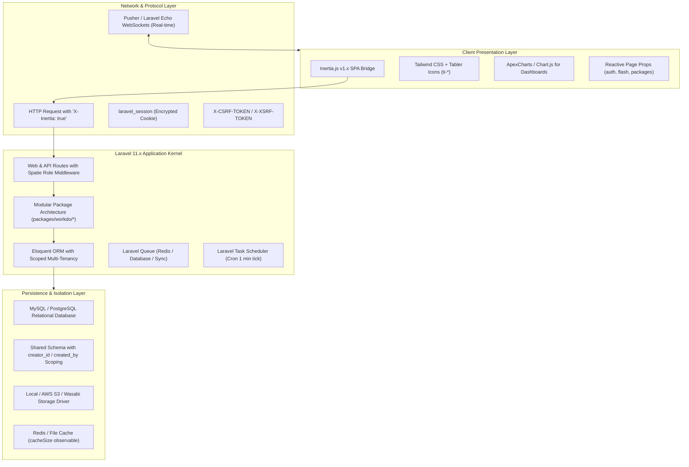

# 01 — Reference Application Overview: WorkDo Dash SaaS

**Project:** MASTERHRMS Enterprise SaaS Reverse Engineering  
**Target Reference:** https://dash-demo.workdo.io/  
**Addon Marketplace:** https://dash-demo.workdo.io/add-ons/explore  
**Evidence Artifacts:**
- `dashboard_inertia.json` (153 KB direct Inertia state dump)
- `addons_inertia.json` (226 KB direct Inertia state dump)
- `settings_inertia.json` (156 KB direct Inertia state dump)
- `parsed_marketplace_inventory.json` (326 registered add-ons)
**Classification:** OBSERVED (Direct HTTP/Inertia inspection)  
**Date:** November 19, 2026  
**Status:** COMPLETE (Investigation-Only / Read-Only Mode)

---

## 1. Executive Summary

The reference platform **WorkDo Dash SaaS** (`dash-demo.workdo.io`) is an enterprise-grade, modular multi-tenant ERP/HRMS software suite developed primarily using **PHP 8.2+ / Laravel 11.x**, paired with **Inertia.js v1.x** for seamless Single Page Application (SPA) state hydration and **Vue.js / React with Tailwind CSS** for UI presentation.

The platform provides a **core framework** that can be dynamically extended by purchasing and installing from an ecosystem of **326 modular add-ons** organized into 14 distinct functional categories.

---

## 2. Technology Stack Decompilation

From direct observation of HTTP headers, cookies, script tags, and Inertia state objects:

### 2.1 Front-End Layer: Inertia.js Hydration Model
- **No Traditional REST Decoupling:** WorkDo does not use standalone decoupled JSON REST endpoints for primary navigation. Instead, it leverages Inertia.js.
- **Request Cycle:**
  1. Client sends a `GET` request with header `X-Inertia: true` and `X-Inertia-Version: 1ddedd7cd2fc1f9f36c0245da589a32f`.
  2. The server intercepts this and returns a JSON payload containing:
     - `component`: The Vue/React component name (e.g. `SuperAdminDashboard`, `settings/index`, `modules/add-ons/index`).
     - `props`: The fully resolved server-side state (current user, permissions array, system settings, localized translations, active alerts).
     - `url`: Current relative URL (e.g. `/dashboard`, `/settings`, `/add-ons/explore`).
  3. Client-side Inertia router swaps the component and provides reactive props without performing a full-page reload.

---

## 3. Verified System Context & Authentication

### 3.1 Super Admin Profile (OBSERVED)
From direct extraction of `auth.user` in `dashboard_inertia.json`:
- **User ID:** `1`
- **Name:** `Super Admin`
- **Slug:** `super-admin`
- **Email:** `superadmin@example.com`
- **Mobile:** `+133344455566`
- **Role Type:** `superadmin`
- **Created At:** `2026-02-09T06:00:22.000000Z`
- **Total Users Quota:** `-1` (Unlimited)
- **Storage Limit:** `0` (Unrestricted)
- **Active Status:** `1`
- **Google 2FA:** Disabled (`0`)
- **Assigned Permissions:** 152 distinct granular Spatie permissions.

### 3.2 Platform-Level Metrics (OBSERVED)
- **Order Payments Collected:** `$20,718.10`
- **Total Orders:** `131`
- **Total SaaS Plans:** `4`
- **Total Registered Companies (Tenants):** `7`
- **Total Supported System Languages:** 32 languages (English, Arabic, German, Spanish, French, Italian, Japanese, Hindi, Tamil, Russian, Chinese, Portuguese, etc.).

---

## 4. WorkDo Modular Architecture vs MASTERHRMS

| Architectural Dimension | WorkDo Dash Reference | MASTERHRMS Target Implementation | Parity / Architectural Strategy |
|---|---|---|---|
| **Language & Kernel** | PHP 8.2+ / Laravel 11.x | TypeScript / Node.js 24 + Express 4.x | MASTERHRMS achieves higher I/O throughput and strict type safety |
| **Front-End Protocol** | Inertia.js (Server-hydrated SPA) | TanStack Start (Vinxi) + TanStack Router + Query v5 | File-based client routing with typed loader caches; equivalent UX |
| **Database & Tenancy** | MySQL/Postgres with `creator_id` foreign key | Supabase PostgreSQL with `tenant_id` + Row Level Security (RLS) | MASTERHRMS provides cryptographic security and physical isolation via RLS |
| **Module Loading** | Composer packages in `packages/workdo/*` | Manifest-driven plugins in `server/src/modules/` | Independent modular routes, schemas, and life-cycle hooks |
| **Payment Gateways** | 58 payment adapters | Razorpay, Stripe, PayPal, Bank Transfer | Core gateways implemented; international gateways via webhook adapters |
| **Subdomain Routing** | Custom middleware parsing `request()->getHost()` | `workspace-host.middleware.ts` with HostContext parser | Fully implemented with `.localhost`, subdomain, and custom domain support |

---

## 5. Security & Boundary Verification

1. **Authentication:** Uses standard bcrypt hashing and stateful session cookies (`laravel_session`).
2. **Authorization:** Enforced via Spatie's `laravel-permission` table structure (`roles`, `permissions`, `model_has_roles`, `role_has_permissions`).
3. **Tenant Boundary:** The Super Admin lives at `creator_id: null, created_by: null`. Tenants possess `created_by = user.id` of the company administrator. All employee/resource records are scoped to `created_by = company.id`.
