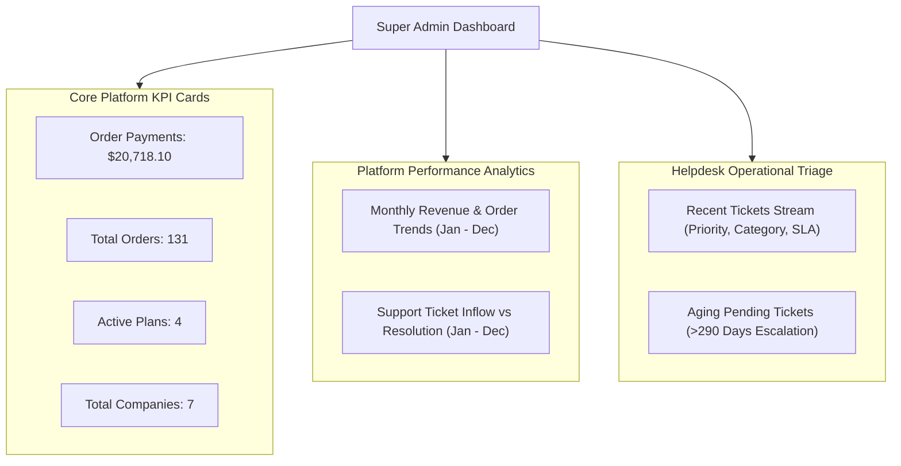

# 02 — Super Admin Architecture: WorkDo Dash SaaS

**Project:** MASTERHRMS Enterprise SaaS Reverse Engineering  
**Target Reference:** https://dash-demo.workdo.io/dashboard  
**Evidence Artifact:** `dashboard_inertia.json` (Direct Inertia State Extraction)  
**Classification:** OBSERVED (Direct Empirical Inspection)  
**Date:** November 19, 2026  
**Status:** COMPLETE

---

## 1. Super Admin Role & Security Context

The Super Admin (`type: "superadmin"`) is the root system tenant operating above individual workspace boundaries. In WorkDo, this user manages platform-wide subscription plans, tenant provisioning, payment collection, addon availability, system settings, and high-level support operations.

### 1.1 Complete Verified Permissions Inventory (152 Granular Permissions)
From `dashboard_inertia.json`, the Super Admin possesses the following exact permissions:

```json
[
  "manage-dashboard", "manage-users", "manage-any-users", "manage-own-users", "create-users", "edit-users", "delete-users", "change-password-users", "impersonate-users", "toggle-status-users", "view-login-history",
  "manage-settings", "edit-settings", "manage-brand-settings", "edit-brand-settings", "manage-system-settings", "edit-system-settings", "manage-currency-settings", "edit-currency-settings", "manage-cache-settings", "clear-cache", "manage-cookie-settings", "edit-cookie-settings", "manage-seo-settings", "edit-seo-settings", "manage-storage-settings", "edit-storage-settings", "manage-email-settings", "edit-email-settings", "test-email",
  "manage-bank-transfer-settings", "edit-bank-transfer-settings", "manage-bank-transfer-requests", "approve-bank-transfer-requests", "reject-bank-transfer-requests", "delete-bank-transfer-requests", "manage-email-notification-settings", "manage-pusher-settings", "edit-pusher-settings",
  "manage-media", "manage-own-media", "create-media", "download-media", "delete-media", "manage-media-directories", "manage-any-media-directories", "manage-own-media-directories", "create-media-directories", "edit-media-directories", "delete-media-directories",
  "manage-helpdesk-categories", "create-helpdesk-categories", "edit-helpdesk-categories", "delete-helpdesk-categories", "manage-helpdesk-tickets", "manage-any-helpdesk-tickets", "view-helpdesk-tickets", "create-helpdesk-tickets", "edit-helpdesk-tickets", "delete-helpdesk-tickets", "manage-helpdesk-replies", "create-helpdesk-replies", "delete-helpdesk-replies",
  "manage-languages", "edit-languages", "manage-add-on", "manage-actions",
  "manage-plans", "manage-any-plans", "manage-own-plans", "view-plans", "create-plans", "edit-plans", "delete-plans",
  "manage-coupons", "manage-any-coupons", "manage-own-coupons", "view-coupons", "create-coupons", "edit-coupons", "delete-coupons",
  "manage-profile", "edit-profile", "change-password-profile",
  "manage-email-templates", "edit-email-templates", "manage-notification-templates", "edit-notification-templates",
  "manage-orders", "view-orders",
  "manage-landing-page", "view-landing-page", "edit-landing-page", "manage-marketplace-settings",
  "manage-custom-pages", "create-custom-pages", "edit-custom-pages", "delete-custom-pages", "view-custom-pages",
  "manage-newsletter-subscribers", "view-newsletter-subscribers", "edit-newsletter-subscribers", "delete-newsletter-subscribers", "export-newsletter-subscribers",
  "manage-recurring-invoice-bill", "edit-recurring-invoice-bill",
  "manage-verification", "create-verification", "edit-verification", "delete-verification",
  "manage-side-menu-builder", "manage-any-side-menu-builder", "manage-own-side-menu-builder", "create-side-menu-builder", "edit-side-menu-builder", "delete-side-menu-builder",
  "manage-tawkto-messenger-settings",
  "manage-zapiers", "create-zapiers", "edit-zapiers", "delete-zapiers",
  "manage-n8n", "create-n8n", "edit-n8n", "delete-n8n",
  "manage-make", "create-make", "edit-make", "delete-make",
  "manage-google-authentication", "edit-google-authentication", "manage-google-captcha-settings", "edit-google-captcha-settings",
  "manage-backup-restore", "create-backup-restore", "restore-backup-restore", "download-backup-restore", "delete-backup-restore",
  "manage-github-signin-settings", "edit-github-signin-settings",
  "manage-bitbucket-signin-settings", "edit-bitbucket-signin-settings",
  "manage-facebook-signin-settings", "edit-facebook-signin-settings",
  "manage-linkedin-signin-settings", "edit-linkedin-signin-settings",
  "manage-twitter-signin-settings", "edit-twitter-signin-settings",
  "manage-google-signin-settings", "edit-google-signin-settings",
  "manage-slack-signin-settings", "edit-slack-signin-settings",
  "manage-outlook-signin-settings", "edit-outlook-signin-settings",
  "manage-microsoft-signin-settings", "edit-microsoft-signin-settings",
  "manage-webhooks", "create-webhooks", "edit-webhooks", "delete-webhooks",
  "manage-pabbly-connect", "create-pabbly-connect", "edit-pabbly-connect", "delete-pabbly-connect",
  "manage-google-analytics", "view-google-analytics", "view-google-analytics-overview", "view-google-analytics-audiences", "view-google-analytics-landing-page", "view-google-analytics-user-acquisition"
]
```

---

## 2. Super Admin Dashboard Metrics & Analytics

From direct observation of `dashboard_inertia.json`, the Super Admin view renders real-time financial, business, and support operations telemetry:



### 2.1 Observed Monthly Revenue & Orders Pipeline
The reference application records monthly revenue and total orders for the preceding 12 months:
- **January:** 13 orders ($2,693.08)
- **February:** 15 orders ($2,302.62)
- **March:** 13 orders ($1,653.84)
- **April:** 7 orders ($1,286.37)
- **May:** 9 orders ($1,496.71)
- **June:** 12 orders ($1,820.30)
- **July:** 7 orders ($1,045.01)
- **August:** 11 orders ($1,816.92)
- **September:** 9 orders ($1,127.79)
- **October:** 9 orders ($1,396.83)
- **November:** 12 orders ($1,874.69)
- **December:** 14 orders ($2,203.94)

### 2.2 Helpdesk Triage Schema
Tickets contain:
- `id`: Unique primary key
- `ticket_id`: 8-digit tracking identifier (e.g. `12345011`)
- `title`: Subject line
- `status`: `open` | `in_progress` | `resolved` | `closed`
- `priority`: `low` | `medium` | `high` | `urgent`
- `category`: Categorization (e.g. `Technical Support`)
- `category_color`: Visual hex tag (e.g. `#3B82F6`)
- `creator`: Tenant organization (e.g. `Company`)
- `created_at`: Relative human timestamp (`9 months ago`)
- `days_pending`: Floating-point duration since last reply

---

## 3. Super Admin Navigation Architecture

The Super Admin sidebar navigation is divided into distinct operational domains:

1. **Dashboard:** `/dashboard` (Platform KPIs, financial overview, ticket status)
2. **User Management:**
   - Companies (Tenants): `/users` (List, Create, Edit, Impersonate, Toggle Status)
   - Login History: `/users/login-history` (Audit log of user authentication timestamps and IPs)
3. **Subscription & Billing:**
   - Plans: `/plans` (CRUD tiered SaaS packages, storage limits, trial days)
   - Coupons: `/coupons` (Discount codes, percentage/fixed off, expiration)
   - Order History: `/orders` (All tenant subscription and addon invoices)
   - Bank Transfer Requests: `/bank-transfer-requests` (Offline payment approvals)
4. **Marketplace & Extensions:**
   - Explore Add-ons: `/add-ons/explore` (326+ modular package catalog)
   - Side Menu Builder: `/side-menu-builder` (Customize default navigation hierarchies)
5. **Customer Support:**
   - Helpdesk Tickets: `/helpdesk-tickets` (Multi-tenant support ticketing with SLA)
   - Helpdesk Categories: `/helpdesk-categories`
6. **Platform Marketing & CMS:**
   - Landing Page Editor: `/landing-page` (Hero sections, feature blocks, pricing table)
   - Custom Pages: `/custom-pages` (Terms, Privacy, custom content)
   - Newsletter Subscribers: `/newsletter-subscribers`
7. **Integrations & Automation:**
   - Webhooks: `/webhooks` (Outbound platform events)
   - Zapier / n8n / Make: `/integrations/*`
8. **System Settings:** `/settings` (Brand, System, Currency, Email, Gateways, Storage, Cache, Cookie, SEO)

---

## 4. MASTERHRMS Equivalent Architecture

In MASTERHRMS, the Super Admin portal is implemented at:
- **Frontend Path:** `src/app/super/`
  - `tenants.tsx` (Companies / Workspaces)
  - `plans.tsx` (Subscription Plans)
  - `coupons.tsx` (Coupon Management)
  - `domains.tsx` (Custom Domain SSL Verification)
  - `settings.tsx` (Global Platform Settings)
  - `tenant-support-tickets.tsx` (Helpdesk)
  - `referral.tsx` (Affiliate Tracking)
  - `files/` (Media Storage Manager)
- **Backend Path:** `server/src/routes/super-admin.routes.ts` & `super-tenants.routes.ts`
- **Tenant Impersonation:** Handled via `/api/super/tenants/:id/impersonate` returning a scoped tenant session token.
