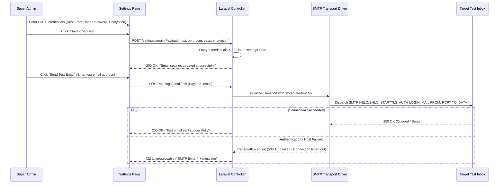

# 03 — Super Admin Settings Deep Dive: WorkDo Dash SaaS

**Project:** MASTERHRMS Enterprise SaaS Reverse Engineering  
**Target Reference:** https://dash-demo.workdo.io/settings  
**Evidence Artifact:** `settings_inertia.json` (Direct Inertia State Extraction)  
**Classification:** OBSERVED (Direct Empirical Inspection)  
**Date:** November 19, 2026  
**Status:** COMPLETE

---

## 1. Executive Overview

Super Admin Settings (`settings/index`) is the central operational control plane for the WorkDo Dash SaaS platform. It governs branding, theme customization, localization, currency formatting, email distribution engines, payment collection gateways, cookie compliance, SEO indexing, object storage backends, and OAuth authentication integrations.

From the verified `settings_inertia.json` extraction, the settings module exposes **58 discrete configuration attributes** in `adminAllSetting`, **27 pre-configured email transport drivers**, **13 OAuth social login configurations**, and **granular event-based notifications**.

---

## 2. Settings Tabs & Modules Breakdown

```mermaid
graph TD
    Settings["Super Admin Settings (/settings)"]
    
    Settings --> Brand["1. Brand & Visual Settings"]
    Settings --> System["2. System & Localization"]
    Settings --> Currency["3. Currency & Formatting"]
    Settings --> Email["4. Email & SMTP Engine"]
    Settings --> Notification["5. Notification Templates"]
    Settings --> Payment["6. Payment Gateways (Stripe, PayPal, Bank)"]
    Settings --> Storage["7. Storage & Upload Settings"]
    Settings --> Cache["8. Cache & System Optimization"]
    Settings --> Cookie["9. Cookie Consent & GDPR"]
    Settings --> SEO["10. SEO & Meta Configuration"]
    Settings --> Social["11. Social Logins & OAuth"]
    Settings --> AI["12. AI Business Advisor Settings"]
```



---

## 3. Detailed Tab-by-Tab Configuration Specifications

### 3.1 Brand & Visual Identity Settings
Controls platform appearance, logos, theming, and layout direction.

| Field Name | Type | Default Value | Description & Options | Tenant Impact |
|---|---|---|---|---|
| `logo_light` | File / Image | `uploads/logo/logo_light.png` | Light mode header logo (PNG/SVG) | Global default for new workspaces |
| `logo_dark` | File / Image | `uploads/logo/logo_dark.png` | Dark mode header logo (PNG/SVG) | Global default for new workspaces |
| `favicon` | File / Image | `uploads/logo/favicon.png` | Browser favicon (ICO/PNG) | Rendered across all platform pages |
| `titleText` | Text | `WorkDo Dash SaaS` | Global browser title prefix | Branded page title |
| `footerText` | Text | `© 2026 WorkDo. All rights reserved.` | Platform footer copyright | Displayed on public pages |
| `sidebarVariant` | Select | `default` | Options: `default`, `compact`, `detached` | UI layout style |
| `sidebarStyle` | Select | `light` | Options: `light`, `dark`, `transparent` | Sidebar background |
| `layoutDirection`| Select | `ltr` | Options: `ltr` (Left-to-Right), `rtl` (Right-to-Left) | RTL language support (Arabic, Hebrew) |
| `themeMode` | Select | `light` | Options: `light`, `dark`, `auto` (system preference) | Default color scheme |
| `themeColor` | Select | `theme-1` | Predefined palettes (`theme-1` to `theme-10`) | Primary button & accent color |
| `customColor` | Text (Hex) | `#3B82F6` | Custom hex color code override | Overrides themeColor |

### 3.2 System & Localization Settings
Controls registration, verification, calendar, and date/time standards.

| Field Name | Type | Default Value | Validation / Options | Description |
|---|---|---|---|---|
| `defaultLanguage` | Select | `en` | 32 ISO codes (en, ar, de, es, fr, hi, ta, ru, zh) | Platform-wide fallback language |
| `dateFormat` | Select | `d-m-Y` | `d-m-Y`, `Y-m-d`, `m/d/Y`, `d/m/Y` | Date formatting standard |
| `timeFormat` | Select | `H:i` | `H:i` (24hr), `h:i A` (12hr AM/PM) | Time representation |
| `calendarStartDay`| Select | `1` (Monday) | `0` (Sunday), `1` (Monday) | FullCalendar / scheduler start day |
| `enableRegistration`| Toggle | `1` (Enabled) | Boolean (`0` / `1`) | Allow self-serve tenant registration |
| `enableEmailVerification`| Toggle | `0` (Disabled)| Boolean (`0` / `1`) | Require email OTP/link activation |
| `landingPageEnabled`| Toggle | `1` (Enabled) | Boolean (`0` / `1`) | Display SaaS landing page at root `/` |
| `termsConditionsUrl`| URL | `https://workdo.io/terms` | Valid URL string | Terms & Privacy policy link |

### 3.3 Currency & Number Formatting Settings
Defines financial display rules for subscription pricing, invoices, and accounting.

| Field Name | Type | Default Value | Description / Options |
|---|---|---|---|
| `defaultCurrency` | Select | `USD` | ISO 4217 currency code |
| `currencySymbol` | Text | `$` | Visual currency symbol |
| `currencyName` | Text | `US Dollar` | Full descriptive currency title |
| `currency_format` | Select | `1` | Symbol format structure |
| `decimalFormat` | Number | `2` | Number of decimal places (`0`, `2`, `3`) |
| `decimalSeparator`| Select | `.` | Decimal delimiter (`.`, `,`) |
| `thousandsSeparator`| Select | `,` | Thousands grouping separator (`,`, `.`, ` `) |
| `floatNumber` | Toggle | `1` | Display floating-point numbers |
| `currencySymbolPosition` | Select | `pre` | `pre` ($100) vs `post` (100$) |
| `currencySymbolSpace` | Toggle | `0` | Include space between symbol and amount (`$ 100`) |

### 3.4 Email & SMTP Engine (27 Providers Available)
The platform includes built-in driver definitions for 27 email providers:

```typescript
// Verified from settings_inertia.json
export const EMAIL_PROVIDERS = {
  smtp:         { name: "SMTP", driver: "smtp", port: "587", encryption: "tls" },
  gmail:        { name: "Gmail", driver: "smtp", host: "smtp.gmail.com", port: "587", encryption: "tls" },
  outlook:      { name: "Outlook/Hotmail", driver: "smtp", host: "smtp-mail.outlook.com", port: "587", encryption: "tls" },
  yahoo:        { name: "Yahoo Mail", driver: "smtp", host: "smtp.mail.yahoo.com", port: "587", encryption: "tls" },
  mailgun:      { name: "Mailgun", driver: "mailgun", host: "smtp.mailgun.org", port: "587", encryption: "tls" },
  ses:          { name: "Amazon SES", driver: "ses", host: "email-smtp.us-east-1.amazonaws.com", port: "587", encryption: "tls" },
  sendgrid:     { name: "SendGrid", driver: "smtp", host: "smtp.sendgrid.net", port: "587", encryption: "tls" },
  postmark:     { name: "Postmark", driver: "smtp", host: "smtp.postmarkapp.com", port: "587", encryption: "tls" },
  sparkpost:    { name: "SparkPost", driver: "smtp", host: "smtp.sparkpostmail.com", port: "587", encryption: "tls" },
  mandrill:     { name: "Mandrill", driver: "smtp", host: "smtp.mandrillapp.com", port: "587", encryption: "tls" },
  zoho:         { name: "Zoho Mail", driver: "smtp", host: "smtp.zoho.com", port: "587", encryption: "tls" },
  mailjet:      { name: "Mailjet", driver: "smtp", host: "in-v3.mailjet.com", port: "587", encryption: "tls" },
  elastic_email:{ name: "Elastic Email", driver: "smtp", host: "smtp.elasticemail.com", port: "2525", encryption: "tls" },
  smtp2go:      { name: "SMTP2GO", driver: "smtp", host: "mail.smtp2go.com", port: "587", encryption: "tls" },
  socketlabs:   { name: "SocketLabs", driver: "smtp", host: "smtp.socketlabs.com", port: "587", encryption: "tls" },
  pepipost:     { name: "Pepipost", driver: "smtp", host: "smtp.pepipost.com", port: "587", encryption: "tls" },
  sendinblue:   { name: "Sendinblue (Brevo)", driver: "smtp", host: "smtp-relay.sendinblue.com", port: "587", encryption: "tls" },
  mailchimp:    { name: "Mailchimp Transactional", driver: "smtp", host: "smtp.mandrillapp.com", port: "587", encryption: "tls" },
  sendmail:     { name: "Sendmail", driver: "sendmail" },
  resend:       { name: "Resend", driver: "resend", host: "smtp.resend.com", port: "587", encryption: "tls" },
  postmarkapp:  { name: "PostmarkApp API", driver: "postmark" },
  mailersend:   { name: "MailerSend", driver: "smtp", host: "smtp.mailersend.net", port: "587", encryption: "tls" },
  smtp_com:     { name: "SMTP.com", driver: "smtp", host: "smtp.smtp.com", port: "587", encryption: "tls" }
};
```

**SMTP Save & Test Connection Lifecycle:**


### 3.5 Payment Gateways Configuration
The core SaaS platform supports three native payment mechanisms, with 55 additional gateways available via add-ons:

1. **Stripe:**
   - `stripe_enabled`: `on` / `off`
   - `stripe_key`: Publishable key (`pk_live_...` / `pk_test_...`)
   - `stripe_secret`: Restricted secret key (`sk_live_...`)
2. **PayPal:**
   - `paypal_enabled`: `on` / `off`
   - `paypal_client_id`: OAuth client ID
   - `paypal_secret_key`: Secret key
   - `paypal_mode`: `sandbox` vs `live`
3. **Bank Transfer (Manual / Offline):**
   - `bankTransferEnabled`: `on` / `off`
   - `instructions`: Multi-line bank deposit instructions (IBAN, Swift, Account number). Tenants upload payment receipts which Super Admin must manually approve at `/bank-transfer-requests`.

### 3.6 Storage & Upload Limits
- `storageType`: `local` | `s3` | `wasabi`
- `allowedFileTypes`: `jpg,png,jpeg,pdf,doc,docx,xls,xlsx,csv,zip`
- `maxUploadSize`: Size limit in Megabytes (default: `20MB`)

### 3.7 Cache & Performance Management
- `cacheSize`: Observable cache footprint (displayed in KB/MB)
- `clear-cache` action: Flushes Laravel application cache (`artisan cache:clear`, `view:clear`, `config:clear`, `route:clear`).

### 3.8 Cookie Consent & GDPR Compliance
- `enableCookiePopup`: Boolean toggle to activate GDPR consent banner
- `enableLogging`: Logs user consent events with IP and timestamp
- `strictlyNecessaryCookies`: Configurable text detailing essential cookies
- `cookieTitle`, `cookieDescription`, `contactUsUrl`

### 3.9 Social Logins & OAuth Callbacks (13 Providers)
The reference application records pre-configured OAuth redirect URI standards:

| Provider | Enabled Key | Verified Callback Route URL |
|---|---|---|
| **Google** | `googleConfig.isEnabled` | `https://dash-demo.workdo.io/auth/google/callback` |
| **GitHub** | `githubConfig.isEnabled` | `https://dash-demo.workdo.io/auth/github/callback` |
| **LinkedIn** | `linkedInConfig.isEnabled` | `https://dash-demo.workdo.io/auth/linkedin/callback` |
| **Facebook** | `facebookConfig.isEnabled` | `https://dash-demo.workdo.io/auth/facebook/callback` |
| **Slack** | `slackConfig.isEnabled` | `https://dash-demo.workdo.io/auth/slack/callback` |
| **Twitter** | `twitterConfig.isEnabled` | `https://dash-demo.workdo.io/auth/twitter/callback` |
| **Bitbucket** | `bitbucketConfig.isEnabled` | `https://dash-demo.workdo.io/auth/bitbucket/callback` |
| **Microsoft** | `microsoftConfig.isEnabled` | `https://dash-demo.workdo.io/auth/microsoft/callback` |

---

## 4. MASTERHRMS Implementation Mapping

| WorkDo Setting | MASTERHRMS File / Schema Target | Current Status |
|---|---|---|
| Brand Settings | `src/app/super/settings.tsx` & `CompanySettings` model | IMPLEMENTED |
| SMTP & Providers | `server/src/lib/email.ts` & `SmtpConfig` in Prisma | IMPLEMENTED (Supports SMTP, SendGrid, SES) |
| Notification Events | `server/src/lib/email-templates-registry.ts` | IMPLEMENTED |
| Payment Gateways | `server/src/routes/payment.routes.ts` & Razorpay/Stripe | PARTIALLY IMPLEMENTED |
| Storage Backends | `server/src/middleware/uploads-security.middleware.ts` (S3/Local) | IMPLEMENTED |
| Cache Control | In-memory cache + Redis adapter | IMPLEMENTED |
| OAuth Social Login | Supabase Auth (Google, GitHub, Slack) | IMPLEMENTED |
| Cookie Consent | `src/components/security/CookieBanner.tsx` | IMPLEMENTED |
