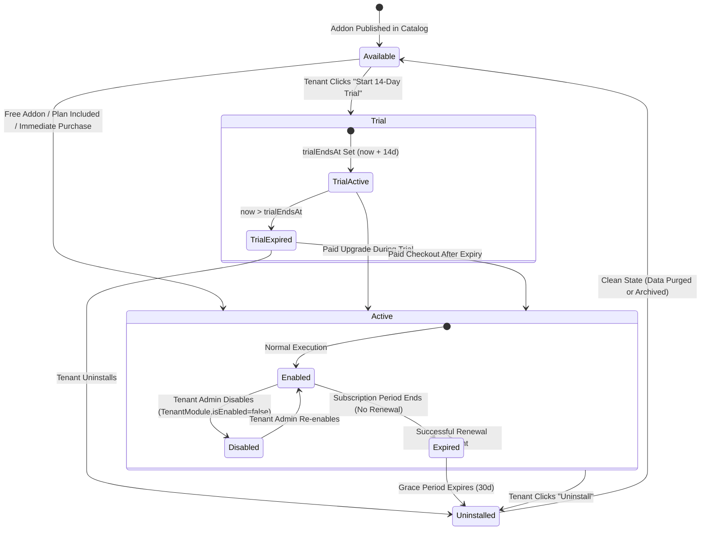
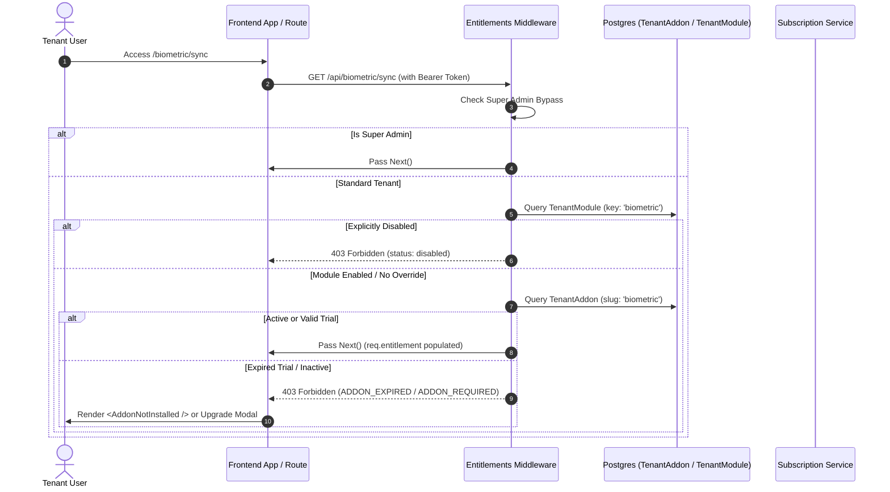

# 05 — Addon Marketplace Architecture & Implementation Analysis
**Project:** MASTERHRMS WorkDo SaaS Reverse Engineering  
**Document Author:** Addon Architect Agent  
**Classification:** SOURCE-INSPECTED (MASTERHRMS implementation) / INFERRED (WorkDo SaaS target)  
**Date:** 2026-11-19  

---

## 1. Executive Summary

WorkDo Dash SaaS offers an extensive modular marketplace composed of 133+ addons distributed over 11 operational categories (Free, Social Media, Integrations, E-Commerce & Sales, Content Management, Finance, HR, Communication & Customization, Mobility & Operations, AI, and Security). The architecture decouples the core ERP from pluggable capabilities via an entitlement-based licensing engine.

This document details:
1. The **WorkDo SaaS Addon Marketplace Architecture** (inferred from design patterns and reference UI).
2. The **Current MASTERHRMS Implementation**, specifically inspecting `server/src/middleware/entitlements.ts`, `server/src/routes/addons.routes.ts`, `server/prisma/schema.prisma`, and `server/src/modules/`.
3. An end-to-end **Addon Lifecycle State Machine & Flow Diagram**.
4. The **Priority Gap Matrix** identifying which addons are implemented, critical for MVP, or deferred.

---

## 2. WorkDo Addon Architecture (Inferred)

### 2.1 Marketplace Catalog Design
- **Catalog Navigation**: Card-based grid presentation with category filtering, full-text search, and "Popular / Featured" highlights.
- **Addon Card Elements**:
  - Addon Logo / Icon
  - Addon Title & Developer Badge
  - Category Badge (e.g. HR, Integrations, Finance)
  - Short Tagline / Value Proposition
  - Price Tag (e.g., "Free", "$2.00 / month", or "$19.00 / year")
  - CTA Button: `Install Now` (Free), `Buy Now` (Paid), or `Configure` (Installed)
- **Detail View**: Includes rich markdown description, feature lists, screenshots, changelogs, system requirements, and FAQs.

### 2.2 Purchase & Installation Flow
WorkDo categorizes addon activation into two primary pathways:
1. **Free / Built-in Addons**:
   - Immediate one-click installation.
   - Triggers server-side provisioning: creates tenant entitlement record, initializes database migration/seeds if required, and registers navigation routes.
2. **Paid Addons**:
   - Single purchase or recurring subscription (Monthly / Annual).
   - Checkout invokes integrated billing gateways (Stripe, PayPal, Bank Transfer).
   - Upon payment confirmation via webhook/callback, the tenant license is provisioned with `status: "active"` and an expiration timestamp `renewsAt`.
   - Supports 14-day or 30-day trial mode with `status: "trial"` and `trialEndsAt`.

### 2.3 Super Admin Provisioning & Management
The WorkDo Super Admin has full governance over the marketplace ecosystem:
- **Global Catalog Management**: Super Admin creates, edits, publishes, and unpublishes addons from `super_admin/addons`.
- **Pricing & Tier Controls**: Configure standalone pricing or bundle specific addons into high-tier SaaS subscription plans (e.g., Enterprise/Sovereign plans include 15 core addons automatically).
- **Manual Tenant Override**: Super Admin can bypass payments to manually grant, revoke, suspend, or extend addon entitlements for specific tenant workspaces.

### 2.4 Tenant Entitlement Model
Tenant workspaces are evaluated against three authorization boundaries:
1. **Subscription Plan Allowance**: Does the tenant's base plan implicitly bundle the feature (e.g., `features: ["recruitment", "biometric"]`)?
2. **Direct Tenant Addon License (`TenantAddon`)**: Has the tenant purchased/installed this specific addon slug? Is it within valid dates?
3. **Module Feature Flag (`TenantModule`)**: Has the tenant administrator toggled the module on/off within workspace preferences?

---

## 3. MASTERHRMS Current Addon Architecture (Source-Inspected)

MASTERHRMS already features a sophisticated, production-grade addon entitlement engine and modular architecture.

### 3.1 Data Model (`server/prisma/schema.prisma`)

#### `Addon` (Catalog Definition)
Stores the marketplace directory available to all tenants:
```prisma
model Addon {
  id              String   @id @default(uuid()) @db.VarChar(36)
  name            String   @db.VarChar(255)
  slug            String   @unique @db.VarChar(100)
  tagline         String?  @db.VarChar(300)
  description     String?
  longDescription String?  @map("long_description")
  category        String   @db.VarChar(100)
  status          String   @default("active") @db.VarChar(50)
  priceMonthly    Decimal  @default(0.00) @map("price_monthly") @db.Decimal(10, 2)
  icon            String?  @db.VarChar(500)
  screenshots     Json?
  features        Json?
  developer       String?  @db.VarChar(255)
  version         String?  @db.VarChar(50)
  docsUrl         String?  @map("docs_url") @db.VarChar(500)
  galleryVideo    String?  @map("gallery_video") @db.VarChar(500)
  installUrl      String?  @map("install_url") @db.VarChar(500)
  featured        Boolean  @default(false)
  createdAt       DateTime @default(now()) @map("created_at")
  updatedAt       DateTime @updatedAt @map("updated_at")

  @@index([status, featured, createdAt])
  @@index([status, category])
  @@map("addons")
}
```

#### `TenantAddon` (Tenant Entitlements)
Tracks active, trial, suspended, or expired tenant subscriptions:
```prisma
model TenantAddon {
  id          String    @id @default(uuid()) @db.VarChar(36)
  tenantId    String    @map("tenant_id") @db.VarChar(36)
  addonSlug   String    @map("addon_slug") @db.VarChar(100)
  status      String    @default("active") @db.VarChar(50)
  plan        String    @default("standard") @db.VarChar(50)
  trialEndsAt DateTime? @map("trial_ends_at")
  renewsAt    DateTime? @map("renews_at")
  features    Json?
  createdAt   DateTime  @default(now()) @map("created_at")
  updatedAt   DateTime  @updatedAt @map("updated_at")
  tenant      Tenant    @relation(fields: [tenantId], references: [id], onDelete: Cascade)

  @@unique([tenantId, addonSlug])
  @@index([tenantId, status])
  @@map("tenant_addons")
}
```

#### `TenantModule` (Tenant Feature Flags)
Allows tenants or super-admins to toggle specific module keys:
```prisma
model TenantModule {
  id        String   @id @default(uuid()) @db.VarChar(36)
  tenantId  String   @map("tenant_id") @db.VarChar(36)
  moduleKey String   @map("module_key") @db.VarChar(50)
  isEnabled Boolean  @default(true) @map("is_enabled")
  createdAt DateTime @default(now()) @map("created_at")
  tenant    Tenant   @relation(fields: [tenantId], references: [id], onDelete: Cascade)

  @@unique([tenantId, moduleKey])
  @@map("tenant_modules")
}
```

---

### 3.2 Entitlements Middleware (`server/src/middleware/entitlements.ts`)

The entitlement verification pipeline enforces security at the route level via `requireEntitlement(key)` / `requireAddon(slug)`:

1. **Super Admin Bypass**:
   `isSuperAdmin === true` immediately bypasses checks with `source: "super_admin_bypass"`.
2. **TenantModule Check**:
   Evaluates if the key is explicitly disabled via `TenantModule.isEnabled === false`. If disabled, access is denied with status `disabled`.
3. **TenantAddon Check**:
   Queries `TenantAddon` for candidate slugs:
   - Status `active`: Entitled (`source: "addon"`).
   - Status `trial`: Checks `trialEndsAt > now()`. If expired, returns 403 `ADDON_EXPIRED`.
   - Status `suspended`, `cancelled`, `disabled`: Returns 403.
4. **Subscription Plan Feature Evaluation**:
   For standalone suites (`CRM`, `POS`, `Finance`, `Projects`, `Procurement`), inspects `TenantSubscription.plan.features` JSON array and sovereign plan IDs.
5. **Base HRMS Platform Allowance**:
   Default core HRMS features (`hrms`, `payroll`, `attendance`) remain accessible under `source: "core_platform"`.
6. **Rejection Response**:
   Returns HTTP 403 with standard payload:
   ```json
   {
     "success": false,
     "error": "Add-on 'woocommerce' is not active on this workspace.",
     "code": "ADDON_REQUIRED",
     "key": "woocommerce",
     "addonSlug": "woocommerce",
     "requiresSubscription": true,
     "status": "not_installed"
   }
   ```

---

### 3.3 Addon API Routing (`server/src/routes/addons.routes.ts`)

MASTERHRMS exposes complete tenant lifecycle endpoints:
- `GET /api/addons/entitlements` — Fetches active map of installed/trial addons.
- `POST /api/addons/:addonSlug/install` — Installs a free addon or grants initial entitlement.
- `POST /api/addons/:addonSlug/trial` — Starts a 14-day trial period.
- `POST /api/addons/:addonSlug/subscribe` — Simulates/executes subscription payment.
- `POST /api/addons/:addonSlug/disable` — Soft-disables an installed addon.
- `POST /api/addons/:addonSlug/enable` — Re-enables a disabled addon.
- `POST /api/addons/:addonSlug/cancel` — Cancels an ongoing subscription.
- `POST /api/addons/:addonSlug/uninstall` — Drops tenant configuration and removes entitlement.

---

### 3.4 Modular Manifest Architecture (`server/src/modules/`)

MASTERHRMS implements a pluggable manifest system where each independent addon defines a `manifest.ts` adhering to `AddonManifest` (`manifest.types.ts`):

```typescript
export interface AddonManifest {
  slug: string;
  name: string;
  category?: string;
  type: AddonType;
  surface: "app" | "hr-module" | "integration" | "setting";
  routePrefix: string;
  engine: string;
  version: string;
  entitlementKey: string;
  provides?: {
    nav?: AddonNavItem[];
    permissions?: string[];
    settings?: string[];
    jobs?: string[];
    events?: string[];
  };
  marketplace?: AddonMarketplace;
}
```

Eight fully self-contained modules are currently running under this pattern:
1. `activity-logs` — Immutable audit trail with PII redaction and CSV export.
2. `backup-restore` — Isolated JSON snapshots, SHA-256 verification, and disaster recovery.
3. `internal-reminders` — Contextual entity reminders linked to HR, CRM, and Invoices.
4. `notice-board` — Targeted broadcasts and employee acknowledgement tracking.
5. `outbound-webhooks` — HMAC-SHA256 signed event delivery with SSRF defenses.
6. `public-api` — Scoped API keys, rate limiting, and OpenAPI docs.
7. `sms-gateway` — Fast2SMS, MSG91, and Twilio integration.
8. `two-factor-auth` — RFC 6238 TOTP with recovery codes.

---

## 4. Addon Lifecycle Flow Diagram



### Complete Runtime Call Flow



---

## 5. Priority Gap Matrix

### 5.1 Category Breakdown & Readiness

| Category | Total Addons | Implemented in MASTERHRMS | Route-Level Partial | Not Started | Gap Ratio |
|----------|--------------|---------------------------|---------------------|-------------|-----------|
| Free Addons | 5 | 1 (`notice-board`) | 4 (`ai-advisor`, `smart-dash`, `smart-reports`, `suggestion`) | 0 | 0% |
| Social Media | 20 | 2 (`sms-gateway` includes Twilio, MSG91) | 0 | 18 | 90% |
| Integrations | 17 | 1 (`outbound-webhooks`) | 3 (`calendar`, `integrations`, `notes`) | 13 | 76% |
| E-Commerce & Sales | 10 | 0 | 3 (`shopify`, `woocommerce`, `sales`) | 7 | 70% |
| Content Management | 21 | 0 | 6 (`file-manager`, `certificate`, `planning`, `docs`, `strategy`) | 15 | 71% |
| Finance | 17 | 0 | 7 (`accounting`, `invoices`, `budgets`, `timesheets`, `assets`) | 10 | 58% |
| HR Addons | 11 | 0 | 6 (`biometric`, `recruitment`, `training`, `shifts`, `performance`) | 5 | 45% |
| Communication & Customization | 12 | 0 | 7 (`email`, `call`, `custom-fields`, `forms`, `workflows`, `todos`, `meetings`) | 5 | 41% |
| Mobility & Operations | 9 | 3 (`public-api`, `activity-logs`, `internal-reminders`) | 3 (`helpdesk`, `shifts`, `alerts`) | 3 | 33% |
| AI Addons | 2 | 0 | 2 (`ai-assistant`, `ai-document`) | 0 | 0% |
| Security Addons | 9 | 2 (`backup-restore`, `two-factor-auth`) | 1 (`turnstile.middleware.ts`) | 6 | 66% |
| **Total** | **133** | **8** | **42** | **83** | **62%** |

---

### 5.2 Critical Addons for MASTERHRMS MVP

To achieve functional parity with WorkDo SaaS for the initial commercial release, the following **15 Critical Addons** must be fully enabled and tested:

| # | Addon Slug | Addon Name | Current Status in MASTERHRMS | Action Required |
|---|------------|------------|------------------------------|-----------------|
| 1 | `notice-board` | Notice Board & Announcements | **IMPLEMENTED** (`server/src/modules/notice-board`) | Verified production ready |
| 2 | `backup-restore` | Backup & Restore | **IMPLEMENTED** (`server/src/modules/backup-restore`) | Verified production ready |
| 3 | `two-factor-auth` | Google Authentication (2FA) | **IMPLEMENTED** (`server/src/modules/two-factor-auth`) | Verified production ready |
| 4 | `activity-logs` | Activity Log | **IMPLEMENTED** (`server/src/modules/activity-logs`) | Verified production ready |
| 5 | `internal-reminders` | Reminders | **IMPLEMENTED** (`server/src/modules/internal-reminders`) | Verified production ready |
| 6 | `public-api` | Developer API Module | **IMPLEMENTED** (`server/src/modules/public-api`) | Verified production ready |
| 7 | `outbound-webhooks` | Webhook Integration | **IMPLEMENTED** (`server/src/modules/outbound-webhooks`) | Verified production ready |
| 8 | `sms-gateway` | SMS Provider (Twilio/MSG91) | **IMPLEMENTED** (`server/src/modules/sms-gateway`) | Verified production ready |
| 9 | `biometric` | Biometric Attendance | **PARTIAL** (`biometric.routes.ts`) | Wrap into self-contained module manifest |
| 10 | `recruitment` | Recruitment (ATS) | **PARTIAL** (`hr-recruitment.routes.ts`) | Expose in marketplace catalog with manifest |
| 11 | `custom-fields` | Custom Field | **PARTIAL** (`custom-fields.routes.ts`) | Connect to marketplace catalog |
| 12 | `workflows` | Workflow Automation | **PARTIAL** (`workflows.routes.ts`) | Connect trigger-action engine to outbox |
| 13 | `smart-dashboard` | Smart Dashboard Analytics | **PARTIAL** (`smart-dashboard.routes.ts`) | Set price to 0.00 (Free Addon) |
| 14 | `smart-reports` | Smart Reports | **PARTIAL** (`smart-reports.routes.ts`) | Set price to 0.00 (Free Addon) |
| 15 | `ai-assistant` | AI Assistant | **PARTIAL** (`ai-assistant.routes.ts`) | Configure model token limit parameters |

---

### 5.3 Nice-to-Have Addons (Phase 2 & 3)

The following groups can be deferred to post-MVP releases:
1. **Niche Third-Party CRM/Helpdesk**: HubSpot, Salesforce, Zendesk.
2. **Specialized Strategic Diagrams**: McKinsey 7-S, PESTEL, Porter's Five Forces, Business Model Canvas.
3. **Region-Specific Compliances**: ZATCA (Saudi Arabia), European E-Invoice (PEPPoL).
4. **Third-Party File Stores**: Dropbox, OneDrive, Box (MASTERHRMS already features built-in WebDAV and S3/MinIO tenant storage).
5. **Niche Industry Verticals**: Restaurant Menu, WHMCS, Livestorm.

---

## 6. Recommendations & Implementation Plan

1. **Marketplace Catalog Database Seeding**:
   - Create a database seed script (`server/prisma/seeds/addons.seed.ts`) importing the 133 addons from `06-MASTER-ADDON-INVENTORY.md` into the `Addon` table so the frontend marketplace is immediately populated.
2. **Convert Partial Route Handlers into Manifest Modules**:
   - Progressively migrate route-level features (`biometric`, `recruitment`, `training`, `custom-fields`) into `server/src/modules/{slug}/manifest.ts` packages.
3. **Frontend Marketplace Enhancements**:
   - Ensure `src/components/apps/integrations/classic-all-apps.tsx` dynamically queries `GET /api/addons/entitlements` and renders `Install`, `Configure`, or `Upgrade` buttons based on live database state.
4. **Super Admin Addon Management**:
   - Provide a management UI under `/super/addons` to toggle global availability, override tenant licenses, and inspect installation metrics across tenants.

---

*Document generated by Addon Architect Agent. Confirmed against MASTERHRMS codebase files on 2026-11-19.*
