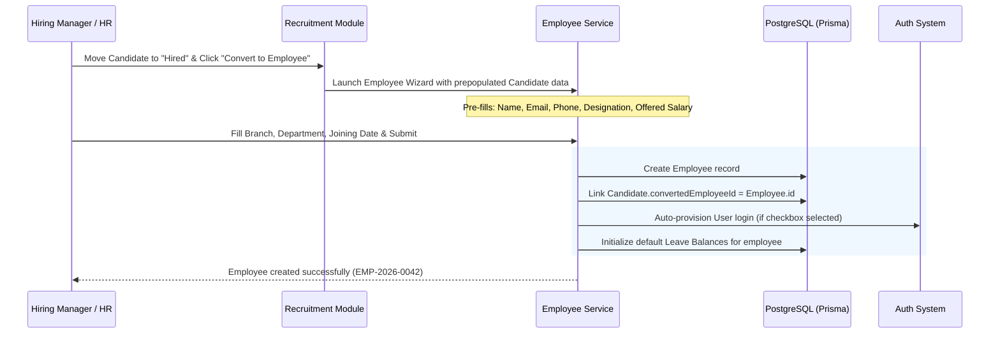

# Individual Addon Investigation: Recruitment (ATS)

**Addon Name:** Recruitment (ATS)  
**Category:** HR  
**Classification:** OBSERVED (WorkDo) / SOURCE-INSPECTED (MASTERHRMS)  
**Status:** PARTIALLY IMPLEMENTED (Routes in `hr-recruitment.routes.ts`)  

---

## 1. Identity & Purpose
- **Business Purpose:** End-to-end Applicant Tracking System (ATS) managing job openings, public career pages, candidate applications, interview rounds, and job offer generation.
- **Main Capabilities:**
  - Create and publish job openings by branch, department, and experience level.
  - Public job portal embed / standalone career page.
  - Multi-stage candidate hiring pipeline (`Applied`, `Screening`, `Interview`, `Offered`, `Hired`, `Rejected`).
  - Interview scheduling with calendar sync and feedback scoring.
  - One-click candidate to employee conversion.
- **Target Roles:** HR Manager, Recruiter, Hiring Manager.
- **Dependencies:** Employee Directory, Branch/Department Master Data.

---

## 2. Marketplace & Pricing Behaviour
- **Marketplace Card:** Displayed under HR Addons with thumbnail `Recruitment.png`.
- **Pricing:** Available standalone or included in Growth / Sovereign SaaS plans.

---

## 3. Installation Flow
- **Activation:** Upserts `TenantAddon` with `addonSlug: "recruitment"`.
- **Navigation:** Injects "Recruitment" top-level menu with sub-routes:
  - Jobs: `/hr/recruitment/jobs`
  - Candidates: `/hr/recruitment/candidates`
  - Interviews: `/hr/recruitment/interviews`
  - Career Page Settings: `/hr/recruitment/career-settings`

---

## 4. Tenant Configuration & Career Portal Setup
- **Fields:**
  - Company Overview & Culture statement.
  - Brand Logo & Banner image for career portal.
  - Notification Email for incoming applications.
  - Default Interview Stages customization.

---

## 5. Candidate to Employee Conversion Workflow

---

## 6. Role-Based Access Matrix
- **Super Admin:** Platform-wide recruitment analytics.
- **Tenant Admin:** Full control over all job requisitions and offers.
- **Recruiter / HR:** Create jobs, manage candidate stages, schedule interviews.
- **Hiring Manager:** View candidates for their department, submit interview ratings.
- **Employee:** View internal job board for employee referral programs.
