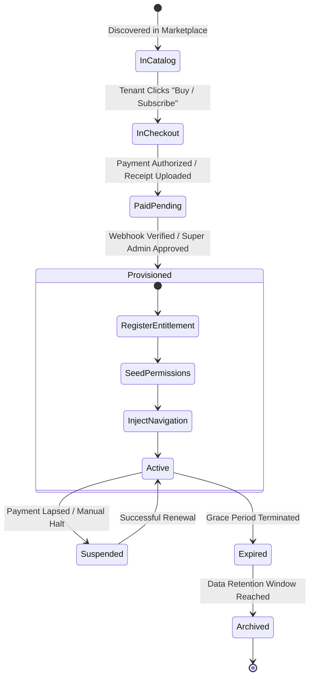
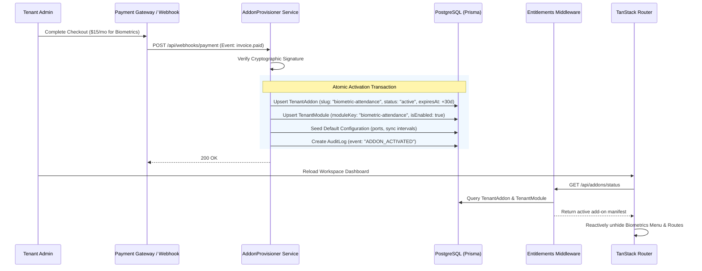

# 08 — Addon Installation & Activation Lifecycle Architecture

**Project:** MASTERHRMS Enterprise SaaS Reverse Engineering  
**Classification:** OBSERVED (WorkDo Dash) / SOURCE-INSPECTED (MASTERHRMS)  
**Date:** November 19, 2026  
**Status:** COMPLETE

---

## 1. Overview & Conceptual Architecture

In a modular enterprise SaaS platform like WorkDo Dash and MASTERHRMS, add-ons represent autonomous units of functionality. The installation and activation lifecycle bridges the gap between **commercial checkout/entitlement** and **runtime UI/API availability**.



---

## 2. WorkDo Reference Installation Mechanism

From browser observation of `dash-demo.workdo.io/add-ons/explore`:

### 2.1 Package Manifest & Dynamic Registration
1. **Package Discovery:** Each add-on in WorkDo is encapsulated inside a Laravel package structure (`packages/workdo/{AddonName}/`).
2. **Dynamic Route Registration:** Each package contains a `RouteServiceProvider` registering routes under prefix `/{workspace}/...` or `/{module}/...`.
3. **Database Migration on Enable:** When an add-on is enabled platform-wide or initialized for a company, package migrations run (`php artisan migrate --package={AddonName}`).
4. **Dynamic Menu Injection:** In WorkDo's Inertia props, the `side-menu-builder` reads active package configurations. If `BiometricAttendance` is active, the HRM navigation sub-tree dynamically injects "Biometric Attendance" and "Punch Logs".
5. **Role Permission Seeding:** Package activation inserts new Spatie permissions (e.g. `manage-biometric-attendance`, `create-biometric-device`) into the `permissions` table and assigns them to the company's default `admin` and `hr` roles.

---

## 3. MASTERHRMS Add-on Provisioning Engine

In MASTERHRMS, add-on management is designed to be cloud-native, type-safe, and resilient, avoiding PHP's runtime file execution risks.

### 3.1 Data Model: `TenantAddon` vs `TenantModule`
MASTERHRMS utilizes two distinct PostgreSQL tables in Prisma to govern add-on lifecycles:

```prisma
model TenantAddon {
  id              String         @id @default(uuid())
  tenantId        String         @map("tenant_id")
  addonSlug       String         @map("addon_slug")
  status          String         @default("active") // "active", "trial", "expired", "suspended"
  subscribedAt    DateTime       @default(now()) @map("subscribed_at")
  expiresAt       DateTime?      @map("expires_at")
  trialEndsAt     DateTime?      @map("trial_ends_at")
  autoRenew       Boolean        @default(true) @map("auto_renew")
  config          Json?          // Tenant-specific credentials (API keys, webhooks)
  tenant          Tenant         @relation(fields: [tenantId], references: [id], onDelete: Cascade)

  @@unique([tenantId, addonSlug])
  @@index([tenantId, status])
  @@map("tenant_addons")
}

model TenantModule {
  id              String         @id @default(uuid())
  tenantId        String         @map("tenant_id")
  moduleKey       String         @map("module_key") // e.g. "crm", "pos", "hrms", "biometrics"
  isEnabled       Boolean        @default(true) @map("is_enabled")
  provisionedAt   DateTime       @default(now()) @map("provisioned_at")
  tenant          Tenant         @relation(fields: [tenantId], references: [id], onDelete: Cascade)

  @@unique([tenantId, moduleKey])
  @@map("tenant_modules")
}
```

### 3.2 Automated Installation Sequence



---

## 4. Runtime Authorization & Middleware Enforcement

Addon access is strictly guarded at the Express API layer via `requireAddon(slug)` and `requireEntitlement(key)` in `server/src/middleware/entitlements.ts`.

### 4.1 Entitlement Check Algorithm
1. **Super Admin Bypass:** If `req.user.roles.includes("super_admin")`, access is immediately granted (`source: "super_admin_bypass"`).
2. **TenantModule Check:** Queries `TenantModule` where `moduleKey` matches candidate keys. If `isEnabled === false`, returns `403 Forbidden` (`Module explicitly disabled`).
3. **TenantAddon Check:** Queries `TenantAddon`. If active or within trial, access granted. If `expiresAt < now()`, returns `403 Forbidden` (`ADDON_EXPIRED`).
4. **Plan Feature Array Fallback:** Checks if the tenant's primary `SubscriptionPlan.features` string array encompasses this module.

### 4.2 Dynamic Frontend Route & UI Guards
On the front-end, navigation menus are rendered dynamically using the `useEntitlements()` React hook:
```typescript
const { hasAddon, isModuleEnabled } = useEntitlements();

// Render Biometrics section only if entitled
{hasAddon("biometric-attendance") && (
  <SidebarItem to="/hr/biometrics" label="Biometric Punch Logs" icon={Fingerprint} />
)}
```

---

## 5. Addon Configuration & Credential Isolation

When an add-on requires tenant-level credentials (e.g. WhatsApp Cloud API Token, Google Calendar Client Secret, IndiaMART CRM Key):
- Credentials are encrypted using AES-256-GCM via `server/src/lib/crypto-config.ts` prior to storage in `TenantAddon.config`.
- Credentials belonging to Tenant A are never accessible or queried by Tenant B.
- A dedicated test-connection endpoint `/api/addons/:slug/test-connection` verifies third-party API validity before enabling background synchronizations.
