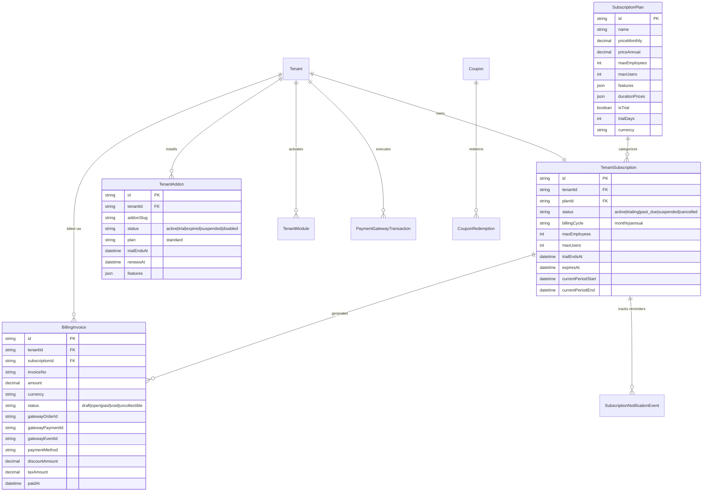
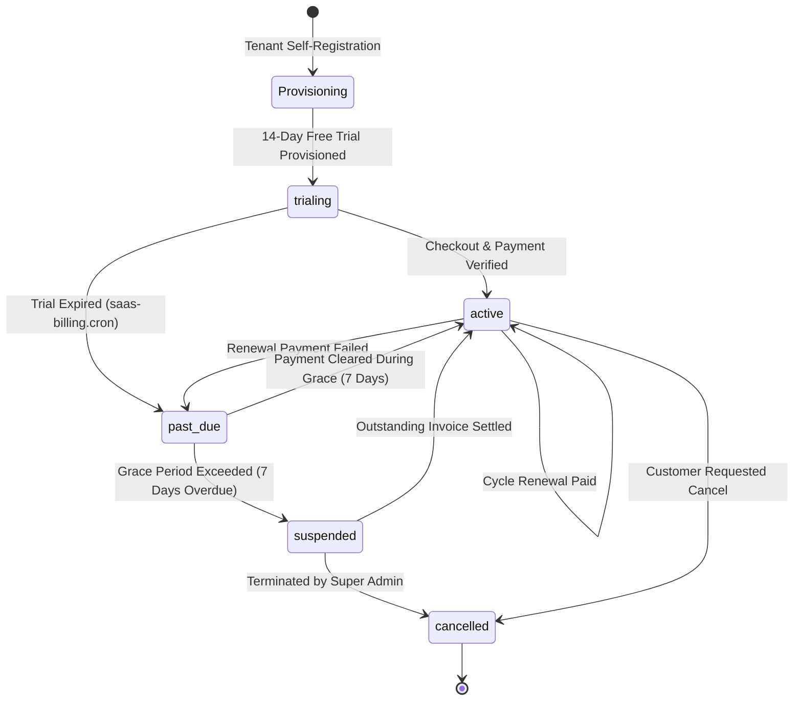
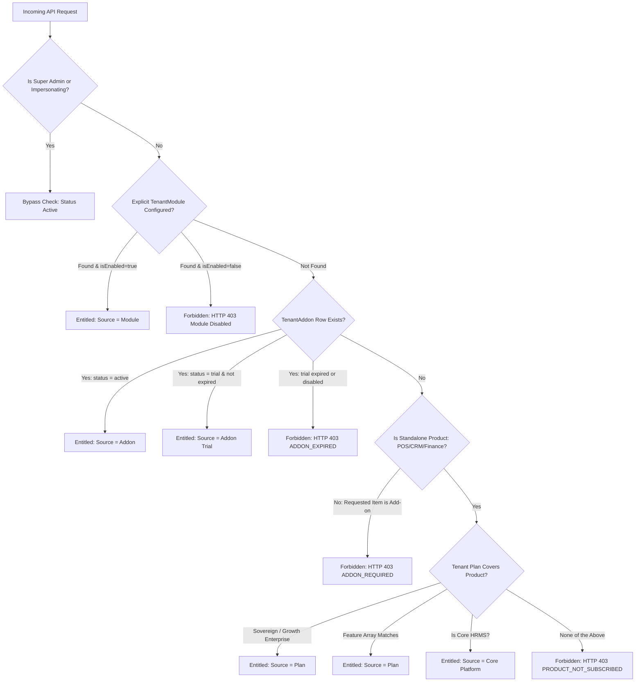
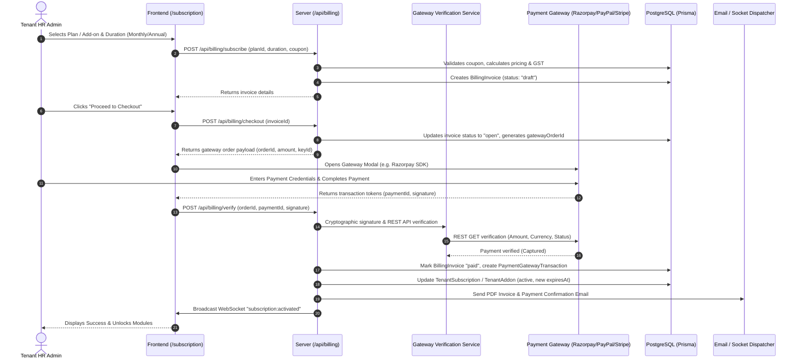

# 09. Add-on, Billing & Subscription Architecture

**Project:** MASTERHRMS WorkDo SaaS Reverse Engineering  
**Role:** Billing & Integration Analyst  
**Classification:** SOURCE-INSPECTED (MASTERHRMS) & INFERRED (WorkDo SaaS Pattern)  
**Date:** November 2026  
**Status:** IMPLEMENTED / ARCHITECTURAL DOCUMENTATION  

---

## 1. Executive Summary

This document details the multi-tenant billing, subscription lifecycle, catalog pricing, and add-on entitlement architecture of **MASTERHRMS**, comparing it with standard **WorkDo SaaS** design patterns. 

MASTERHRMS implements a dual-tier monetization model combining:
1. **Core Subscription Plans**: Tiered platform packages (Starter, Growth, Sovereign, Custom Flex) governing seat quotas, base HRMS features, and warehouse allocations.
2. **Modular Add-On Marketplace**: Over 35 granular extensions spanning ERP standalone modules (POS, CRM, Finance), cloud connectors (Google Workspace, WhatsApp, Biometrics), enterprise operations (Activity Logs, Public API, Outbound Webhooks), and regional compliance packs (ZATCA, EU E-Invoice, Tally).

Entitlements are enforced strictly at the API gateway layer via Express middleware and validated against PostgreSQL tables in Prisma (`TenantSubscription`, `TenantAddon`, `TenantModule`).

---

## 2. MASTERHRMS Billing Model

### 2.1 Prisma Schema Billing Models

The billing and entitlement domain in `server/prisma/schema.prisma` is composed of the following core data models:

### 2.2 Core Subscription States

State management is codified in `server/src/cron/saas-billing.cron.ts`, `server/src/middleware/subscription.ts`, and `server/src/lib/tenant-provisioning.ts`:

| State | Definition | Access Permissions | Transition Triggers |
| :--- | :--- | :--- | :--- |
| `trialing` | Workspace is within initial trial window (default 14 days upon self-serve registration). | Full access to plan-assigned features and quotas. | Trial date passes `trialEndsAt` $\rightarrow$ transitions to `past_due`. |
| `active` | Active paid subscription with `expiresAt > now()`. | Full access to business operations. | Expiry timestamp elapsed $\rightarrow$ API middleware returns `HTTP 402 SUBSCRIPTION_EXPIRED`. |
| `past_due` | Trial or billing renewal expired; workspace enters default 7-day grace period. | Safe routes allowed (`/api/billing`, `/api/auth`, `/api/health`). Business APIs gated. | `saas-billing.cron.ts` moves to `past_due` when `trialEndsAt < now()`. |
| `suspended` | Grace period exceeded without payment settlement. | All business operations locked. Middleware returns `HTTP 402 SUBSCRIPTION_SUSPENDED`. | `saas-billing.cron.ts` moves `past_due` to `suspended` when `updatedAt < now() - 7 days`. |
| `cancelled` | Subscription explicitly terminated by tenant admin or super admin. | Access locked except for invoices & export history. | Admin action or customer cancellation. |

---

## 3. Subscription Lifecycle & State Machine

---

## 4. Add-on Entitlement Check Architecture

Entitlement checking is executed by `server/src/middleware/entitlements.ts` (`checkTenantEntitlement` and `requireEntitlement`), utilizing a strict 5-tier resolution hierarchy:

### 4.1 Entitlement Check Resolution Rules

1. **Super Admin Bypass**: Any request bearing `super_admin` in JWT claims or active session impersonation flag immediately bypasses all feature locks.
2. **TenantModule Check**: Database table `tenant_modules` contains tenant-level feature flags (`moduleKey`, `isEnabled`). If disabled explicitly, access is denied even if a subscription plan exists.
3. **TenantAddon Check**: Queries `tenant_addons` by matching normalized slug variations (e.g. `google-workspace`, `razorpay-gateway`, `biometric-sync`, `outbound-webhooks`). Handles trial expiration (`trialEndsAt < now()`).
4. **Plan Feature Array Inspection**: For standalone products (POS, CRM, Finance, Inventory, Projects), checks `SubscriptionPlan.features` or top-tier plans (`sovereign`, `growth`).
5. **Core Platform Default**: Base HRMS functionalities (employee directory, attendance, leaves, departments) are permanently entitled as the platform baseline.

---

## 5. End-to-End Billing Purchase Flow

---

## 6. Commerce Pricing & Catalog Configuration

The system configures catalog pricing via `server/src/config/commerce-pricing.config.ts`. In production environments (`NODE_ENV === "production"`), commercial prices strictly require explicit environment configurations; otherwise they resolve to `null` to prevent unapproved charges.

### 6.1 Standard Seat Tiers & Overage Models
- **Micro (1–25 seats)**: Included 25 seats; overage ₹15/month or ₹150/year per extra seat.
- **Small (26–100 seats)**: Included 100 seats; overage ₹12/month or ₹120/year per extra seat.
- **Mid-Market (101–500 seats)**: Included 500 seats; overage ₹10/month or ₹100/year per extra seat.
- **Enterprise (501+ seats)**: Included 500 seats; overage ₹8/month or ₹80/year per extra seat.

### 6.2 Indian GST Place-of-Supply Engine
- **Platform Base**: Haryana (State Code `06`, GSTIN `06AAACM1234F1Z8`).
- **Intra-State (Haryana to Haryana)**: CGST (9%) + SGST (9%) = 18%.
- **Inter-State (Haryana to Other Indian States)**: IGST (18%).
- **Export (Foreign Workspaces)**: Zero-rated GST (0%).

---

## 7. WorkDo SaaS Billing Comparison

| Capability | MASTERHRMS Implementation (SOURCE-INSPECTED) | WorkDo SaaS Pattern (INFERRED) | Parity Status |
| :--- | :--- | :--- | :--- |
| **Pricing Architecture** | Hybrid: Plan base fees + Seat tier overages + Modular add-ons. | Package-based SaaS plans with bundled module presets. | **SUPERIOR (MASTERHRMS)** |
| **Addon Purchase Mode** | Independent `TenantAddon` activation with separate renewals. | Addon bundle activation tied to main workspace subscription. | **MATCHED** |
| **Tax Compliance** | Built-in Indian GST dual-rate engine (CGST/SGST/IGST) + ZATCA/EU e-invoice schemas. | Flat percentage tax rate configuration per country/currency. | **SUPERIOR (MASTERHRMS)** |
| **Payment Gateways** | Multi-Gateway: Razorpay (INR), PayPal (USD), Stripe (USD), Bank Transfer manual receipt. | Multi-Gateway: Stripe, PayPal, Razorpay, Mollie, Paystack, Flutterwave, Mercadopago. | **PARTIALLY MATCHED** (WorkDo offers more regional gateways) |
| **Trial Automation** | 14-day automated provisioning trial with cron-driven `past_due` & grace period enforcement. | Configurable plan trial days with access cutoff upon expiration. | **MATCHED** |
| **Invoice Engine** | Authoritative canonical invoice engine with PDF generation & cryptographic verification logs. | System-generated PDF invoices downloadable in customer panel. | **MATCHED** |

---

## 8. Gap Analysis & Recommendations

1. **Self-Serve Addon Proration**: MASTERHRMS currently creates standard standalone billing cycles for add-ons. It should implement mid-cycle proration to co-terminate add-on expiry with the tenant's primary subscription renewal date.
2. **Additional Global Payment Gateways**: To achieve full parity with WorkDo's global footprint, integrate **Mollie** (Europe), **Paystack** (Africa), and **MercadoPago** (Latin America) alongside existing Razorpay, PayPal, and Stripe engines.
3. **Automated Dunning Retries**: Implement recurring webhook handlers for Stripe Billing / Razorpay Subscriptions to manage multi-day retry intervals before moving accounts to `past_due`.
