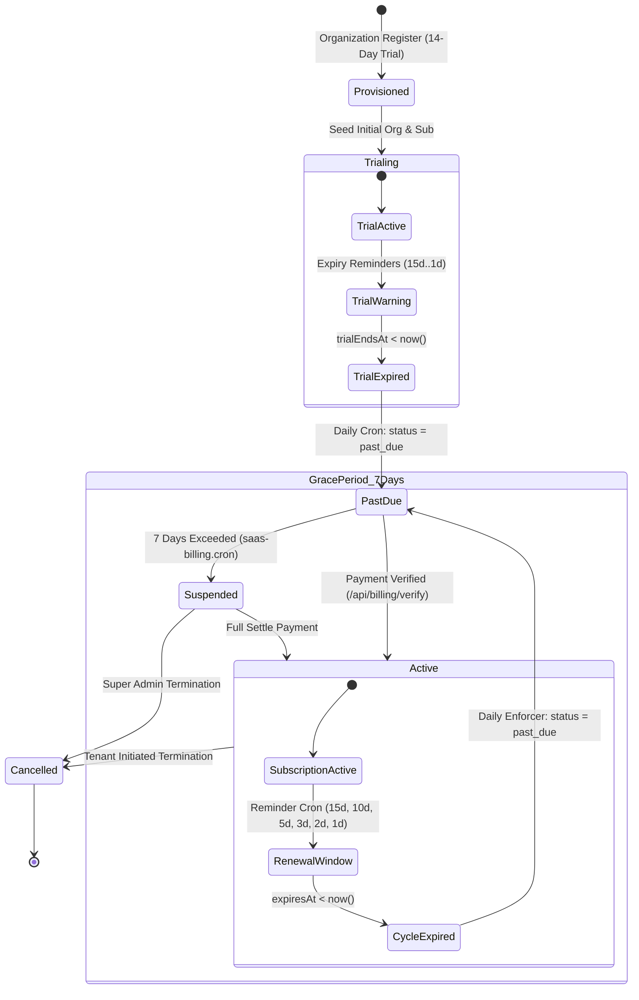
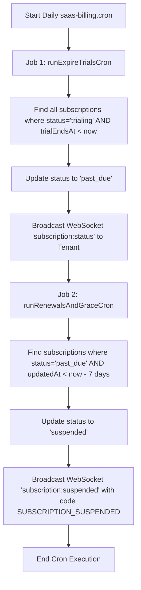

# 10. Expiry & Renewal Lifecycle Architecture

**Project:** MASTERHRMS WorkDo SaaS Reverse Engineering  
**Role:** Billing & Integration Analyst  
**Classification:** SOURCE-INSPECTED (MASTERHRMS) & INFERRED (WorkDo SaaS Pattern)  
**Date:** November 2026  
**Status:** IMPLEMENTED / ARCHITECTURAL SPECIFICATION  

---

## 1. Overview

The subscription lifecycle system in MASTERHRMS governs tenant access, trial expiration, scheduled renewals, automated dunning warnings, and grace-period suspensions. 

This document defines the lifecycle enforcement mechanisms across:
1. **Real-time API Middleware**: `server/src/middleware/subscription.ts`
2. **Daily Trial & Grace Enforcement Cron**: `server/src/cron/saas-billing.cron.ts`
3. **Multi-Stage Reminder Notification Cron**: `server/src/cron/subscription-reminder.cron.ts`
4. **Duration & Period Computation Engine**: `server/src/services/billing-duration.service.ts`

---

## 2. Subscription Lifecycle State Machine



---

## 3. Real-Time Expiry Enforcement (Middleware)

Tenant access checks execute on every incoming HTTP request via `requireActiveSubscription` in `server/src/middleware/subscription.ts`.

### 3.1 Route Bypass Whitelist (`SAFE_PREFIXES`)
To ensure a locked or expired tenant can still authenticate, review past invoices, and complete payment checkout, specific routes bypass subscription locking:

```typescript
const SAFE_PREFIXES = [
  "/api/billing",             // Invoice view, checkout, payment verification
  "/api/auth",                // Login, session token refresh, logout
  "/api/webhooks",            // Gateway webhook callbacks
  "/api/health",              // System uptime checks
  "/api/public",              // Public assets and branding
  "/api/v1/public",           // Public contact/career portals
  "/api/v1/settings",         // Public system settings
  "/api/v1/media",            // Static media assets
  "/api/super",               // Super admin management operations
  "/api/workspace/subscription", // Subscription status polling
  "/api/workspace/check-slug",// Slug discovery
  "/api/workspace/public",    // Tenant branding resolution
];
```

### 3.2 High-Performance In-Memory Cache
Database lookups for tenant subscription status are cached with a 60-second TTL:
```typescript
const subscriptionCache = new Map<string, { sub: any; expiresAt: number }>();
```

### 3.3 Access Lock Responses
1. **Suspension Lock (HTTP 402)**:
   ```json
   {
     "error": "Workspace account is suspended. Access to business operations is locked.",
     "code": "SUBSCRIPTION_SUSPENDED",
     "status": "suspended",
     "tenantId": "c4b8b80b-...",
     "planName": "Growth Enterprise"
   }
   ```
2. **Expiration Lock (HTTP 402)**:
   ```json
   {
     "error": "Workspace subscription has expired. Access to business operations is locked.",
     "code": "SUBSCRIPTION_EXPIRED",
     "status": "expired",
     "expiresAt": "2026-11-19T00:00:00.000Z",
     "tenantId": "c4b8b80b-...",
     "planName": "Standard Plan"
   }
   ```

---

## 4. Background Lifecycle Enforcement (Cron Jobs)

MASTERHRMS executes two distinct cron workflows to govern lifecycle transitions:

### 4.1 Daily SaaS Billing Cron (`saas-billing.cron.ts`)



1. **`runExpireTrialsCron()`**: Runs daily at midnight. Finds workspaces where `status === 'trialing'` and `trialEndsAt < now()`. Moves status to `past_due` and broadcasts an immediate alert to all connected browser sessions.
2. **`runRenewalsAndGraceCron(graceDays = 7)`**: Evaluates overdue accounts in `past_due`. If an account remains unpaid for greater than 7 days (`updatedAt < now() - 7 days`), the account status transitions to `suspended`.

### 4.2 Automated Lifecycle Reminders (`subscription-reminder.cron.ts`)

Runs daily to scan all tenant subscriptions with `expiresAt !== null` and `status NOT IN ('suspended', 'cancelled')`.

#### Threshold Tiers:
| Days Remaining | Event Type | Template ID | Dispatched Action |
| :---: | :---: | :---: | :--- |
| **15 Days** | `reminder_15d` | `subscription-reminder-15d` | Warning email + WebSocket banner |
| **10 Days** | `reminder_10d` | `subscription-reminder-10d` | Warning email + WebSocket banner |
| **5 Days** | `reminder_5d` | `subscription-reminder-5d` | Urgent notice email + WebSocket banner |
| **3 Days** | `reminder_3d` | `subscription-reminder-3d` | High priority expiry warning email |
| **2 Days** | `reminder_2d` | `subscription-reminder-2d` | High priority countdown warning email |
| **1 Day** | `reminder_1d` | `subscription-reminder-1d` | Final day reminder email |
| **$\le$ 0 Days** | `expired` | `subscription-expired` | Expiry lockdown notice + WebSocket `subscription:expired` |

#### Idempotency Architecture:
To prevent duplicate emails on repeated cron runs, dispatches are tracked in `subscription_notification_events`:
```prisma
model SubscriptionNotificationEvent {
  id             String    @id @default(uuid())
  tenantId       String
  subscriptionId String
  cycleKey       String    // e.g. "exp_2026-11-30"
  eventType      String    // e.g. "reminder_3d", "expired"
  recipientEmail String
  status         String    // "sent" | "failed" | "skipped"
  sentAt         DateTime?
  attemptCount   Int       @default(1)
  
  @@unique([subscriptionId, cycleKey, eventType])
}
```

---

## 5. Renewal Trigger & Duration Computation

Renewals are processed in `server/src/routes/billing.routes.ts` via `POST /api/billing/subscribe` or `POST /api/billing/renew`.

### 5.1 Billing Intervals & Duration Service
Computed by `server/src/services/billing-duration.service.ts`:
- **`1_month`**: Adds exactly 1 calendar month or 30 days.
- **`3_months`**: Adds 1 calendar quarter (90 days).
- **`6_months`**: Adds 6 calendar months (180 days).
- **`1_year`**: Adds 1 full calendar year (365 days).

### 5.2 Period Start Alignment
If renewed while an active subscription exists, the new `periodStart` begins at the existing `expiresAt` (continuous coverage without losing remaining paid days). If renewed after expiration, `periodStart` resets to `now()`.

---

## 6. WorkDo Comparison & Recommendations

| Lifecycle Capability | MASTERHRMS (SOURCE-INSPECTED) | WorkDo SaaS Reference (INFERRED) |
| :--- | :--- | :--- |
| **Grace Period** | 7-day automated `past_due` window before hard suspension. | Immediate lock or configurable super admin grace period. |
| **Reminder Granularity** | 6 notification tiers (15d, 10d, 5d, 3d, 2d, 1d) + Expired. | 3 standard email reminders (7d, 3d, 1d) prior to due date. |
| **Notification Reliability** | Cryptographic idempotency key (`subscriptionId_cycleKey_eventType`) in PostgreSQL. | Cron queue job tracking in Laravel `jobs` / `notifications`. |
| **Realtime Feedback** | WebSocket broadcasts directly into active user sessions (`subscription:warning`, `subscription:expired`). | Relies on page reload / HTTP redirect on subsequent request. |

### Recommendations for Future Sprints:
1. **Configurable Grace Period**: Expose `graceDays` in Super Admin settings rather than hardcoded 7-day default in cron.
2. **Auto-Charge Webhooks**: For payment methods supporting mandates (Stripe / Razorpay Subscriptions), trigger automated server-to-server renewal charges 24 hours prior to `expiresAt`.
