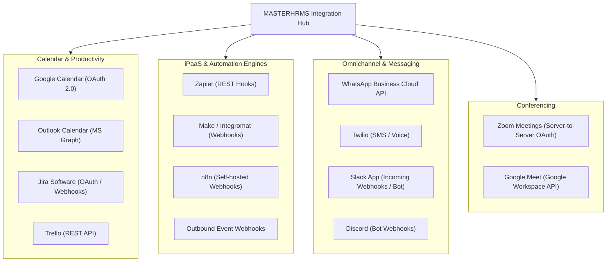
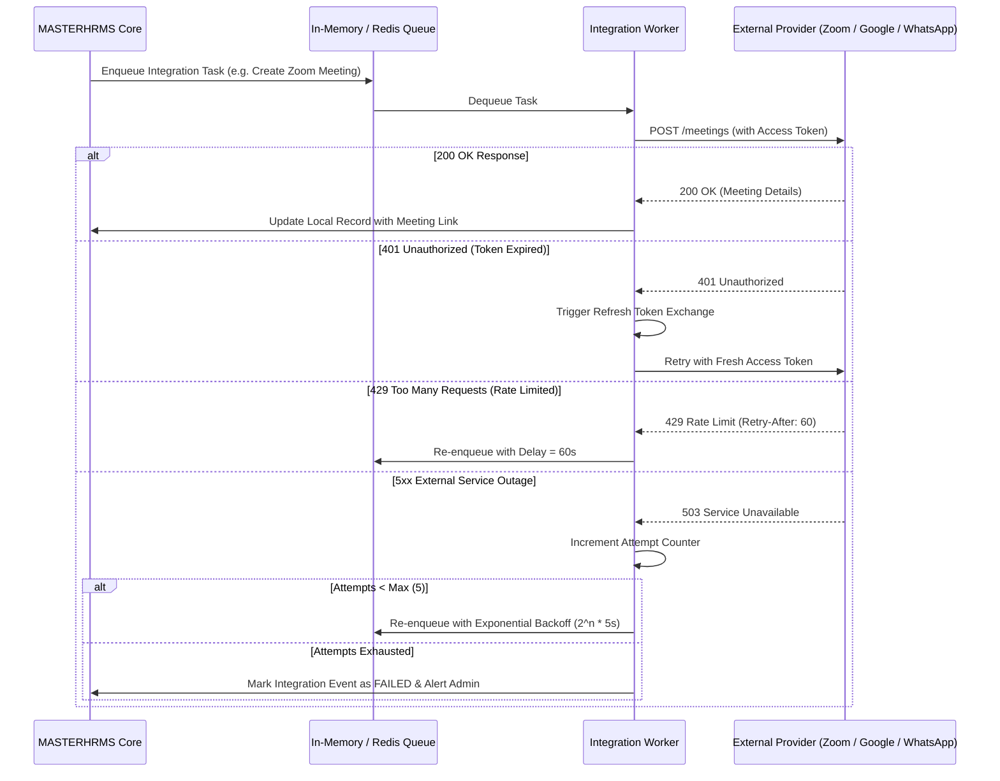

# 12 — Integration Architecture: WorkDo Dash SaaS & MASTERHRMS

**Project:** MASTERHRMS Enterprise SaaS Reverse Engineering  
**Classification:** OBSERVED (WorkDo Dash) / SOURCE-INSPECTED (MASTERHRMS)  
**Date:** November 19, 2026  
**Status:** COMPLETE

---

## 1. Executive Summary

Enterprise SaaS platforms require interoperability with third-party productivity suites, messaging channels, workflow automation platforms, and external CRMs. 

WorkDo Dash exposes over **40 distinct integration add-ons** spanning Calendars, Webhooks, iPaaS automation (Zapier, Make, n8n), messaging platforms (WhatsApp, Slack, Discord, Telegram), and video conferencing (Zoom, Google Meet).

MASTERHRMS supports this ecosystem via modular integration services, structured outbound webhook dispatchers (`server/src/modules/outbound-webhooks/`), public REST APIs (`server/src/modules/public-api/`), and multi-provider SMS dispatchers (`server/src/modules/sms-gateway/`).

---

## 2. Integration Classification Matrix



---

## 3. Deep Dive: Key Integrations Architecture

### 3.1 Google Calendar Integration
- **Objective:** Bi-directional sync of employee leaves, company holidays, recruitment interviews, and shift rotas.
- **Protocol:** OAuth 2.0 Authorization Code Grant with Refresh Token.
- **Scopes Required:**
  - `https://www.googleapis.com/auth/calendar.events`
  - `https://www.googleapis.com/auth/calendar.readonly`
- **Flow:**
  1. Tenant Admin inputs Google Client ID & Secret in Addon Settings.
  2. Clicks "Authorize with Google". Redirects to `accounts.google.com/o/oauth2/v2/auth`.
  3. Google redirects to callback: `/api/integrations/google-calendar/callback`.
  4. Server exchanges `code` for `access_token` and `refresh_token`.
  5. Tokens are encrypted (AES-256-GCM) and saved to `TenantAddon.config`.
  6. When an interview or leave is approved, a background worker dispatches a Calendar Event insertion request.

### 3.2 Outlook Calendar Integration (Microsoft Graph)
- **Objective:** Synchronize events with Office 365 / Microsoft Outlook.
- **Protocol:** Microsoft Identity Platform OAuth 2.0.
- **Endpoints:**
  - Auth: `https://login.microsoftonline.com/common/oauth2/v2.0/authorize`
  - Token: `https://login.microsoftonline.com/common/oauth2/v2.0/token`
  - Events API: `https://graph.microsoft.com/v1.0/me/events`
- **Scopes:** `Calendars.ReadWrite`, `offline_access`.

### 3.3 Outbound Webhooks & iPaaS (Zapier, Make, n8n)
MASTERHRMS possesses a production-grade outbound webhook dispatcher in `server/src/modules/outbound-webhooks/`:

**Core Components:**
- `outbound-webhooks.service.ts`: Manages webhook registrations, event subscriptions, and signature secret generation (`whsec_...`).
- `webhook-retry.worker.ts`: Background exponential backoff retry worker (retries on 5xx or connection timeouts up to 5 attempts).
- **HMAC Signature Header:** Every outbound HTTP POST includes:
  ```http
  X-MasterHRMS-Signature: sha256=4f53cda18c2baa0c0354bb5f9a3ecbe5ed12ab4d8e1...
  X-MasterHRMS-Event: employee.created
  X-MasterHRMS-Delivery: 7b3e2182-411a-429a-9e22-16a2b8e3924f
  Content-Type: application/json
  ```
- **Supported Event Triggers:**
  - `employee.created`, `employee.terminated`
  - `leave.requested`, `leave.approved`, `leave.rejected`
  - `attendance.clockin`, `attendance.clockout`
  - `payroll.processed`, `invoice.generated`

### 3.4 WhatsApp Business Cloud API Integration
- **Objective:** Automated salary slip delivery, attendance alerts, and leave approval notifications via WhatsApp.
- **Provider:** Meta Graph API (v19.0+).
- **Required Credentials:**
  - Phone Number ID
  - WhatsApp Business Account ID (WABA)
  - Permanent System User Access Token
- **Template Messaging:** Pre-approved WhatsApp HSM (Highly Structured Message) templates with variable interpolation (`{{1}} = Employee Name, {{2}} = Net Salary`).

### 3.5 IndiaMART CRM Integration
- **Objective:** Pull business leads generated on the IndiaMART B2B marketplace into the Sales/CRM module.
- **Method:** Scheduled REST polling against `https://mapi.indiamart.com/wservce/enquiry/listing/GLUSR_MOBILE/{mobile}/GLUSR_MOBILE_KEY/{key}/`.
- **Sync Cadence:** Configurable cron job running every 15 or 30 minutes.

---

## 4. Error Handling, Resilience & Circuit Breaking



---

## 5. Security & Credential Hygiene Guidelines

1. **Zero Secret Logging:** Client Secrets, API Keys, and Access Tokens must be redacted in application logs (`[REDACTED]`).
2. **At-Rest Encryption:** Stored in PostgreSQL utilizing AES-256-GCM authenticated encryption.
3. **Tenant Scoping:** External API tokens are strictly scoped to the originating `tenant_id`.
4. **OAuth State Verification:** All OAuth authorization redirect requests generate a high-entropy cryptographically random `state` parameter cached in Redis/memory to prevent Cross-Site Request Forgery (CSRF).
