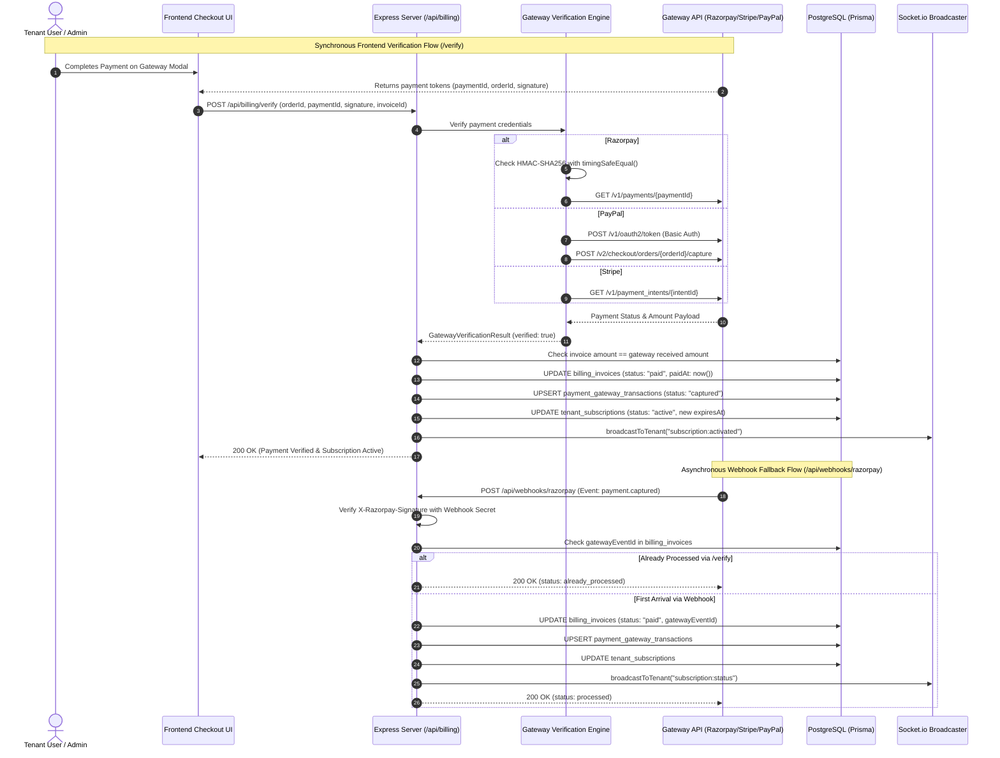

# 13. Payment Gateway & Callback Architecture

**Project:** MASTERHRMS WorkDo SaaS Reverse Engineering  
**Role:** Billing & Integration Analyst  
**Classification:** SOURCE-INSPECTED (MASTERHRMS) & INFERRED (WorkDo SaaS Pattern)  
**Date:** November 2026  
**Status:** IMPLEMENTED / ARCHITECTURAL SPECIFICATION  

---

## 1. Executive Summary

MASTERHRMS provides a resilient, multi-gateway payment architecture supporting **Razorpay**, **PayPal**, **Stripe**, and **Offline Bank Transfers**. 

The gateway infrastructure enforces:
1. **Cryptographic Validation**: HMAC-SHA256 signature verification with constant-time equality checks (`crypto.timingSafeEqual`).
2. **Server-Side Cross-Verification**: Direct REST API calls from the backend to payment gateways to confirm capture status, received amounts, and currency alignment prior to order fulfillment.
3. **Webhook Idempotency**: Unique event ID logging (`gatewayEventId`) to guarantee that repeated webhook payloads do not trigger double activation or duplicate accounting ledger entries.
4. **Tenant Isolation & Secret Encryption**: Tenant-specific or platform-wide gateway secrets encrypted at rest via AES-256-GCM (`server/src/services/settings/settings.service.ts`).

---

## 2. Supported Payment Gateways in MASTERHRMS

| Gateway | Supported Currencies | Integration Type | Verification Method | Implemented Files | Status |
| :--- | :--- | :--- | :--- | :--- | :--- |
| **Razorpay** | INR, USD | Direct Checkout + Webhooks | HMAC-SHA256 Signature + REST API GET verification | `gateway-verification.service.ts`, `billing.routes.ts`, `payments.routes.ts` | **IMPLEMENTED** |
| **PayPal** | USD, EUR, GBP | Client Capture + Server Verification | OAuth 2.0 Client Credentials + v2/orders Capture REST API | `gateway-verification.service.ts`, `billing.routes.ts` | **IMPLEMENTED** |
| **Stripe** | USD, EUR, INR, Multi | Elements / Checkout Sessions | REST API PaymentIntent / Session Retrieval | `gateway-verification.service.ts`, `billing.routes.ts` | **IMPLEMENTED** |
| **Bank Transfer** | Tenant Base Currency | Manual Offline Reference | Super Admin Manual Receipt & Reconciliation | `billing.routes.ts`, `payments.routes.ts` | **IMPLEMENTED** |

---

## 3. Payment Gateway Callback & Verification Sequence



---

## 4. Webhook Security Architecture

### 4.1 Fail-Closed Signature Validation
In `server/src/routes/billing.routes.ts` (`handleRazorpayWebhook`), the system enforces fail-closed operations:
1. Missing `RAZORPAY_WEBHOOK_SECRET` returns `HTTP 503 WEBHOOK_VERIFICATION_UNAVAILABLE`.
2. Missing `x-razorpay-signature` returns `HTTP 400 SIGNATURE_REQUIRED`.
3. Buffers are extracted from raw request payloads to compute cryptographic HMAC-SHA256 digests.
4. Digits are compared using `crypto.timingSafeEqual` to thwart timing attacks.

### 4.2 Cross-Verification of Monetary Values
Webhook handlers protect against payload tampering by querying the original internal invoice before applying changes:
```typescript
const gatewayAmountInPaise = Number(payment.amount);
const gatewayCurrency = String(payment.currency || "INR").toUpperCase();
const invoiceAmountInPaise = Math.round(Number(invoice.amount) * 100);
const invoiceCurrency = String(invoice.currency || "INR").toUpperCase();

if (gatewayAmountInPaise !== invoiceAmountInPaise) {
  return res.status(422).json({
    error: `Payment verification mismatch: expected ${invoiceAmountInPaise} paise, received ${gatewayAmountInPaise} paise.`,
    code: "VERIFICATION_MISMATCH",
  });
}
```

---

## 5. Prisma Database Audit Models

Every gateway interaction is durably recorded in two schema tables:

1. **`BillingInvoice`** (`billing_invoices`):
   - `gatewayOrderId`: Order ID assigned by gateway (e.g., `order_EKfNOAGSuIddpV`).
   - `gatewayPaymentId`: Unique transaction ID (e.g., `pay_29QQoUBcxrhLE5`).
   - `gatewayEventId`: Webhook unique delivery ID for idempotency deduplication.
2. **`PaymentGatewayTransaction`** (`payment_gateway_transactions`):
   - Unique index: `@@unique([tenantId, provider, providerOrderId])`
   - Attributes: `provider`, `amount`, `currency`, `status`, `verifiedAt`, `payload` (full sanitized JSON audit dump).
3. **`PaymentWebhookEvent`** (`payment_webhook_events`):
   - Tracks raw inbound provider payloads, delivery keys, and signature validation results.

---

## 6. WorkDo Comparison & Recommendations

| Capability | MASTERHRMS Implementation | WorkDo SaaS Pattern (INFERRED) |
| :--- | :--- | :--- |
| **Gateway Breadth** | Razorpay, PayPal, Stripe, Manual Bank Transfer. | 10+ Gateways (Stripe, PayPal, Razorpay, Mollie, Paystack, Flutterwave, Coingate, Mercadopago). |
| **Verification Depth** | Dual Layer: Cryptographic HMAC signature + outbound server REST query. | Single Layer: Cryptographic signature check or gateway redirect status query. |
| **Idempotency** | Authoritative database constraint on `gatewayEventId` and order uniqueness. | Laravel queue/event database locking. |
| **Tenant Credentials** | AES-256-GCM encrypted per tenant or fallback to global platform gateway. | Global Super Admin gateway credentials stored in `.env` or settings table. |

### Recommendations for Future Sprints:
1. **Recurring Subscriptions Engine**: Integrate Razorpay Subscriptions / Stripe Billing Webhooks (`invoice.payment_succeeded`, `customer.subscription.deleted`) for automated card-on-file renewals.
2. **Additional Gateways**: Add Mollie and Paystack adapters to the existing `gateway-verification.service.ts` harness to match WorkDo's European and African SaaS footprint.
