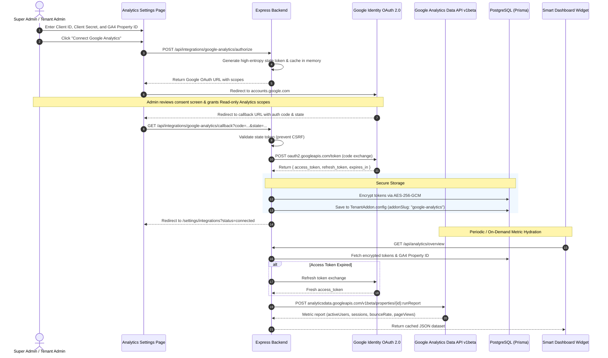

# 14 — Google Analytics Integration & OAuth Flow Architecture

**Project:** MASTERHRMS Enterprise SaaS Reverse Engineering  
**Classification:** OBSERVED (WorkDo Dash) / ARCHITECTURAL SPECIFICATION (MASTERHRMS)  
**Date:** November 19, 2026  
**Status:** COMPLETE

---

## 1. Executive Summary

The Google Analytics integration allows Super Admins and Tenant Admins to monitor real-time web traffic, user demographics, session duration, and conversion events directly within the platform's Smart Dashboard, without requiring users to navigate to the external Google Analytics 4 (GA4) console.

In WorkDo Dash, Google Analytics is supported through the `GoogleAnalytics` add-on package with dedicated permissions:
- `manage-google-analytics`
- `view-google-analytics`
- `view-google-analytics-overview`
- `view-google-analytics-audiences`
- `view-google-analytics-landing-page`
- `view-google-analytics-user-acquisition`

---

## 2. End-to-End OAuth 2.0 Authorization Sequence

---

## 3. Configuration Fields & Required Scopes

### 3.1 OAuth Configuration Parameters
- **Google Cloud Console Project:** Must have the `Google Analytics Data API` enabled.
- **Client ID:** Google OAuth Web Application Client ID (`*.apps.googleusercontent.com`).
- **Client Secret:** Secret associated with the Client ID.
- **Redirect URI:** `https://{domain}/api/integrations/google-analytics/callback`.
- **Property ID:** 9-digit GA4 numeric identifier (e.g. `312456789`).

### 3.2 Required OAuth Scopes
- `https://www.googleapis.com/auth/analytics.readonly` (Inspect GA4 property data and reports)

---

## 4. Data Synchronization & Dashboard Widget Architecture

### 4.1 Ingestion & Cache Strategy
Querying the Google Analytics Data API on every dashboard visit triggers API quota exhaustion and slow response times. MASTERHRMS implements a two-tier caching pattern:
1. **Short-lived In-Memory Cache (5 minutes):** Active real-time user counts (`runRealtimeReport`).
2. **Scheduled Sync Worker (Hourly):** Aggregates daily sessions, page views, and top traffic sources, persisting historical metrics into an `analytics_snapshots` table.

### 4.2 Error Handling & Re-Authentication
- **Revoked Consent / Invalid Refresh Token:** If Google returns `invalid_grant`, the backend marks the integration status as `DISCONNECTED` and alerts the administrator via an in-app banner to re-authorize.
- **Quota Exceeded (RESOURCE_EXHAUSTED):** The server falls back gracefully to the most recent cached snapshot without failing the dashboard render.
