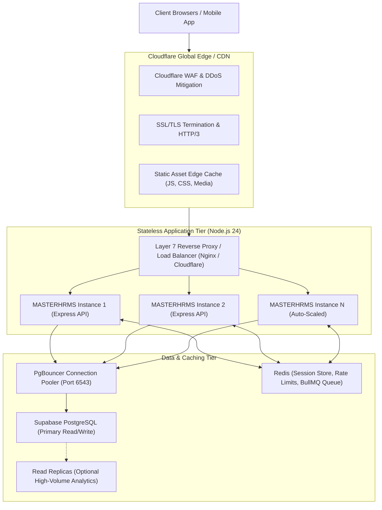

# 17 — Performance Optimization & Load Balancing Architecture

**Project:** MASTERHRMS Enterprise SaaS Reverse Engineering  
**Classification:** OBSERVED (WorkDo Dash) / ARCHITECTURAL SPECIFICATION (MASTERHRMS)  
**Date:** November 19, 2026  
**Status:** COMPLETE

---

## 1. Executive Summary

Enterprise SaaS platforms supporting thousands of concurrent tenants require strict latency budgets, connection resilience, and defensive rate-limiting mechanisms.

In **WorkDo Dash**, performance optimization relies on Laravel's opcode caching, file/Redis caching, frontend Inertia asset versioning (`X-Inertia-Version`), and paginated Eloquent queries.

In **MASTERHRMS**, performance and scalability are achieved through asynchronous Node.js I/O, Supabase PostgreSQL connection pooling (`PrismaClient` with PgBouncer), Redis-backed rate limiting, multi-tenant caching via `tenantStorage`, and CDN edge caching via Cloudflare/Vercel.

---

## 2. Scalability & High-Availability Architecture

---

## 3. Database Connection Pooling & Multi-Tenant Query Patterns

### 3.1 PgBouncer & Transaction-Mode Pooling
Direct PostgreSQL connections consume ~10MB of RAM per connection on the database server. Under heavy concurrent tenant traffic, raw connections exhaust database limits.
- **PgBouncer Configuration:** Deployed in `transaction` pooling mode.
- Connections are returned to the pool immediately upon completion of a query or transaction block, enabling thousands of concurrent HTTP requests to share a pool of 50-100 physical PostgreSQL connections.
- **Tenant Scoping in Queries:** Every indexed table includes a compound index on `(tenant_id, id)` or `(tenant_id, created_at)` to ensure index-only scans and prevent full table scans.

### 3.2 Pagination Standards
Large datasets (e.g. Employee Directory, Attendance Logs, Audit Trails) strictly enforce keyset or limit/offset pagination:
- Default page size: `25` records.
- Maximum page size: `100` records.
- Avoids memory bloating in both Node.js memory heaps and client browsers.

---

## 4. Caching Strategies & Cache Invalidation

| Cache Layer | Technology | TTL | Invalidation Trigger |
|---|---|---|---|
| **Tenant Entitlement Cache** | In-Memory LRU / Redis | 15 minutes | Addon purchase, plan upgrade, module toggle |
| **RBAC Permissions Cache** | In-Memory LRU | 30 minutes | Role assignment, permission update |
| **Settings & Brand Cache** | Redis | 1 hour | Admin updates settings |
| **Static Assets (JS/CSS)** | Cloudflare Edge | 1 year (Immutable hash) | Application deployment |

---

## 5. Defensive Rate Limiting & Circuit Breaking

To protect multi-tenant infrastructure from noisy neighbor disruptions or brute-force attacks:
1. **Public Authentication Endpoints (`/api/auth/*`):** Restricted to 5 attempts per IP per minute via `express-rate-limit`.
2. **Standard API Routes:** Restricted to 120 requests per tenant per minute.
3. **Public Webhook & Public API Endpoints:** Governed by API Key quotas (e.g. 1000 requests/hour on Starter, 5000 requests/hour on Enterprise).
4. **Integration Circuit Breaker:** If an external service (e.g. Twilio, Meta, Google) returns 5 consecutive failures, the circuit breaker opens for 60 seconds, rejecting subsequent calls immediately to prevent worker exhaustion.
