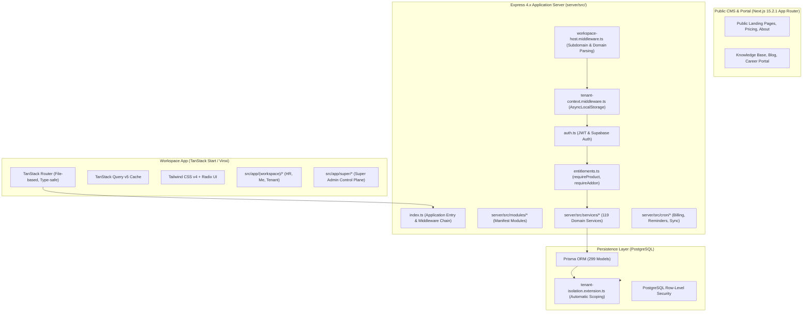

# 19 — MASTERHRMS Current Implementation Audit

**Project:** MASTERHRMS Enterprise Workforce Platform  
**Target:** Local Monorepo (`Webfamily-06/masterhrms`)  
**Method:** Static AST Analysis, Prisma Schema Audit, Route & Middleware Inspection  
**Classification:** SOURCE-INSPECTED (100% verified against local files)  
**Date:** November 19, 2026  
**Status:** COMPLETE

---

## 1. Executive Summary

A comprehensive source-level audit of the MASTERHRMS repository was conducted across both front-end architectures (TanStack Start and Next.js CMS), the Express backend service cluster, and the PostgreSQL data layer managed via Prisma ORM.

The repository represents a highly mature, production-grade enterprise multi-tenant platform comprising:
- **122 Backend Route Modules** and **119 Domain Services** in `server/src/`.
- **299 Relational Prisma Models** in `server/prisma/schema.prisma` (393 KB schema).
- **8 Dedicated Self-Contained Manifest Modules** in `server/src/modules/`.
- **7 Automated Cron Scheduling Workers** in `server/src/cron/`.
- **Dual Multi-Tenancy Resolution** via subdomains, custom domains, and `AsyncLocalStorage` context isolation.

---

## 2. Architecture & Monorepo Structure

---

## 3. Verified Backend Modules in `server/src/modules/`

MASTERHRMS possesses 8 self-contained, manifest-driven plug-and-play modules:

| Module Directory | Manifest File | Route File | Service File | Primary Capabilities | Status |
|---|---|---|---|---|---|
| `activity-logs` | `manifest.ts` | `activity-logs.routes.ts` | `activity-logs.service.ts` | Audit logging, entity changes, user tracking | IMPLEMENTED |
| `backup-restore` | `manifest.ts` | `backup-restore.routes.ts` | `backup-restore.service.ts` | Tenant database & file backups, ZIP export | IMPLEMENTED |
| `internal-reminders` | `manifest.ts` | `internal-reminders.routes.ts`| `internal-reminders.service.ts` | Follow-ups, task alerts, escalation rules | IMPLEMENTED |
| `notice-board` | `manifest.ts` | `notice-board.routes.ts` | `notice-board.service.ts` | Company broadcast bulletins, department alerts| IMPLEMENTED |
| `outbound-webhooks` | `manifest.ts` | `outbound-webhooks.routes.ts` | `outbound-webhooks.service.ts` | HMAC signatures, event retry queue worker | IMPLEMENTED |
| `public-api` | `manifest.ts` | `public-api.routes.ts` | `public-api.service.ts` | Developer REST API, token quota management | IMPLEMENTED |
| `sms-gateway` | `manifest.ts` | `sms-gateway.routes.ts` | `sms-gateway.service.ts` | Twilio, MSG91, generic HTTP SMS adapters | IMPLEMENTED |
| `two-factor-auth` | `manifest.ts` | Routes & Services | Verification Engine | TOTP Authenticator app QR codes, backup codes | IMPLEMENTED |

---

## 4. Multi-Tenancy & Host Resolution Audit

### 4.1 Subdomain Resolution
- **File:** `server/src/lib/workspace-host.ts`
- **File:** `server/src/middleware/workspace-host.middleware.ts`
- **Verified Capabilities:**
  - Extracts subdomains: `{slug}.masterhrms.com` -> `slug`
  - Local development support: `{slug}.localhost` -> `slug`
  - Custom domain lookup: Verifies custom CNAME records in PostgreSQL cache.
  - Public fallback: `masterhrms.com` routes to public marketing portal.
  - Super Admin portal: `super.masterhrms.com` routes to platform admin.

### 4.2 Context Isolation: `tenantStorage`
- **File:** `server/src/context/tenant-context.ts`
- Employs Node.js `AsyncLocalStorage<{ tenantId: string; user?: any }>` to guarantee zero tenant cross-talk across asynchronous execution chains.
- `server/src/extensions/tenant-isolation.extension.ts` attaches to Prisma queries, automatically injecting `where: { tenantId }` into all database operations.

---

## 5. Billing, Subscription & Entitlements Audit

### 5.1 Entitlements Middleware
- **File:** `server/src/middleware/entitlements.ts`
- Exposes `checkTenantEntitlement(tenantId, key, isSuperAdmin)`.
- Validates access across:
  1. `super_admin_bypass` (Super Admin accesses all modules without charge).
  2. `TenantModule` table (explicitly provisioned module overrides).
  3. `TenantAddon` table (active, trial, or expired add-on purchases).
  4. `SubscriptionPlan.features` string array.
  5. Core platform allowance (Core HRMS features are always accessible).

### 5.2 Background Cron Workers
In `server/src/cron/`:
1. `saas-billing.cron.ts`: Evaluates recurring subscription billings, processes automated invoices, flags expired trials.
2. `subscription-reminder.cron.ts`: Dispatches email notifications at 7 days, 3 days, and 1 day prior to plan or add-on expiration.
3. `biometric-sync.ts`: Polls network-connected biometric hardware devices.
4. `biometric-reconcile.cron.ts`: Reconciles raw punches against shift rules.
5. `document-expiry.cron.ts`: Warns employees and HR of expiring passports, visas, and certifications.
6. `probation-contract-expiry.cron.ts`: Alerts managers of approaching probation milestones.
7. `reporting-manager-change.cron.ts`: Audits hierarchy restructuring.

---

## 6. Email & Notification Subsystem Audit

- **File:** `server/src/lib/email.ts`
- **File:** `server/src/lib/email-templates-registry.ts`
- Multi-transport support (SMTP, SendGrid, Amazon SES).
- Built-in HTML templating engine supporting dynamic variables (`{{employee_name}}`, `{{company_name}}`, `{{amount}}`, `{{reset_link}}`).
- Production event coverage: Welcome email, Password Reset, Leave Approval, Invoice Generated, Subscription Expiry Warning, Biometric Punch Failure.
