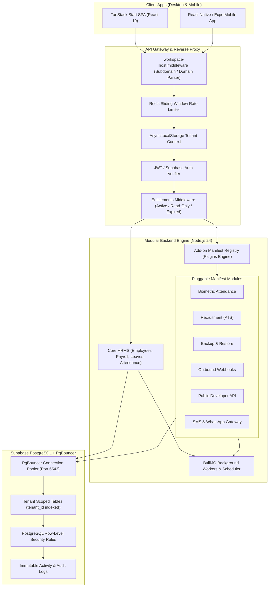

# 21 — Recommended MASTERHRMS Target Architecture

**Project:** MASTERHRMS Enterprise Workforce Platform  
**Purpose:** Target Architecture Blueprint for Enterprise Parity  
**Date:** November 19, 2026  
**Status:** COMPLETE (Investigation-Only Recommendation)

---

## 1. Architectural Principles

To deliver complete functional parity with WorkDo Dash while maintaining enterprise-grade security, fault isolation, and developer velocity, the target MASTERHRMS architecture is based on four core tenets:

1. **Defense-in-Depth Multi-Tenancy:** Combine application-level `AsyncLocalStorage` context scoping with database-level PostgreSQL Row-Level Security (RLS) policies.
2. **Type-Safe Modular Plug-in System:** Add-ons must follow the standard Manifest specification (`manifest.ts`) established in `server/src/modules/manifest.types.ts`, encapsulating routes, permissions, migrations, and event listeners.
3. **Graceful Degradation for Expired Entitlements:** Rather than abruptly failing requests with 403, expired subscriptions transition into a secure **Read-Only / Data-Preservation state**, allowing tenants to export records while prompting renewal.
4. **Declarative UI Composition:** Front-end navigation, route guards, and action buttons dynamically hydrate based on the tenant's evaluated entitlement vector (`useEntitlements()`).

---

## 2. Target System Architecture Diagram



---

## 3. Recommended Subsystem Enhancements

### 3.1 Generic Add-on Configuration Subsystem (`AddonConfigEngine`)
Create a schema-driven configuration renderer. Each add-on manifest exports a JSON Schema describing its required settings (e.g. API keys, webhooks, toggles):

```typescript
export interface AddonManifest {
  slug: string;
  name: string;
  category: "finance" | "hr" | "integration" | "communication" | "security";
  version: string;
  configSchema?: {
    fields: Array<{
      key: string;
      label: string;
      type: "text" | "password" | "select" | "toggle";
      required?: boolean;
      placeholder?: string;
      options?: Array<{ label: string; value: string }>;
    }>;
    testConnectionEndpoint?: string;
  };
}
```

The frontend renders a dynamic configuration drawer, automatically handling encrypted persistence and "Test Connection" validation.

### 3.2 Add-on Expiry Lifecycle Policy
Implement a 3-tier expiration lifecycle:
1. **Active (Days > 0):** Full read-write operational access.
2. **Grace Period (Day 1 - 7 after expiration):** In-app warning banners displayed on every workspace page. Automated reminder emails sent to Tenant Admin. Full functionality remains active.
3. **Read-Only Mode (Day 8 - 30 after expiration):**
   - HTTP `GET` endpoints remain accessible (tenants can view historical attendance, export payroll slips, download documents).
   - HTTP `POST`, `PUT`, `DELETE` return `403 Forbidden` (`PAYMENT_REQUIRED_TO_MUTATE`).
4. **Suspended Mode (Day 31+):** Access blocked entirely. Tenant data retained safely in database for 90 days prior to cold archival.

### 3.3 Enhanced ATS Recruitment-to-Employee Conversion Pipeline
Implement an atomic service method `candidateService.convertToEmployee(candidateId)`:
- Extracts candidate name, email, phone, resume, and accepted salary offer.
- Launches the 3-step employee creation wizard with prepopulated values.
- Marks candidate status as `HIRED` and links candidate ID to the newly provisioned `Employee` record.
