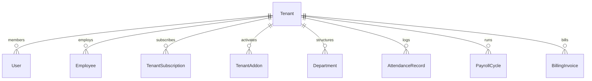

# 28 — Complete Database & Relationship Register

**Project:** MASTERHRMS Enterprise SaaS Reverse Engineering  
**Database Engine:** Supabase PostgreSQL with PgBouncer Pooling  
**Total Data Models Audited:** 299  
**Classification:** SOURCE-INSPECTED (Direct Prisma Schema AST Audit)  
**Date:** November 19, 2026  

---

## 1. Executive Summary & Multi-Tenant Schema Strategy

MASTERHRMS utilizes a **shared-database, row-level isolated schema** architecture. Of the 299 defined Prisma models, all tenant-owned entities enforce isolation through mandatory `tenantId` foreign keys linked to the central `Tenant` model, indexed compound unique constraints, and automatic query wrapping via `server/src/extensions/tenant-isolation.extension.ts`.

---

## 2. Complete Relational Models Catalog (299 Models)

| # | Model Name | Fields Count | Tenant Scoped (`tenantId`) | Relational Links | Primary Relationships |
|---|---|---|---|---|---|
| 1 | **`User`** | 23 | ⚪ Platform Global | 0 | None |
| 2 | **`Tenant`** | 227 | ⚪ Platform Global | 0 | None |
| 3 | **`Profile`** | 11 | ✅ Yes | 2 | `tenant`, `user` |
| 4 | **`UserRole`** | 7 | ✅ Yes | 2 | `tenant`, `user` |
| 5 | **`Department`** | 20 | ✅ Yes | 2 | `branch`, `tenant` |
| 6 | **`Employee`** | 142 | ✅ Yes | 28 | `announcements`, `delegationsReceived`, `delegationsGiven`, `campusRecruiterFor` |
| 7 | **`Attendance`** | 20 | ✅ Yes | 2 | `employee`, `tenant` |
| 8 | **`LeaveType`** | 19 | ✅ Yes | 1 | `tenant` |
| 9 | **`LeaveRequest`** | 21 | ✅ Yes | 3 | `employee`, `leaveType`, `tenant` |
| 10 | **`AttendancePolicy`** | 25 | ✅ Yes | 1 | `tenant` |
| 11 | **`LeavePolicy`** | 26 | ✅ Yes | 2 | `leaveType`, `tenant` |
| 12 | **`AttendanceMonthLock`** | 13 | ✅ Yes | 1 | `tenant` |
| 13 | **`LeaveEncashmentRequest`** | 85 | ✅ Yes | 8 | `employee`, `leaveType`, `tenant`, `encashmentConfig` |
| 14 | **`PayrollRun`** | 25 | ✅ Yes | 1 | `tenant` |
| 15 | **`Payslip`** | 21 | ✅ Yes | 3 | `employee`, `payrollRun`, `tenant` |
| 16 | **`EmployeeLoan`** | 21 | ✅ Yes | 2 | `employee`, `tenant` |
| 17 | **`LoanInstallment`** | 16 | ✅ Yes | 2 | `loan`, `tenant` |
| 18 | **`SalaryComponent`** | 23 | ✅ Yes | 1 | `tenant` |
| 19 | **`SalaryStructure`** | 12 | ✅ Yes | 1 | `tenant` |
| 20 | **`SalaryStructureItem`** | 9 | ⚪ Platform Global | 2 | `component`, `structure` |
| 21 | **`EmployeeSalaryAssignment`** | 17 | ✅ Yes | 3 | `employee`, `structure`, `tenant` |
| 22 | **`EmployeeSalaryItem`** | 7 | ⚪ Platform Global | 2 | `assignment`, `component` |
| 23 | **`StatutoryRule`** | 34 | ✅ Yes | 1 | `tenant` |
| 24 | **`StatutoryRuleAuditLog`** | 11 | ⚪ Platform Global | 1 | `rule` |
| 25 | **`PasswordResetToken`** | 7 | ⚪ Platform Global | 1 | `user` |
| 26 | **`EmployeeTaxDeclaration`** | 28 | ✅ Yes | 2 | `employee`, `tenant` |
| 27 | **`TaxDeclarationProof`** | 14 | ⚪ Platform Global | 1 | `declaration` |
| 28 | **`FbpDeclaration`** | 14 | ✅ Yes | 2 | `employee`, `tenant` |
| 29 | **`FbpDeclarationItem`** | 9 | ⚪ Platform Global | 1 | `declaration` |
| 30 | **`PayrollSnapshot`** | 19 | ✅ Yes | 3 | `employee`, `payrollRun`, `tenant` |
| 31 | **`GenericFormTemplate`** | 16 | ✅ Yes | 1 | `tenant` |
| 32 | **`CmsPage`** | 9 | ⚪ Platform Global | 0 | None |
| 33 | **`SubscriptionPlan`** | 32 | ⚪ Platform Global | 0 | None |
| 34 | **`TenantSubscription`** | 35 | ✅ Yes | 2 | `plan`, `tenant` |
| 35 | **`BillingInvoice`** | 28 | ✅ Yes | 2 | `subscription`, `tenant` |
| 36 | **`CommerceOrder`** | 28 | ✅ Yes | 2 | `tenant`, `user` |
| 37 | **`Coupon`** | 18 | ⚪ Platform Global | 0 | None |
| 38 | **`CouponRedemption`** | 9 | ✅ Yes | 2 | `coupon`, `tenant` |
| 39 | **`SubscriptionPolicyAudit`** | 9 | ✅ Yes | 2 | `subscription`, `tenant` |
| 40 | **`CommercialPriceSchedule`** | 17 | ⚪ Platform Global | 0 | None |
| 41 | **`Addon`** | 20 | ⚪ Platform Global | 0 | None |
| 42 | **`TenantAddon`** | 11 | ✅ Yes | 1 | `tenant` |
| 43 | **`OkrCycle`** | 12 | ✅ Yes | 1 | `tenant` |
| 44 | **`OkrObjective`** | 20 | ✅ Yes | 5 | `cycle`, `owner`, `parent`, `children` |
| 45 | **`OkrKeyResult`** | 13 | ⚪ Platform Global | 1 | `objective` |
| 46 | **`OkrCheckin`** | 10 | ⚪ Platform Global | 2 | `employee`, `keyResult` |
| 47 | **`OkrReview`** | 13 | ⚪ Platform Global | 3 | `cycle`, `employee`, `reviewer` |
| 48 | **`AssetCategory`** | 11 | ✅ Yes | 1 | `tenant` |
| 49 | **`Asset`** | 38 | ✅ Yes | 3 | `assignedEmployee`, `categoryRel`, `tenant` |
| 50 | **`AssetAssignment`** | 19 | ⚪ Platform Global | 2 | `asset`, `employee` |
| 51 | **`AssetRequest`** | 16 | ✅ Yes | 2 | `employee`, `tenant` |
| 52 | **`AssetDisposalBatch`** | 16 | ✅ Yes | 1 | `tenant` |
| 53 | **`AssetDisposalItem`** | 10 | ⚪ Platform Global | 2 | `asset`, `batch` |
| 54 | **`AssetMaintenance`** | 13 | ⚪ Platform Global | 1 | `asset` |
| 55 | **`AssetActivityLog`** | 10 | ✅ Yes | 2 | `asset`, `tenant` |
| 56 | **`JobPosting`** | 44 | ✅ Yes | 9 | `branch`, `category`, `department`, `designation` |
| 57 | **`JobCategory`** | 10 | ✅ Yes | 1 | `tenant` |
| 58 | **`JobType`** | 10 | ✅ Yes | 1 | `tenant` |
| 59 | **`JobLocation`** | 14 | ✅ Yes | 1 | `tenant` |
| 60 | **`CandidateSource`** | 10 | ✅ Yes | 1 | `tenant` |
| 61 | **`InterviewTypeMaster`** | 11 | ✅ Yes | 1 | `tenant` |
| 62 | **`InterviewRoundMaster`** | 11 | ✅ Yes | 2 | `interviewType`, `tenant` |
| 63 | **`OfferTemplate`** | 11 | ✅ Yes | 1 | `tenant` |
| 64 | **`OnboardingChecklistTemplate`** | 14 | ✅ Yes | 2 | `department`, `tenant` |
| 65 | **`OnboardingCheckItem`** | 15 | ✅ Yes | 2 | `template`, `tenant` |
| 66 | **`AssessmentTemplate`** | 13 | ✅ Yes | 1 | `tenant` |
| 67 | **`CandidateAssessment`** | 21 | ✅ Yes | 5 | `candidate`, `evaluator`, `jobPosting`, `template` |
| 68 | **`CandidateOffer`** | 32 | ✅ Yes | 7 | `branch`, `candidate`, `department`, `designation` |
| 69 | **`CandidateOnboarding`** | 21 | ✅ Yes | 6 | `buddy`, `candidate`, `hrOwner`, `offer` |
| 70 | **`CandidateOnboardingTask`** | 18 | ✅ Yes | 2 | `onboarding`, `tenant` |
| 71 | **`JobCandidate`** | 38 | ✅ Yes | 5 | `convertedEmployee`, `jobPosting`, `recruiter`, `source` |
| 72 | **`JobCandidateInterview`** | 20 | ✅ Yes | 2 | `candidate`, `interviewer` |
| 73 | **`CampusCandidate`** | 17 | ✅ Yes | 2 | `recruiter`, `tenant` |
| 74 | **`EmployeeReferral`** | 16 | ✅ Yes | 2 | `referrer`, `tenant` |
| 75 | **`ShiftDefinition`** | 14 | ✅ Yes | 1 | `tenant` |
| 76 | **`ShiftRoster`** | 12 | ✅ Yes | 3 | `employee`, `shift`, `tenant` |
| 77 | **`ShiftSwapRequest`** | 14 | ✅ Yes | 3 | `requesterEmployee`, `targetEmployee`, `tenant` |
| 78 | **`ExpenseCategory`** | 11 | ✅ Yes | 1 | `tenant` |
| 79 | **`ExpenseClaim`** | 36 | ✅ Yes | 3 | `category`, `employee`, `tenant` |
| 80 | **`StoredDocument`** | 15 | ✅ Yes | 1 | `tenant` |
| 81 | **`TrainingCourse`** | 18 | ✅ Yes | 1 | `tenant` |
| 82 | **`CourseModule`** | 10 | ⚪ Platform Global | 1 | `course` |
| 83 | **`CourseEnrollment`** | 15 | ✅ Yes | 3 | `course`, `employee`, `tenant` |
| 84 | **`EmployeeExit`** | 32 | ✅ Yes | 2 | `employee`, `tenant` |
| 85 | **`ExitChecklistItem`** | 10 | ⚪ Platform Global | 1 | `exit` |
| 86 | **`CompanyDocument`** | 27 | ✅ Yes | 3 | `documentType`, `employee`, `tenant` |
| 87 | **`HelpdeskTicket`** | 18 | ✅ Yes | 2 | `employee`, `tenant` |
| 88 | **`HelpdeskComment`** | 7 | ⚪ Platform Global | 1 | `ticket` |
| 89 | **`PlatformSupportTicket`** | 15 | ✅ Yes | 1 | `tenant` |
| 90 | **`PlatformTicketMessage`** | 8 | ⚪ Platform Global | 1 | `ticket` |
| 91 | **`Announcement`** | 29 | ✅ Yes | 5 | `author`, `targetDepartment`, `targetBranch`, `categoryModel` |
| 92 | **`AnnouncementCategory`** | 13 | ✅ Yes | 1 | `tenant` |
| 93 | **`AnnouncementView`** | 10 | ✅ Yes | 3 | `announcement`, `employee`, `tenant` |
| 94 | **`AnnouncementAcknowledgement`** | 8 | ✅ Yes | 2 | `announcement`, `employee` |
| 95 | **`CustomForm`** | 21 | ✅ Yes | 3 | `author`, `targetDepartment`, `tenant` |
| 96 | **`FormField`** | 14 | ⚪ Platform Global | 1 | `form` |
| 97 | **`FormSubmission`** | 14 | ✅ Yes | 3 | `employee`, `form`, `tenant` |
| 98 | **`FormResponseValue`** | 8 | ⚪ Platform Global | 2 | `field`, `submission` |
| 99 | **`BiometricDevice`** | 21 | ✅ Yes | 1 | `tenant` |
| 100 | **`BiometricPunchLog`** | 14 | ✅ Yes | 3 | `device`, `employee`, `tenant` |
| 101 | **`BiometricEmployeeMapping`** | 13 | ✅ Yes | 3 | `device`, `employee`, `tenant` |
| 102 | **`BiometricOfflineBuffer`** | 15 | ✅ Yes | 1 | `tenant` |
| 103 | **`ChartOfAccount`** | 18 | ✅ Yes | 3 | `parentAccount`, `childAccounts`, `tenant` |
| 104 | **`FiscalYear`** | 13 | ✅ Yes | 1 | `tenant` |
| 105 | **`AccountingPeriod`** | 13 | ✅ Yes | 2 | `fiscalYear`, `tenant` |
| 106 | **`JournalEntry`** | 14 | ✅ Yes | 1 | `tenant` |
| 107 | **`JournalItem`** | 10 | ⚪ Platform Global | 2 | `account`, `journalEntry` |
| 108 | **`Contract`** | 22 | ✅ Yes | 1 | `tenant` |
| 109 | **`BudgetPlan`** | 14 | ✅ Yes | 2 | `department`, `tenant` |
| 110 | **`FinancialGoal`** | 13 | ✅ Yes | 1 | `tenant` |
| 111 | **`ProductCategory`** | 9 | ✅ Yes | 1 | `tenant` |
| 112 | **`Brand`** | 9 | ✅ Yes | 1 | `tenant` |
| 113 | **`Unit`** | 8 | ✅ Yes | 1 | `tenant` |
| 114 | **`TaxRate`** | 9 | ✅ Yes | 1 | `tenant` |
| 115 | **`Warehouse`** | 21 | ✅ Yes | 3 | `transfersFrom`, `transfersTo`, `tenant` |
| 116 | **`Product`** | 34 | ✅ Yes | 5 | `brand`, `category`, `taxRate`, `tenant` |
| 117 | **`ProductWarehouse`** | 8 | ⚪ Platform Global | 2 | `product`, `warehouse` |
| 118 | **`Customer`** | 20 | ✅ Yes | 1 | `tenant` |
| 119 | **`Supplier`** | 17 | ✅ Yes | 1 | `tenant` |
| 120 | **`Sale`** | 35 | ✅ Yes | 3 | `customer`, `tenant`, `warehouse` |
| 121 | **`SaleDetail`** | 17 | ⚪ Platform Global | 2 | `product`, `sale` |
| 122 | **`SalePayment`** | 10 | ⚪ Platform Global | 1 | `sale` |
| 123 | **`PaymentGatewayTransaction`** | 16 | ✅ Yes | 2 | `sale`, `tenant` |
| 124 | **`PaymentWebhookEvent`** | 9 | ✅ Yes | 1 | `tenant` |
| 125 | **`HeldOrder`** | 7 | ✅ Yes | 1 | `tenant` |
| 126 | **`Purchase`** | 20 | ✅ Yes | 3 | `supplier`, `tenant`, `warehouse` |
| 127 | **`PurchaseDetail`** | 12 | ⚪ Platform Global | 2 | `product`, `purchase` |
| 128 | **`PurchasePayment`** | 12 | ✅ Yes | 2 | `purchase`, `tenant` |
| 129 | **`StockTransfer`** | 14 | ✅ Yes | 3 | `fromWarehouse`, `tenant`, `toWarehouse` |
| 130 | **`StockTransferDetail`** | 7 | ⚪ Platform Global | 2 | `product`, `transfer` |
| 131 | **`StockAdjustment`** | 11 | ✅ Yes | 2 | `tenant`, `warehouse` |
| 132 | **`StockAdjustmentDetail`** | 7 | ⚪ Platform Global | 2 | `adjustment`, `product` |
| 133 | **`StockMovement`** | 16 | ✅ Yes | 3 | `product`, `tenant`, `warehouse` |
| 134 | **`ChatMessage`** | 31 | ✅ Yes | 1 | `tenant` |
| 135 | **`ChatGroup`** | 18 | ✅ Yes | 1 | `tenant` |
| 136 | **`ChatGroupMember`** | 10 | ✅ Yes | 2 | `tenant`, `group` |
| 137 | **`ChatReadReceipt`** | 6 | ✅ Yes | 1 | `tenant` |
| 138 | **`ChatConversationPin`** | 6 | ✅ Yes | 1 | `tenant` |
| 139 | **`ChatConversationPreference`** | 12 | ✅ Yes | 1 | `tenant` |
| 140 | **`ChatUserPresence`** | 9 | ✅ Yes | 1 | `tenant` |
| 141 | **`WorkspaceRole`** | 11 | ✅ Yes | 1 | `tenant` |
| 142 | **`Permission`** | 9 | ⚪ Platform Global | 0 | None |
| 143 | **`RolePermission`** | 6 | ⚪ Platform Global | 2 | `permission`, `role` |
| 144 | **`UserRoleAssignment`** | 8 | ✅ Yes | 3 | `role`, `tenant`, `user` |
| 145 | **`TenantModule`** | 7 | ✅ Yes | 1 | `tenant` |
| 146 | **`TwoFactorOtp`** | 9 | ⚪ Platform Global | 1 | `user` |
| 147 | **`CrmLead`** | 16 | ✅ Yes | 1 | `tenant` |
| 148 | **`CrmProposal`** | 16 | ✅ Yes | 1 | `tenant` |
| 149 | **`CrmContact`** | 18 | ✅ Yes | 1 | `tenant` |
| 150 | **`CrmDeal`** | 17 | ✅ Yes | 1 | `tenant` |
| 151 | **`TenantDomain`** | 22 | ✅ Yes | 1 | `tenant` |
| 152 | **`WorkspaceSlugHistory`** | 8 | ✅ Yes | 1 | `tenant` |
| 153 | **`WorkspaceSlugRedirect`** | 7 | ✅ Yes | 1 | `tenant` |
| 154 | **`Project`** | 20 | ✅ Yes | 1 | `tenant` |
| 155 | **`ProjectTask`** | 13 | ✅ Yes | 2 | `project`, `tenant` |
| 156 | **`ProjectMilestone`** | 13 | ✅ Yes | 2 | `project`, `tenant` |
| 157 | **`Timesheet`** | 17 | ✅ Yes | 3 | `employee`, `project`, `tenant` |
| 158 | **`CashRegister`** | 10 | ✅ Yes | 2 | `tenant`, `warehouse` |
| 159 | **`RegisterShift`** | 20 | ✅ Yes | 2 | `register`, `tenant` |
| 160 | **`SalesReturn`** | 22 | ✅ Yes | 4 | `customer`, `sale`, `tenant`, `warehouse` |
| 161 | **`SalesReturnDetail`** | 16 | ⚪ Platform Global | 3 | `originalDetail`, `product`, `salesReturn` |
| 162 | **`CreditNote`** | 20 | ✅ Yes | 4 | `customer`, `salesReturn`, `sale`, `tenant` |
| 163 | **`PurchaseReturn`** | 22 | ✅ Yes | 4 | `purchase`, `supplier`, `tenant`, `warehouse` |
| 164 | **`PurchaseReturnDetail`** | 15 | ⚪ Platform Global | 3 | `originalDetail`, `product`, `purchaseReturn` |
| 165 | **`DebitNote`** | 20 | ✅ Yes | 4 | `purchase`, `purchaseReturn`, `supplier`, `tenant` |
| 166 | **`AwardType`** | 21 | ✅ Yes | 2 | `workflow`, `tenant` |
| 167 | **`Award`** | 20 | ✅ Yes | 4 | `awardType`, `employee`, `tenant`, `nomination` |
| 168 | **`AwardNomination`** | 25 | ✅ Yes | 3 | `tenant`, `employee`, `awardType` |
| 169 | **`EmployeeAwardCertificate`** | 17 | ✅ Yes | 0 | None |
| 170 | **`OrganizationBrandingAsset`** | 8 | ✅ Yes | 0 | None |
| 171 | **`OrganizationSignatory`** | 17 | ✅ Yes | 2 | `tenant`, `signatureAsset` |
| 172 | **`CertificateTemplate`** | 20 | ✅ Yes | 1 | `tenant` |
| 173 | **`CertificateTemplateVersion`** | 4 | ⚪ Platform Global | 0 | None |
| 174 | **`CertificateTemplateAssignment`** | 6 | ✅ Yes | 0 | None |
| 175 | **`CertificateAuditLog`** | 7 | ✅ Yes | 0 | None |
| 176 | **`WarningType`** | 9 | ✅ Yes | 1 | `tenant` |
| 177 | **`DisciplinaryWarning`** | 19 | ✅ Yes | 3 | `employee`, `tenant`, `warningType` |
| 178 | **`CrmCompany`** | 13 | ✅ Yes | 1 | `tenant` |
| 179 | **`AutomationRule`** | 14 | ✅ Yes | 1 | `tenant` |
| 180 | **`AutomationLog`** | 10 | ✅ Yes | 2 | `rule`, `tenant` |
| 181 | **`OvertimeRequest`** | 15 | ✅ Yes | 2 | `employee`, `tenant` |
| 182 | **`WfhRequest`** | 14 | ✅ Yes | 2 | `employee`, `tenant` |
| 183 | **`PromotionRecord`** | 16 | ✅ Yes | 2 | `employee`, `tenant` |
| 184 | **`ProbationRecord`** | 15 | ✅ Yes | 2 | `employee`, `tenant` |
| 185 | **`ProvidentFundRecord`** | 14 | ✅ Yes | 2 | `employee`, `tenant` |
| 186 | **`BannedIp`** | 8 | ✅ Yes | 1 | `tenant` |
| 187 | **`SystemCronJob`** | 13 | ⚪ Platform Global | 0 | None |
| 188 | **`Call`** | 20 | ✅ Yes | 1 | `tenant` |
| 189 | **`CallParticipant`** | 10 | ⚪ Platform Global | 1 | `call` |
| 190 | **`CallEvent`** | 7 | ⚪ Platform Global | 1 | `call` |
| 191 | **`CallHistoryRecord`** | 29 | ✅ Yes | 1 | `tenant` |
| 192 | **`RecurringInvoice`** | 30 | ✅ Yes | 2 | `customer`, `tenant` |
| 193 | **`RecurringInvoiceItem`** | 9 | ⚪ Platform Global | 1 | `recurringInvoice` |
| 194 | **`CustomField`** | 14 | ✅ Yes | 1 | `tenant` |
| 195 | **`CustomFieldValue`** | 9 | ✅ Yes | 2 | `customField`, `tenant` |
| 196 | **`MarketingCampaign`** | 19 | ✅ Yes | 1 | `tenant` |
| 197 | **`LoginHistory`** | 9 | ⚪ Platform Global | 1 | `user` |
| 198 | **`DeviceSession`** | 20 | ✅ Yes | 2 | `user`, `tenant` |
| 199 | **`Branch`** | 22 | ✅ Yes | 1 | `tenant` |
| 200 | **`Designation`** | 13 | ✅ Yes | 2 | `department`, `tenant` |
| 201 | **`ContractType`** | 9 | ✅ Yes | 1 | `tenant` |
| 202 | **`EmployeeContract`** | 27 | ✅ Yes | 4 | `contractType`, `employee`, `supplier`, `tenant` |
| 203 | **`StateUTMaster`** | 10 | ⚪ Platform Global | 0 | None |
| 204 | **`Establishment`** | 17 | ✅ Yes | 1 | `tenant` |
| 205 | **`StaffingClient`** | 14 | ✅ Yes | 1 | `tenant` |
| 206 | **`PayrollFormula`** | 20 | ✅ Yes | 1 | `tenant` |
| 207 | **`PayrollExportTemplate`** | 10 | ✅ Yes | 1 | `tenant` |
| 208 | **`PayrollExecutionTrace`** | 13 | ✅ Yes | 1 | `tenant` |
| 209 | **`BankDisbursementBatch`** | 27 | ✅ Yes | 2 | `payrollRun`, `tenant` |
| 210 | **`BankDisbursementItem`** | 14 | ⚪ Platform Global | 2 | `batch`, `employee` |
| 211 | **`StatutoryReturnFiling`** | 24 | ✅ Yes | 3 | `establishment`, `payrollRun`, `tenant` |
| 212 | **`WorkspaceTodo`** | 13 | ✅ Yes | 2 | `tenant`, `user` |
| 213 | **`WorkspaceNote`** | 15 | ✅ Yes | 2 | `tenant`, `user` |
| 214 | **`CalendarEvent`** | 30 | ✅ Yes | 3 | `tenant`, `user`, `room` |
| 215 | **`CalendarEventShare`** | 10 | ⚪ Platform Global | 1 | `event` |
| 216 | **`CalendarEventReminder`** | 16 | ⚪ Platform Global | 1 | `event` |
| 217 | **`SubscriptionNotificationEvent`** | 13 | ✅ Yes | 1 | `subscription` |
| 218 | **`Setting`** | 13 | ⚪ Platform Global | 0 | None |
| 219 | **`SettingSecret`** | 8 | ⚪ Platform Global | 1 | `setting` |
| 220 | **`SettingAudit`** | 10 | ⚪ Platform Global | 0 | None |
| 221 | **`MediaFile`** | 63 | ✅ Yes | 2 | `parent`, `children` |
| 222 | **`FileStar`** | 6 | ✅ Yes | 1 | `file` |
| 223 | **`FileShare`** | 11 | ✅ Yes | 1 | `file` |
| 224 | **`MediaUsage`** | 7 | ⚪ Platform Global | 1 | `media` |
| 225 | **`FileVersion`** | 10 | ⚪ Platform Global | 1 | `file` |
| 226 | **`FileAcl`** | 13 | ⚪ Platform Global | 1 | `file` |
| 227 | **`FileTeam`** | 9 | ✅ Yes | 0 | None |
| 228 | **`FileTeamMember`** | 5 | ⚪ Platform Global | 1 | `team` |
| 229 | **`FileLink`** | 10 | ⚪ Platform Global | 1 | `file` |
| 230 | **`FileUploadSession`** | 16 | ✅ Yes | 0 | None |
| 231 | **`StorageQuota`** | 7 | ✅ Yes | 0 | None |
| 232 | **`StorageUsage`** | 8 | ✅ Yes | 0 | None |
| 233 | **`StorageSnapshot`** | 11 | ✅ Yes | 0 | None |
| 234 | **`StorageAlertState`** | 7 | ✅ Yes | 0 | None |
| 235 | **`StorageRetentionPolicy`** | 15 | ✅ Yes | 0 | None |
| 236 | **`StorageLegalHold`** | 12 | ✅ Yes | 1 | `file` |
| 237 | **`StorageRetentionJob`** | 20 | ✅ Yes | 0 | None |
| 238 | **`FileRecent`** | 6 | ✅ Yes | 1 | `file` |
| 239 | **`FileActivity`** | 10 | ✅ Yes | 1 | `file` |
| 240 | **`EmployeeChangeRequest`** | 15 | ✅ Yes | 2 | `employee`, `tenant` |
| 241 | **`ApprovalDelegation`** | 12 | ✅ Yes | 3 | `delegate`, `manager`, `tenant` |
| 242 | **`DocumentRequest`** | 12 | ✅ Yes | 2 | `employee`, `tenant` |
| 243 | **`CompanyProfile`** | 28 | ✅ Yes | 1 | `tenant` |
| 244 | **`GSTRegistration`** | 16 | ✅ Yes | 2 | `companyProfile`, `tenant` |
| 245 | **`AttendanceRegularization`** | 15 | ✅ Yes | 2 | `employee`, `tenant` |
| 246 | **`LeaveLedgerEntry`** | 13 | ✅ Yes | 2 | `employee`, `tenant` |
| 247 | **`OutboxEvent`** | 15 | ✅ Yes | 1 | `tenant` |
| 248 | **`WorkflowDefinition`** | 15 | ✅ Yes | 1 | `tenant` |
| 249 | **`WorkflowStep`** | 13 | ⚪ Platform Global | 1 | `workflow` |
| 250 | **`ApprovalRequest`** | 16 | ✅ Yes | 2 | `tenant`, `workflow` |
| 251 | **`ApprovalAction`** | 12 | ✅ Yes | 2 | `request`, `tenant` |
| 252 | **`Notification`** | 13 | ✅ Yes | 2 | `tenant`, `user` |
| 253 | **`NotificationTemplate`** | 11 | ✅ Yes | 1 | `tenant` |
| 254 | **`AuditLog`** | 13 | ✅ Yes | 1 | `tenant` |
| 255 | **`EmployeeTransfer`** | 16 | ✅ Yes | 2 | `employee`, `tenant` |
| 256 | **`Holiday`** | 15 | ✅ Yes | 1 | `tenant` |
| 257 | **`HolidayType`** | 11 | ✅ Yes | 1 | `tenant` |
| 258 | **`EmployeeEvent`** | 16 | ✅ Yes | 2 | `employee`, `tenant` |
| 259 | **`EmployeeTrip`** | 22 | ✅ Yes | 2 | `employee`, `tenant` |
| 260 | **`TripExpenseItem`** | 13 | ✅ Yes | 2 | `tenant`, `trip` |
| 261 | **`EmployeeComplaint`** | 21 | ✅ Yes | 1 | `tenant` |
| 262 | **`ComplaintCaseNote`** | 9 | ✅ Yes | 2 | `complaint`, `tenant` |
| 263 | **`GoalTypeMaster`** | 11 | ✅ Yes | 1 | `tenant` |
| 264 | **`IndicatorCategory`** | 11 | ✅ Yes | 1 | `tenant` |
| 265 | **`PerformanceIndicator`** | 20 | ✅ Yes | 2 | `category`, `tenant` |
| 266 | **`ReviewIndicatorRating`** | 12 | ✅ Yes | 2 | `indicator`, `tenant` |
| 267 | **`PerformanceImprovementPlan`** | 16 | ✅ Yes | 2 | `employee`, `tenant` |
| 268 | **`TrainingTypeMaster`** | 13 | ✅ Yes | 3 | `branch`, `department`, `tenant` |
| 269 | **`Trainer`** | 18 | ✅ Yes | 3 | `branch`, `department`, `tenant` |
| 270 | **`TrainingSession`** | 29 | ✅ Yes | 6 | `branch`, `course`, `department`, `tenant` |
| 271 | **`TrainingTask`** | 15 | ✅ Yes | 3 | `assignee`, `tenant`, `training` |
| 272 | **`TrainingTaskFeedback`** | 11 | ✅ Yes | 2 | `task`, `tenant` |
| 273 | **`SessionAttendance`** | 12 | ✅ Yes | 3 | `employee`, `session`, `tenant` |
| 274 | **`AssetDepreciationSchedule`** | 11 | ✅ Yes | 2 | `asset`, `tenant` |
| 275 | **`MeetingRoom`** | 12 | ✅ Yes | 1 | `tenant` |
| 276 | **`MeetingTypeMaster`** | 10 | ✅ Yes | 1 | `tenant` |
| 277 | **`Meeting`** | 20 | ✅ Yes | 4 | `organizer`, `room`, `tenant`, `type` |
| 278 | **`MeetingAttendee`** | 8 | ⚪ Platform Global | 2 | `employee`, `meeting` |
| 279 | **`MeetingActionItem`** | 16 | ✅ Yes | 3 | `assignee`, `meeting`, `tenant` |
| 280 | **`DocumentCategory`** | 9 | ✅ Yes | 1 | `tenant` |
| 281 | **`DocumentType`** | 11 | ✅ Yes | 1 | `tenant` |
| 282 | **`DocumentTemplate`** | 13 | ✅ Yes | 1 | `tenant` |
| 283 | **`DocumentAcknowledgement`** | 12 | ✅ Yes | 3 | `document`, `employee`, `tenant` |
| 284 | **`GeneratedLetter`** | 12 | ✅ Yes | 3 | `employee`, `template`, `tenant` |
| 285 | **`UserEmailAccount`** | 29 | ✅ Yes | 2 | `user`, `tenant` |
| 286 | **`DocumentAnnotation`** | 14 | ✅ Yes | 1 | `file` |
| 287 | **`DocumentAnnotationReply`** | 8 | ✅ Yes | 1 | `annotation` |
| 288 | **`FileScanJob`** | 12 | ✅ Yes | 1 | `file` |
| 289 | **`DlpPolicy`** | 13 | ✅ Yes | 0 | None |
| 290 | **`DlpFinding`** | 16 | ✅ Yes | 2 | `file`, `policy` |
| 291 | **`ExternalStorageConnection`** | 18 | ✅ Yes | 0 | None |
| 292 | **`ExternalSyncConflict`** | 13 | ✅ Yes | 2 | `connection`, `file` |
| 293 | **`ArchiveJob`** | 11 | ✅ Yes | 0 | None |
| 294 | **`WebdavToken`** | 10 | ✅ Yes | 0 | None |
| 295 | **`LeaveEncashmentConfig`** | 40 | ✅ Yes | 3 | `tenant`, `leaveType`, `payrollComponent` |
| 296 | **`CompOffConfig`** | 42 | ✅ Yes | 2 | `tenant`, `compOffLeaveType` |
| 297 | **`CompOffUsageAllocation`** | 15 | ✅ Yes | 4 | `tenant`, `employee`, `compOffRequest`, `leaveRequest` |
| 298 | **`LeaveEncashmentCompOffEvent`** | 21 | ✅ Yes | 3 | `tenant`, `request`, `employee` |
| 299 | **`ChatMediaBlob`** | 7 | ✅ Yes | 0 | None |

---

## 3. Database Indexing & Performance Policies

- **Compound Tenant Indexes:** Crucial operational models (e.g. `AttendanceRecord`, `Employee`, `PayrollSlip`, `AuditLog`) enforce composite B-tree indexes: `@@index([tenantId, createdAt])` and `@@index([tenantId, status])`.
- **Foreign Key Cascades:** Tenant deletion or workspace purging safely cascades across child business entities via `onDelete: Cascade` declarations.
