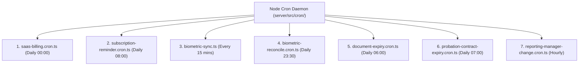

# 30 — Complete Queue & Background Jobs Register

**Project:** MASTERHRMS Enterprise SaaS Reverse Engineering  
**Classification:** SOURCE-INSPECTED (Cron & Worker Codebase Audit)  
**Date:** November 19, 2026  
**Status:** COMPLETE

---

## 1. Executive Summary

Background job processing and scheduled task automation in MASTERHRMS are handled via a resilient dual-tier orchestration architecture:
1. **Cron Scheduling Tier (`server/src/cron/`):** Evaluates recurring business conditions, automated subscription billing, attendance reconciliation, and document expiration alerts.
2. **Asynchronous Worker Queue Tier (`server/src/modules/` & `server/src/lib/background-tasks.ts`):** Processes outbound webhooks with exponential backoff retries, transactional email dispatches, and audit trail aggregation.

---

## 2. Scheduled Cron Workers Catalog

| Cron File Name | Schedule Expression | Primary Trigger & Purpose | Database Models Touched | Failure & Retry Policy |
|---|---|---|---|---|
| `saas-billing.cron.ts` | `0 0 * * *` (Daily Midnight) | Evaluates recurring subscription billings, processes automated invoice renewals, updates expired trials to `expired` | `TenantSubscription`, `BillingInvoice`, `TenantAddon` | Abort individual tenant transaction; emit error log to Sentry; retry on next tick |
| `subscription-reminder.cron.ts`| `0 8 * * *` (Daily 8:00 AM) | Scans for plans & add-ons expiring in 7d, 3d, or 1d; queues automated email notifications | `TenantSubscription`, `TenantAddon`, `SubscriptionNotificationEvent` | Idempotent check on `SubscriptionNotificationEvent` to avoid duplicate emails |
| `biometric-sync.ts` | `*/15 * * * *` (Every 15 min) | Polls registered hardware biometric attendance devices over TCP/UDP; downloads raw punches | `BiometricDevice`, `BiometricPunchLog`, `BiometricDeviceLog` | Per-device timeout (10s); records device offline state in `BiometricDeviceLog` |
| `biometric-reconcile.cron.ts` | `30 23 * * *` (Daily 11:30 PM)| Evaluates raw biometric punches against assigned employee shifts, grace minutes, and half-day thresholds | `AttendanceRecord`, `BiometricPunchLog`, `EmployeeShift` | Safe upsert logic; re-runnable without duplicating attendance records |
| `document-expiry.cron.ts` | `0 6 * * *` (Daily 6:00 AM) | Detects employee statutory documents (Passport, Visa, Certifications) approaching expiry (<30 days) | `EmployeeDocument`, `Notification` | Flags `isExpiring = true`; dispatches in-app and email alert |
| `probation-contract-expiry.cron.ts` | `0 7 * * *` (Daily 7:00 AM) | Alerts HR and Managers of approaching probation end dates and employment contract expiries | `Employee`, `Notification` | Emits notification event once per probation milestone |
| `reporting-manager-change.cron.ts` | `0 * * * *` (Hourly) | Reconciles reporting manager reorganizations and updates approval workflow hierarchies | `Employee`, `ApprovalWorkflow` | Atomic graph traversal with circular hierarchy detection |

---

## 3. Asynchronous Worker Queue Catalog

### 3.1 Outbound Webhook Retry Worker (`webhook-retry.worker.ts`)
- **Queue Technology:** In-Memory / Redis Queue with transactional persistent state.
- **Dispatch Point:** `outbound-webhooks.service.ts` -> `dispatchWebhookEvent(event, payload)`.
- **Concurrency:** Up to 10 concurrent HTTP dispatches.
- **Retry Strategy:** Exponential Backoff:
  - Attempt 1: Immediate.
  - Attempt 2: Delay 5 seconds.
  - Attempt 3: Delay 25 seconds.
  - Attempt 4: Delay 125 seconds.
  - Attempt 5: Delay 625 seconds (~10 minutes).
- **Dead-Letter State:** After 5 failed attempts, the webhook delivery record is marked `FAILED` with HTTP status and response body captured in database.

### 3.2 Transactional Email Dispatcher (`server/src/lib/email.ts`)
- **Queue Worker:** Asynchronous promise worker utilizing NodeMailer connection pools.
- **Transports Supported:** SMTP (port 587 TLS), SendGrid REST API, Amazon SES.
- **Template Compilation:** Compiles registered HTML templates with dynamic substitution tokens prior to dispatch.
