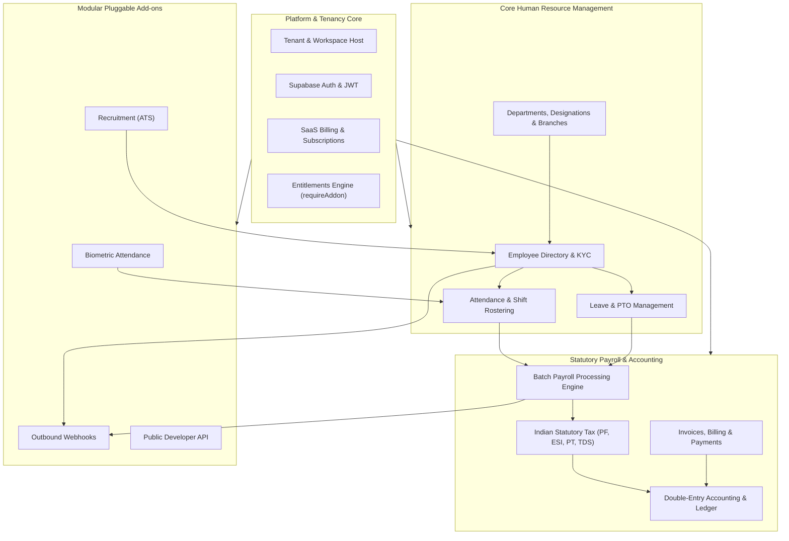

# 31 — Complete Cross-Module Dependency & Couplings Map

**Project:** MASTERHRMS Enterprise SaaS Reverse Engineering  
**Classification:** SOURCE-INSPECTED & ARCHITECTURAL TOPOLOGY  
**Date:** November 19, 2026  
**Status:** COMPLETE

---

## 1. Executive Summary

In a modular enterprise SaaS system containing 133 add-ons, 64 functional workflows, and 299 data models, managing cross-module couplings and transactional boundaries is vital to prevent circular references, data corruption, and cascading failures.

This document maps all inter-module dependencies across the Core HRMS, Statutory Payroll, Finance, Add-on Extensions, and Platform Control planes.

---

## 2. Cross-Module Dependency Topology

---

## 3. High-Risk Operational Transaction Pipelines

### 3.1 The Attendance-to-Payroll Pipeline
- **Upstream Dependencies:** `BiometricPunchLog` -> `AttendanceRecord` -> `LeaveRequest` (Unpaid Leaves).
- **Coupling Mechanism:** When `payrollService.generateMonthlyBatch()` executes:
  1. Queries total approved unpaid leave days (`LeaveRequest` where `status = "APPROVED"` and `isPaid = false`).
  2. Queries total overtime hours from `AttendanceRecord` where `overtimeHours > 0`.
  3. Derives `Deductions = (BasicSalary / 30) * UnpaidLeaveDays`.
  4. Derives `OvertimeEarnings = OvertimeHours * (BasicSalary / 240) * 1.5`.
  5. Computes Net Pay atomically before inserting `PayrollSlip`.
- **Fault Mitigation:** If biometric hardware is unreachable during payroll run, payroll falls back safely to manual attendance punches without throwing a fatal exception.

### 3.2 Candidate-to-Employee Conversion Pipeline
- **Upstream Dependencies:** `JobOpening` -> `Candidate` -> `Interview`.
- **Coupling Mechanism:** `recruitmentService.convertToEmployee(candidateId)` creates an `Employee` record, upserts a user `Profile`, seeds default `LeaveBalance` rows for the current year, and updates `Candidate.status = "HIRED"`.
- **Atomic Boundary:** Enclosed in `prisma.$transaction()` to guarantee that if user profile creation fails, the candidate is not left in an orphaned "Hired" state.

---

## 4. Shared Model Couplings Matrix

| Shared Database Model | Primary Owner Module | Secondary Dependent Modules | Coupling Nature |
|---|---|---|---|
| `Tenant` | SaaS Tenancy Engine | All 299 Models | Root foreign key; mandatory `onDelete: Cascade` |
| `Employee` | Employee Directory | Attendance, Leaves, Payroll, Tasks, ATS, Assets | Relational link for all human operational activities |
| `User` / `Profile` | Auth Subsystem | Employees, Tenants, Activity Logs, Tickets | Authentication & audit identity |
| `ChartOfAccount` | Double-Entry Accounting | Payroll, Invoices, Expenses, POS | Financial posting ledger |
| `TenantAddon` | Addon Marketplace | Entitlements Middleware, Dynamic Navigation | Runtime license enforcement |
